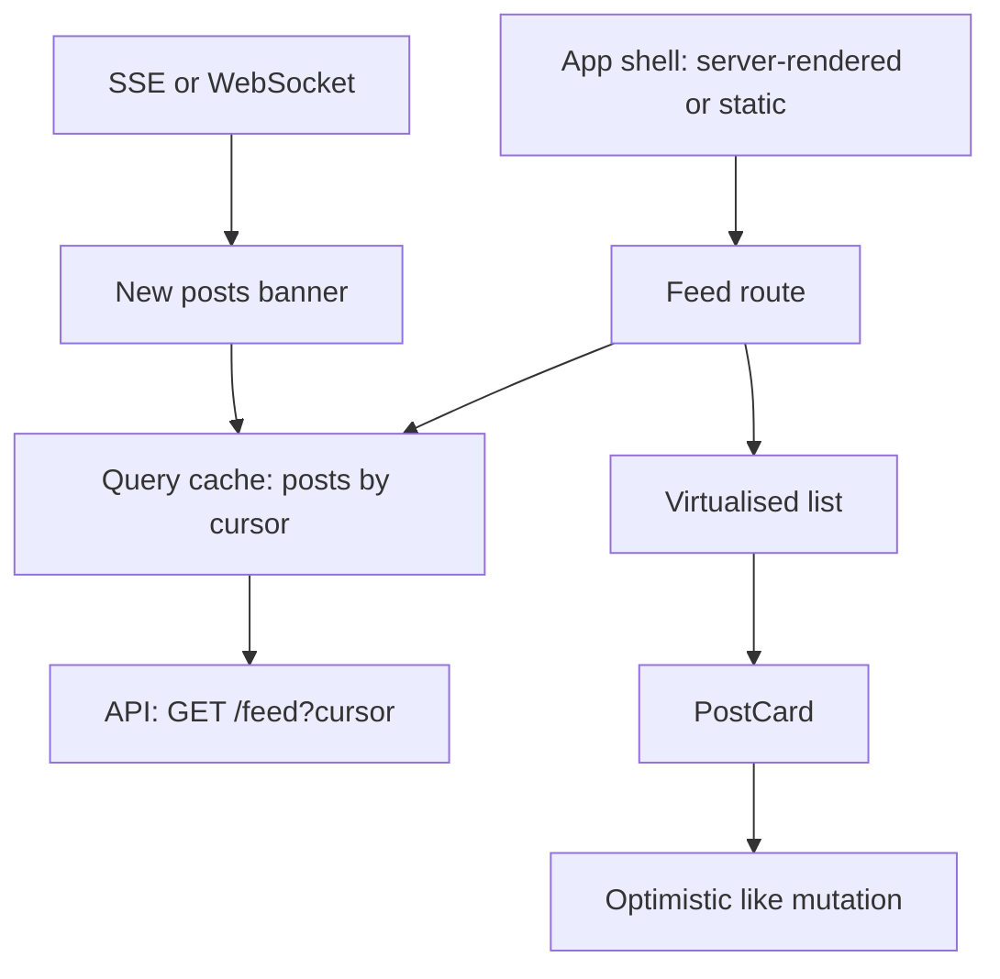

@more
## More output questions

Work these out on paper first. Every answer here was run.

### Scope and closures

```javascript 1. What's printed?
let x = 1;
function f() {
  console.log(x);
  let x = 2;
}
try { f(); } catch (e) { console.log(e.name); }
// ReferenceError: the inner x shadows the outer one, and isn't initialised yet
```

```javascript 2. What's printed?
const fns = [];
for (var i = 0; i < 2; i++) {
  fns.push(((n) => () => n)(i));
}
console.log(fns[0](), fns[1]());
// 0 1: the extra function creates a separate n per loop, the fix used before let
```

```javascript 3. What's printed?
function counter() {
  counter.count = (counter.count ?? 0) + 1;
  return counter.count;
}
counter();
console.log(counter());
// 2: functions are objects, and can hold properties
```

### Objects and equality

```javascript 4. What's printed?
const a = { n: 1 };
const b = { n: 1 };
console.log(a === b, a == b, JSON.stringify(a) === JSON.stringify(b));
// false false true: objects compare by reference
```

```javascript 5. What's printed?
const o = { a: 1 };
const frozen = Object.freeze({ inner: o, n: 1 });
frozen.inner.a = 2;
console.log(frozen.inner.a, Object.isFrozen(frozen));
// 2 true: freeze is shallow, as spread is
```

```javascript 6. What's printed?
const key = { id: 1 };
const obj = {};
obj[key] = 'a';
obj[{ id: 2 }] = 'b';
console.log(Object.keys(obj), obj[key]);
// [ '[object Object]' ] b: object keys become strings. Use a Map instead
```

```javascript 7. What's printed?
const m = new Map();
m.set({ id: 1 }, 'a');
console.log(m.get({ id: 1 }), m.size);
// undefined 1: a Map compares keys by reference
```

### Arrays

```javascript 8. What's printed?
const arr = [1, 2, 3];
const r = arr.map((n) => { n * 2; });
console.log(r);
// [ undefined, undefined, undefined ]: a block body needs an explicit return
```

```javascript 9. What's printed?
const nums = [3, 1, 2];
const sorted = nums.sort();
console.log(nums === sorted, nums);
// true [ 1, 2, 3 ]: sort changes the original array in place
```

```javascript 10. What's printed?
console.log([1, 2, 3].includes(NaN), [NaN].includes(NaN), [NaN].indexOf(NaN));
// false true -1: includes finds NaN, whereas indexOf can't
```

### Types

```javascript 11. What's printed?
console.log(1 + '2', 1 - '2', '3' * '4', true + 1, [] + [], null + 1, undefined + 1);
// '12' -1 12 2 '' 1 NaN
```

```javascript 12. What's printed?
console.log(typeof undefined, typeof (() => {}), typeof class {}, Array.isArray([]));
// undefined function function true
```

### this and classes

```javascript 13. What's printed?
class Counter {
  n = 0;
  incArrow = () => ++this.n;
  incMethod() { return ++this.n; }
}
const c = new Counter();
const { incArrow, incMethod } = c;
console.log(incArrow());
try { incMethod(); } catch (e) { console.log(e.name); }
// 1, then TypeError: arrow fields keep this, whereas a detached method doesn't
```

### Async

```javascript 14. What's printed?
async function f1() { return 1; }
console.log(f1() instanceof Promise);
f1().then(console.log);
console.log(2);
// true, 2, 1: an async function always returns a promise
```

```javascript 15. What's printed?
const out = [];
for (const n of [1, 2]) {
  setTimeout(() => out.push(n), 10 - n);
}
setTimeout(() => console.log(out), 20);
// [ 2, 1 ]: the shorter delay fires first
```

```javascript 16. What's printed?
Promise.reject(new Error('x'))
  .catch((e) => e.message)
  .then((v) => console.log(v));
// x: catch handles the rejection, and its return value continues the chain
```

```javascript 17. What's printed?
const results = await Promise.allSettled([Promise.resolve(1), Promise.reject(new Error('no'))]);
console.log(results.map((r) => r.status));
// [ 'fulfilled', 'rejected' ]
```

```javascript 18. What's printed?
const first = await Promise.race([
  new Promise((r) => setTimeout(() => r('slow'), 20)),
  new Promise((r) => setTimeout(() => r('fast'), 5)),
]);
console.log(first);
// fast
```

### Practice writing these by hand

| Utility | Must handle |
|---|---|
| `once(fn)` | Runs once; later calls return the first result |
| `groupBy(items, keyFn)` | Returns an object of arrays |
| `deepEqual(a, b)` | Nested objects and arrays |
| `retry(fn, n)` | Retries an async function |
| `curry(fn)` | Partial application |
| `EventEmitter` | `on`, `off`, `emit` |

```javascript Solutions to three of these
function once(fn) {
  let called = false;
  let result;
  return (...args) => {
    if (!called) {
      called = true;
      result = fn(...args);
    }
    return result;
  };
}

async function retry(fn, attempts) {
  for (let i = 1; ; i++) {
    try {
      return await fn();
    } catch (e) {
      if (i >= attempts) throw e;
    }
  }
}

class EventEmitter {
  #listeners = new Map();
  on(name, fn) {
    if (!this.#listeners.has(name)) this.#listeners.set(name, new Set());
    this.#listeners.get(name).add(fn);
    return () => this.off(name, fn);       // returning an unsubscribe is a nice touch
  }
  off(name, fn) {
    this.#listeners.get(name)?.delete(fn);
  }
  emit(name, ...args) {
    this.#listeners.get(name)?.forEach((fn) => fn(...args));
  }
}
```

!keypoints Objects compare by reference ;; freeze and spread are shallow ;; Block arrow bodies need return ;; An async function always returns a promise

?? What does [1, 2].map((n) => { n * 2 }) give?
=> [undefined, undefined], as a block body has no implicit return.
?? Why does obj[{ id: 2 }] overwrite obj[{ id: 1 }]?
=> Both keys become the string '[object Object]'. A Map keeps them apart.
?? Why does m.get({ id: 1 }) return undefined after setting that key?
=> It's a different object. Map compares keys by reference.

## Worked machine coding: Todo and data table

### Problem 1: Todo with filters and persistence

**Requirements:** add, toggle and delete; filter by all, active and done; survive a refresh.

```tsx A complete solution
type Todo = { id: string; title: string; done: boolean };
type Filter = 'all' | 'active' | 'done';

type Action =
  | { type: 'add'; title: string }
  | { type: 'toggle'; id: string }
  | { type: 'remove'; id: string };

function todosReducer(todos: Todo[], action: Action): Todo[] {
  switch (action.type) {
    case 'add':
      return [...todos, { id: crypto.randomUUID(), title: action.title, done: false }];
    case 'toggle':
      return todos.map((t) => (t.id === action.id ? { ...t, done: !t.done } : t));
    case 'remove':
      return todos.filter((t) => t.id !== action.id);
  }
}

function loadTodos(): Todo[] {
  try {
    return JSON.parse(localStorage.getItem('todos') ?? '[]');
  } catch {
    return [];
  }
}

const FILTERS: Record<Filter, (t: Todo) => boolean> = {
  all: () => true,
  active: (t) => !t.done,
  done: (t) => t.done,
};

export function TodoApp() {
  const [todos, dispatch] = useReducer(todosReducer, undefined, loadTodos);
  const [filter, setFilter] = useState<Filter>('all');
  const [title, setTitle] = useState('');

  useEffect(() => {
    localStorage.setItem('todos', JSON.stringify(todos));
  }, [todos]);

  function add(e: React.FormEvent) {
    e.preventDefault();
    const trimmed = title.trim();
    if (!trimmed) return;
    dispatch({ type: 'add', title: trimmed });
    setTitle('');
  }

  const visible = todos.filter(FILTERS[filter]);
  const remaining = todos.filter((t) => !t.done).length;

  return (
    <main>
      <h1>Todos</h1>
      <form onSubmit={add}>
        <label htmlFor="title">New todo</label>
        <input id="title" value={title} onChange={(e) => setTitle(e.target.value)} />
        <button>Add</button>
      </form>

      <div role="group" aria-label="Filter">
        {(Object.keys(FILTERS) as Filter[]).map((f) => (
          <button key={f} aria-pressed={filter === f} onClick={() => setFilter(f)}>{f}</button>
        ))}
      </div>

      {visible.length === 0 && <p>Nothing here.</p>}
      <ul>
        {visible.map((t) => (
          <li key={t.id}>
            <label>
              <input type="checkbox" checked={t.done} onChange={() => dispatch({ type: 'toggle', id: t.id })} />
              {t.title}
            </label>
            <button aria-label={`Delete ${t.title}`} onClick={() => dispatch({ type: 'remove', id: t.id })}>×</button>
          </li>
        ))}
      </ul>
      <p>{remaining} left</p>
    </main>
  );
}
```

**What earns marks:** a pure reducer, lazy initial load, derived `visible` and `remaining`, no stored duplicates, stable IDs as keys, trimmed input, an empty state and accessible controls.

### Problem 2: a sortable, paginated table

```tsx Everything is derived from three values
type SortKey = 'name' | 'total';

function DataTable({ rows }: { rows: { id: string; name: string; total: number }[] }) {
  const [sort, setSort] = useState<{ key: SortKey; asc: boolean }>({ key: 'name', asc: true });
  const [page, setPage] = useState(0);
  const size = 10;

  const sorted = useMemo(() => {
    const dir = sort.asc ? 1 : -1;
    return [...rows].sort((a, b) =>
      typeof a[sort.key] === 'string'
        ? dir * String(a[sort.key]).localeCompare(String(b[sort.key]))
        : dir * (Number(a[sort.key]) - Number(b[sort.key])),
    );
  }, [rows, sort]);

  const pages = Math.max(1, Math.ceil(sorted.length / size));
  const current = Math.min(page, pages - 1);        // data may shrink
  const visible = sorted.slice(current * size, (current + 1) * size);

  function toggle(key: SortKey) {
    setSort((s) => (s.key === key ? { key, asc: !s.asc } : { key, asc: true }));
    setPage(0);
  }

  const ariaSort = (key: SortKey) => (sort.key === key ? (sort.asc ? 'ascending' : 'descending') : 'none');

  return (
    <>
      <table>
        <thead>
          <tr>
            <th aria-sort={ariaSort('name')}><button onClick={() => toggle('name')}>Name</button></th>
            <th aria-sort={ariaSort('total')}><button onClick={() => toggle('total')}>Total</button></th>
          </tr>
        </thead>
        <tbody>
          {visible.map((r) => <tr key={r.id}><td>{r.name}</td><td>{r.total}</td></tr>)}
        </tbody>
      </table>
      <button disabled={current === 0} onClick={() => setPage(current - 1)}>Previous</button>
      <span>Page {current + 1} of {pages}</span>
      <button disabled={current >= pages - 1} onClick={() => setPage(current + 1)}>Next</button>
    </>
  );
}
```

**Points to mention:** copy before sorting, since `sort` mutates. Use `localeCompare` for text. Clamp the page if data shrinks. Reset the page on sort. Add `aria-sort`. In production, large tables sort and paginate on the server, and state lives in the URL.

### What interviewers notice

| Good signs | Bad signs |
|---|---|
| Asks questions first | Starts typing at once |
| Runs the code often | Writes everything, and then tests |
| Handles empty and error states | Only the happy path |
| Clear names and small components | One 300-line component |
| Says trade-offs aloud | Works in silence |
| Admits what they'd do with more time | Pretends it's complete |

!keypoints Reducers keep the logic testable ;; Derive filtered lists and counts ;; Copy before sorting ;; Clamp the page when data shrinks

?? Why pass a loader function as useReducer's third argument?
=> It runs only once at start, rather than reading storage on every render.
?? What goes wrong if you call rows.sort() directly on a prop?
=> It mutates the parent's array, breaking React's assumptions, and can cause bugs elsewhere.
?? Why clamp the page number?
=> If data shrinks, a stale page may no longer exist, and would show nothing.

## Frontend system design: a news feed

Experienced candidates may be asked to design a frontend architecture. A strong answer follows a structure. Even as a fresher, this helps you talk about your own project.

### 1. Clarify requirements

**Functional:** infinite feed, like and comment, new post notifications, images and video. **Non-functional:** works on slow phones, accessible, fast first load, handles lost connections.

### 2. Architecture



### 3. Data model and API

```ts Client types and API
interface Post { id: string; author: UserRef; text: string; media: Media[]; likes: number; liked: boolean; createdAt: string; }
interface FeedPage { items: Post[]; nextCursor: string | null; }
// GET  /feed?cursor=abc&limit=20
// POST /posts/:id/like
// GET  /feed/events (SSE: new post IDs)
```

Use **cursor pagination**: offset pages shift when new posts arrive, which causes duplicates and gaps.

### 4. Hard parts

| Problem | Approach |
|---|---|
| Very long list | Virtualise; keep a limited number of pages in memory |
| New posts while reading | Show "3 new posts" and don't jump the scroll position |
| Images | Reserve space with `aspect-ratio`, lazy load, sized variants |
| Autoplaying video | Play only when in view, using `IntersectionObserver` |
| Like button | Optimistic update, with rollback |
| Going offline | Show cached feed and a banner; queue likes, or disable them |
| Duplicate posts across pages | De-duplicate by ID |
| Returning to the feed | Restore scroll, using the cached pages |

### 5. Performance plan

Split routes. Render a static shell. Send critical CSS first. Serve images through a CDN, with `srcset`. Prefetch the next page as the user nears the end. Keep the main thread free for smooth scrolling.

### 6. Accessibility

Use `article` per post, a feed role, keyboard shortcuts for next and previous, labelled buttons, and an announcement for new posts. Virtualisation needs care, as off-screen items don't exist for screen readers, so provide proper set sizes and positions.

### 7. Reliability and security

Retry reads with backoff, and show inline errors per post rather than breaking the whole page. Sanitise any user-provided HTML, and render user text as text. Track errors and Web Vitals by release.

### Practice questions

| Design | Focus on |
|---|---|
| Autocomplete | Debounce, cache, races, keyboard and ARIA |
| Chat app | WebSocket, ordering, offline queue, optimistic send |
| Image carousel | Lazy loading, gestures, accessibility |
| Data dashboard | Virtual tables, charts, polling, saved filters |
| Google Docs-like editor | Conflict handling, presence (a stretch) |

!interview Interview answer :: **"Design X."** Spend the first minutes on requirements, then components and data flow, then API and state, and go deep on the hardest part. Finish with performance, accessibility, failure handling and what you would measure.

!keypoints Clarify first ;; Use cursor pagination for feeds ;; Don't jump scroll on new posts ;; Cover performance, accessibility and failure

?? Why use a cursor rather than an offset for a feed?
=> New posts shift offsets, causing duplicates and gaps. A cursor stays stable.
?? How do you show new posts without disturbing the reader?
=> Show a banner, and add them when clicked, preserving scroll position.
?? How do you avoid layout shifts in an image feed?
=> Reserve space with known dimensions or `aspect-ratio`.
