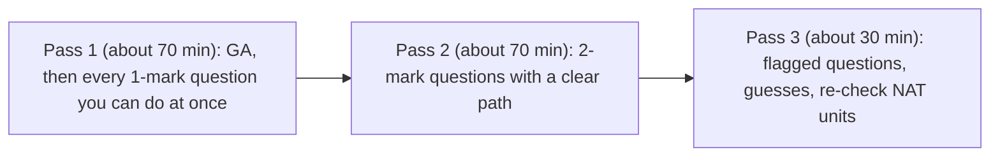

@part gate-start | Start here: GATE 2027 pattern, strategy and General Aptitude | start
## GATE 2027 at a glance

GATE 2027 is organised by **IIT Madras**. Computer Science and Information Technology is paper code **CS**. The exam is computer based, lasts 3 hours and has 65 questions for 100 marks. A GATE score is valid for 3 years, and 2027 adds a new Robotics and Automation (RA) paper that does not affect CS.

| Part | Questions | Marks |
|---|---|---|
| General Aptitude (GA) | 10 | 15 |
| Engineering Mathematics | part of the 55 subject questions | 13 |
| Core CS subjects | the rest of the 55 | 72 |
| **Total** | **65** | **100** |

In recent papers GA has been 5 one-mark and 5 two-mark questions, and the subject part 25 one-mark and 30 two-mark questions. The official 2027 page does not state this split, so treat it as the usual shape rather than a rule.

### Question types and marking

| Type | What you do | Wrong answer costs |
|---|---|---|
| MCQ | pick one of four options | 1-mark MCQ: **1/3** mark. 2-mark MCQ: **2/3** mark |
| MSQ | tick every correct option (one or more) | nothing, but there is **no partial credit** |
| NAT | type a number | nothing |

A virtual calculator is provided on screen. Physical calculators are not allowed.

!cheat Guessing arithmetic ::
- **MSQ and NAT never lose marks**, so never leave one blank.
- A pure guess on an MCQ is worth exactly **0** on average (¼ chance of +1, ¾ chance of −⅓).
- **Eliminate one option and the guess becomes positive.** With three options left, a 1-mark MCQ is worth about +0.11 and a 2-mark MCQ about +0.22.
- So: guess an MCQ only after you have crossed out at least one option. Otherwise skip it.
- For MSQ, a single wrong tick costs the whole question, so tick only options you can justify.
!end

### Where the marks come from

These are rough averages from the last few papers. Marks move by a few every year, so use them to rank subjects and not as targets.

| Subject | Typical marks |
|---|---|
| General Aptitude | 15 (fixed) |
| Engineering Mathematics | about 13 |
| Programming and Data Structures | about 10 |
| Computer Organization and Architecture | about 9 |
| Operating Systems | about 8 |
| Theory of Computation | about 8 |
| Computer Networks | about 8 |
| Algorithms | about 7 |
| Databases | about 7 |
| Compiler Design | about 6 |
| Digital Logic | about 6 |

### What changed in the 2027 syllabus

The official syllabus is the 2-page PDF on the IIT Madras GATE 2027 site. Compared with 2026:

- **Computer Organization:** secondary storage and magnetic disks are no longer listed.
- **Computer Networks:** ARP, ICMP, DHCP, SMTP, FTP and UDP are no longer named. The section is now layering, switching, data link, routing, IPv4, TCP, sockets, DNS and HTTP.
- **Digital Logic:** the wording is clearer, but the topics are the same.

!warning Not named is not banned :: A topic missing from the list can still be a small part of a question on a related topic. UDP, for example, appears in any TCP versus UDP comparison. Treat the trimmed topics as low priority, not as zero.

## Exam strategy: the three passes

You have 180 minutes for 100 marks, which is about **1.8 minutes per mark**. A 1-mark question should take 1 to 1.5 minutes and a 2-mark question 2.5 to 3. The exam is not about solving everything, it is about collecting the sure marks first.

1. **Pass 1.** Start with General Aptitude (15 to 20 minutes, mostly easy marks), then walk through the subject questions. Answer anything you can finish in about a minute. Flag the rest and move on without agonising.
2. **Pass 2.** Return to flagged 2-mark questions that you know the method for. Do the ones with short calculations first.
3. **Pass 3.** Use the leftover time on the hardest questions. Apply the guessing rule above. Re-read NAT answers for units and rounding.

!cheat Speed rules that save 15 minutes ::
- **Read the options before solving.** Often only one option has the right units, parity or magnitude.
- **Plug in small cases** (n = 1, 2, 3) to kill options on recurrences, counting and complexity.
- **Check limiting cases:** empty graph, single node, all equal elements, zero probability.
- **Write the formula, then substitute.** Mistakes come from doing both at once.
- **For C output questions,** trace on the first 2 or 3 iterations and look for a pattern before running the whole loop.
- **For NAT,** keep the rounding the question asks for. Typically the answer is accepted in a range, so do not over-round early.
!end

## General Aptitude: 15 marks, the cheapest marks in the paper

General Aptitude is common to every GATE paper. It is a different syllabus from the CS one, so it is not in the CS syllabus PDF. The long-standing GA areas are:

| Area | What is asked |
|---|---|
| Verbal | grammar, vocabulary, idioms, sentence completion, reading comprehension, sentence ordering |
| Quantitative | percentages, ratios, work and time, speed and distance, data interpretation, mensuration, elementary probability and statistics |
| Analytical | logical deduction, analogies, number and letter series, seating and ordering |
| Spatial | rotating and mirroring shapes, paper folding and cutting, patterns |

Check the current GA syllabus on the IIT Madras site. This site does not repeat that practice here: your **Aptitude tree** already has thousands of questions on it. Use it like this:

| GA area | Where to practise on this site |
|---|---|
| Percentages, ratios | [Percentages](/r/aptitude/topics/apt-percentages), [Ratio and proportion](/r/aptitude/topics/apt-ratio-proportion-variation) |
| Work, speed, distance | [Time and work](/r/aptitude/topics/apt-time-work), [Time, speed and distance](/r/aptitude/topics/apt-time-speed-distance) |
| Counting and probability | [Permutation and combination](/r/aptitude/topics/apt-permutation-combination), [Probability](/r/aptitude/topics/apt-probability) |
| Data interpretation | [Reading and analysing data](/r/aptitude/topics/apt-reading-analysing-data) |
| Logic, series, spatial | [Verbal reasoning](/r/aptitude/topics/apt-verbal-reasoning), [Non-verbal reasoning](/r/aptitude/topics/apt-non-verbal-reasoning) |
| Verbal ability | [Grammar](/r/aptitude/topics/apt-grammar), [Vocabulary](/r/aptitude/topics/apt-vocabulary), [Comprehension](/r/aptitude/topics/apt-comprehension), [Sentence structure and flow](/r/aptitude/topics/apt-sentence-structure-flow) |

### GA cheat codes

!cheat Quantitative shortcuts ::
- **Successive percentage change:** a% then b% is a + b + ab/100. A rise then an equal fall always leaves a net loss of x²/100 %.
- **Percent to fraction:** 12.5% = 1/8, 16.67% = 1/6, 33.33% = 1/3, 37.5% = 3/8, 66.67% = 2/3, 83.33% = 5/6.
- **Average speed over equal distances** = 2ab/(a + b), not (a + b)/2.
- **Work:** if A takes a days and B takes b days, together they take ab/(a + b) days. Treat the whole job as LCM units to avoid fractions.
- **Ratio trick:** to split N in ratio p : q, the parts are Np/(p + q) and Nq/(p + q). Check that your answer is divisible.
- **Profit and loss:** SP = CP × (1 ± r/100). A discount of d% on the marked price and a markup of m% give a net change of (m − d − md/100)%.
- **Probability:** use the complement ("at least one") whenever the direct case has many branches.
- **Counting with repeats:** n letters with repeats a, b, c give n!/(a! b! c!) arrangements.
!end

!cheat Verbal and analytical shortcuts ::
- **Sentence completion:** read the sentence, guess the word yourself, then look at the options. Check the tone (positive or negative) and any contrast word such as "but" or "although".
- **Grammar:** most errors are subject-verb agreement, tense consistency, pronoun reference and parallel structure. Check these four in that order.
- **Reading comprehension:** read the questions first, then the passage. The answer is nearly always stated, not inferred. Wrong options are usually too extreme ("always", "never", "only").
- **Seating and ordering puzzles:** draw the diagram and place the fixed facts first. Do not try to hold the arrangement in your head.
- **Number series:** check differences, then second differences, then ratios, then alternating patterns.
- **Spatial questions:** track one marked corner or one unique feature through the rotation or fold. Do not try to rotate the whole figure at once.
!end

## Study plan and how to use this tree

How long you have decides the plan. GATE is normally held in February. Confirm the exact dates on the official site, and count back from them.

| Time left | Plan |
|---|---|
| About 12 weeks | Weeks 1 to 8: one subject at a time in the order of this tree, notes plus the cheat codes plus all MCQs. Weeks 9 to 10: second pass on weak topics only. Weeks 11 to 12: full mock papers and error-log review. |
| About 6 weeks | Skip first-pass notes for subjects you know. Do the cheat codes and the MCQs first, and read the notes only for what you miss. Take a mock paper every week from week 3. |
| About 2 weeks | Revise cheat sheets only. Redo your error log. Two full mock papers, strictly timed. |

For each topic, do this loop:

1. Read the notes once, slowly, and write the formulas you could not have recalled.
2. Read the cheat codes, then try to solve the MCQs without looking at the options.
3. Do the MCQs in sets of 20 and read every explanation, including for the ones you got right.
4. Keep an **error log**: the question, why you missed it (concept, trap, arithmetic, time) and the fix. Re-read it weekly. Most marks are lost to the same few mistakes.
5. Once a topic is done, mark it complete on the roadmap.

!tip The tree order is a suggestion :: Mathematics comes first because Discrete Maths feeds Algorithms, Theory of Computation and Databases. Then come the hardware subjects, then programming and the theory subjects (Compiler Design needs Theory of Computation), and last the systems subjects. If you are strong in a subject, skip ahead. The weightage on each node tells you what is worth your time.

??  Why should you never leave a NAT or MSQ blank, but sometimes leave an MCQ blank?
=> NAT and MSQ have no negative marking, so a guess can only gain marks. An MCQ loses 1/3 or 2/3 of a mark on a wrong answer, so a blind guess is worth 0 on average, and you should guess only after eliminating at least one option.
??  What is the expected value of guessing a 2-mark MCQ after eliminating one option?
=> Three options remain, so the chance of being right is 1/3. Expected value = (1/3)(2) + (2/3)(−2/3) = 2/3 − 4/9 = 2/9, about +0.22 marks.
??  A 12-week plan is available. How should the time be split?
=> About 8 weeks to cover every subject once (notes, cheat codes and MCQs), 2 weeks to revisit weak topics using the error log, and 2 weeks of timed full-length mocks with review. Heavier-weight subjects (Programming, COA, OS, TOC, Networks) deserve more of the first 8 weeks.
