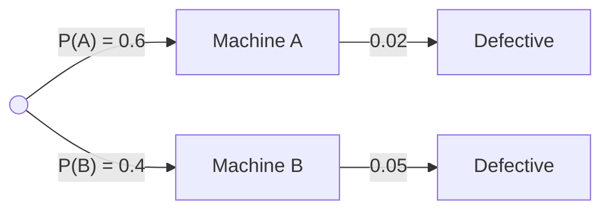

@part gate-probability | Probability and Statistics | math
## Probability basics

The **sample space** S is the set of all outcomes, an **event** is a subset of S, and P assigns each event a number with P(S) = 1, P(A) ≥ 0 and additivity for disjoint events. When all outcomes are equally likely, P(A) = |A| / |S|, so most basic problems are counting problems (see the Discrete Mathematics counting section).

| Rule | Formula |
|---|---|
| Complement | P(Aᶜ) = 1 − P(A) |
| Addition | P(A ∪ B) = P(A) + P(B) − P(A ∩ B) |
| Mutually exclusive | P(A ∩ B) = 0, so P(A ∪ B) = P(A) + P(B) |
| Independent | P(A ∩ B) = P(A) P(B) |
| Neither occurs | 1 − P(A ∪ B) |
| Three events | P(A∪B∪C) = ΣP − ΣP(pairs) + P(A∩B∩C) |

!warning Independent is not the same as mutually exclusive :: Two events with non-zero probability can **never** be both. If A and B are mutually exclusive and P(A), P(B) > 0, then P(A ∩ B) = 0 ≠ P(A)P(B), so they are dependent: knowing A happened tells you B did not.

### Standard experiments

- **Two dice:** 36 outcomes. Sum 7 has 6 ways (the most likely), sum 2 or 12 has 1. Sum s has 6 − |s − 7| ways.
- **Cards:** 52 cards, 4 suits of 13, 4 kings, 12 face cards, 26 red.
- **Coins:** n tosses give 2ⁿ outcomes, and exactly k heads occur in C(n, k) of them.
- **Without replacement:** multiply conditional probabilities, or count with combinations. P(both aces) = (4/52)(3/51) = 1/221 = C(4,2)/C(52,2).

!cheat Probability cheat codes ::
- **"At least one" → 1 − P(none).** Almost always faster.
- **Adjacent arrangements:** glue the pair into one block, multiply by the internal orderings. For 1 and 2 adjacent in a permutation of n: 2·(n − 1)! / n! = 2/n.
- **Linearity of expectation needs no independence.** To count a total, add up indicator variables. The expected number of fixed points of a random permutation is n · (1/n) = 1 for every n.
- **Symmetry shortcuts:** the probability the maximum of n distinct random numbers is at position k is 1/n; each of two people is equally likely to be "ahead".
- **Distinct values:** n draws with replacement from m values are all different with probability m(m−1)…(m−n+1) / mⁿ.
!end

## Conditional probability and Bayes' theorem

P(A | B) = P(A ∩ B) / P(B), defined when P(B) > 0. Rearranged, this is the **multiplication rule** P(A ∩ B) = P(B) P(A | B). Events A and B are independent exactly when P(A | B) = P(A).

**Total probability.** If B₁, …, Bₙ partition the sample space, then P(A) = Σ P(Bᵢ) P(A | Bᵢ).

**Bayes' theorem.** P(Bᵢ | A) = P(Bᵢ) P(A | Bᵢ) / Σⱼ P(Bⱼ) P(A | Bⱼ).

For the tree above, P(defective) = 0.6 × 0.02 + 0.4 × 0.05 = 0.032, and P(machine A | defective) = 0.012 / 0.032 = 3/8. Multiply along a branch, add across branches, then divide.

### Classic puzzles

| Puzzle | Answer | Why |
|---|---|---|
| Two children, at least one is a boy, both boys | 1/3 | outcomes BB, BG, GB equally likely |
| Two children, the **elder** is a boy, both boys | 1/2 | only the other child is uncertain |
| Monty Hall, always switch | 2/3 | your first pick is right with 1/3 and the host's choice carries the rest |
| Rare disease, accurate test | low | a small prevalence swamps a small false-positive rate |

!cheat Bayes cheat codes ::
- **Draw the tree.** Write the prior on the first branches and the likelihood on the second, then multiply along the paths that match the evidence.
- **Use natural frequencies:** imagine 10 000 people. With a prevalence of 1%, 100 are ill; 99 of those test positive. Of the 9 900 healthy, 5% (495) test positive. P(ill | positive) = 99 / (99 + 495) = 1/6.
- **Posterior ≤ 1/2 when the prior is tiny** unless the false-positive rate is much smaller than the prior.
- **Without replacement,** the second draw depends on the first, so use P(2nd | 1st), not P(2nd).
- **Independence check:** P(A ∩ B) = P(A)P(B). If given P(A | B) = P(A), you are done.
!end

## Random variables, expectation and variance

A **random variable** X maps outcomes to numbers. A discrete X has a pmf p(x) = P(X = x), and a continuous X has a pdf f(x) with P(a ≤ X ≤ b) = ∫ f. The cdf is F(x) = P(X ≤ x).

| Quantity | Discrete | Continuous |
|---|---|---|
| Mean E[X] | Σ x p(x) | ∫ x f(x) dx |
| E[g(X)] | Σ g(x) p(x) | ∫ g(x) f(x) dx |
| Variance | E[X²] − (E[X])² | the same |
| Standard deviation | √Var(X) | |

### Rules

- **E[aX + b] = a E[X] + b**, and **Var(aX + b) = a² Var(X)**. Adding a constant changes the mean but not the spread.
- **E[X + Y] = E[X] + E[Y] always**, even for dependent variables.
- **Var(X + Y) = Var(X) + Var(Y) + 2 Cov(X, Y).** For independent X, Y, Var(aX + bY) = a² Var(X) + b² Var(Y): the coefficient is **squared** and the variances **always add**, even for X − Y.
- **E[XY] = E[X] E[Y] if X and Y are independent.** The converse is false: uncorrelated does not imply independent.
- **For a non-negative integer X:** E[X] = Σₖ₌₁ P(X ≥ k).
- Normalisation: Σ p(x) = 1 or ∫ f = 1. Use this to find an unknown constant first.

!cheat Random variable cheat codes ::
- **Variance of a sum of independent variables:** the sign inside does not matter. Var(2X − Y) = 4 Var(X) + Var(Y).
- **E[(X − c)²] = Var(X) + (E[X] − c)².** This is the shortcut for any "mean squared deviation about a point".
- **Expected maximum of two fair dice** = Σ k (2k − 1) / 36 = 161/36. Build the pmf from "max ≤ k has probability (k/6)²".
- **Fair die:** mean 7/2, variance 35/12.
- **Indicator trick:** X = Σ Iᵢ, so E[X] = Σ P(Iᵢ = 1). Perfect for "expected number of …" questions.
!end

## Standard distributions

| Distribution | Models | pmf or pdf | Mean | Variance |
|---|---|---|---|---|
| Bernoulli(p) | one yes/no trial | p, 1 − p | p | p(1 − p) |
| Binomial(n, p) | successes in n independent trials | C(n, k) pᵏ (1 − p)ⁿ⁻ᵏ | np | np(1 − p) |
| Geometric(p) | trials up to the first success | (1 − p)ᵏ⁻¹ p | 1/p | (1 − p)/p² |
| Poisson(λ) | events in a fixed interval | e⁻λ λᵏ / k! | λ | λ |
| Uniform(a, b) | equally likely over an interval | 1/(b − a) | (a + b)/2 | (b − a)²/12 |
| Exponential(λ) | waiting time between events | λ e⁻λx for x ≥ 0 | 1/λ | 1/λ² |
| Normal(μ, σ²) | sums and measurements | bell curve | μ | σ² |

### Key properties

- **Binomial and Poisson:** Poisson(np) approximates Binomial(n, p) when n is large and p is small. Sums of independent Poissons add their λ.
- **Geometric and exponential are memoryless:** P(X > s + t | X > s) = P(X > t). The expected additional wait does not depend on how long you have already waited.
- **Exponential tail:** P(X > x) = e⁻λx. The median is ln 2 / λ.
- **Poisson process:** events at rate r per unit time. The number in time t is Poisson(rt), and the gap between events is Exponential(r).
- **Normal:** symmetric, so mean = median = mode. About **68%** of the mass lies within one σ, **95%** within two, **99.7%** within three. Standardise with Z = (X − μ) / σ. P(Z < 1) = 0.8413 and P(Z < 1.96) = 0.975. If X ~ N(μ, σ²) then aX + b ~ N(aμ + b, a²σ²), and independent normals add means and variances.

!cheat Distribution cheat codes ::
- **Match the question to the table in 5 seconds:** fixed number of trials → binomial; "first success" → geometric; "events per unit time" → Poisson; "time between events" → exponential.
- **Given mean and variance of a binomial,** divide: Var/mean = 1 − p. A mean of 12 and a variance of 8 give p = 1/3 and n = 36.
- **Poisson with λ = 2:** P(0) = e⁻² ≈ 0.135, P(1) = 2e⁻² ≈ 0.271.
- **Exponential with mean μ:** P(X > μ) = e⁻¹ ≈ 0.368 for any μ.
- **Uniform conditional:** inside an interval, probabilities are proportional to lengths. P(X > 7 | X > 3) on [0, 10] is 3/7.
- **Geometric trap:** this table counts trials, including the success. If a question counts failures, the mean is (1 − p)/p instead.
!end

## Descriptive statistics: mean, median, mode, standard deviation

| Measure | Definition | Effect of y = ax + b |
|---|---|---|
| Mean | Σxᵢ / n | ȳ = a x̄ + b |
| Median | middle value of sorted data (average of the two middle values if n is even) | median becomes a·median + b |
| Mode | most frequent value | same transformation |
| Variance | Σ(xᵢ − x̄)² / n (population) | multiplied by a² |
| Standard deviation | √variance | multiplied by \|a\| |

- **Sample variance** divides by n − 1, population variance divides by n. Read the question for which one it means.
- **Empirical relation** for moderately skewed data: Mode ≈ 3 · Median − 2 · Mean.
- **Combined mean** of groups with sizes nᵢ and means mᵢ is Σ nᵢ mᵢ / Σ nᵢ. A mean cannot be combined by averaging averages unless the sizes are equal.
- **First n natural numbers:** mean (n + 1)/2, variance (n² − 1)/12.
- **Removing or adding a value:** recompute from the total. New mean = (old total ∓ value) / new count.
- **Skew:** mean > median > mode for a long right tail, and mean < median < mode for a long left tail.

!cheat Statistics cheat codes ::
- **Shift and scale:** the mean follows y = ax + b; the SD follows only |a|. The variance follows a².
- **Variance shortcut:** compute E[X²] − (E[X])². For data 2, 4, 4, 4, 5, 5, 7, 9: mean 5, E[X²] = 29, variance = 29 − 25 = 4, SD = 2.
- **Median of even count** = average of the two middle values after sorting. Always sort first.
- **Outliers move the mean, not the median.** If a question asks which statistic is unchanged when the largest value grows, the answer is the median (or the mode).
- **Weighted average > unweighted** when the heavier group has the higher mean.
!end

## Cheat sheet: Probability and Statistics on one page

| Topic | Formula or fact |
|---|---|
| Union | P(A) + P(B) − P(A ∩ B) |
| Conditional | P(A ∩ B) / P(B) |
| Bayes | P(Bᵢ) P(A \| Bᵢ) / Σ P(Bⱼ) P(A \| Bⱼ) |
| Linear transform | E[aX + b] = aE[X] + b, Var(aX + b) = a² Var(X) |
| Independent sum | Var(aX ± bY) = a² Var(X) + b² Var(Y) |
| Fair die | mean 3.5, variance 35/12 |
| Binomial | np, np(1 − p) |
| Geometric | mean 1/p, variance (1 − p)/p² |
| Poisson | mean = variance = λ |
| Uniform(a, b) | (a + b)/2, (b − a)²/12 |
| Exponential(λ) | mean 1/λ, P(X > x) = e⁻λx, memoryless |
| Normal | 68 – 95 – 99.7, Z = (X − μ)/σ |
| Mode estimate | 3 · median − 2 · mean |
| Natural numbers 1…n | mean (n + 1)/2, variance (n² − 1)/12 |

??  A test detects a disease 99% of the time and gives a false positive 5% of the time. The disease affects 1% of people. What is P(disease | positive)?
=> (0.01 × 0.99) / (0.01 × 0.99 + 0.99 × 0.05) = 99 / 594 = 1/6, about 17%. The healthy majority produces far more false positives than the few ill people produce true positives.
??  Why is Var(X − Y) equal to Var(X) + Var(Y) for independent X and Y?
=> Var(−Y) = (−1)² Var(Y) = Var(Y), and covariance is zero, so the variances add. Spreads accumulate whether you add or subtract.
??  A fair die is rolled until a six appears. What are the mean and variance of the number of rolls?
=> Geometric with p = 1/6: mean = 1/p = 6 and variance = (1 − p)/p² = (5/6) / (1/36) = 30.
??  What does "memoryless" mean for an exponential random variable?
=> P(X > s + t | X > s) = P(X > t). If a bus has not come in the last s minutes, the remaining wait has the same distribution as when you started. No other continuous distribution has this property.
