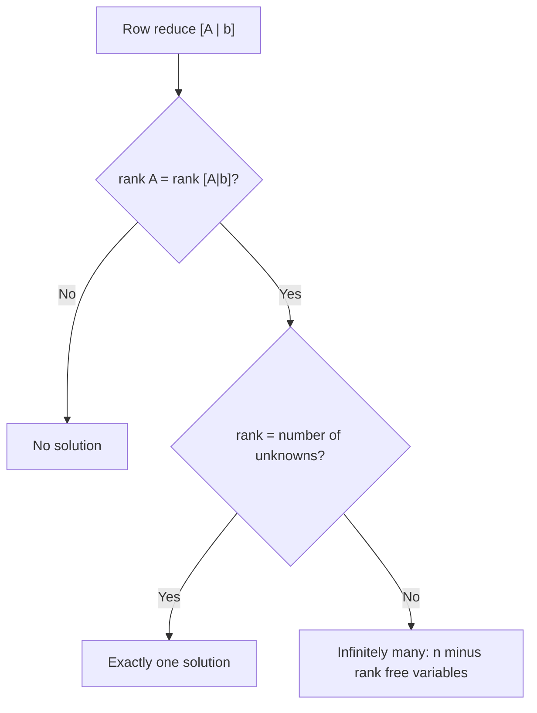

@part gate-linear-algebra | Linear Algebra | math
## Matrices

A matrix of order m × n has m rows and n columns. Product AB exists only when the number of columns of A equals the number of rows of B, and an (m × k)(k × n) product is m × n. Matrix multiplication is associative and distributive but **not commutative**.

| Type | Definition | Quick facts |
|---|---|---|
| Symmetric | Aᵀ = A | A + Aᵀ and AᵀA are symmetric; real eigenvalues |
| Skew-symmetric | Aᵀ = −A | diagonal is 0; odd-order determinant is 0 |
| Orthogonal | AᵀA = I | det = ±1; \|eigenvalue\| = 1; preserves length |
| Idempotent | A² = A | eigenvalues 0 or 1; rank = trace |
| Nilpotent | Aᵏ = 0 for some k | all eigenvalues 0 |
| Involutory | A² = I | eigenvalues ±1 |
| Diagonal / triangular | zeros off the diagonal / on one side | det = product of the diagonal |

### Transpose, inverse, adjoint

- (AB)ᵀ = BᵀAᵀ, and (AB)⁻¹ = B⁻¹A⁻¹: **the order reverses** in both.
- A is invertible exactly when det A ≠ 0. Then A⁻¹ = adj(A) / det A.
- For a 2 × 2 matrix, [[a, b], [c, d]]⁻¹ = (1 / (ad − bc)) [[d, −b], [−c, a]].
- A⁻¹ is unique, and (Aᵀ)⁻¹ = (A⁻¹)ᵀ.
- **|adj A| = |A|ⁿ⁻¹** and adj(adj A) = |A|ⁿ⁻² A for an n × n matrix.
- trace(AB) = trace(BA), and trace(A + B) = trace A + trace B.

!cheat Matrix cheat codes ::
- **Size check first.** Write the three orders on paper. A 4×3, B 3×5, C 5×2 give ABC of order 4×2.
- **Idempotent and not I → singular.** From A(A − I) = 0, if A were invertible we could cancel and get A = I.
- **Powers of a shear:** [[1, 1], [0, 1]]ⁿ = [[1, n], [0, 1]].
- **0/1 matrices:** the number of 2×2 matrices over {0, 1} with non-zero determinant is 6 (out of 16).
- **For any square A,** A + Aᵀ is symmetric and A − Aᵀ is skew-symmetric. Every matrix is the sum of one of each.
!end

## Determinants

For a square matrix, the determinant is a single number that says whether the matrix is invertible and how it scales volume.

| Property | Statement |
|---|---|
| Transpose | \|Aᵀ\| = \|A\| |
| Product | \|AB\| = \|A\| \|B\| |
| Inverse | \|A⁻¹\| = 1 / \|A\| |
| Scalar | \|kA\| = kⁿ \|A\| for an n × n matrix |
| Row swap | changes the sign |
| Multiply a row by k | multiplies the determinant by k |
| Add a multiple of one row to another | **no change** |
| Two equal rows, or a row that is a combination of the others | determinant is 0 |
| Triangular matrix | product of the diagonal entries |

### Computing

1. For 2 × 2: ad − bc.
2. For 3 × 3: expand along a row or column with the most zeros, using the sign pattern + − +, − + −, + − +.
3. For larger matrices: reduce to triangular form with row operations, tracking swaps (sign) and row scalings, then multiply the diagonal.

**Vandermonde:** det of [[1, 1, 1], [x, y, z], [x², y², z²]] = (y − x)(z − x)(z − y). It is non-zero exactly when the numbers are distinct.

!cheat Determinant cheat codes ::
- **Scalar factor:** det(2A) for a 3×3 matrix is 2³ det A = 8 det A. Do not multiply by 2.
- **Spot zero determinants:** two equal or proportional rows, a zero row, or a row that equals a sum of others. A matrix with all entries equal (order ≥ 2) has determinant 0.
- **Track the operations:** swap (×−1), scale a row by 5 (×5), add a multiple (×1). Starting at 6, swap, then scale one row by 5 and add 7×row₁ to row₂: 6 × (−1) × 5 × 1 = −30.
- **Skew-symmetric of odd order:** determinant 0. **Orthogonal:** determinant ±1.
- **Singular if** k makes det = 0: [[1, 2], [3, k]] is singular when k = 6.
!end

## Rank and systems of linear equations

The **rank** of a matrix is the number of linearly independent rows, which equals the number of independent columns, which equals the number of non-zero rows in its row echelon form. For an m × n matrix, rank ≤ min(m, n), and **rank + nullity = n** (the number of columns).

Properties: rank(AB) ≤ min(rank A, rank B); rank(Aᵀ) = rank A; the rank of an n × n matrix is n exactly when it is invertible.

### The consistency theorem

For Ax = b with n unknowns, compare rank(A) = r with rank of the augmented matrix [A | b]:

| Condition | Result |
|---|---|
| rank(A) < rank([A \| b]) | **no solution** (inconsistent) |
| rank(A) = rank([A \| b]) = n | **unique** solution |
| rank(A) = rank([A \| b]) = r < n | **infinitely many** solutions, with n − r free parameters |

**Homogeneous systems** Ax = 0 always have the trivial solution. They have a non-trivial solution exactly when rank(A) < n; for a square matrix this means det A = 0. The solutions form a space of dimension n − r.

**Cramer's rule** (square system, det A ≠ 0): xᵢ = det(Aᵢ) / det(A), where Aᵢ is A with column i replaced by b.

!cheat Linear-system cheat codes ::
- **A parameter question** (system depends on k): the determinant of the coefficient matrix being 0 is where things change. Check that k separately by row reduction, as it is the only k where "no solution" or "infinitely many" can happen.
- **Same left side, different right side** (like x + 2y = 3 and 2x + 4y = k): consistent only for the proportional right side, k = 6.
- **More unknowns than equations** (3×5 with rank 3): never inconsistent, and has n − r = 2 free variables.
- **Homogeneous, 5 unknowns, 3 independent equations:** 5 − 3 = 2 independent solutions.
- **A is n×n with rank n − 1:** adj(A) has rank 1. With rank < n − 1, adj(A) = 0.
- **Rank of a product is at most the smaller rank.** A 3×4 matrix of rank 2 times anything has rank at most 2.
!end

## Eigenvalues and eigenvectors

A non-zero vector v is an **eigenvector** of A with **eigenvalue** λ if Av = λv. The eigenvalues are the roots of the characteristic equation **det(A − λI) = 0**. For each eigenvalue, solve (A − λI)v = 0.

### Facts that decide most questions

| Fact | Detail |
|---|---|
| Sum of eigenvalues | trace(A) |
| Product of eigenvalues | det(A) |
| Triangular or diagonal matrix | eigenvalues are the diagonal entries |
| Aᵀ | same eigenvalues as A |
| Aᵏ | eigenvalues λᵏ |
| A⁻¹ | eigenvalues 1/λ (A must be invertible) |
| A + cI | eigenvalues λ + c |
| cA | eigenvalues cλ |
| p(A) for a polynomial p | eigenvalues p(λ) |
| Singular matrix | has eigenvalue 0 |

For a 2 × 2 matrix, the characteristic equation is **λ² − (trace) λ + det = 0**. For example, trace 5 and det 6 give λ = 2 and 3.

### Special matrices

- **Real symmetric:** real eigenvalues, and eigenvectors of distinct eigenvalues are orthogonal. Always diagonalizable.
- **Real skew-symmetric:** eigenvalues are 0 or purely imaginary.
- **Orthogonal:** every eigenvalue has absolute value 1. Rotations by 90° have eigenvalues ±i.
- **Idempotent:** eigenvalues 0 or 1. **Nilpotent:** all eigenvalues are 0.
- **Rank-1 matrix** uvᵀ: one non-zero eigenvalue vᵀu, and the rest are 0.

### Multiplicity, diagonalization and Cayley–Hamilton

- The **algebraic multiplicity** of λ is its multiplicity as a root. The **geometric multiplicity** is the dimension of its eigenspace, which is n − rank(A − λI). Always 1 ≤ geometric ≤ algebraic.
- A matrix is **diagonalizable** exactly when the geometric multiplicity equals the algebraic multiplicity for every eigenvalue. n distinct eigenvalues guarantee it. [[2, 1], [0, 2]] is **not** diagonalizable: eigenvalue 2 repeated, but A − 2I has rank 1, so only one eigenvector.
- **Cayley–Hamilton:** every matrix satisfies its own characteristic equation. If A² − 3A + 2I = 0, then A⁻¹ = (3I − A) / 2, because A(3I − A) = 2I.

!cheat Eigenvalue cheat codes ::
- **Never expand a 3×3 characteristic polynomial if you can avoid it.** Use trace and determinant to check candidate roots, or spot a triangular, block or rank-1 structure.
- **Function of a matrix:** apply the function to each eigenvalue. det(A² − 2A + I) with eigenvalues 1, 2, 3 is (0)(1)(4) = 0.
- **Eigenvector test:** compute A·v and see whether it is a multiple of v. For A = [[2, 1], [1, 2]], v = (1, 1) gives (3, 3), so λ = 3.
- **Count eigenvectors:** the number of independent eigenvectors for λ is n − rank(A − λI). If λ = 2 has algebraic multiplicity 3 and rank(A − 2I) = 1, there are 2 independent eigenvectors.
- **Trace of a power:** trace(Aᵏ) = Σ λᵢᵏ. For eigenvalues 1 and 2, trace(A¹⁰) = 1 + 1024 = 1025.
- **Idempotent:** rank = trace. A 3×3 idempotent with trace 2 has rank 2.
!end

## LU decomposition

**LU decomposition** writes a square matrix as A = LU, where L is lower triangular and U is upper triangular. Doolittle's convention gives L a unit diagonal (ones); Crout's gives U a unit diagonal.

### How to compute it

Run Gaussian elimination, and record each multiplier used. If row i is reduced by subtracting lᵢⱼ × row j, then lᵢⱼ is the (i, j) entry of L. The result of elimination is U.

Example: A = [[2, 1], [4, 3]]. The multiplier is l₂₁ = 4 / 2 = 2. Row 2 becomes [4, 3] − 2·[2, 1] = [0, 1]. So L = [[1, 0], [2, 1]] and U = [[2, 1], [0, 1]]. Check: LU = [[2, 1], [4, 3]].

### Using it

To solve Ax = b: solve Ly = b by **forward substitution**, then Ux = y by **back substitution**. The factorisation costs about (2/3)n³ operations, i.e. Θ(n³), but each additional right-hand side only needs Θ(n²). The determinant is the product of the diagonal of U (when L has a unit diagonal).

### When it fails

LU without row swaps exists when every leading principal minor is non-zero. A zero pivot (like the top-left 0 in [[0, 1], [1, 0]]) forces a row swap, giving **PA = LU** with a permutation matrix P (partial pivoting). Symmetric positive-definite matrices have the faster **Cholesky** form A = LLᵀ.

!cheat LU cheat codes ::
- **L stores the multipliers,** U is the echelon form. The diagonal of L is 1 in Doolittle's form.
- **det A = product of U's diagonal** (times (−1)^(number of swaps) if pivoting).
- **Top-left entry zero → no plain LU.** You need a permutation.
- **Many right-hand sides:** factorise once (Θ(n³)), then Θ(n²) per solve, instead of redoing elimination.
- **Check the answer** by multiplying L and U back: the product must reproduce A.
!end

## Cheat sheet: Linear Algebra on one page

| Topic | Fact |
|---|---|
| (AB)ᵀ, (AB)⁻¹ | BᵀAᵀ, B⁻¹A⁻¹ |
| det(kA) | kⁿ det A |
| det(adj A) | (det A)ⁿ⁻¹ |
| Row operations | swap ×(−1), scale ×k, add multiple ×1 |
| Rank-nullity | rank + nullity = number of columns |
| Ax = b | solvable iff rank A = rank [A \| b]; unique iff that rank = n |
| Ax = 0 (square) | non-trivial solution iff det A = 0 |
| Eigenvalues | sum = trace, product = det |
| 2×2 characteristic equation | λ² − (trace) λ + det = 0 |
| Triangular matrix | eigenvalues on the diagonal |
| Functions | eigenvalues of f(A) are f(λ) |
| Eigenvectors for λ | n − rank(A − λI) independent ones |
| Cayley–Hamilton | A satisfies its characteristic polynomial |
| Idempotent | eigenvalues 0 or 1, rank = trace |
| LU | A = LU, det = product of U's diagonal, solve in Θ(n²) |

??  For a 3 × 3 matrix with determinant 4, what is det(2A) and det(adj A)?
=> det(2A) = 2³ × 4 = 32. det(adj A) = (det A)^(n−1) = 4² = 16.
??  When does a system Ax = b have infinitely many solutions?
=> When rank(A) = rank([A | b]) = r and r is less than the number of unknowns n. There are n − r free variables.
??  Why does a matrix with an eigenvalue of 0 have no inverse?
=> The product of the eigenvalues is det A. A zero eigenvalue makes det A = 0, so A is singular. Equivalently, Av = 0 has a non-zero solution.
??  Is [[2, 1], [0, 2]] diagonalizable?
=> No. The eigenvalue 2 has algebraic multiplicity 2, but A − 2I = [[0, 1], [0, 0]] has rank 1, so the eigenspace has dimension 1. The geometric multiplicity is smaller than the algebraic multiplicity.
