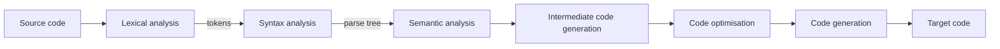

@part gate-compiler | Compiler Design | software
## Phases of a compiler and lexical analysis

A compiler translates source code into target code in phases:



The **symbol table** (names, types, scopes) and the **error handler** are used by all phases. The first three phases form the **front end** (machine independent), and optimisation plus code generation the **back end**.

### Lexical analysis

The lexer reads characters and produces **tokens**. A **lexeme** is the actual text, such as `count`, a **token** is its class (identifier), and a **pattern** is the rule that describes the class, written as a regular expression. It also removes white space and comments and tracks line numbers.

- **Maximal munch:** the lexer takes the longest prefix that matches a pattern. The input `a>>=b` gives the three tokens `a`, `>>=`, `b` when `>`, `>=`, `>>` and `>>=` are all operators.
- **Priority:** when two patterns match the same lexeme, the one listed first wins. This is how keywords such as `if` beat the identifier pattern.
- Tokens are specified with **regular expressions** and recognised by finite automata. Balanced parentheses are **not** checked here, that needs a context-free grammar and so is the parser's job.
- **Counting tokens** treats each identifier, keyword, constant, string, operator and punctuation mark as one token. `x = y + 3 * (z - 4);` has 12 tokens, and `if (a >= b) max = a; else max = b;` has 15.

!cheat Lexical cheat codes ::
- **Token counting:** scan left to right, take the longest valid token each time, and ignore spaces and comments. A string literal is one token whatever it contains.
- **Which phase finds the error?** Illegal character → lexer. Missing semicolon, unbalanced parentheses → parser. Undeclared variable or type mismatch → semantic analysis.
- **Regular expressions describe tokens; context-free grammars describe syntax.**
!end

## Syntax analysis: top-down parsing

A parser checks that the token stream follows the grammar and builds the parse tree. **Top-down** parsers build the tree from the root, expanding non-terminals by leftmost derivation.

### FIRST and FOLLOW

- FIRST(α) is the set of terminals that can begin a string derived from α (plus ε if α can derive ε).
- FOLLOW(A) is the set of terminals that can appear immediately after A in some sentential form. $ (end of input) is in FOLLOW of the start symbol.

For the grammar E → T X, X → + T X | ε, T → F Y, Y → * F Y | ε, F → ( E ) | i:

| Symbol | FIRST | FOLLOW |
|---|---|---|
| E, T, F | { ( , i } | E: { ), $ }, T: { +, ), $ }, F: { *, +, ), $ } |
| X | { +, ε } | { ), $ } |
| Y | { *, ε } | { +, ), $ } |

Rules for computing FOLLOW: for A → α B β, add FIRST(β) − {ε} to FOLLOW(B). If β can derive ε (or is empty), add FOLLOW(A) to FOLLOW(B).

### LL(1) grammars

LL(1) means: read the input **L**eft to right, build a **L**eftmost derivation, using **1** token of lookahead. In the LL(1) table, A → α goes into M[A, a] for every a in FIRST(α), and, if ε is in FIRST(α), also for every a in FOLLOW(A).

A grammar is LL(1) exactly when no table cell has two productions. This needs, for every pair A → α | β:

1. FIRST(α) ∩ FIRST(β) = ∅.
2. At most one of α, β derives ε, and if β derives ε then FIRST(α) ∩ FOLLOW(A) = ∅.

So an LL(1) grammar must be **unambiguous**, **not left-recursive** and **left-factored**.

| Grammar | LL(1)? | Why |
|---|---|---|
| S → a S \| a | no | both alternatives start with a: left factoring needed |
| S → a S \| b | yes | different first symbols |
| S → S a \| b | no | left recursion: a recursive-descent parser would loop forever |
| S → A \| B, A → a, B → a | no | ambiguous: both start with a |

### Fixing a grammar

- **Left recursion** A → Aα | β becomes A → β A′, A′ → α A′ | ε. So E → E + T | T becomes E → T E′, E′ → + T E′ | ε.
- **Left factoring** A → αβ₁ | αβ₂ becomes A → α A′, A′ → β₁ | β₂.

For S → a S b | ε the table has three filled cells: M[S, a] = aSb, and M[S, b], M[S, $] = ε (FOLLOW(S) = {b, $}).

!cheat Top-down cheat codes ::
- **Compute FIRST bottom-up and FOLLOW top-down.** Build FIRST for every non-terminal first, then FOLLOW.
- **ε productions put FOLLOW into the table.** That is where beginners forget entries.
- **LL(1) test in 10 seconds:** look for a left recursion, a common prefix or a shared first terminal.
- **Table entries** = Σ over productions of |FIRST(α)| (plus FOLLOW(A) for ε-productions).
- **Recursive descent** does not work on a left-recursive grammar.
!end

## Bottom-up parsing: LR parsers

A bottom-up parser builds the tree from the leaves and traces a **rightmost derivation in reverse**. A **shift–reduce** parser keeps a stack and either **shifts** the next token onto it or **reduces** a **handle** (a right-hand side at the top of the stack) to its left-hand side.

### LR(0) items and the automaton

An **LR(0) item** is a production with a dot marking how much has been seen: A → X • Y Z. A production with k symbols on its right side has **k + 1 items**, and A → ε has exactly one (A → •). Build states with the **closure** and **goto** operations, starting from the augmented grammar S′ → S.

| Parser | Reduce on | Notes |
|---|---|---|
| LR(0) | any input | conflict if a state has a complete item and any other item |
| **SLR(1)** | the terminals in FOLLOW(A) | simple, but FOLLOW is too coarse sometimes |
| **LALR(1)** | the lookaheads that actually occur, merged for states with the same core | used by yacc and bison |
| **CLR(1) = LR(1)** | exact lookaheads | most powerful, many more states |

- **Power:** LR(0) ⊂ SLR(1) ⊂ LALR(1) ⊂ CLR(1), as classes of grammars. Every LL(1) grammar is also LR(1).
- **Number of states:** LR(0), SLR(1) and LALR(1) all have the **same states** (the LR(0) automaton), while CLR(1) has at least as many. For S → AA, A → aA | b: 7 states for LR(0), SLR and LALR, and 10 for CLR(1). The expression grammar E → E+T | T, T → T*F | F, F → (E) | i has 12 LR(0) states.
- **Conflicts:** *shift/reduce* (the parser cannot tell whether to shift or reduce) and *reduce/reduce* (two different reductions are possible). yacc resolves shift/reduce by shifting and reduce/reduce by choosing the production listed first.

### Grammars that separate the classes

| Grammar | Classification |
|---|---|
| S → a S \| b | LR(0) |
| E → E + T \| T, T → T * F \| F, F → ( E ) \| i | SLR(1), but not LR(0) (a state with E → T • and T → T • * F) |
| S → L = R \| R, L → * R \| i, R → L | LALR(1) and CLR(1), but not SLR(1) |
| S → a A d \| b B d \| a B e \| b A e, A → c, B → c | CLR(1), but not LALR(1) (merging adds a reduce/reduce conflict) |

**Dangling else:** S → i E t S | i E t S e S | a is ambiguous. Compilers resolve it by matching each `else` with the nearest unmatched `if`.

### Counting reductions

Each reduction corresponds to one internal node of the parse tree. For `i + i * i` with the usual expression grammar there are 8: F → i (three times), T → F (twice), T → T * F, E → T and E → E + T.

!cheat LR cheat codes ::
- **Item count:** a production with k symbols gives k + 1 items. An ε-production gives 1.
- **Same number of states:** SLR = LALR = LR(0). Only CLR can be bigger.
- **To spot SLR failure,** look for a state with a reduction A → α • where a terminal in FOLLOW(A) is also shifted.
- **Reductions = internal nodes** of the parse tree (non-terminal nodes), excluding the augmented start.
- **Handle** = the substring that matches a right-hand side whose reduction is one step of the reverse rightmost derivation.
- **yacc/bison = LALR(1).** Default conflict resolution: shift over reduce, earlier rule over later.
!end

## Syntax-directed translation

An **SDD** attaches attributes to grammar symbols and rules to compute them. In a **syntax-directed translation scheme** semantic actions are embedded in the productions at the position where they run.

| Attribute kind | Computed from | Example |
|---|---|---|
| **Synthesized** | the node's children (and itself) | E.val = E₁.val + T.val |
| **Inherited** | the node's parent and its siblings | the type passed to a list of identifiers |

- An **S-attributed** SDD uses only synthesized attributes. It can be evaluated during a bottom-up (LR) parse, at each reduction.
- An **L-attributed** SDD allows inherited attributes that depend only on the parent's attributes and the attributes of **siblings to the left**. It can be evaluated in a depth-first left-to-right walk, so it suits top-down (LL) parsing. Every S-attributed definition is L-attributed.
- The dependency graph of the attributes must be **acyclic** to be evaluable.

Examples:

```text Evaluating a non-standard rule
E -> E1 # T   { E.val = E1.val * 2 + T.val }
E -> T        { E.val = T.val }
T -> num      { T.val = num.value }

Input 1 # 2 # 3 is left-associative: ((1 # 2) # 3)
(1 # 2) -> 1*2 + 2 = 4
(4 # 3) -> 4*2 + 3 = 11
```

A translation scheme for infix to postfix: `E → E + T { print('+') } | T`, `T → num { print(num) }`. For `4 + 5 + 6` the printed output is `4 5 + 6 +`.

!cheat SDT cheat codes ::
- **Draw the parse tree, then compute bottom-up** for synthesized attributes. Respect the associativity of the grammar.
- **Action position matters:** actions at the end of a production run after the children have been processed.
- **LR parsers + S-attributed = easy.** Inherited attributes need marker non-terminals or an L-attributed top-down design.
- **Postfix output** from a left-recursive expression grammar: print operands as they are reduced, and print the operator after the right operand.
!end

## Runtime environments

### Storage organisation

A running program's memory holds the **code**, **static data**, the **heap** (dynamic data such as `malloc`) and the **stack** (activation records). The heap and stack grow toward each other.

### Activation records

Each procedure call pushes an **activation record** (stack frame):

| Field | Purpose |
|---|---|
| Actual parameters | values or addresses passed in |
| Returned value | space for the result |
| Control link (dynamic link) | the caller's record |
| **Access link (static link)** | the record of the lexically enclosing procedure, to reach non-local variables |
| Saved machine status | return address, saved registers |
| Local data and temporaries | the procedure's variables |

The source code is **not** stored in an activation record. Recursion works because each call has its own record on the stack, and the maximum stack space is (depth + 1) × (record size). A function recursing to depth 100 with 32-byte records uses 101 × 32 = 3232 bytes.

### Accessing non-local names

With nested procedures, a procedure at nesting depth d accessing a variable declared at depth k follows **d − k access links**. A **display** array holds a pointer to the latest record at each depth, giving constant-time access instead.

### Parameter passing

| Mechanism | What is passed | Effect of assigning to the formal |
|---|---|---|
| Call by value | a copy of the value | caller unaffected |
| **Call by reference** | the address | the actual changes (aliasing) |
| Copy-restore (value-result) | copy in, copy out at return | actual updated at the end |
| Call by name | the expression, re-evaluated at every use | like a macro |

Example. `f(x, y) { x = x + 1; y = y + x; }` with a = 1 and b = 2, called as `f(a, b)`: by value leaves a = 1, b = 2. By reference x aliases a and y aliases b, so x becomes 2 and y becomes 2 + 2 = 4: a = 2, b = 4.

### Memory management

The stack frees memory automatically when a call returns, while the heap needs explicit freeing or **garbage collection**. **Reference counting** cannot reclaim cyclic garbage. **Mark-and-sweep** can.

!cheat Runtime cheat codes ::
- **Stack = locals and calls. Heap = memory that outlives the call** (`malloc`, `new`).
- **Nesting-depth difference = number of access links to follow.**
- **For parameter-passing output questions,** draw a box for each variable and let the formal point to the same box for by-reference.
- **Recursion needs a stack,** so a language without a stack (static allocation only) cannot support it.
!end

## Intermediate code generation

Common forms are the **syntax tree**, the **DAG**, **postfix notation** and **three-address code** (at most one operator on the right-hand side). For a = b * c + d * e:

```text Three-address code
t1 = b * c
t2 = d * e
a  = t1 + t2        // 3 instructions (4 if the sum is first put in a temporary)
```

| Representation | Fields | Notes |
|---|---|---|
| Quadruples | op, arg1, arg2, result | easy to reorder, uses temporaries |
| Triples | op, arg1, arg2 | results referred to by position, so reordering is awkward |
| **Indirect triples** | a list of pointers to triples | reordering instructions only changes the list |

((a + b) * (c + d)) - (e + f) needs 5 instructions: three additions, one multiplication and one subtraction.

### Basic blocks and flow graphs

A **basic block** is a maximal sequence of instructions with a single entry (the first) and a single exit (the last). The **leaders** that begin blocks are:

1. the first instruction;
2. the target of any jump (conditional or unconditional);
3. the instruction immediately after a jump.

```text Counting basic blocks
1: i = 0
2: if i >= 10 goto 8
3: t = i * 2
4: if t > 6 goto 6
5: s = s + t
6: i = i + 1
7: goto 2
8: halt
// leaders: 1 (first), 2 (target of 7), 3 (after 2), 5 (after 4), 6 (target of 4), 8 (target of 2, after 7)
// six leaders, so six basic blocks
```

**Backpatching** generates jump instructions with unfilled targets and fills them in once the target is known, which lets conditional and loop code be produced in a single pass.

!cheat ICG cheat codes ::
- **Three-address count:** one instruction per operator, plus an assignment only if the final result needs a copy.
- **Leaders:** first instruction, jump targets, instructions after jumps. The number of leaders equals the number of basic blocks.
- **DAG nodes** = distinct leaves (initial variable values) + distinct operations (same operator on the same operands counted once).
- **Prefer indirect triples** when the optimiser moves code.
!end

## Code optimisation and data-flow analysis

### Local and peephole optimisations

| Technique | Example |
|---|---|
| Constant folding | `x = 3 + 4 * 2` becomes `x = 11` |
| Constant propagation | `a = 5; b = a + 2` becomes `b = 7` |
| Algebraic simplification | `x + 0`, `x * 1` → `x` |
| **Strength reduction** | `x * 2` → `x + x` or `x << 1` |
| Common subexpression elimination | the second `a + b` reuses the first value |
| Dead-code elimination | removing an assignment whose result is never used |
| Copy propagation | replace `y` by `x` after `y = x` |
| Peephole | redundant load/store, jump over jump, unreachable code |

Within a block, a **DAG** finds common subexpressions: the block `p = a + b; q = p * c; r = a + b; s = r * c; t = q + s` has the DAG nodes + (a,b), × (p,c), and + (q,q). After CSE only 3 arithmetic operations remain instead of 5. A DAG with leaves a, b and operators + and × for `t1 = a + b; t2 = a + b; t3 = t1 * t2` has 4 nodes.

**Loop optimisations:** *code motion* moves loop-invariant computations (such as `x = y + z` when neither y nor z changes in the loop) out of the loop; *induction-variable* strength reduction replaces `i * 4` by a running sum `t = t + 4`; *loop unrolling* reduces loop overhead.

### Data-flow analysis

A data-flow problem is solved by iterating transfer equations around the flow graph until nothing changes.

| Analysis | Direction | Meet | Equations |
|---|---|---|---|
| **Reaching definitions** | forward | union | OUT = gen ∪ (IN − kill) |
| **Available expressions** | forward | **intersection** | OUT = gen ∪ (IN − kill) |
| **Live variables** | **backward** | union | IN = use ∪ (OUT − def) |
| Very busy expressions | backward | intersection | IN = use ∪ (OUT − kill) |
| Constant propagation | forward | lattice meet (≠ constant if values differ) | substitute known constants |

- "May" analyses (union) ask whether something holds on **some** path. "Must" analyses (intersection) ask whether it holds on **all** paths.
- A variable is **live** at a point if its current value may be used later before being redefined. Liveness decides **dead code** and register allocation.
- An expression is **available** at a point if it has been computed on every path to it and none of its operands has been redefined since.

Worked liveness example. B1 defines x and y; B2 uses x and defines z; B3 uses y and defines z; B4 uses z; B1 branches to B2 and B3, both reach B4. Live-in(B4) = {z}. Live-in(B2) = {x} (z is redefined) and live-in(B3) = {y}. So live-out(B1) = {x, y}.

Worked reaching-definitions example. B1 has d1: x = 1 and d2: y = 2; B2 has d3: x = 3; edges B1 → B2, B1 → B3, B2 → B3. OUT[B1] = {d1, d2}, OUT[B2] = {d3, d2} (d3 kills d1), so IN[B3] = {d1, d2, d3}.

Worked availability example. B1 computes a + b; B2 assigns a; B3 recomputes nothing, with edges B1 → B3 and B1 → B2 → B3. At the entry of B3 the expression a + b arrives on the path through B1 but is killed on the path through B2. With intersection it is **not** available.

!cheat Data-flow cheat codes ::
- **Memorise the four rows:** forward-union (reaching defs), forward-intersection (available expr), backward-union (liveness), backward-intersection (very busy).
- **Liveness works from the end:** start at the last block, add uses, remove definitions, move up.
- **Initial values:** may problems start with empty sets, available expressions starts with the universal set (except at the entry).
- **After CSE,** count operators in the DAG, not the number of original statements.
- **Constant folding then dead-code elimination** often cascade: folding makes variables unused, and removing them exposes more.
!end

## Cheat sheet: Compiler Design on one page

| Topic | Fact |
|---|---|
| Lexer | maximal munch; tokens via regular expressions |
| Left recursion | A → Aα \| β ⟹ A → βA′, A′ → αA′ \| ε |
| LL(1) table | FIRST(α), and FOLLOW(A) when α derives ε |
| LL(1) grammar | unambiguous, no left recursion, left-factored |
| Items | k + 1 for a production with k symbols |
| Power | LR(0) ⊂ SLR(1) ⊂ LALR(1) ⊂ CLR(1) |
| States | LR(0) = SLR = LALR ≤ CLR |
| yacc | LALR(1), shift beats reduce |
| S-attributed / L-attributed | synthesized only (bottom-up) / left-sibling inherited (top-down) |
| Access links | follow (depth of use − depth of declaration) links |
| Basic block leaders | first, jump targets, after jumps |
| Reaching defs / available expr / liveness | forward ∪ / forward ∩ / backward ∪ |
| Liveness equation | IN = use ∪ (OUT − def) |
| DAG | shares common subexpressions |

??  Why is E → E + T | T unsuitable for a recursive-descent parser, and what is the fix?
=> It is left-recursive: the parser for E would call itself without consuming input and recurse forever. Rewrite as E → T E′, E′ → + T E′ | ε.
??  Why do SLR(1), LALR(1) and LR(0) parsers have the same number of states for a grammar?
=> All three use the LR(0) item-set automaton. They differ only in how they pick the lookahead set for reductions. CLR(1) items carry lookaheads, so it can split LR(0) states and have more.
??  What is the difference between synthesized and inherited attributes?
=> A synthesized attribute is computed from the attributes of the node's children, so information flows up the parse tree. An inherited attribute is computed from the parent and the siblings, so information flows down or sideways.
??  Why does available-expressions analysis use intersection while reaching definitions uses union?
=> An expression may be reused only if it is computed on every path to the point, which is a "must" property and so needs intersection. A definition reaches a point if it reaches along some path, a "may" property, so union.
