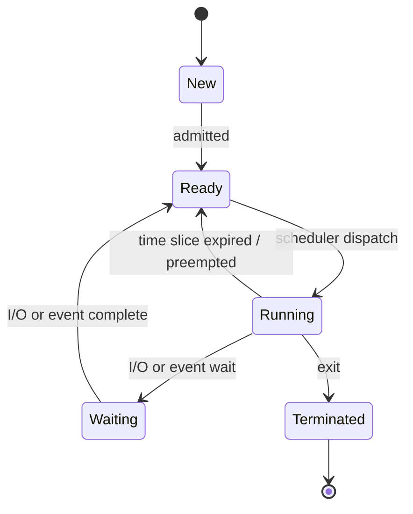

@part gate-os | Operating Systems | systems
## System calls, processes and threads

### Kernel mode and system calls

The CPU runs in **user mode** or **kernel (privileged) mode**. Instructions that can disturb other programs or the hardware are privileged: disabling interrupts, setting the timer, changing the memory-management registers, and I/O instructions. A **system call** is how a program asks the OS for a service. It executes a **trap** (software interrupt) that switches to kernel mode, jumps to the handler, and returns to user mode afterwards.

### Processes

A **process** is a program in execution: code, data, heap, stack, and a **process control block (PCB)** that holds its state, registers, memory-management information and open files.

A **context switch** saves the PCB of the running process and loads that of the next. It is pure overhead.

### fork, exec and wait

`fork()` creates a child that is a copy of the caller. It returns **0 in the child** and the **child's PID in the parent** (and −1 on failure). After a `fork`, both processes continue with the next statement.

- k consecutive `fork()` calls (or a loop with k forks) create **2ᵏ processes** in total, including the original, so 2ᵏ − 1 new ones.
- `for (i = 0; i < 3; i++) fork(); printf("X");` prints X **8** times.
- `if (fork() == 0) { fork(); } printf("A");` prints A **3** times: the parent once, the child, and the grandchild.
- `exec()` replaces the process image. `wait()` makes the parent block until a child terminates.
- A **zombie** is a terminated process whose parent has not yet called `wait()`. An **orphan** is a child whose parent has terminated.

### Threads

A thread is a unit of CPU use. Threads of one process **share** the code, global data, heap and open files, but each has its own **stack, registers and program counter**.

| | User-level threads | Kernel-level threads |
|---|---|---|
| Managed by | a library, in user space | the OS kernel |
| Switching cost | low | higher |
| A blocking system call | **blocks the whole process** | blocks only that thread |
| Multiprocessor use | one kernel thread at a time | true parallelism |

### Inter-process communication

Processes communicate by **shared memory** (fastest, since after setup no kernel call is needed, but they must synchronise) or by **message passing** (pipes, message queues, sockets, simpler and works across machines). Signals deliver simple notifications.

!cheat Process cheat codes ::
- **fork counting:** draw a tree. Every `fork()` doubles the number of running copies from that point on.
- **Return value:** `0` means "I am the child".
- **Privileged instructions:** anything that changes protection or timing (disable interrupts, set timer, halt, I/O). Plain arithmetic and reading a register are not.
- **User threads block together,** kernel threads independently.
- **Fastest IPC:** shared memory. **Easiest to get right:** message passing.
!end

## CPU scheduling

### Criteria and definitions

CPU utilisation and throughput should be high; turnaround, waiting and response times should be low.

- **Turnaround time = completion time − arrival time.**
- **Waiting time = turnaround time − burst time.**
- **Response time** = first run − arrival.

| Algorithm | Preemptive? | Notes |
|---|---|---|
| FCFS | no | simple, **convoy effect** (short jobs wait behind a long one) |
| SJF | no | minimum average waiting time among non-preemptive algorithms; starvation of long jobs |
| SRTF | yes | preemptive SJF, minimum average waiting time overall |
| Priority | either | starvation of low priority, cured by **aging** |
| Round robin | yes | time quantum q; large q → FCFS; very small q → too much switching |
| Multilevel (feedback) queue | yes | processes move between queues |

### Worked example

Processes (arrival, burst): P1 (0, 5), P2 (1, 3), P3 (2, 8), P4 (3, 2).

| Algorithm | Completion times (P1, P2, P3, P4) | Average waiting | Average turnaround |
|---|---|---|---|
| FCFS | 5, 8, 16, 18 | 5.75 | 10.25 |
| SJF (non-preemptive) | 5, 10, 18, 7 | 4.0 | 8.5 |
| SRTF | 10, 4, 18, 6 | 3.5 | 8.0 |
| Round robin, q = 2 | 14, 11, 18, 10 | 7.25 | 11.75 |

Priority scheduling (non-preemptive, all arrive at 0, lower number = higher priority): P1 (burst 6, priority 2), P2 (2, 1), P3 (8, 4), P4 (3, 3). The order is P2, P1, P4, P3, the waiting times are 0, 2, 8, 11, and the average is 5.25.

Other formulas:

- In round robin with n processes, quantum q and context-switch time s, a process can wait up to **(n − 1)(q + s)** before running again. With n = 5, q = 10 ms and s = 2 ms that is 48 ms.
- **CPU utilisation with n processes** that each wait for I/O a fraction p of the time: 1 − pⁿ. For p = 0.4 and n = 3 that is 1 − 0.064 = 0.936.

!cheat Scheduling cheat codes ::
- **Draw the Gantt chart,** then read off completion times. Waiting time = completion − arrival − burst.
- **Preemptive shortest-job (SRTF):** at every arrival, compare the new burst with the remaining time of the running process.
- **Round-robin tie rule:** a new arrival joins the queue before the preempted process (state the convention you used).
- **Averages:** SRTF ≤ SJF ≤ FCFS for waiting time on the usual examples, but not by law for every input (FCFS can tie).
- **Starvation fix = aging.** **Convoy effect = FCFS.**
!end

## Process synchronisation

### The critical-section problem

A solution must give **mutual exclusion**, **progress** (only processes outside their remainder section decide who enters next, and the decision cannot be postponed forever) and **bounded waiting** (no process waits forever while others enter repeatedly).

A **race condition** means the result depends on the interleaving. Two threads that each increment a shared counter twice, using load–add–store with no synchronisation, can end with 2, 3 or 4, never below 2 and never above 4. With N increments each the range is 2 to 2N.

### Solutions

| Mechanism | Remarks |
|---|---|
| **Peterson's algorithm** | two processes, `flag[2]` and `turn`; satisfies all three requirements (software only) |
| **Test-and-set / compare-and-swap** | atomic hardware instructions; spinlocks that busy-wait |
| Disabling interrupts | only for kernel code on a single CPU |
| **Semaphore** | integer S with atomic `wait` (P: S−−, block if S < 0) and `signal` (V: S++, wake one) |
| Monitor | a language construct: one process active inside at a time, with condition variables |

- A **binary semaphore** is initialised to 1 and gives mutual exclusion. A **counting semaphore** controls access to a pool of identical resources.
- If a semaphore starts at S and k `wait`s and m `signal`s complete, its value is S − k + m. For S = 10, 6 waits and 4 signals leave 8. With initial value 3, eight processes that execute `wait` and none that `signal` leave **5 blocked**.

### Classic problems

- **Bounded buffer (producer–consumer):** semaphores `mutex = 1`, `empty = N`, `full = 0`. The producer does wait(empty), wait(mutex), insert, signal(mutex), signal(full). The consumer does the mirror image. **Swapping the order of wait(empty) and wait(mutex) can deadlock.**
- **Readers–writers:** many readers or one writer. In the first version (readers have priority) writers may **starve**.
- **Dining philosophers:** five philosophers and five forks. If each takes the left fork first, all can hold one fork and **deadlock**. Cures: allow only four to sit at once, pick up both forks atomically, or number the forks and always pick the lower one first.
- **Two processes with semaphores S and T:** P1 does wait(S), wait(T), …; P2 does wait(T), wait(S), …. A bad interleaving gives deadlock.

!cheat Synchronisation cheat codes ::
- **Semaphore value arithmetic:** S_final = S_initial − (#wait) + (#signal). If it goes negative, its magnitude is the number of blocked processes.
- **Race range:** for two threads incrementing n times each, the minimum is 2 and the maximum is 2n.
- **Deadlock smell:** two locks taken in opposite orders by two processes.
- **Producer–consumer initial values:** `empty = N`, `full = 0`, `mutex = 1`.
- **Busy waiting** (spinlocks) wastes CPU cycles but avoids a context switch; it is good only for very short critical sections.
!end

## Deadlock

A set of processes is **deadlocked** if each waits for a resource held by another in the set. Four conditions must **all** hold:

1. **Mutual exclusion**, 2. **hold and wait**, 3. **no preemption**, 4. **circular wait**.

Removing any one prevents deadlock. Imposing a total order on resource types and requiring requests in increasing order breaks **circular wait**.

### Resource-allocation graph

With **one instance** of each resource, a cycle in the graph means deadlock. With several instances a cycle is necessary but not sufficient.

### Sizing a pool

n processes each need at most m units of a single resource type. Deadlock cannot occur if the total R satisfies **R ≥ n(m − 1) + 1**, because even if every process holds m − 1 units, one unit left lets someone finish. For n = 4 and m = 3 the minimum is 4 × 2 + 1 = **9**.

### Banker's algorithm (avoidance)

Keep **Available**, **Allocation** and **Max**; **Need = Max − Allocation**. A state is **safe** if there is an order in which every process can obtain its Need, finish and release its Allocation. To test it: find a process whose Need ≤ Work (initially Available), add its Allocation to Work, and repeat. Complexity O(m·n²). An unsafe state *may* lead to deadlock, but not necessarily. A safe state never does.

Example: Available (2, 1); Allocation P0 (1,1), P1 (3,1), P2 (2,3), P3 (2,1); Max P0 (3,1), P1 (6,2), P2 (4,6), P3 (2,5). Need: P0 (2,0), P1 (3,1), P2 (2,3), P3 (0,4). Only P0 can run first: Work becomes (3,2). Then only P1: (6,3). Then P2: (8,6). Then P3. The only safe sequence is **P0, P1, P2, P3**.

### Detection and recovery

Allow deadlock, run a detection algorithm (like the safety test, using current requests), and recover by terminating processes or preempting resources.

!cheat Deadlock cheat codes ::
- **Four conditions** (mutual exclusion, hold and wait, no preemption, circular wait): preemption itself is *not* a condition.
- **Minimum for deadlock freedom:** n(m − 1) + 1.
- **Banker's by hand:** compute Need, then repeatedly pick any process with Need ≤ Work. If you get stuck, the state is unsafe.
- **Prevention** attacks one of the four conditions; **avoidance** (Banker) keeps the system in safe states.
- **Cycle + single instances = deadlock.**
!end

## Memory management

### Contiguous allocation

Each process gets one block. Strategies for choosing a hole: **first fit** (first big enough), **best fit** (smallest big enough, leaves tiny holes), **worst fit** (largest). Contiguous allocation suffers **external fragmentation** (free space in unusable pieces), cured by compaction.

Example: holes 150K, 400K, 250K, 600K in order, requests 200K, 120K, 350K, 500K. First fit places 200K in 400K, 120K in 150K, 350K in 600K, and 500K has nowhere to go. **Best fit** places 200K in 250K, 120K in 150K, 350K in 400K, 500K in 600K: all placed.

### Paging

Physical memory is divided into **frames**, logical memory into **pages** of the same size. A logical address is **page number | offset**.

- For a page size of 2ᵏ bytes, the offset has **k bits**; the page number has (address bits − k) bits.
- For 32-bit addresses and 4 KB (2¹²) pages: 20-bit page number, so 2²⁰ page-table entries. With 4-byte entries the page table is 4 MB.
- **Internal fragmentation:** the last page is partly empty. A 50 000-byte process with 4096-byte pages needs 13 pages (53 248 bytes), wasting 3248 bytes.
- **Multi-level paging:** page the page table so each piece fits in one page. A page of 4 KB holds 1024 four-byte entries (10 bits). So 20 bits need **2 levels**. With 48-bit addresses, 4 KB pages and 8-byte entries (9 bits per level): (48 − 12)/9 = **4 levels**.
- **Inverted page table:** one entry per physical frame, searched by hash.
- **TLB** (translation lookaside buffer) caches translations. With TLB time t, memory time m and hit ratio h: **EAT = h(t + m) + (1 − h)(t + 2m)** for a single-level table. With t = 10 ns, m = 100 ns, h = 0.9: 0.9 × 110 + 0.1 × 210 = 120 ns.

### Segmentation

A logical address is (segment, offset). The segment table gives a **base** and a **limit**. If offset ≥ limit the hardware raises an addressing error (trap). Otherwise physical address = base + offset.

!cheat Memory cheat codes ::
- **Offset bits = log₂(page size).** Page number bits = address bits − offset bits.
- **Page table size** = number of pages × entry size.
- **Levels:** keep dividing the page-number bits by (bits per page of entries) and round up.
- **EAT with TLB:** misses cost one extra memory access (single-level paging).
- **Internal fragmentation** is wasted space inside a page; **external** is wasted space between blocks.
- **Best fit is not always best:** it leaves tiny useless holes. Try each strategy in order on a sequence.
!end

## Virtual memory

**Demand paging** loads a page only when it is first referenced. A reference to a page that is not in memory causes a **page fault**: the OS finds the page on disk, loads it into a free (or victim) frame, updates the page table and restarts the instruction.

**Effective access time with faults:** EAT = (1 − p)·m + p·s, where p is the fault rate and s the fault service time. With m = 200 ns, s = 8 ms and p = 1/10 000: 0.9999 × 200 + 0.0001 × 8 000 000 ≈ 1000 ns, five times slower than no faults.

### Page replacement

| Policy | Evicts | Notes |
|---|---|---|
| FIFO | oldest page | simple; can suffer **Belady's anomaly** (more frames, more faults) |
| LRU | least recently used | good, but can be pathological; a stack algorithm |
| Optimal (OPT) | page used furthest in the future | minimum faults, not implementable; a stack algorithm |
| Clock (second chance) | approximates LRU using a reference bit | |

Belady's anomaly: for the reference string 1 2 3 4 1 2 5 1 2 3 4 5, FIFO has 9 faults with 3 frames but 10 with 4. LRU and OPT never show the anomaly.

Reference string 4 1 2 4 5 1 3 4 2 5 1 2 with 3 frames: FIFO 9 faults, LRU 10, OPT 7. (LRU is not always better than FIFO.) A loop 1 2 3 4 5 repeated over 4 frames with LRU faults on **every** reference.

- **Thrashing:** a process spends more time paging than executing, because it has too few frames. CPU utilisation drops. The **working set** WS(t, Δ) is the set of pages used in the last Δ references. For references … 4 4 2 3 with Δ = 4, WS = {4, 2, 3}.
- **Copy-on-write:** after `fork`, parent and child share the pages until one writes.
- **Page size:** larger pages shrink the page table and speed disk transfers, but increase internal fragmentation.

!cheat Virtual-memory cheat codes ::
- **Simulate replacement on paper:** list the frames after each reference and mark each fault. OPT looks ahead; LRU looks back.
- **OPT ≤ LRU ≤ FIFO usually,** but only OPT is guaranteed to be best. FIFO can beat LRU on special strings.
- **Belady's anomaly = FIFO only** (among the standard policies).
- **EAT with faults:** the fault term dominates, because disks are millions of times slower than memory.
- **Thrashing fix:** reduce the degree of multiprogramming or use the working-set model.
!end

## File systems and disk scheduling

### File allocation

| Method | Pros | Cons |
|---|---|---|
| Contiguous | fast, sequential and direct access | **external fragmentation**, file growth is hard |
| Linked (and FAT) | no external fragmentation | slow direct access; FAT keeps the table in memory |
| Indexed (inode) | direct access, no external fragmentation | index block overhead |

In a **Unix inode**, a few **direct** pointers point at data blocks, then one **single**, one **double** and one **triple indirect** pointer. With block size B and pointer size P, a block holds B/P pointers. For B = 1 KB and P = 4 bytes that is 256. A file with 10 direct, 1 single and 1 double indirect pointer can be at most 10 + 256 + 256² = 65 802 blocks = **65 802 KB**.

A FAT has one entry per disk block: an 8 GB disk with 4 KB blocks has 2³³ / 2¹² = 2²¹ entries.

### Disk access time

**Access time = seek time + rotational latency + transfer time.** The average rotational latency is half a revolution. At 7200 RPM one revolution takes 60/7200 = 8.33 ms, so the average latency is 4.17 ms. With an 8 ms seek and a 0.1 ms transfer: about 12.3 ms.

### Disk scheduling (head at 50, requests 82, 170, 43, 140, 24, 16, 190, cylinders 0–199)

| Algorithm | Idea | Total head movement |
|---|---|---|
| FCFS | serve in arrival order | 642 |
| **SSTF** | nearest request next (may starve far requests) | 208 |
| SCAN (elevator) | sweep to the end, then reverse | 332 (going up first) |
| LOOK | sweep only as far as the last request, then reverse | 314 |
| C-SCAN, C-LOOK | sweep one way, jump back, serve in one direction | uniform wait |

!cheat File-system and disk cheat codes ::
- **Pointers per block = block size / pointer size.** Maximum file = (direct + P + P² + P³) blocks × block size.
- **Rotational latency = half a rotation** = 30 / RPM seconds.
- **Disk scheduling by hand:** write the visiting order, then add the absolute differences.
- **SCAN goes to the physical end;** LOOK stops at the last request.
- **Contiguous allocation = external fragmentation.** Indexed and linked do not have it.
!end

## Cheat sheet: Operating Systems on one page

| Topic | Fact |
|---|---|
| k forks | 2ᵏ processes |
| Thread-private | stack, registers, PC |
| TAT / WT | CT − AT / TAT − BT |
| SRTF | minimum average waiting time |
| RR wait bound | (n − 1)(q + s) |
| Semaphore | S − #wait + #signal |
| Peterson | mutual exclusion, progress, bounded waiting |
| Deadlock conditions | mutual exclusion, hold and wait, no preemption, circular wait |
| Deadlock-free pool | R ≥ n(m − 1) + 1 |
| Banker's | Need = Max − Allocation; find a safe sequence |
| Paging | offset = log₂ page size |
| EAT with TLB | h(t + m) + (1 − h)(t + 2m) |
| EAT with faults | (1 − p)m + p·s |
| Belady | FIFO only |
| Inode | pointers/block = B/P; add direct + P + P² + P³ |
| Disk access | seek + ½ rotation + transfer |

??  Why does a blocking system call in a user-level thread block all other threads of the process?
=> The kernel schedules only the process, not the individual user threads. When one thread blocks in the kernel, the kernel sees the whole process blocked and cannot run the other threads.
??  A system has 4 processes and each may need up to 3 units of the same resource. What is the least number of units that guarantees no deadlock?
=> Even if every process holds 2 units (8 in total), one more unit lets some process get its third unit, finish, and release resources. So 4 × 2 + 1 = 9.
??  What is Belady's anomaly and why does LRU not suffer from it?
=> With some policies (FIFO) giving a process more frames can increase the number of page faults. LRU is a stack algorithm: the set of pages in memory with n frames is always a subset of the set with n + 1 frames, so more frames can never add faults.
??  Why must the disk-scheduling total for SCAN include a trip to the last cylinder, but LOOK does not?
=> SCAN always runs to the physical end of the disk before reversing, even if no request is there. LOOK reverses at the last pending request, so it travels less.
