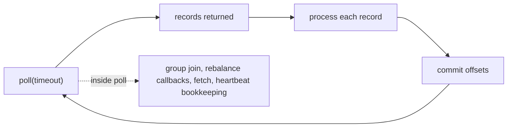
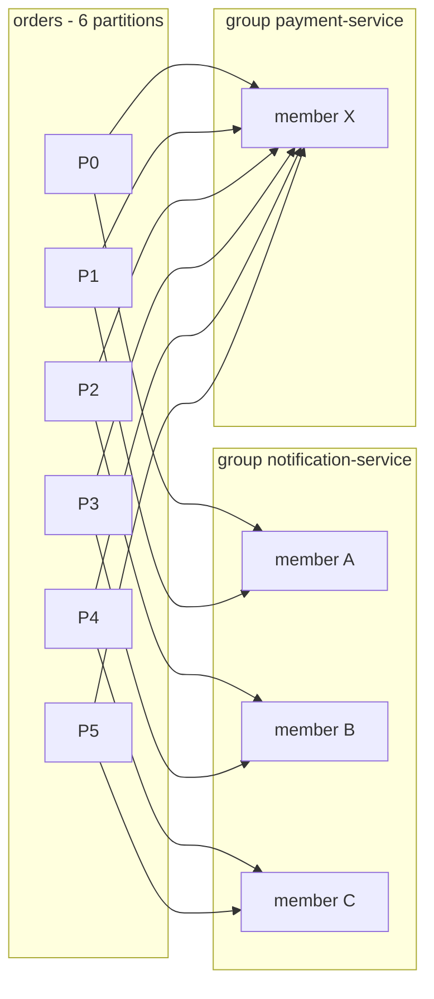

@part kafka-consumer-api | Kafka · Part 3b: The Java Consumer API | distributed
## The Consumer at a Glance

In ShopStream the `order-service` publishes an `OrderCreated` event to the `orders` topic. Somebody has to read it. The `notification-service` wants to e-mail the customer, the `payment-service` wants to charge the card, and each of them must see every order. The object that does the reading is a `KafkaConsumer`, the consumer class of the same `kafka-clients` library that holds the producer you met in *The Producer at a Glance*. This chapter writes the smallest useful consumer, explains the loop at its centre, and lists the rules that every later chapter builds on.

A producer is an engine that you hand records to. A consumer is the opposite: it is a loop that you drive. Kafka never pushes anything into your code. You call `poll()`, you get back whatever records have arrived, you process them, and you call `poll()` again. Everything else a consumer does (finding the brokers, joining its group, being told which partitions it owns, fetching data, sending heartbeats, committing offsets) happens inside or around that call.

### Your first consumer

The project setup is the one from the producer chapter: `kafka-clients` 4.3.1 plus `slf4j-api` and `slf4j-simple`. Only three settings are required to start reading: `bootstrap.servers`, `key.deserializer` and `value.deserializer`. A fourth one, `group.id`, is required as soon as you use `subscribe()`, which is almost always.

```java FirstConsumer.java
package com.shopstream.consumer;

import java.time.Duration;
import java.util.List;
import java.util.Properties;
import org.apache.kafka.clients.consumer.ConsumerConfig;
import org.apache.kafka.clients.consumer.ConsumerRecord;
import org.apache.kafka.clients.consumer.ConsumerRecords;
import org.apache.kafka.clients.consumer.KafkaConsumer;
import org.apache.kafka.common.serialization.StringDeserializer;

public class FirstConsumer {

    public static void main(String[] args) {
        Properties props = new Properties();
        props.put(ConsumerConfig.BOOTSTRAP_SERVERS_CONFIG, "localhost:9092");
        props.put(ConsumerConfig.GROUP_ID_CONFIG, "notification-service");
        props.put(ConsumerConfig.KEY_DESERIALIZER_CLASS_CONFIG, StringDeserializer.class.getName());
        props.put(ConsumerConfig.VALUE_DESERIALIZER_CLASS_CONFIG, StringDeserializer.class.getName());
        props.put(ConsumerConfig.AUTO_OFFSET_RESET_CONFIG, "earliest");

        try (KafkaConsumer<String, String> consumer = new KafkaConsumer<>(props)) {
            consumer.subscribe(List.of("orders"));
            while (true) {
                ConsumerRecords<String, String> records = consumer.poll(Duration.ofSeconds(1));
                for (ConsumerRecord<String, String> record : records) {
                    System.out.printf("%s-%d@%d key=%s value=%s%n",
                            record.topic(), record.partition(), record.offset(),
                            record.key(), record.value());
                }
            }
        }
    }
}
```

**What to notice.** `group.id` names the consumer group. Every instance of the `notification-service` uses the same name, so Kafka treats them as one logical reader and shares the partitions between them. `auto.offset.reset=earliest` only matters the first time a group runs: with no stored position, it starts at the beginning of each partition instead of at the end. The `try`-with-resources block closes the consumer, which tells the broker that this member has left. And the loop never ends, because a consumer is a long-running service.

Run the producer from the earlier chapter in a second terminal and the records appear here with their partition and offset. Start a second copy of this program and watch the partitions of `orders` split between the two.

### What poll() really does

`poll(Duration)` looks like "get me some records", but it is the heart of the client. In a single call it can:

- connect to the cluster and find the **group coordinator** (a broker) on the first call;
- take part in a **rebalance**, which means joining the group and receiving the partitions you now own;
- **fetch** data from the partition leaders and hand you the records that are ready;
- **commit** offsets if auto-commit is on and the interval has passed;
- run your **rebalance callbacks**, on your own thread, inside the call.

The timeout is a maximum, not a delay. If records are already buffered, `poll()` returns at once. If nothing arrives, it returns an empty `ConsumerRecords` after the timeout, and your loop simply goes round again.



This loop shape is why the **time between two `poll()` calls** is a health signal. If your processing of one batch takes longer than `max.poll.interval.ms` (5 minutes by default), the client assumes the thread is stuck and leaves the group. *Rebalancing in Practice* returns to this.

### What a record carries

A `ConsumerRecord<K, V>` is read-only and carries everything the broker stored plus where it came from:

| Accessor | Meaning |
|---|---|
| `topic()`, `partition()` | Where the record lives |
| `offset()` | Its position in that partition, starting at 0 |
| `key()`, `value()` | The deserialized key and value (either can be `null`) |
| `timestamp()`, `timestampType()` | `CreateTime` (set by the producer) or `LogAppendTime` (set by the broker) |
| `headers()` | Key-value metadata that is not part of the business payload |
| `leaderEpoch()` | Which leader generation wrote it (used internally to detect log truncation) |

A `null` value is legal and meaningful: on a compacted topic it is a **tombstone** that means "delete this key". A listener that calls `record.value().length()` without a check will fail on the first one.

### subscribe() or assign()

There are two ways to tell the consumer what to read, and they exclude each other in one consumer instance.

| | `subscribe(topics)` | `assign(partitions)` |
|---|---|---|
| Who chooses the partitions | The group: Kafka balances them between members | You: a fixed list of `TopicPartition` |
| Rebalancing | Yes | None |
| `group.id` required | Yes | No (needed only if you commit offsets) |
| Reacts to a member crashing | Yes, partitions move to survivors | No, nobody takes over |
| Typical use | Application services scaling out | Tools, replays, a service that stores its own offsets |

`subscribe` also accepts a regular expression (`subscribe(Pattern.compile("orders\\..*"))`), which picks up new matching topics when the metadata refreshes. Use it sparingly: topic creation then changes your group's subscription and triggers a rebalance.

### One thread per consumer

!warning Gotcha: KafkaConsumer is not thread-safe :: Calling `poll()`, `commitSync()` or `seek()` from two threads throws `ConcurrentModificationException: KafkaConsumer is not safe for multi-threaded access`. The single exception is `wakeup()`, which is designed to be called from another thread to break a blocked `poll()` (used for shutdown, see the last chapter of this Part). A consumer belongs to the thread that polls it. If you want parallelism, you create one consumer per thread or hand work to a pool, and *Fetching, Throughput and Parallelism* shows both.

!interview Interview angle: Is KafkaConsumer thread-safe? How do you stop it from another thread? :: No. All calls must come from one thread at a time, and the client checks this and throws `ConcurrentModificationException`. The one thread-safe method is `wakeup()`: it makes the current or next blocking call throw `WakeupException`, so a shutdown hook can call `wakeup()`, the polling thread catches the exception, commits what it has finished and closes the consumer.

!keypoints A consumer is a loop you drive: you call `poll()`, Kafka never pushes records ;; `poll()` also joins the group, runs rebalance callbacks, fetches and may auto-commit, so call it regularly ;; The timeout is a maximum wait, not a delay ;; `subscribe` lets the group balance partitions; `assign` gives you fixed partitions and no rebalancing ;; A `KafkaConsumer` instance belongs to one thread; only `wakeup()` may be called from outside ;; A `null` value is a tombstone, not an error

?? Why does a consumer need a `group.id`?
=> With `subscribe()`, the group id names the set of consumers that share a topic's partitions and the key under which their committed offsets are stored. Without it Kafka cannot balance partitions or remember where the group stopped.

?? What does `poll(Duration.ofSeconds(1))` do when no records are available?
=> It waits up to one second, then returns an empty `ConsumerRecords`. The timeout is the longest it will wait; it returns immediately when data is buffered. During the call it can also join the group, run rebalance callbacks and send fetch requests.

?? Two copies of the `notification-service` run with the same `group.id`, and a third service runs with a different one. Who sees which orders?
=> The two copies split the partitions of `orders` between them, so each record reaches exactly one of them. The third service is a separate group and receives every record. Groups are independent readers of the same log.

## Consumer Groups and Partition Assignment

A topic is split into partitions so that many machines can share the work. A **consumer group** is the mechanism that does the sharing on the reading side. The rule is short and has large consequences: *within one group, every partition is read by exactly one member at a time.*

### The rule and what follows from it

Take the `orders` topic with six partitions.



- **Groups are independent.** Both services see every record, because each group keeps its own position. Adding a new reader of `orders` never affects the others.
- **Inside a group, records are divided.** Each record reaches one member of the group, which is what makes a group behave like a work queue.
- **The partition count is the ceiling.** With six partitions, a seventh member in the same group receives nothing. It sits idle until another member leaves. This is why the partition count is chosen with future throughput in mind.
- **Ordering is per partition.** One member reads a partition in order. Two records of different partitions can be processed in any order, which is why `orderId` is the record key.

### Who is in charge: the group coordinator

For each group, one broker acts as its **group coordinator**. It is the leader of the partition of the internal `__consumer_offsets` topic that the group id hashes to (50 partitions by default). The coordinator knows the members, notices when one stops sending heartbeats, and stores the group's committed offsets. Clients find it automatically; you never configure it.

You can ask it about any group from the command line:

```bash Inspecting a group
kafka-consumer-groups.sh --bootstrap-server localhost:9092 \
  --describe --group notification-service --members --verbose
```

`--state` shows the group state. For a classic group: `Stable` when everything is assigned, `PreparingRebalance` or `CompletingRebalance` while members are changing, `Empty` when no member is connected but offsets are still stored, and `Dead` when the group has gone. Groups on the new protocol report their own states (for example while the coordinator is moving partitions), but `Stable` and `Empty` mean the same.

### Classic protocol: the assignors

By default, groups run the **classic rebalance protocol**. Members send `JoinGroup` to the coordinator. The coordinator picks one member as the group leader. That leader, inside your application process, runs a **partition assignor** to decide who gets what, and sends the result back through the coordinator in `SyncGroup`. The assignor is chosen with `partition.assignment.strategy`.

| Assignor | Rebalance style | Idea |
|---|---|---|
| `RangeAssignor` | Eager | Per topic, gives each member a contiguous range of partitions. Topics with the same partition count are co-partitioned: member A gets partition 0 and 1 of both `orders` and `payments`. Can be uneven when counts do not divide |
| `RoundRobinAssignor` | Eager | Deals all partitions of all subscribed topics out one by one |
| `StickyAssignor` | Eager | As balanced as round robin, but tries to keep each partition with its previous owner |
| `CooperativeStickyAssignor` | Cooperative | Same result as sticky, reached in two rounds so that members keep reading partitions that do not move |

The default list is `RangeAssignor, CooperativeStickyAssignor`. The group uses the first assignor that **every** member supports, so with the default a group runs `RangeAssignor` and the cooperative one is there only to make the migration possible. To move a group to cooperative rebalancing without downtime, first make sure that every member lists `CooperativeStickyAssignor` (the default already does), then roll out `partition.assignment.strategy=CooperativeStickyAssignor` on its own. Setting it on some members only, with others still on the old list, is the classic way to break a rolling deploy.

!tip Choose the assignor on purpose :: Use `CooperativeStickyAssignor` for services that scale out and restart often (Kubernetes). Keep `RangeAssignor` when a job joins two topics by partition number and needs partition *n* of both on the same member (a stream-stream join, for example).

### The new protocol (Kafka 4.0 and later)

Kafka 4.0 made a redesigned protocol, KIP-848, generally available. With it the **coordinator on the broker** computes the assignment, and members only send heartbeats that say what they subscribe to and which partitions they currently own. The coordinator moves partitions one member at a time: it asks the old owner to give a partition up, waits for the acknowledgement, then hands the partition to the new owner. There is no group-wide pause and no `JoinGroup`/`SyncGroup` barrier. A new member joining or a deploy restarting one pod disturbs only the partitions that move.

You opt in on the client:

```properties Opting in to the new group protocol
group.protocol=consumer
# optional: choose the server-side assignor (uniform is the default; range is the other)
group.remote.assignor=uniform
```

| | Classic protocol | New consumer protocol |
|---|---|---|
| Enable | Default | `group.protocol=consumer` on the client |
| Who computes the assignment | The group leader, in a client process | The coordinator, on the broker |
| Assignor setting | `partition.assignment.strategy` (client) | `group.remote.assignor` selects a server-side assignor |
| Liveness settings | `session.timeout.ms`, `heartbeat.interval.ms` (client) | Set on the broker for the group (`group.consumer.session.timeout.ms`, `group.consumer.heartbeat.interval.ms`) |
| Rebalance cost | Barrier for the whole group unless cooperative | Incremental by design |
| Custom assignors in your code | Yes | No (the assignor is a broker feature) |

`max.poll.interval.ms` and `max.poll.records` still apply, because they describe your processing loop. Whether you can use the new protocol also depends on the client library: the Java client supports it from 4.0, other clients vary, so check the library you use. For a service built on Spring Boot 4 (and so on a 4.x client) it is a configuration change you can try on one consumer group at a time.

### Share groups: a different model

Kafka 4.2 made **share groups** (KIP-932, the `KafkaShareConsumer` API) production-ready. They answer a different question. A normal group gives a partition to one member, which guarantees order and caps parallelism at the partition count. A share group lets **many members read the same partition**; the broker hands out records individually, and each record is acknowledged on its own (accept, release for redelivery, or reject), the way a work queue works.

| | Consumer group | Share group |
|---|---|---|
| Records per partition are read by | One member | Many members at once |
| Parallelism limit | Number of partitions | Not tied to partitions |
| Order within a partition | Guaranteed | Not guaranteed |
| Acknowledgement | Offset per partition (everything before it) | Per record |
| Fits | Event streams, per-key order, stateful processing | Background jobs, tasks of independent items |

For ShopStream, `orders.events` is a stream where the order of one order's events matters, so it belongs to normal groups. A pool of workers that resize product images, where any worker may take any job, is what share groups were designed for. They add no priorities or delayed delivery, so Kafka does not turn into a full job scheduler.

!interview Interview angle: What is the maximum useful number of consumers in a group, and how do you handle a hot partition? :: At most one per partition; extra members stay idle. A hot partition cannot be split by adding consumers, because one partition is read by one member. Fixes: a better key that spreads the load, more partitions (accepting that the key-to-partition mapping changes), or moving that workload to a share group when order does not matter.

!keypoints Within a group each partition has exactly one reader; across groups every group reads everything ;; The partition count is the ceiling on parallelism of a group ;; The group coordinator is a broker; it tracks members and stores offsets in `__consumer_offsets` ;; Classic protocol: the group leader runs an assignor; `CooperativeStickyAssignor` avoids stop-the-world rebalances ;; Kafka 4.0 added the broker-side protocol (`group.protocol=consumer`); you opt in per client ;; Share groups (production-ready in 4.2) give queue-style, per-record consumption without per-partition order

?? A topic has 4 partitions and a group has 6 members. What happens?
=> Four members each read one partition and two members are idle. They are standby: if an active member dies, an idle one takes over its partition after a rebalance.

?? Why do two topics that are both joined by a consumer often need the same partition count and the same key?
=> `RangeAssignor` gives the same member the same partition numbers of every topic, and the default partitioner maps a key to the same partition number in both. Together they put all records of one key on one member, which a join or a shared in-memory state needs.

?? Name two differences between the classic and the new group protocol.
=> The classic protocol computes assignments in a client process and stops the whole group during a rebalance unless the cooperative assignor is used; the new protocol computes them on the broker and moves partitions incrementally. Liveness settings also move from the client to the broker.

## Offsets and Commits

A consumer can stop, crash or be redeployed, and when it comes back it must continue where it left off. The memory that makes this possible is the **committed offset**: a number per partition, stored by the group, that says how far the group has progressed.

### Position and committed offset

Two numbers are easy to confuse:

- The **position** is the offset of the next record that this consumer will hand to you from `poll()`. It lives in the consumer's memory and moves forward with every poll.
- The **committed offset** is the position that has been saved on the broker. It is what a new or restarted member starts from.

!warning Gotcha: commit the offset of the next record, not of the last one :: The committed offset means "the next record to read". After processing the record at offset 41, the value to commit is 42. `commitSync()` without arguments does this for you by committing the current position. When you build the map yourself, write `new OffsetAndMetadata(record.offset() + 1)`. Committing `record.offset()` makes the group read the last processed record again after every restart.

Commits are stored as ordinary records in the internal compacted topic `__consumer_offsets`, keyed by *(group, topic, partition)*. The Kafka server keeps a group's offsets for `offsets.retention.minutes` (7 days by default) after the group becomes empty. A service that is stopped for longer than that loses its place and falls back to `auto.offset.reset`.

### Where a group starts: auto.offset.reset

When a group has **no committed offset** for a partition (a new group, or offsets that expired), or the committed offset points to a record that no longer exists, the consumer applies `auto.offset.reset`.

| Value | Behaviour |
|---|---|
| `latest` (default) | Start at the end: you see only records produced from now on |
| `earliest` | Start at the oldest record still in the partition |
| `none` | Throw an exception (`NoOffsetForPartitionException`) so that the application decides |
| `by_duration:<ISO-8601 duration>` | Start at the offset from that long ago, for example `by_duration:PT1H` (Kafka 4.0 and later) |

It is **not** applied on every start, only when no valid offset exists. Changing it for a group that already has offsets does nothing, and that is a frequent surprise: "I set `earliest` but the service still skips the old orders" means the group had committed offsets already. To replay, you reset the group's offsets (see below).

### Auto-commit and its limits

`enable.auto.commit` is `true` by default with `auto.commit.interval.ms=5000`. The consumer commits the offsets returned by the **previous** `poll()` from inside the next `poll()`, if the interval has passed. When all processing happens inside the loop, before the next `poll()`, a crash replays at most the work since the last commit, which gives **at-least-once** delivery. That is acceptable for idempotent work.

Auto-commit becomes dangerous when processing is **not finished** when `poll()` is called again: records handed to another thread, an async call that has not returned, a batch that you buffer for later. The next `poll()` commits their offsets, the process crashes, and those records are never read again: **at-most-once**, silently. For business code, switch auto-commit off and commit yourself.

### Committing manually

With `enable.auto.commit=false`, you decide when a record counts as done. Four calls matter:

| Call | Behaviour |
|---|---|
| `commitSync()` | Commits the position of everything returned by the last `poll()`. Blocks, retries retriable errors, throws if it cannot succeed |
| `commitSync(Map<TopicPartition, OffsetAndMetadata>)` | Commits exactly the offsets you give: use it to commit part of a batch |
| `commitAsync(callback)` | Sends the commit and returns; the callback reports the result. **Does not retry**, so that a late retry cannot overwrite a newer commit |
| `close()` | Commits pending auto-commit offsets (if enabled), leaves the group |

A pattern that is both fast and safe: commit asynchronously inside the loop, and synchronously once at the end.

```java CommitPatterns.java
package com.shopstream.consumer;

import java.time.Duration;
import java.util.HashMap;
import java.util.List;
import java.util.Map;
import java.util.Properties;
import org.apache.kafka.clients.consumer.ConsumerConfig;
import org.apache.kafka.clients.consumer.ConsumerRecord;
import org.apache.kafka.clients.consumer.ConsumerRecords;
import org.apache.kafka.clients.consumer.KafkaConsumer;
import org.apache.kafka.clients.consumer.OffsetAndMetadata;
import org.apache.kafka.common.TopicPartition;
import org.apache.kafka.common.errors.WakeupException;
import org.apache.kafka.common.serialization.StringDeserializer;
import org.slf4j.Logger;
import org.slf4j.LoggerFactory;

public class CommitPatterns {

    private static final Logger log = LoggerFactory.getLogger(CommitPatterns.class);

    static Properties config() {
        Properties props = new Properties();
        props.put(ConsumerConfig.BOOTSTRAP_SERVERS_CONFIG, "localhost:9092");
        props.put(ConsumerConfig.GROUP_ID_CONFIG, "payment-service");
        props.put(ConsumerConfig.KEY_DESERIALIZER_CLASS_CONFIG, StringDeserializer.class.getName());
        props.put(ConsumerConfig.VALUE_DESERIALIZER_CLASS_CONFIG, StringDeserializer.class.getName());
        props.put(ConsumerConfig.ENABLE_AUTO_COMMIT_CONFIG, "false");
        props.put(ConsumerConfig.AUTO_OFFSET_RESET_CONFIG, "earliest");
        return props;
    }

    /** Fast path: async commit after each batch, one sync commit before leaving. */
    static void asyncThenSync(KafkaConsumer<String, String> consumer) {
        try {
            while (true) {
                ConsumerRecords<String, String> records = consumer.poll(Duration.ofSeconds(1));
                for (ConsumerRecord<String, String> record : records) {
                    handle(record);
                }
                consumer.commitAsync((offsets, ex) -> {
                    if (ex != null) {
                        log.warn("async commit failed for {}", offsets, ex);   // the next commit will cover it
                    }
                });
            }
        } catch (WakeupException shutdown) {
            // expected on shutdown
        } finally {
            try {
                consumer.commitSync();       // last chance, with retries
            } finally {
                consumer.close();
            }
        }
    }

    /** Slow handlers: commit every N records so that a crash replays little. */
    static void commitEveryN(KafkaConsumer<String, String> consumer, int n) {
        Map<TopicPartition, OffsetAndMetadata> pending = new HashMap<>();
        int sinceCommit = 0;
        while (true) {
            for (ConsumerRecord<String, String> record : consumer.poll(Duration.ofSeconds(1))) {
                handle(record);
                pending.put(new TopicPartition(record.topic(), record.partition()),
                        new OffsetAndMetadata(record.offset() + 1));         // the NEXT offset
                if (++sinceCommit >= n) {
                    consumer.commitSync(pending);
                    pending.clear();
                    sinceCommit = 0;
                }
            }
        }
    }

    static void handle(ConsumerRecord<String, String> record) {
        // charge the card, write to the database ...
    }

    public static void main(String[] args) {
        try (KafkaConsumer<String, String> consumer = new KafkaConsumer<>(config())) {
            consumer.subscribe(List.of("orders"));
            asyncThenSync(consumer);
        }
    }
}
```

**What to notice.** The asynchronous callback only logs. Retrying a failed async commit would be wrong, because by then a later commit may already have succeeded and the retry would move the group *backwards*. The final `commitSync()` has no such risk, because nothing follows it. And `commitEveryN` keeps one entry per partition in `pending`, always the highest offset plus one.

When a commit fails with `CommitFailedException`, the group has already rebalanced and given your partitions to someone else; the records you processed will be processed again by the new owner. That is why handlers should be idempotent, and the next chapter shows how to commit in time when a partition is taken away.

### What the commit position means for delivery

| When you commit | Result after a crash | Delivery |
|---|---|---|
| Before processing | Records read but not processed are skipped | At most once |
| After processing | Records processed but not yet committed are read again | At least once |
| Atomically with the effect | Neither lost nor repeated | Exactly once for that effect |

The third row has two real implementations. Inside Kafka (read, process, write to another topic), **transactions** commit the produced records and the consumed offsets together; the producer calls `sendOffsetsToTransaction`, and downstream consumers use `isolation.level=read_committed` so that they see only committed transactions. See *Transactions in Spring Kafka* for the Spring form. For a database effect, the practical answer is an **idempotent consumer**: store a processed-event id with the effect, so that a replay does nothing; see *Idempotent Consumers and the Inbox Pattern*.

### Moving the position: seek, replay and reset

A consumer can go anywhere in a partition it owns:

| Call | Use |
|---|---|
| `seek(partition, offset)` | Jump to an exact offset (re-read after an error, skip a bad record) |
| `seekToBeginning(partitions)`, `seekToEnd(partitions)` | Start over, or skip the backlog |
| `offsetsForTimes(map)` | Find the first offset at or after a timestamp; combine with `seek` to replay "everything since 09:00" |
| `position(partition)`, `committed(set)` | Read the current position, or the last committed offset |
| `beginningOffsets(...)`, `endOffsets(...)`, `currentLag(partition)` | Compute how far behind you are |

These work on partitions the consumer currently owns, so do them after the assignment arrives (inside `onPartitionsAssigned`, or after the first `poll()`).

To reposition a **whole group** from outside, with every member stopped (the tool refuses to change a group that has active members), use the command line:

```bash Resetting a group's offsets
# show what would happen (no --execute means a dry run)
kafka-consumer-groups.sh --bootstrap-server localhost:9092 \
  --group payment-service --topic orders --reset-offsets --to-datetime 2026-10-30T09:00:00.000

# apply it
kafka-consumer-groups.sh --bootstrap-server localhost:9092 \
  --group payment-service --topic orders --reset-offsets --to-datetime 2026-10-30T09:00:00.000 --execute
```

The options are `--to-earliest`, `--to-latest`, `--to-offset`, `--to-datetime`, `--by-duration`, `--shift-by` (forward or backward from the current offset) and `--from-file`. `--shift-by 1` on one partition is the standard way to skip a single poison record, and the troubleshooting chapter of *Testing, Monitoring and Troubleshooting* walks through it.

!interview Interview angle: Your consumer processed an order and crashed before committing. What happens on restart, and how do you make that safe? :: The group resumes from the last committed offset, so the order is delivered again: at-least-once. It is made safe by making the handler idempotent (a unique processed-event id, an upsert, a conditional update) or by using Kafka transactions when the output is another Kafka topic. Committing *before* processing would trade duplicates for lost records, which is almost never the right trade.

!keypoints The committed offset is the NEXT record to read: commit `offset + 1` ;; `auto.offset.reset` applies only when the group has no valid committed offset ;; Auto-commit is fine when all work finishes inside the loop; it loses records when work is handed off ;; `commitAsync` never retries; finish with one `commitSync` before closing ;; `CommitFailedException` means a rebalance already moved the partition to someone else ;; Replay a group with `--reset-offsets` while it is stopped; replay one consumer with `seek`

?? A group has committed offset 120 for `orders-0`. Which record does it read first after a restart?
=> The record at offset 120. The committed offset names the next record to read, so records up to 119 count as done.

?? Why does `commitAsync` not retry on failure?
=> A retry could arrive after a newer commit and move the stored offset backwards, causing already processed records to be read again. The next successful commit supersedes a lost one anyway, and a final `commitSync` covers the shutdown case.

?? You changed `auto.offset.reset` to `earliest` but the service still ignores old orders. Why?
=> The group already has committed offsets, and the setting only applies when no valid offset exists. Reset the group's offsets with `kafka-consumer-groups.sh --reset-offsets` (with the group stopped), or use a new `group.id`.
