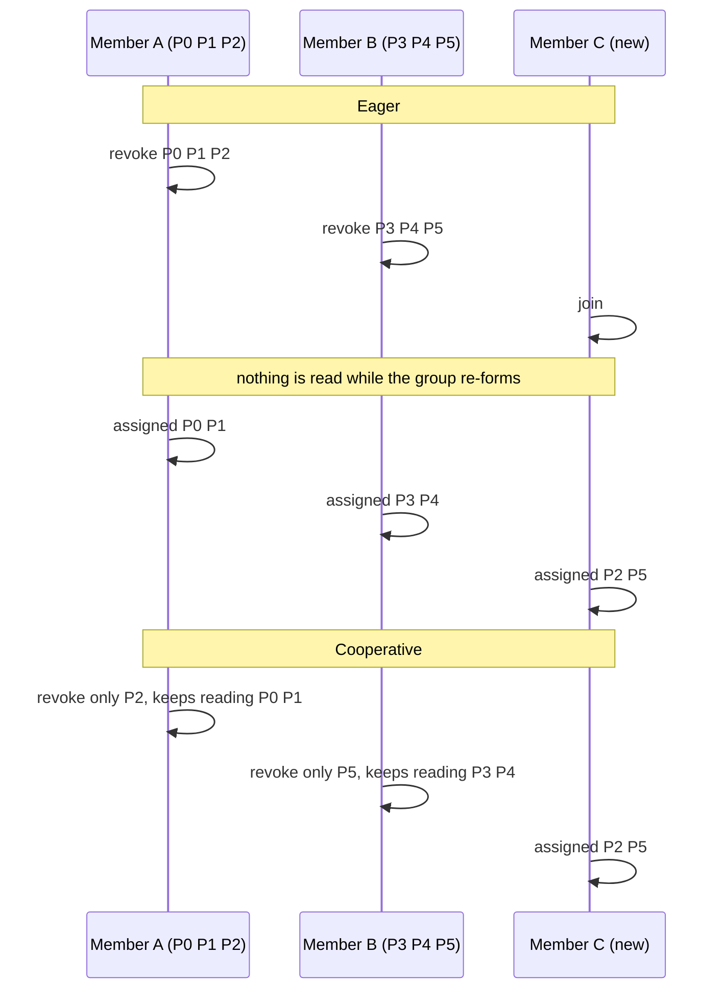

@more
## Rebalancing in Practice

A **rebalance** is the group deciding again who reads which partition. It is how Kafka survives a crashed pod and how it uses a new one, so it is not a fault. It becomes a problem when it happens too often, takes too long, or catches your code in the middle of unfinished work. This chapter explains what starts a rebalance, what the callbacks give you, and how to stop the avoidable ones.

### What starts a rebalance

- A member **joins** the group (a new pod, a restart).
- A member **leaves**: a clean `close()`, a crash that stops its heartbeats (`session.timeout.ms`), or a thread that does not call `poll()` within `max.poll.interval.ms`.
- The **subscription changes**: a topic matching a `subscribe(Pattern)` appears, or the partition count of a subscribed topic grows.
- An operator or the application forces one (`enforceRebalance()`, rarely).

### Eager and cooperative rebalances

With an **eager** protocol (`RangeAssignor`, `RoundRobinAssignor`, `StickyAssignor`) every rebalance is a stop-the-world event. Each member gives up all its partitions, the group re-forms, and everyone receives a fresh assignment, even partitions that end up exactly where they were. For the whole time, nobody reads anything.

With a **cooperative** protocol (`CooperativeStickyAssignor`, or the new broker-side protocol) members keep the partitions that do not move and only the moving ones pause.



### The rebalance listener

`subscribe(topics, listener)` lets you react. The three methods run on your polling thread, **inside** `poll()`:

| Callback | When | What to do |
|---|---|---|
| `onPartitionsRevoked(partitions)` | Before partitions are taken away. You still own them | Finish or flush work for these partitions and **commit their offsets** |
| `onPartitionsAssigned(partitions)` | After new partitions arrive | Load state, `seek` to a stored position, log |
| `onPartitionsLost(partitions)` | The partitions are already gone (session expired, member fenced). Defaults to calling `onPartitionsRevoked` | Do **not** commit: it would fail. Drop local state only |

Two details cause real bugs. With a cooperative protocol the collections are **incremental**: `onPartitionsRevoked` receives only the partitions that leave and `onPartitionsAssigned` only the ones that are added, so do not treat the argument as the full assignment (call `consumer.assignment()` for that). And with an eager protocol `onPartitionsRevoked` can be called with an empty collection on the first join, so handle that.

```java OffsetTrackingListener.java
package com.shopstream.consumer;

import java.util.Collection;
import java.util.HashMap;
import java.util.Map;
import org.apache.kafka.clients.consumer.Consumer;
import org.apache.kafka.clients.consumer.ConsumerRebalanceListener;
import org.apache.kafka.clients.consumer.ConsumerRecord;
import org.apache.kafka.clients.consumer.OffsetAndMetadata;
import org.apache.kafka.common.TopicPartition;
import org.slf4j.Logger;
import org.slf4j.LoggerFactory;

/** Remembers what is finished and commits it for exactly the partitions that leave. */
public class OffsetTrackingListener implements ConsumerRebalanceListener {

    private static final Logger log = LoggerFactory.getLogger(OffsetTrackingListener.class);

    private final Consumer<?, ?> consumer;
    private final Map<TopicPartition, OffsetAndMetadata> finished = new HashMap<>();

    public OffsetTrackingListener(Consumer<?, ?> consumer) {
        this.consumer = consumer;
    }

    /** Call after a record has been fully processed. */
    public void markFinished(ConsumerRecord<?, ?> record) {
        finished.put(new TopicPartition(record.topic(), record.partition()),
                new OffsetAndMetadata(record.offset() + 1));
    }

    /** Offsets for the regular commit. */
    public Map<TopicPartition, OffsetAndMetadata> snapshot() {
        return new HashMap<>(finished);
    }

    @Override
    public void onPartitionsRevoked(Collection<TopicPartition> partitions) {
        Map<TopicPartition, OffsetAndMetadata> toCommit = new HashMap<>();
        for (TopicPartition tp : partitions) {
            OffsetAndMetadata offset = finished.remove(tp);
            if (offset != null) {
                toCommit.put(tp, offset);
            }
        }
        if (!toCommit.isEmpty()) {
            log.info("revoked {}, committing {}", partitions, toCommit);
            consumer.commitSync(toCommit);          // still the owner: this succeeds
        }
    }

    @Override
    public void onPartitionsLost(Collection<TopicPartition> partitions) {
        log.warn("lost {}: another member owns them now, dropping local state", partitions);
        partitions.forEach(finished::remove);       // committing here would throw
    }

    @Override
    public void onPartitionsAssigned(Collection<TopicPartition> partitions) {
        log.info("assigned {}, full assignment is now {}", partitions, consumer.assignment());
    }
}
```

**What to notice.** The class commits only for the partitions in the argument, so under a cooperative protocol the partitions that stay keep their normal commit schedule. If your loop already commits after **every** batch before the next `poll()`, this listener has nothing to do: rebalance callbacks run only inside `poll()`, at which point everything is committed. You need it when you commit less often than you poll (every N records, or on a timer) or when you keep records in a buffer.

### Three clocks: heartbeat, session and poll interval

Liveness is judged by three separate settings, and they catch three different failures.

| Setting | Default | Catches | What the group does |
|---|---|---|---|
| `heartbeat.interval.ms` | 3 s | Not a detector: how often a background thread pings the coordinator | Keep it at most a third of the session timeout |
| `session.timeout.ms` | 45 s | The process died or cannot reach the broker (no heartbeats) | Coordinator removes the member and rebalances |
| `max.poll.interval.ms` | 5 min | The process is alive, but the thread is stuck or too slow between `poll()` calls | The client leaves the group itself; your partitions move |
| `max.poll.records` | 500 | Not a detector: caps the batch you get from one `poll()` | Lets you bound the time one batch takes |

The heartbeat thread keeps running while your code is busy, which is why a hung handler is *not* detected by the session timeout. The poll interval is the only guard against it. A rule that keeps you safe: **`max.poll.records` times the worst-case time per record must stay well below `max.poll.interval.ms`**. With 500 records and 2 seconds per record in a bad moment, one batch needs 1,000 seconds, far above 300. Lower `max.poll.records` before you raise the interval.

When the interval is exceeded, the symptoms are always the same: the log line `consumer poll timeout has expired`, a `CommitFailedException` on the next commit, a rebalance, and records that are processed twice, because the new owner starts from the last commit.

### Rebalance storms

A single slow batch can start a chain reaction. A member exceeds the poll interval and leaves; its partitions move to the others; they now have more to do, so they too exceed the interval; each leaving member triggers another rebalance, and rebalances themselves stop reading. Garbage-collection pauses longer than the session timeout, and rolling deploys that restart pods one after another, produce the same pattern.

| Cause | Remedy |
|---|---|
| Rolling deploy restarts every pod | **Static membership**: a stable `group.instance.id` per member, so a quick restart does not leave the group |
| Eager assignor | Move to `CooperativeStickyAssignor` or to the new group protocol |
| Batches too slow | Lower `max.poll.records`, speed up the handler, or hand work to a pool with pause and resume |
| GC pauses, CPU starvation | Size the heap and CPU limits; make `session.timeout.ms` longer than the longest pause |
| Autoscaler adds and removes pods in a loop | Add stabilisation windows; scale on lag, not on CPU alone |

**Static membership** works like this. With `group.instance.id=notification-2`, the coordinator remembers the member and its partitions for `session.timeout.ms` after it disappears. If the same instance id comes back within that time, it simply gets its partitions back and the group never rebalances. A clean `close()` of a static member does not send a leave request. The id must be **unique and stable**: two live members with the same id make the older one fail with `FencedInstanceIdException`, and an id based on a random pod name changes at every restart and gives no benefit. In Kubernetes use a StatefulSet, or an ordinal you control.

!warning Gotcha: a long session timeout hides real failures :: Static membership is usually paired with a larger `session.timeout.ms` (a few minutes) so that a restart fits inside it. The price is that a member that really died keeps its partitions for that long, and those partitions are not read. Pick a value just above your normal restart time.

### Seeing rebalances

The client logs the reason at INFO level: look for `Request joining group due to:` and for the poll-timeout message above. As metrics (group `consumer-coordinator-metrics`): `rebalance-total`, `rebalance-latency-avg`, `failed-rebalance-total`, `last-rebalance-seconds-ago` and `assigned-partitions`. A group that rebalances every few minutes without any deploy has a liveness problem, not bad luck.

!interview Interview angle: Consumers keep leaving and rejoining the group, lag rises, and the logs mention `max.poll.interval.ms`. What do you do? :: The handler is taking longer than the poll interval for one batch. Reduce `max.poll.records` so a batch finishes in time, find and fix the slow call (a database query, a downstream HTTP call without a timeout), and only then consider raising `max.poll.interval.ms`. Add static membership and cooperative rebalancing to keep restarts cheap, and make the handler idempotent because the partition's records will be delivered again.

!keypoints A rebalance is normal; frequent or long ones are the problem ;; Eager protocols stop the whole group; cooperative and the new protocol move only the partitions that change ;; `onPartitionsRevoked` is the last chance to commit; `onPartitionsLost` is too late and must not commit ;; Cooperative callbacks receive only the changed partitions, not the full assignment ;; The session timeout detects dead processes; the poll interval detects stuck or slow ones ;; Keep `max.poll.records` times worst-case record time well below `max.poll.interval.ms` ;; Static membership (`group.instance.id`) removes rebalances caused by quick restarts

?? When does `onPartitionsLost` run instead of `onPartitionsRevoked`, and why must it not commit?
=> It runs when the member has already lost its partitions without a chance to hand them over, for example after a session timeout or when it was fenced. Another member owns them now, so a commit from this member is rejected; you should only clean up local state.

?? A handler is fast on average but occasionally takes 6 minutes for a batch. What breaks and how do you fix it?
=> The thread does not call `poll()` within the 5-minute `max.poll.interval.ms`, so the client leaves the group, the partitions are reassigned and the batch is processed again by someone else. Reduce `max.poll.records` or the work per record, set timeouts on the slow call, or move the slow work to a worker pool while the polling thread keeps polling with the partitions paused.

?? Why does a Deployment with random pod names get no benefit from `group.instance.id`?
=> The id is only useful if the restarted member presents the same id. A new random pod name is a new member, so the coordinator sees a join instead of a return, and the old entry waits out the session timeout.

## Fetching, Throughput and Parallelism

When a consumer is too slow, the temptation is to add threads. Sometimes that is right, but first you need to know where the time goes: waiting for data, receiving it, or processing it. This chapter follows a record from the broker to your method and shows the settings and the parallelism patterns that apply at each step.

### How records reach poll()

The consumer sends **fetch requests** to the leader of each partition it owns. The broker answers when it has `fetch.min.bytes` of data or when `fetch.max.wait.ms` has passed, whichever comes first. Responses are kept in a buffer inside the consumer. `poll()` then simply takes up to `max.poll.records` records out of that buffer, which is why it often returns instantly.

| Setting | Default | Effect |
|---|---|---|
| `fetch.min.bytes` | 1 | The broker answers as soon as any data exists. Raise it (for example to 64 KB or more) for fewer, bigger responses and better throughput, at the cost of latency |
| `fetch.max.wait.ms` | 500 | The longest the broker holds a fetch open waiting for `fetch.min.bytes`. This is the latency ceiling when traffic is low |
| `max.partition.fetch.bytes` | 1 MB | Per-partition cap on one response. A larger single batch is still returned, so a consumer never gets stuck on a big record |
| `fetch.max.bytes` | 50 MB | Cap on the whole response across partitions |
| `max.poll.records` | 500 | How many records one `poll()` hands to your code. It does not change how much is fetched |

For a **low-latency** consumer, leave the defaults: with `fetch.min.bytes=1` records come back as soon as they exist. For a **throughput** consumer (a nightly analytics load), raise `fetch.min.bytes` and `max.partition.fetch.bytes` so that each request carries more data. Compression is transparent: the consumer decompresses for you, which costs CPU on your side.

!tip Fetching is rarely the bottleneck :: Measure first. `fetch-latency-avg` and `records-per-request-avg` (group `consumer-fetch-manager-metrics`) tell you whether fetching is slow. If the time between polls (`time-between-poll-avg`) is large and `poll-idle-ratio-avg` is low, the time goes into **your handler**, and no fetch setting will help.

### Reading from a nearby replica

By default every fetch goes to the partition leader, which in a three-zone cloud deployment often means traffic across zones. Since Kafka 2.4 a consumer can fetch from a follower in its own rack (KIP-392). Set `client.rack` on the consumer to its zone, and on the brokers `broker.rack` and `replica.selector.class=org.apache.kafka.common.replica.RackAwareReplicaSelector`. Reads then stay in the zone, and you save cross-zone cost. See *Replication: Leaders, Followers and the ISR* for what followers know about the log.

### Lag: the number that matters

**Lag** of a partition is the distance between the newest record (the log end offset) and the position of the group. It is the amount of work waiting. Three ways to read it:

- From the command line: `kafka-consumer-groups.sh --describe --group payment-service` (the `LAG` column).
- Inside the client: `consumer.currentLag(partition)` returns an `OptionalLong` computed from cached fetch information (empty when nothing is known yet), and `endOffsets(...)` minus `position(...)` gives the same figure with a network call.
- As a metric: `records-lag-max` in `consumer-fetch-manager-metrics`, and `records-lag` per partition.

A growing lag means your group is slower than the producers. Count alone is not enough: a lag of 10,000 records at 5,000 records per second is two seconds; at 10 records per second it is a quarter of an hour. *Testing, Monitoring and Troubleshooting* turns this into alerts.

### Pattern 1: one consumer per thread

The simplest way to use more cores is more consumers in the same group. Each runs its own loop on its own thread, owns its own partitions, and keeps per-partition order. Spring Kafka's `concurrency` setting does exactly this.

```java ConsumerPool.java
package com.shopstream.consumer;

import java.time.Duration;
import java.util.ArrayList;
import java.util.List;
import java.util.Properties;
import java.util.concurrent.ExecutorService;
import java.util.concurrent.Executors;
import java.util.concurrent.TimeUnit;
import java.util.concurrent.atomic.AtomicBoolean;
import org.apache.kafka.clients.consumer.ConsumerConfig;
import org.apache.kafka.clients.consumer.ConsumerRecord;
import org.apache.kafka.clients.consumer.KafkaConsumer;
import org.apache.kafka.common.errors.WakeupException;

public class ConsumerPool {

    private final List<Loop> loops = new ArrayList<>();
    private final ExecutorService executor;

    public ConsumerPool(int threads, Properties base, List<String> topics) {
        this.executor = Executors.newFixedThreadPool(threads);
        for (int i = 0; i < threads; i++) {
            Properties props = new Properties();
            props.putAll(base);
            props.put(ConsumerConfig.CLIENT_ID_CONFIG, "payment-" + i);   // distinct ids make metrics readable
            Loop loop = new Loop(new KafkaConsumer<>(props), topics);
            loops.add(loop);
            executor.submit(loop);
        }
    }

    public void shutdown() throws InterruptedException {
        loops.forEach(Loop::stop);
        executor.shutdown();
        executor.awaitTermination(30, TimeUnit.SECONDS);
    }

    static final class Loop implements Runnable {
        private final KafkaConsumer<String, String> consumer;
        private final List<String> topics;
        private final AtomicBoolean stopped = new AtomicBoolean();

        Loop(KafkaConsumer<String, String> consumer, List<String> topics) {
            this.consumer = consumer;
            this.topics = topics;
        }

        @Override
        public void run() {
            try {
                consumer.subscribe(topics);
                while (!stopped.get()) {
                    for (ConsumerRecord<String, String> record : consumer.poll(Duration.ofSeconds(1))) {
                        process(record);
                    }
                    consumer.commitSync();
                }
            } catch (WakeupException e) {
                if (!stopped.get()) {
                    throw e;                       // a wakeup nobody asked for
                }
            } finally {
                consumer.close();
            }
        }

        void stop() {
            stopped.set(true);
            consumer.wakeup();                     // the only thread-safe call
        }

        private void process(ConsumerRecord<String, String> record) {
            // the business logic
        }
    }
}
```

**What to notice.** The constructor creates each `KafkaConsumer` on the calling thread but only *uses* it on its own pool thread, which is allowed because no two threads use it at the same time. `stop()` sets a flag and then calls `wakeup()`, so a loop blocked in `poll()` ends promptly. With six partitions and eight threads, two threads are idle: more threads than partitions achieve nothing.

### Pattern 2: one polling thread, many workers

When the handler waits on slow I/O, one thread per partition wastes memory and caps you at the partition count. The alternative is to let the polling thread do **only** polling and committing, and give each partition's batch to a pool. The partition is **paused** while its batch is processed, so `poll()` keeps the membership alive and returns nothing for that partition, and **resumed** after the batch is done and its offsets are committed.

```java PartitionWorkers.java
package com.shopstream.consumer;

import java.time.Duration;
import java.util.HashMap;
import java.util.Iterator;
import java.util.List;
import java.util.Map;
import java.util.concurrent.ExecutionException;
import java.util.concurrent.ExecutorService;
import java.util.concurrent.Executors;
import java.util.concurrent.Future;
import org.apache.kafka.clients.consumer.ConsumerRecord;
import org.apache.kafka.clients.consumer.ConsumerRecords;
import org.apache.kafka.clients.consumer.KafkaConsumer;
import org.apache.kafka.clients.consumer.OffsetAndMetadata;
import org.apache.kafka.common.TopicPartition;

public class PartitionWorkers {

    private record Work(long firstOffset, long nextOffset, Future<?> future) { }

    private final KafkaConsumer<String, String> consumer;
    private final ExecutorService workers = Executors.newFixedThreadPool(8);
    private final Map<TopicPartition, Work> inFlight = new HashMap<>();
    private volatile boolean running = true;

    public PartitionWorkers(KafkaConsumer<String, String> consumer) {
        this.consumer = consumer;
    }

    public void run() {
        while (running) {
            ConsumerRecords<String, String> records = consumer.poll(Duration.ofMillis(200));
            for (TopicPartition tp : records.partitions()) {
                List<ConsumerRecord<String, String>> batch = records.records(tp);
                consumer.pause(List.of(tp));                            // no new records for tp meanwhile
                inFlight.put(tp, new Work(
                        batch.get(0).offset(),
                        batch.get(batch.size() - 1).offset() + 1,
                        workers.submit(() -> batch.forEach(this::handle))));
            }
            finishCompleted();
        }
    }

    private void finishCompleted() {
        Map<TopicPartition, OffsetAndMetadata> done = new HashMap<>();
        Iterator<Map.Entry<TopicPartition, Work>> it = inFlight.entrySet().iterator();
        while (it.hasNext()) {
            Map.Entry<TopicPartition, Work> e = it.next();
            if (!e.getValue().future().isDone()) {
                continue;
            }
            it.remove();
            try {
                e.getValue().future().get();
                done.put(e.getKey(), new OffsetAndMetadata(e.getValue().nextOffset()));
            } catch (ExecutionException | InterruptedException failure) {
                consumer.seek(e.getKey(), e.getValue().firstOffset()); // read the batch again
            }
            consumer.resume(List.of(e.getKey()));
        }
        if (!done.isEmpty()) {
            consumer.commitSync(done);
        }
    }

    private void handle(ConsumerRecord<String, String> record) {
        // slow I/O
    }

    public void stop() {
        running = false;
    }
}
```

This is the shape that frameworks implement for you, and it hides traps:

- **A rebalance during processing.** Partitions can be revoked while a worker still runs. The new owner then processes the same records. Handlers must be idempotent, and a production version must wait for or cancel the in-flight work in `onPartitionsRevoked`.
- **Order inside a partition** is kept only because a partition has at most one batch in flight. Two batches of the same partition running in parallel would break it.
- **Failures.** The sketch seeks back and retries forever; a real one needs a retry limit and a dead-letter topic.
- **Pause state and rebalances.** With some protocols the pause state does not survive a reassignment; re-pause partitions that still have work in `onPartitionsAssigned`.

Use this pattern only when you have measured that blocking I/O is the problem and the partition count is the limit. Otherwise Pattern 1, or more partitions, is simpler and safer.

!tip Virtual threads change the cost of blocking, not the rules :: A virtual thread can run a consumer loop, and cheap threads make "wait for an HTTP call" less expensive. They do not remove the ceiling of one reader per partition, and they do not make it safe to process two records of the same partition at once. The ordering rules above stay as they are.

### When the consumer cannot keep up

| Symptom | Options, in the order to try them |
|---|---|
| Lag grows, handler is CPU-bound | Optimise the handler, add members (up to the partition count) |
| Lag grows, handler waits on a database | Batch the writes (one bulk insert per poll instead of one per record), add an index, add a connection pool of the right size |
| Lag grows, handler waits on a remote API | Timeouts and bulkheads first; then Pattern 2, or a queue-like share group if order does not matter |
| All members are busy and the partition count is the limit | Add partitions (this remaps keys; see the Producer part), or split the work across topics |
| One partition is far behind the others | A hot key or a stuck record: look at keys and at the last error for that partition |

!interview Interview angle: You have 12 partitions and your consumer lag grows. You scale the service from 12 to 24 pods. Does it help? :: No. A group has at most one member per partition, so 12 of the 24 pods are idle. To use more consumers you need more partitions, which changes the key-to-partition mapping and so breaks per-key order across the change. The better first steps are making the handler faster, batching its I/O, or moving the work that needs no ordering to a different mechanism.

!keypoints Fetch settings tune how data crosses the network; `max.poll.records` only limits what poll hands to your code ;; Raise `fetch.min.bytes` for throughput, leave the defaults for latency ;; Lag is the work waiting; judge it as time to drain, not only as a count ;; One consumer per thread is the simple way to scale; threads beyond the partition count are idle ;; A polling thread plus workers needs pause, resume, in-order batches per partition and idempotent handlers ;; Follower fetching (`client.rack`) cuts cross-zone traffic

?? What is the difference between `fetch.min.bytes` and `max.poll.records`?
=> `fetch.min.bytes` controls how much data the broker waits for before answering a fetch request, so it shapes network traffic and latency. `max.poll.records` caps how many already fetched records one `poll()` returns to your code, so it shapes the size of a processing batch.

?? Why must a partition be paused while a worker processes its batch?
=> Otherwise the next `poll()` would return more records of that partition while the previous batch is still running, which could run two batches of one partition in parallel and break per-partition order. Pausing keeps polling (and group membership) alive while returning nothing for that partition.

?? How would you compute the lag of one partition in code?
=> Subtract the position from the log end offset: `consumer.endOffsets(List.of(tp)).get(tp) - consumer.position(tp)`, or read it from local information with `consumer.currentLag(tp)`, which returns an `OptionalLong`.

## Failures, Shutdown and Testing a Plain Consumer

Everything so far assumed that records are valid and handlers succeed. Production does not. This chapter handles the three failures a plain consumer must handle itself (a record that cannot be deserialized, a handler that keeps failing, and a request to stop), then assembles them into one class and tests it without a broker.

### The poison pill that never reaches your code

If a record cannot be deserialized, `poll()` itself throws a `RecordDeserializationException`. Your handler never sees it, and the failure is not tied to a processing attempt: the consumer's position has not moved, so the **next** `poll()` fetches the same bytes and throws again. The loop spins, committing nothing, forever.

The exception tells you where the problem is. `topicPartition()` and `offset()` name the record, and recent clients also carry the raw `keyBuffer()`, `valueBuffer()` and `headers()`, so the bytes are not lost. The standard answer is to **park the record and skip it**: write it to a dead-letter topic, then `seek` past it.

```java Parking an undecodable record
try {
    records = consumer.poll(Duration.ofSeconds(1));
} catch (RecordDeserializationException e) {
    deadLetter(e);                                              // keep the bytes
    consumer.seek(e.topicPartition(), e.offset() + 1);          // move on
    continue;
}
```

!warning Gotcha: skipping without parking is silent data loss :: Logging the offset and seeking past it removes the record from the pipeline, and by the time somebody investigates, the retention period may have deleted the original. Always write the raw bytes and the reason to a dead-letter topic first, and make sure that write has succeeded before you seek.

### A handler that fails

A handler can throw because of a bug, a missing reference, or a downstream outage. These need different reactions, and the plain client gives you no framework for them, so the policy is yours. A sound default for a plain consumer:

1. **Retry a few times in place**, with a short back-off, for failures that are probably temporary. This blocks the partition, so keep the total well below `max.poll.interval.ms`.
2. **Then park the record** on a dead-letter topic with the exception message in a header, wait for the write to be acknowledged, and continue.
3. **Never swallow the exception** and carry on without parking: that is the same silent loss as above.
4. If the dead-letter write itself fails, **stop**: do not commit, let the process end or retry, so that nothing is lost.

*Error Handling in Spring Kafka Listeners* and *Non-Blocking Retries with @RetryableTopic* show how Spring packages these decisions, including retry topics that avoid blocking the partition at all.

### Stopping cleanly

A consumer that is killed in the middle of a batch causes duplicates; one that stops cleanly does not. The pattern from the first chapters is: a shutdown hook calls `wakeup()`; the polling thread catches `WakeupException`; it finishes or abandons the current batch, commits what is done, and calls `close()`. `close()` waits (up to 30 seconds by default) for the final commit and then sends a leave request, so the group rebalances immediately instead of waiting for the session timeout.

### One production-shaped consumer

The class below combines the pieces. It takes the `Consumer` and `Producer` **interfaces** rather than concrete clients, which is what lets the next section test it without a broker.

```java OrderConsumer.java
package com.shopstream.consumer;

import java.nio.ByteBuffer;
import java.nio.charset.StandardCharsets;
import java.time.Duration;
import java.util.List;
import java.util.concurrent.CountDownLatch;
import java.util.concurrent.TimeUnit;
import org.apache.kafka.clients.consumer.Consumer;
import org.apache.kafka.clients.consumer.ConsumerRecord;
import org.apache.kafka.clients.consumer.ConsumerRecords;
import org.apache.kafka.clients.producer.Producer;
import org.apache.kafka.clients.producer.ProducerRecord;
import org.apache.kafka.common.errors.RecordDeserializationException;
import org.apache.kafka.common.errors.WakeupException;
import org.slf4j.Logger;
import org.slf4j.LoggerFactory;

public class OrderConsumer implements Runnable {

    @FunctionalInterface
    public interface RecordHandler {
        void handle(ConsumerRecord<String, String> record) throws Exception;
    }

    private static final Logger log = LoggerFactory.getLogger(OrderConsumer.class);
    private static final String DLT = "orders-dlt";
    private static final int MAX_ATTEMPTS = 3;

    private final Consumer<String, String> consumer;
    private final Producer<byte[], byte[]> dltProducer;
    private final RecordHandler handler;
    private final CountDownLatch stopped = new CountDownLatch(1);

    public OrderConsumer(Consumer<String, String> consumer,
                         Producer<byte[], byte[]> dltProducer,
                         RecordHandler handler) {
        this.consumer = consumer;
        this.dltProducer = dltProducer;
        this.handler = handler;
    }

    @Override
    public void run() {
        try {
            consumer.subscribe(List.of("orders"));
            while (true) {
                ConsumerRecords<String, String> records;
                try {
                    records = consumer.poll(Duration.ofMillis(500));
                } catch (RecordDeserializationException e) {
                    parkUndecodable(e);
                    consumer.seek(e.topicPartition(), e.offset() + 1);
                    continue;
                }
                for (ConsumerRecord<String, String> record : records) {
                    handleWithRetry(record);
                }
                if (!records.isEmpty()) {
                    consumer.commitSync();                  // after the whole batch is done or parked
                }
            }
        } catch (WakeupException shutdown) {
            log.info("shutdown requested");
        } finally {
            stopped.countDown();
        }
    }

    /** Called from another thread (a shutdown hook). */
    public void shutdown() throws InterruptedException {
        consumer.wakeup();
        stopped.await(30, TimeUnit.SECONDS);
    }

    private void handleWithRetry(ConsumerRecord<String, String> record) {
        for (int attempt = 1; ; attempt++) {
            try {
                handler.handle(record);
                return;
            } catch (Exception ex) {
                if (attempt >= MAX_ATTEMPTS) {
                    park(record, ex);
                    return;
                }
                log.warn("attempt {} failed for {}-{}@{}", attempt,
                        record.topic(), record.partition(), record.offset(), ex);
                pause(200L * attempt);                       // short and bounded
            }
        }
    }

    private void park(ConsumerRecord<String, String> record, Exception ex) {
        ProducerRecord<byte[], byte[]> dead = new ProducerRecord<>(DLT,
                record.key() == null ? null : record.key().getBytes(StandardCharsets.UTF_8),
                record.value() == null ? null : record.value().getBytes(StandardCharsets.UTF_8));
        dead.headers().add("dlt-reason", String.valueOf(ex.getMessage()).getBytes(StandardCharsets.UTF_8));
        dead.headers().add("dlt-origin", (record.topic() + "-" + record.partition() + "@" + record.offset())
                .getBytes(StandardCharsets.UTF_8));
        sendAndWait(dead);
    }

    private void parkUndecodable(RecordDeserializationException e) {
        ProducerRecord<byte[], byte[]> dead = new ProducerRecord<>(DLT, bytes(e.keyBuffer()), bytes(e.valueBuffer()));
        dead.headers().add("dlt-reason", String.valueOf(e.getMessage()).getBytes(StandardCharsets.UTF_8));
        sendAndWait(dead);
    }

    private void sendAndWait(ProducerRecord<byte[], byte[]> dead) {
        try {
            dltProducer.send(dead).get(10, TimeUnit.SECONDS);   // must succeed before we move on
        } catch (Exception failure) {
            throw new IllegalStateException("dead-letter write failed; stopping without committing", failure);
        }
    }

    private static byte[] bytes(ByteBuffer buffer) {
        if (buffer == null) {
            return null;
        }
        byte[] copy = new byte[buffer.remaining()];
        buffer.duplicate().get(copy);
        return copy;
    }

    private static void pause(long millis) {
        try {
            Thread.sleep(millis);
        } catch (InterruptedException e) {
            Thread.currentThread().interrupt();
        }
    }
}
```

**What to notice.** The dead-letter write waits for its acknowledgement (`get(10, SECONDS)`) and a failure throws, so a lost dead letter stops the consumer instead of passing silently. The commit happens once per batch, after every record has either succeeded or been parked, so a crash replays at most one batch. The consumer is not closed here: whoever created it closes it, which keeps the class easy to test.

### Wiring it up

```java OrderConsumerMain.java
package com.shopstream.consumer;

import java.util.Properties;
import org.apache.kafka.clients.consumer.ConsumerConfig;
import org.apache.kafka.clients.consumer.KafkaConsumer;
import org.apache.kafka.clients.producer.KafkaProducer;
import org.apache.kafka.clients.producer.ProducerConfig;
import org.apache.kafka.common.serialization.ByteArraySerializer;
import org.apache.kafka.common.serialization.StringDeserializer;

public class OrderConsumerMain {

    public static void main(String[] args) throws Exception {
        Properties c = new Properties();
        c.put(ConsumerConfig.BOOTSTRAP_SERVERS_CONFIG, "localhost:9092");
        c.put(ConsumerConfig.GROUP_ID_CONFIG, "payment-service");
        c.put(ConsumerConfig.KEY_DESERIALIZER_CLASS_CONFIG, StringDeserializer.class.getName());
        c.put(ConsumerConfig.VALUE_DESERIALIZER_CLASS_CONFIG, StringDeserializer.class.getName());
        c.put(ConsumerConfig.ENABLE_AUTO_COMMIT_CONFIG, "false");
        c.put(ConsumerConfig.MAX_POLL_RECORDS_CONFIG, "100");
        c.put(ConsumerConfig.PARTITION_ASSIGNMENT_STRATEGY_CONFIG,
                "org.apache.kafka.clients.consumer.CooperativeStickyAssignor");

        Properties p = new Properties();
        p.put(ProducerConfig.BOOTSTRAP_SERVERS_CONFIG, "localhost:9092");
        p.put(ProducerConfig.KEY_SERIALIZER_CLASS_CONFIG, ByteArraySerializer.class.getName());
        p.put(ProducerConfig.VALUE_SERIALIZER_CLASS_CONFIG, ByteArraySerializer.class.getName());
        p.put(ProducerConfig.ACKS_CONFIG, "all");

        try (KafkaConsumer<String, String> consumer = new KafkaConsumer<>(c);
             KafkaProducer<byte[], byte[]> dlt = new KafkaProducer<>(p)) {
            OrderConsumer app = new OrderConsumer(consumer, dlt, record -> {
                System.out.println("charging for order " + record.key());
            });
            Runtime.getRuntime().addShutdownHook(new Thread(() -> {
                try {
                    app.shutdown();
                } catch (InterruptedException e) {
                    Thread.currentThread().interrupt();
                }
            }));
            app.run();
        }
    }
}
```

### Testing without a broker

Because `OrderConsumer` depends on the `Consumer` and `Producer` interfaces, the clients ship test doubles for it: `MockConsumer` and `MockProducer`, both in `kafka-clients`. `MockConsumer` runs scheduled tasks one per `poll()` call, so a test scripts the sequence: assign the partition, add records, request a stop.

```java OrderConsumerTest.java
package com.shopstream.consumer;

import static org.junit.jupiter.api.Assertions.assertEquals;

import java.util.ArrayList;
import java.util.List;
import java.util.Map;
import java.util.Set;
import org.apache.kafka.clients.consumer.ConsumerRecord;
import org.apache.kafka.clients.consumer.MockConsumer;
import org.apache.kafka.clients.consumer.OffsetResetStrategy;
import org.apache.kafka.clients.producer.MockProducer;
import org.apache.kafka.common.TopicPartition;
import org.apache.kafka.common.serialization.ByteArraySerializer;
import org.junit.jupiter.api.Test;

class OrderConsumerTest {

    @Test
    void poisonRecordIsParkedAndTheBatchIsCommitted() {
        TopicPartition tp = new TopicPartition("orders", 0);
        MockConsumer<String, String> consumer = new MockConsumer<>(OffsetResetStrategy.EARLIEST);
        MockProducer<byte[], byte[]> dlt =
                new MockProducer<>(true, new ByteArraySerializer(), new ByteArraySerializer());
        List<String> handled = new ArrayList<>();

        OrderConsumer app = new OrderConsumer(consumer, dlt, record -> {
            if (record.value().contains("poison")) {
                throw new IllegalStateException("cannot process");
            }
            handled.add(record.key());
        });

        consumer.schedulePollTask(() -> {                         // poll 1: we own the partition
            consumer.rebalance(List.of(tp));
            consumer.updateBeginningOffsets(Map.of(tp, 0L));
        });
        consumer.schedulePollTask(() -> {                         // poll 2: two records arrive
            consumer.addRecord(new ConsumerRecord<>("orders", 0, 0L, "o-1", "{\"total\":10}"));
            consumer.addRecord(new ConsumerRecord<>("orders", 0, 1L, "o-2", "{poison}"));
        });
        consumer.schedulePollTask(consumer::wakeup);              // poll 3: ask the loop to stop

        app.run();

        assertEquals(List.of("o-1"), handled);
        assertEquals(1, dlt.history().size());                    // the poison record was parked
        assertEquals(2L, consumer.committed(Set.of(tp)).get(tp).offset());   // next offset after the batch
    }
}
```

The test proves three behaviours that a hand-written loop often gets wrong: a bad record does not stop the good one before it, the bad record ends up in the dead-letter topic rather than disappearing, and the committed offset is the **next** offset (2), not the last (1). It does not prove anything about partitioning, ordering across partitions, or real rebalances; those need a real broker, and *Testing, Monitoring and Troubleshooting* shows how.

!interview Interview angle: A consumer throws a deserialization exception on every `poll()` and makes no progress. What happened and what do you do? :: One record on the partition cannot be deserialized. The exception is raised by `poll()` before the position moves, so the same bytes are fetched again on every call. Catch `RecordDeserializationException`, write the raw bytes to a dead-letter topic, then `seek` to `offset + 1`. In Spring Kafka the same job is done by wrapping the deserializer in `ErrorHandlingDeserializer`, covered in *Deserialization, Conversion and Poison Pills*.

!keypoints A deserialization failure is thrown by `poll()` itself and repeats until you seek past the record ;; Park the raw bytes on a dead-letter topic and wait for the write before skipping ;; Retry a few times in place, then park; never swallow an error silently ;; Stop cleanly: `wakeup()` from the hook, catch `WakeupException`, commit, `close()` ;; Write consumer code against the `Consumer` and `Producer` interfaces so `MockConsumer` and `MockProducer` can drive it ;; Mocks check your logic, not partitioning, ordering or rebalancing

?? Why is `consumer.close()` better than killing the process?
=> `close()` commits pending offsets (when auto-commit is on or you commit before it) and sends a leave request, so the group rebalances immediately and the records are not processed twice. A killed process leaves the partitions unowned until the session timeout expires and replays everything since the last commit.

?? Which thread may call `wakeup()` and what does it do?
=> Any thread. It makes the current or the next blocking consumer call throw `WakeupException` on the polling thread, which is the supported way to interrupt `poll()` for a shutdown.

?? In the test above, why is the committed offset 2 when the last record has offset 1?
=> Committed offsets name the next record to read. After the batch (offsets 0 and 1) is finished, the group's position is 2.
