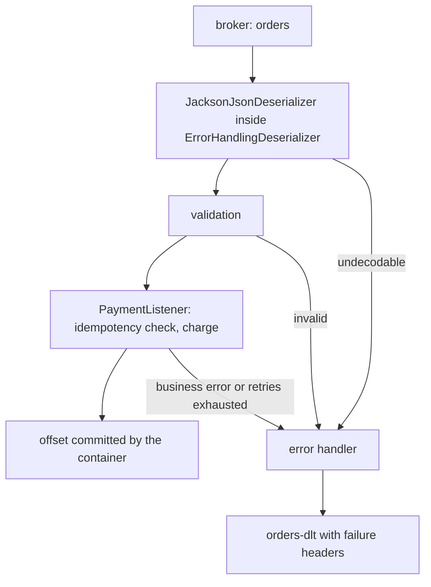

@more
## Deserialization, Conversion and Poison Pills

A listener method receives a Java object, but the broker stores bytes. Between the two there are two separate steps, and most mysterious consumer failures happen in one of them. Knowing which step failed tells you where to look.

1. **Deserialization.** The Kafka client turns the key and value bytes into objects with a `Deserializer`. This runs inside `poll()`, *before* the container sees the record.
2. **Conversion.** Spring adapts what the deserializer produced to the parameters of your method (a payload type, headers, a `ConsumerRecord`). This runs inside the container, per record, and may use a `MessageConverter`.

### Four ways to get from bytes to an object

| Approach | Conversion happens in | The target type comes from | Good for |
|---|---|---|---|
| JSON deserializer with type headers | The client | A `__TypeId__` header written by the producer | One codebase that owns both ends |
| JSON deserializer with a default type | The client | `spring.json.value.default.type` | A topic that carries one event type |
| JSON deserializer with **type mapping** | The client | A short token in the header, mapped to a class by each side | Several event types, services that must not share class names |
| `StringDeserializer` plus a JSON message converter | Spring, per listener method | The type of the method parameter | Producers in other languages; each consumer using its own class |
| Avro or Protobuf deserializer with a registry | The client | The schema id inside the payload | Governed contracts (*Schema Registry*) |

The first row is the convenient default and the trap. `JacksonJsonSerializer` writes the **fully qualified Java class name** of the producer's class into a header, and a consumer using that header must have the same class on its classpath, in the same package. That ties two services to each other's internal class names. For ShopStream the `order-service` knows `com.shopstream.order.OrderCreated` while the `payment-service` has its own `com.shopstream.payment.events.OrderCreated`; the header would name a class the second service does not have.

### Type mapping: names instead of classes

With type mapping both sides agree on a short token, and each maps it to its own class. The class name never travels.

```yaml order-service: producer side
spring:
  kafka:
    producer:
      value-serializer: org.springframework.kafka.support.serializer.JacksonJsonSerializer
      properties:
        spring.json.type.mapping: created:com.shopstream.order.OrderCreated,cancelled:com.shopstream.order.OrderCancelled
```

```yaml payment-service: consumer side
spring:
  kafka:
    consumer:
      value-deserializer: org.springframework.kafka.support.serializer.JacksonJsonDeserializer
      properties:
        spring.json.type.mapping: created:com.shopstream.payment.events.OrderCreated,cancelled:com.shopstream.payment.events.OrderCancelled
        spring.json.trusted.packages: com.shopstream.payment.events
```

The producer's header now says `created`, and the consumer maps it to its own class. A token with no mapping fails conversion. That is why the `@KafkaHandler` example in the first chapter keeps a default handler, and why a new event type must be added to the consumers' mapping before the producer starts to send it.

If the topic carries only one type, skip headers altogether: set `spring.json.add.type.headers: false` on the producer and `spring.json.use.type.headers: false` with `spring.json.value.default.type` on the consumer, as in the first chapter's configuration.

!warning Gotcha: trusted packages are a security control, not a nuisance :: When the deserializer builds an object from a class named in a header, it would instantiate whatever class the header names, and a crafted record could name a dangerous one. `spring.json.trusted.packages` restricts it to your event packages. The error `The class '...' is not in the trusted packages` should be fixed by listing the right package, never by setting `*`. A default type or a type mapping avoids the question, because the class is chosen by your configuration, not by the record.

### Unreadable records

Both steps can fail, and they fail differently.

| Failure | Where | What happens without protection |
|---|---|---|
| Malformed bytes or JSON that does not fit the class | Deserialization, in `poll()` | `poll()` throws, the position does not move, the same bytes are fetched again: the **poison pill** that blocks the partition |
| A header or token that maps to no class, a parameter that cannot be built | Conversion, in the container | `MessageConversionException` or `MethodArgumentResolutionException` before your method is called |

Wrapping the deserializer in `ErrorHandlingDeserializer` closes the first hole. It catches the exception, hands the container a record with a null value and the failure in a header, and lets the error handler send the raw bytes to a dead-letter topic. *Error Handling in Spring Kafka Listeners* has the configuration and the recoverer. Spring classifies deserialization and conversion failures as **not retryable** by default, since retrying the same bytes cannot succeed, so they go straight to the recoverer.

### Validating the payload

A syntactically valid record can still be nonsense: a negative total, a missing customer id. Bean Validation works on listener parameters if you register a validator with the endpoint registrar.

```java KafkaValidationConfig.java
package com.shopstream.payment.config;

import org.springframework.beans.factory.annotation.Qualifier;
import org.springframework.context.annotation.Configuration;
import org.springframework.kafka.annotation.KafkaListenerConfigurer;
import org.springframework.kafka.config.KafkaListenerEndpointRegistrar;
import org.springframework.validation.Validator;

@Configuration
class KafkaValidationConfig implements KafkaListenerConfigurer {

    private final Validator validator;

    KafkaValidationConfig(@Qualifier("defaultValidator") Validator validator) {
        this.validator = validator;
    }

    @Override
    public void configureKafkaListeners(KafkaListenerEndpointRegistrar registrar) {
        registrar.setValidator(validator);
    }
}
```

```java Constraints on the event and @Valid on the parameter
public record OrderCreated(
        @NotBlank String orderId,
        @NotBlank String customerId,
        @Positive long totalCents) { }

@KafkaListener(id = "payment-orders", topics = "orders", groupId = "payment-service")
public void onOrderCreated(@Valid @Payload OrderCreated event) { /* ... */ }
```

A violation raises `MethodArgumentNotValidException`. It is **not** on Spring's default list of non-retryable exceptions (that list holds the deserialization, conversion and argument-resolution failures), so by default the container would retry it with the whole back-off before giving up. Register it as fatal: `errorHandler.addNotRetryableExceptions(MethodArgumentNotValidException.class)`. An invalid record never becomes valid by waiting.

### Tombstones and absent values

On a compacted topic, a record with a `null` value deletes its key. Your method must be ready for it. The payload parameter is required by default, and a missing payload would fail argument resolution, so mark it optional:

```java TombstoneListener.java
package com.shopstream.catalog.messaging;

import com.shopstream.catalog.model.Product;
import java.util.Map;
import java.util.concurrent.ConcurrentHashMap;
import org.springframework.kafka.annotation.KafkaListener;
import org.springframework.kafka.support.KafkaHeaders;
import org.springframework.messaging.handler.annotation.Header;
import org.springframework.messaging.handler.annotation.Payload;
import org.springframework.stereotype.Component;

@Component
public class TombstoneListener {

    private final Map<String, Product> cache = new ConcurrentHashMap<>();

    @KafkaListener(id = "catalog-cache", topics = "products.compacted", groupId = "catalog-cache")
    public void on(@Header(KafkaHeaders.RECEIVED_KEY) String sku, @Payload(required = false) Product product) {
        if (product == null) {
            cache.remove(sku);          // tombstone: the product was deleted
        } else {
            cache.put(sku, product);
        }
    }
}
```

Note the `ConcurrentHashMap`: the cache is shared state in a singleton listener, which the previous chapter warned about.

### Evolving the event

Producers add fields over time. A consumer that fails on a field it does not know breaks at the first deploy of the producer. Spring's JSON deserializer ignores unknown properties by default, which is the tolerant-reader behaviour you want. The rules that keep it working: add fields, do not rename or repurpose them; make new fields optional with a sensible default in the consumer's class; deploy consumers before producers when a field becomes required. For stricter guarantees use a schema registry and compatibility checks (*Evolving Schemas Safely*).

!interview Interview angle: Why can a JSON `__TypeId__` header be a problem between microservices, and what do you do about it? :: It carries the producer's fully qualified class name, so every consumer needs a class with that exact name, which couples deployments and leaks internals. Disable type headers and use a default type for single-type topics, or use `spring.json.type.mapping` so only short agreed tokens travel. Also keep `spring.json.trusted.packages` narrow, because a header-driven type is an injection surface.

!keypoints Deserialization runs in the client during `poll()`; conversion runs in the container per record ;; Type headers couple services to class names: prefer a default type or `spring.json.type.mapping` ;; Keep `spring.json.trusted.packages` to your own packages, never `*` ;; `ErrorHandlingDeserializer` turns a poison pill into a record the error handler can park ;; Register a validator through `KafkaListenerConfigurer`, and add `MethodArgumentNotValidException` to the non-retryable list ;; A tombstone is a null value: declare `@Payload(required = false)`

?? Why is a malformed record without `ErrorHandlingDeserializer` more dangerous than one that makes your handler throw?
=> A handler exception happens after the record was handed over, so the container's error handler can retry, park or skip it. A deserialization exception is thrown by `poll()` itself before the position moves, so the same bytes are fetched on every poll and the partition makes no progress.

?? A producer starts sending a new event type. What must happen first when you use type mapping?
=> Every consumer's mapping must include the new token and class (or have a default handler that tolerates unknown tokens), otherwise conversion fails. Add the mapping to consumers, deploy them, then let the producer send.

?? Which exceptions does Spring treat as non-retryable by default, and what should you add?
=> Deserialization, message conversion, conversion, argument resolution, no-such-method and class-cast failures. Add business validation failures such as `MethodArgumentNotValidException` and your own permanent errors, since retrying them cannot succeed.

## Batch Listeners and Throughput Tuning

A record listener calls your method once per record. That is the right default, because the code is simple and the failure unit is one record. It is also expensive when each call does a database round trip: 500 records means 500 inserts. A **batch listener** receives the whole poll result at once, which lets you do one bulk write per batch.

### Turning it on

Either per listener, or for all listeners of the factory:

```java OrderBatchListener.java
package com.shopstream.payment.messaging;

import com.shopstream.payment.events.OrderCreated;
import com.shopstream.payment.store.OrderStore;
import java.util.ArrayList;
import java.util.List;
import org.apache.kafka.clients.consumer.ConsumerRecord;
import org.springframework.kafka.annotation.KafkaListener;
import org.springframework.kafka.listener.BatchListenerFailedException;
import org.springframework.stereotype.Component;

@Component
public class OrderBatchListener {

    private final OrderStore store;

    OrderBatchListener(OrderStore store) {
        this.store = store;
    }

    @KafkaListener(id = "order-archive", topics = "orders", groupId = "order-archive",
            batch = "true", properties = "max.poll.records=200")
    public void archive(List<ConsumerRecord<String, OrderCreated>> records) {
        List<OrderCreated> valid = new ArrayList<>(records.size());
        for (int i = 0; i < records.size(); i++) {
            OrderCreated event = records.get(i).value();
            if (event == null) {
                // a record that cannot be processed: tell the container exactly which one
                throw new BatchListenerFailedException("null payload", i);
            }
            valid.add(event);
        }
        store.insertAll(valid);                 // one bulk statement for up to 200 records
    }
}
```

The same effect for every listener comes from `spring.kafka.listener.type: batch`. The method parameter can be `List<OrderCreated>` (payloads only), `List<ConsumerRecord<K, V>>` (full records), `ConsumerRecords<K, V>`, or a `List<Message<V>>` when you also want headers.

**What a batch is.** It is exactly what one `poll()` returned: **up to** `max.poll.records` records, possibly across several partitions, and possibly a single record when traffic is low. Never assume the list is full, and never assume it holds one partition. Order within each partition is kept.

### When a batch fails

The container needs to know how far the batch succeeded. If the method throws an arbitrary exception, it cannot tell, and the whole batch is retried, then recovered as a whole. If you throw a `BatchListenerFailedException` with the **index** (or the record) that failed, the container commits the offsets of the records before it, retries from the failed one, and recovers only that record when retries are exhausted. *Error Handling in Spring Kafka Listeners* covers the batch error flow and the dead-letter details; the practical rule is to report the failing index whenever you can name it.

!warning Gotcha: a bulk write must be all-or-nothing, or idempotent :: If `store.insertAll` fails after inserting 150 of 200 rows, the whole batch is delivered again. Run the write in one transaction, or make each row idempotent (a unique key with `ON CONFLICT DO NOTHING`), otherwise a retry duplicates the first 150. This is the batch form of the idempotent-consumer rule.

### Dropping records before the listener

A `RecordFilterStrategy` removes records before the method is called, for example events of a test tenant or of another region. Return `true` to **discard** a record.

```java FilterConfig.java
package com.shopstream.payment.config;

import com.shopstream.payment.events.OrderCreated;
import org.springframework.context.annotation.Bean;
import org.springframework.context.annotation.Configuration;
import org.springframework.kafka.listener.adapter.RecordFilterStrategy;

@Configuration
class FilterConfig {

    @Bean
    RecordFilterStrategy<String, OrderCreated> skipTestOrders() {
        return record -> record.value() != null && record.value().test();   // true = discard
    }
}
```

Boot attaches a single `RecordFilterStrategy` bean to the auto-configured factory. A filtered record is not acknowledged unless the factory's `ackDiscarded` is `true`; with manual or per-record acknowledgement, set it, or a trailing discarded record keeps the commit behind and is read again after a restart.

### Tuning checklist

Change one thing at a time and watch lag and the time between polls.

| Symptom | Likely cause | Try |
|---|---|---|
| Lag grows, CPU idle, handler is waiting on the database | One round trip per record | Batch listener with a bulk write; connection pool sized for `concurrency` |
| Lag grows, all consumer threads busy | Not enough consumers | Raise `concurrency` up to the partitions per instance; add instances up to the partition count |
| Rebalances during busy periods | Batch takes too long | Lower `max.poll.records`; fix the slow call; check `max.poll.interval.ms` |
| High latency at low traffic | Fetch settings tuned for throughput | Default `fetch.min.bytes`; check `fetch.max.wait.ms` |
| Commit overhead visible in profiles | `AckMode.RECORD` on a fast handler | `BATCH`, with an idempotent handler |
| One partition always behind | Hot key | Look at keys; change the key or the partitioning |

The settings sit in `spring.kafka.consumer.properties` (for example `max.poll.records`, `fetch.min.bytes`) and in `spring.kafka.listener.*` (`concurrency`, `ack-mode`, `type`). A per-listener override goes in the annotation's `properties` attribute, as the batch example does.

!interview Interview angle: When would you choose a batch listener over a record listener, and what must you handle? :: Choose it when the cost per record is dominated by something that can be amortised, typically database writes or HTTP calls to a bulk endpoint. You must handle a partially failed batch (report the failing index with `BatchListenerFailedException`), make the bulk operation atomic or idempotent because failures redeliver, and remember that the batch holds whatever one poll returned, up to `max.poll.records`, not a fixed size.

!keypoints A batch listener receives what one `poll()` returned, up to `max.poll.records`, possibly from several partitions ;; Use it to amortise per-record cost, typically one bulk write per batch ;; Throw `BatchListenerFailedException` with the failing index so earlier records are committed ;; Make the bulk operation atomic or idempotent, because a failed batch is redelivered ;; `RecordFilterStrategy` drops records before the listener; set `ackDiscarded` when acknowledging per record ;; Tune one setting at a time, guided by lag and time between polls

?? A batch listener sometimes receives a list with a single record. Is something wrong?
=> No. A batch is whatever one `poll()` returned. At low traffic that can be one record. Code must not assume a minimum size.

?? What does throwing `BatchListenerFailedException(message, 7)` change compared with throwing an ordinary exception?
=> The container learns that records 0 to 6 succeeded, commits their offsets, and retries or recovers from record 7. With an ordinary exception it cannot tell and retries the whole batch.

?? Your bulk insert uses `INSERT` without a uniqueness check and a retry produces duplicates. What are the fixes?
=> Wrap the batch write in a single transaction so it is all-or-nothing, and/or give each row a natural unique key and insert with a conflict-ignoring form, so that processing the same record twice has no further effect.

## Putting It Together: The payment-service Consumer

This chapter assembles the previous ones into the consuming side of ShopStream's `payment-service`: it reads `OrderCreated` from `orders`, charges the card exactly once in effect, and parks anything it cannot handle. The point is less the code than the **list of decisions** and where each one lives.

### The flow



### Configuration

```yaml application.yml (payment-service)
spring:
  kafka:
    bootstrap-servers: ${KAFKA_BOOTSTRAP:localhost:9092}
    consumer:
      group-id: payment-service
      auto-offset-reset: earliest
      max-poll-records: 100
      key-deserializer: org.apache.kafka.common.serialization.StringDeserializer
      value-deserializer: org.springframework.kafka.support.serializer.ErrorHandlingDeserializer
      properties:
        spring.deserializer.value.delegate.class: org.springframework.kafka.support.serializer.JacksonJsonDeserializer
        spring.json.value.default.type: com.shopstream.payment.events.OrderCreated
        spring.json.use.type.headers: false
        spring.json.trusted.packages: com.shopstream.payment.events
        max.poll.interval.ms: 300000
    listener:
      ack-mode: record
      concurrency: 3
      idle-event-interval: 60s
      no-poll-threshold: 3
      monitor-interval: 30s
      observation-enabled: true
```

### The error policy and the listener

```java PaymentKafkaConfig.java
package com.shopstream.payment.config;

import com.shopstream.payment.service.PermanentPaymentException;
import org.springframework.context.annotation.Bean;
import org.springframework.context.annotation.Configuration;
import org.springframework.kafka.core.KafkaOperations;
import org.springframework.kafka.listener.DeadLetterPublishingRecoverer;
import org.springframework.kafka.listener.DefaultErrorHandler;
import org.springframework.messaging.handler.invocation.MethodArgumentResolutionException;
import org.springframework.util.backoff.FixedBackOff;

@Configuration
class PaymentKafkaConfig {

    @Bean
    DefaultErrorHandler errorHandler(KafkaOperations<Object, Object> template) {
        var recoverer = new DeadLetterPublishingRecoverer(template);          // orders -> orders-dlt, same partition
        var handler = new DefaultErrorHandler(recoverer, new FixedBackOff(1_000L, 3));   // 3 retries, 1 s apart
        handler.addNotRetryableExceptions(PermanentPaymentException.class, MethodArgumentResolutionException.class);
        return handler;
    }
}
```

```java PaymentListener.java
package com.shopstream.payment.messaging;

import com.shopstream.payment.events.OrderCreated;
import com.shopstream.payment.service.PaymentService;
import com.shopstream.payment.service.ProcessedEvents;
import org.slf4j.Logger;
import org.slf4j.LoggerFactory;
import org.springframework.kafka.annotation.KafkaListener;
import org.springframework.stereotype.Component;

@Component
public class PaymentListener {

    private static final Logger log = LoggerFactory.getLogger(PaymentListener.class);

    private final PaymentService payments;
    private final ProcessedEvents processed;

    PaymentListener(PaymentService payments, ProcessedEvents processed) {
        this.payments = payments;
        this.processed = processed;
    }

    @KafkaListener(id = "payment-orders", topics = "orders", groupId = "payment-service")
    public void onOrderCreated(OrderCreated event) {
        if (!processed.firstTime("order-created:" + event.orderId())) {
            log.info("duplicate order {} ignored", event.orderId());
            return;                                   // redelivery after a crash or rebalance
        }
        payments.charge(event);                       // throws PermanentPaymentException for e.g. an unknown customer
    }
}
```

!warning Gotcha: the dead-letter template must be able to write raw bytes :: A record that failed deserialization reaches the recoverer with its original `byte[]` value. The auto-configured template serializes values as JSON, which would encode those bytes as Base64 text and corrupt the dead letter. Production code builds the `DeadLetterPublishingRecoverer` with a map of templates (one with a `ByteArraySerializer` for `byte[]` values, one for objects); *Error Handling in Spring Kafka Listeners* shows exactly that. The short form above is enough only when you do not use `ErrorHandlingDeserializer`.

### The decisions and where they live

| Decision | Where | Why |
|---|---|---|
| Stable group id | `groupId` and `consumer.group-id` | A renamed id is a new group with no offsets |
| Defensive deserialization | `ErrorHandlingDeserializer` around `JacksonJsonDeserializer` | A malformed record becomes a dead letter, not a stuck partition |
| No class names on the wire | Default type, `use.type.headers: false` | The producer's classes stay private |
| Commit after each record | `ack-mode: record` | A crash replays at most one charge |
| Idempotent handler | `ProcessedEvents.firstTime(...)` | Delivery is at-least-once; a replay must be harmless |
| Permanent errors fail fast | `addNotRetryableExceptions` | Retrying an unknown customer wastes the partition's time |
| Bounded retries, then park | `FixedBackOff(1000, 3)` plus `DeadLetterPublishingRecoverer` | Total wait about three seconds, far below the poll interval |
| Parallelism | `concurrency: 3` with 12 partitions and 4 pods | One partition per consumer, none idle |
| Visibility | `observation-enabled`, idle and non-responsive events | Traces, lag and a hung handler show up in monitoring |

For failures that are temporary but long (a payment gateway down for ten minutes), blocking retries are the wrong tool, because they stall the partition; use `@RetryableTopic` as in *Non-Blocking Retries with @RetryableTopic*. The next Part shows how to test this configuration, including the dead-letter path, and how to watch it in production.

!keypoints A consumer's behaviour is a handful of decisions: group id, deserialization safety, commit point, idempotency, error classification, retry bounds, parallelism ;; Each decision has one home in configuration or code; write them down ;; Business errors are permanent: do not retry them ;; Blocking retries are for short outages; long ones need retry topics ;; Test the dead-letter path as carefully as the happy path

?? In the flow above, which three situations end up in `orders-dlt`?
=> A record that cannot be deserialized, a record that fails validation (when classified as non-retryable), and a record whose handler keeps failing until the back-off is exhausted, or throws a permanent business exception.

?? Why does the configuration commit per record while the poll size is 100?
=> The handler charges a card, which is expensive to repeat. Committing after each record keeps the replay window after a crash to a single record, at the cost of one commit round trip per record. The idempotency check makes even that single replay harmless.

?? What would you change if the payment gateway is down for 20 minutes?
=> Blocking retries would hold the partition and risk the poll interval. Move transient failures to retry topics with delays (`@RetryableTopic`), or pause the container with a circuit breaker until the gateway recovers, and keep the idempotency check in place.
