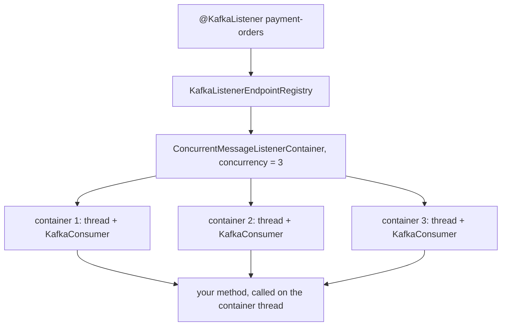

@part kafka-spring-consuming | Kafka · Part 5b: Consuming with Spring for Apache Kafka | distributed
## The @KafkaListener Programming Model

*Producing with KafkaTemplate* showed the sending side. This Part is its mirror image, and it picks up where *The Java Consumer API* stopped. In that Part you wrote the `poll()` loop, the commits, the rebalance callbacks and the shutdown by hand. Spring Kafka keeps the same `KafkaConsumer` underneath and writes that loop for you. What you write is a method.

```java OrderCreatedListener.java
package com.shopstream.payment.messaging;

import com.shopstream.payment.events.OrderCreated;
import com.shopstream.payment.service.PaymentService;
import org.slf4j.Logger;
import org.slf4j.LoggerFactory;
import org.springframework.kafka.annotation.KafkaListener;
import org.springframework.kafka.support.KafkaHeaders;
import org.springframework.messaging.handler.annotation.Header;
import org.springframework.messaging.handler.annotation.Payload;
import org.springframework.stereotype.Component;

@Component
public class OrderCreatedListener {

    private static final Logger log = LoggerFactory.getLogger(OrderCreatedListener.class);

    private final PaymentService payments;

    public OrderCreatedListener(PaymentService payments) {
        this.payments = payments;
    }

    @KafkaListener(id = "payment-orders", topics = "orders", groupId = "payment-service")
    public void onOrderCreated(@Payload OrderCreated event,
                               @Header(KafkaHeaders.RECEIVED_KEY) String key,
                               @Header(KafkaHeaders.RECEIVED_PARTITION) int partition,
                               @Header(KafkaHeaders.OFFSET) long offset) {
        log.info("order {} from partition {} offset {}", key, partition, offset);
        payments.charge(event);
    }
}
```

And the matching configuration for the `payment-service`, using the same Spring Boot 4.1 and Spring Kafka 4.1 versions as the producing chapters:

```yaml application.yml (payment-service)
spring:
  kafka:
    bootstrap-servers: localhost:9092
    consumer:
      group-id: payment-service
      auto-offset-reset: earliest
      key-deserializer: org.apache.kafka.common.serialization.StringDeserializer
      value-deserializer: org.springframework.kafka.support.serializer.JacksonJsonDeserializer
      properties:
        spring.json.value.default.type: com.shopstream.payment.events.OrderCreated
        spring.json.use.type.headers: false
        spring.json.trusted.packages: com.shopstream.payment.events
```

No loop, no `poll()`, no commit and no `main`. At startup Spring Boot finds the annotation, creates a **listener container** for it, subscribes to `orders` and starts a thread that polls. For every record, the container deserializes the value, builds the arguments your method asks for, and calls it.

### What the annotation does

`@KafkaListener` is processed once, when the application context starts. The bean post-processor registers an **endpoint** with the `KafkaListenerEndpointRegistry`, and the container factory (`kafkaListenerContainerFactory`, built by Boot from `spring.kafka.consumer.*` and `spring.kafka.listener.*`) creates the container from it. So the annotation does not subscribe anything itself. It describes what to subscribe to, and the factory decides how to run it. Everything you can change about running (threads, acknowledgement, error handling) is a property of the factory or the container, and the next chapters cover each.

### What a listener method can ask for

Spring resolves each parameter of the method from the record. The payload is the deserialized value; anything else you request is read from the record's metadata.

| Parameter | What you get |
|---|---|
| `OrderCreated event` or `@Payload OrderCreated event` | The deserialized value |
| `@Header(KafkaHeaders.RECEIVED_KEY) String key` | The record key |
| `@Header(KafkaHeaders.RECEIVED_TOPIC)`, `RECEIVED_PARTITION`, `OFFSET`, `RECEIVED_TIMESTAMP` | Where the record came from and when |
| `@Header("source") String source` | Any custom header, by name |
| `ConsumerRecord<String, OrderCreated> record` | The complete raw record: topic, partition, offset, key, value, headers |
| `Message<OrderCreated> message` | The Spring Messaging form: payload plus all headers as a map |
| `Acknowledgment ack` | A handle for committing yourself (next chapters) |
| `Consumer<?, ?> consumer` | The underlying `KafkaConsumer`, for rare low-level needs; only valid on the container thread |
| `List<...>` of the above | Selected by a batch listener (*Batch Listeners and Throughput Tuning*) |

Choose by what the method needs. A handler that only needs the business object should declare only the object: it is the easiest to unit-test, because you can call it like any other method. Take the `ConsumerRecord` when you need several metadata fields together.

### Attributes you will use

| Attribute | Purpose |
|---|---|
| `topics` | One or more topic names. Placeholders such as `${shopstream.topics.orders}` are resolved from the environment |
| `topicPattern` | A regular expression instead of fixed names (rebalances when matching topics appear) |
| `topicPartitions` | Fixed partitions, optionally with starting offsets. The container then **assigns** instead of subscribing: no group balancing |
| `groupId` | The `group.id` for this listener, overriding `spring.kafka.consumer.group-id` |
| `id` | The container's name; it also appears in thread names, logs and the registry |
| `containerFactory` | Use a differently configured factory (for example one with manual acknowledgement) |
| `concurrency` | Number of consumer threads for this listener (next chapter) |
| `autoStartup` | `false` keeps the container stopped until you start it |
| `properties` | Extra consumer properties for this listener only, such as `max.poll.records=50` |
| `batch` | `true` makes this one a batch listener |

!warning Gotcha: the id is also the group id :: If you set `id` but not `groupId`, the `id` becomes the consumer group (the attribute `idIsGroup` is `true` by default). Renaming a listener's `id` in a refactoring then silently moves it to a **new group** with no committed offsets. It starts at `auto.offset.reset`, so it either re-reads every record in the topic or skips everything that is already waiting. Always set `groupId` explicitly in business listeners, and treat it as a stable identifier like a database table name.

### Several message types on one topic: @KafkaHandler

A topic such as `orders.events` can carry more than one event type. Put `@KafkaListener` on the class and mark one method per type with `@KafkaHandler`. Spring picks the method by the type of the deserialized payload.

```java OrderEventsListener.java
package com.shopstream.payment.messaging;

import com.shopstream.payment.events.OrderCancelled;
import com.shopstream.payment.events.OrderCreated;
import com.shopstream.payment.service.PaymentService;
import org.slf4j.Logger;
import org.slf4j.LoggerFactory;
import org.springframework.kafka.annotation.KafkaHandler;
import org.springframework.kafka.annotation.KafkaListener;
import org.springframework.stereotype.Component;

@Component
@KafkaListener(id = "payment-order-events", topics = "orders.events", groupId = "payment-service")
public class OrderEventsListener {

    private static final Logger log = LoggerFactory.getLogger(OrderEventsListener.class);

    private final PaymentService payments;

    public OrderEventsListener(PaymentService payments) {
        this.payments = payments;
    }

    @KafkaHandler
    public void created(OrderCreated event) {
        payments.charge(event);
    }

    @KafkaHandler
    public void cancelled(OrderCancelled event) {
        payments.refund(event.orderId());
    }

    @KafkaHandler(isDefault = true)
    public void unknown(Object other) {
        log.warn("ignoring unexpected payload {}", other.getClass().getName());
    }
}
```

This only works if the deserializer can produce different classes, which means the record must say which class it carries. *Deserialization, Conversion and Poison Pills* explains type headers and their safer alternative, type mapping. The default handler is not optional in practice: without it a record of an unknown type fails the listener and goes through error handling.

!interview Interview angle: What does `@KafkaListener(topics = "orders")` actually create, and when? :: At application startup the `KafkaListenerAnnotationBeanPostProcessor` registers an endpoint, and the `ConcurrentKafkaListenerContainerFactory` builds a listener container from it. The container owns one or more `KafkaConsumer` instances and the threads that run their `poll()` loops, and it calls the annotated method for each record. The annotation describes what to listen to; the container does the polling, committing and error handling.

!keypoints `@KafkaListener` registers an endpoint; a container built by the factory runs the poll loop ;; A method declares what it needs: payload, headers, `ConsumerRecord`, `Acknowledgment` ;; Prefer the plain payload parameter: such methods are easy to unit-test ;; `id` is also the `group.id` unless `groupId` is set: always set `groupId` ;; `topicPartitions` assigns partitions manually and bypasses group balancing ;; `@KafkaHandler` on methods lets one class listen to several event types

?? Which `group.id` does `@KafkaListener(id = "payment-orders", topics = "orders")` use, and why is that a hazard?
=> `payment-orders`, because `idIsGroup` is true and no `groupId` is given. Renaming the `id` later changes the group, which has no committed offsets, so the listener restarts from `auto.offset.reset`.

?? How is the record's key made available to a listener method that takes the payload?
=> Add a parameter `@Header(KafkaHeaders.RECEIVED_KEY) String key`, or take the whole `ConsumerRecord`. The container resolves each parameter from the record.

?? Why is a `@KafkaHandler(isDefault = true)` method recommended on a class with several handlers?
=> A record whose payload type matches no handler would otherwise fail, enter error handling and may end up in a dead-letter topic. A default handler lets you log and ignore event types your service does not care about.

## Listener Containers, Threads and Concurrency

The listener container is where Spring's design and Kafka's rules meet, and nearly every consumer problem in production comes back to how it runs. This chapter shows how many threads and consumers there really are, what that means for your code, and how to start, pause and stop them.

### One consumer, one thread

The basic unit is the `KafkaMessageListenerContainer`. It owns exactly **one `KafkaConsumer`** and **one thread** that runs its `poll()` loop and calls your method. Everything from *The Java Consumer API* applies unchanged: the thread polls, your method runs on that thread, and while it runs nothing polls.

Boot's factory creates a `ConcurrentMessageListenerContainer` for each `@KafkaListener`. It is a parent that creates `concurrency` of those basic containers. With `concurrency: 3` you get three consumers in the same group, each with its own thread, sharing the partitions between them, which is exactly the *one consumer per thread* pattern from the previous Part, done for you.



You set the number in the annotation (`concurrency = "3"`, which also accepts a placeholder) or for all listeners with `spring.kafka.listener.concurrency`.

### Counting consumers

Parallelism is the product of three numbers, and the partition count is the ceiling:

| Quantity | Example |
|---|---|
| Partitions of `orders` | 12 |
| Application instances (pods) | 4 |
| `concurrency` per instance | 3 |
| Consumers in the group | 4 × 3 = 12, each owns one partition |
| If you scale to 6 pods | 18 consumers for 12 partitions: 6 are idle |

Setting `concurrency` above the number of partitions *one instance can receive* just creates idle threads. When you add instances, lower `concurrency` or keep an eye on the total. The thread names, which contain the listener id (for example `payment-orders-0-C-1`), tell you in a thread dump which container a thread belongs to.

### What this means for your code

Three consequences follow from the design, and each causes a class of bugs.

**Order.** The container calls your method for one record at a time per consumer thread, in offset order within a partition. You never see two records of the same partition at the same time, so per-partition order is kept without any work from you.

**Thread safety.** With `concurrency` above 1 the same listener bean is called from several threads **at the same time**, one per partition group. A Spring `@Component` is a singleton, so a mutable field in it is shared state. Keep listeners stateless, or protect what they share.

**Blocking.** While your method runs, the thread does not poll. A call that takes minutes (a slow HTTP service, a database lock) eats the `max.poll.interval.ms` budget and finally causes a rebalance, as in *Rebalancing in Practice*. Bound every external call with a timeout, keep `max.poll.records` honest, and see the batch chapter for the sizing rule.

!tip A quick sanity check for concurrency :: In a running application, a thread dump (or the log pattern `%thread`) should show exactly `concurrency` listener threads per instance. If you see more, a listener is declared twice; if you see fewer, one of them failed to start, and the log will say why.

### Starting, pausing and stopping

Containers have a lifecycle, and the registry gives you a handle to each one by its `id`.

```java ListenerControl.java
package com.shopstream.payment.ops;

import java.util.Set;
import org.springframework.kafka.config.KafkaListenerEndpointRegistry;
import org.springframework.kafka.listener.MessageListenerContainer;
import org.springframework.stereotype.Component;

@Component
public class ListenerControl {

    private final KafkaListenerEndpointRegistry registry;

    public ListenerControl(KafkaListenerEndpointRegistry registry) {
        this.registry = registry;
    }

    /** Stop taking new records, keep the group membership alive. */
    public void pause(String listenerId) {
        MessageListenerContainer container = registry.getListenerContainer(listenerId);
        if (container != null) {
            container.pause();
        }
    }

    public void resume(String listenerId) {
        MessageListenerContainer container = registry.getListenerContainer(listenerId);
        if (container != null) {
            container.resume();
        }
    }

    public boolean isPaused(String listenerId) {
        MessageListenerContainer container = registry.getListenerContainer(listenerId);
        return container != null && container.isContainerPaused();
    }

    public Set<String> all() {
        return registry.getListenerContainerIds();
    }
}
```

`pause()` is a request: the container finishes the records it already has, then keeps polling with all partitions paused, so the member stays in the group and no rebalance happens, but no new records are delivered. That is the right tool when a downstream system is down (a circuit breaker can call it) or during a maintenance window. `stop()` is different: it leaves the group, which causes a rebalance. Use it for a real shutdown.

Setting `autoStartup = "false"` on the annotation keeps a container stopped until you call `registry.getListenerContainer(id).start()`. A common use is a feature flag, or a listener that must wait until a cache has been loaded.

On application shutdown Spring stops the containers and waits for the record in progress to finish, up to `shutdownTimeout` (10 seconds by default; `ContainerProperties.setShutdownTimeout`). If your handler can run longer than that, either raise it or accept that the record will be delivered again, and pair it with Spring Boot's graceful shutdown so that the web server also drains.

### Knowing when a container is stuck

The container publishes Spring application events, and two of them are worth reacting to:

| Event | Published when | Use |
|---|---|---|
| `ListenerContainerIdleEvent` | No records for `idle-event-interval` | Finish a batch job, release resources, detect a silent topic |
| `NonResponsiveConsumerEvent` | The thread has not called `poll()` for longer than `no-poll-threshold` × `poll-timeout`, checked every `monitor-interval` | Detect a hung handler **before** the poll interval expires |

```java StuckConsumerWatcher.java
package com.shopstream.payment.ops;

import org.slf4j.Logger;
import org.slf4j.LoggerFactory;
import org.springframework.context.event.EventListener;
import org.springframework.kafka.event.NonResponsiveConsumerEvent;
import org.springframework.stereotype.Component;

@Component
public class StuckConsumerWatcher {

    private static final Logger log = LoggerFactory.getLogger(StuckConsumerWatcher.class);

    @EventListener
    public void onStuck(NonResponsiveConsumerEvent event) {
        log.error("listener {} has not polled for {} ms; partitions {}",
                event.getListenerId(), event.getTimeSinceLastPoll(), event.getTopicPartitions());
        // raise a metric or alert here; do not call the container from inside the event handler
    }
}
```

The settings are `spring.kafka.listener.idle-event-interval`, `monitor-interval` and `no-poll-threshold` (and `poll-timeout`, which defaults to 5 seconds). The non-responsive event is a cheap liveness signal: a handler stuck on a lock produces it long before the five-minute poll interval produces a rebalance.

!interview Interview angle: Your listener has `concurrency = 5` and the topic has 3 partitions. What happens, and is the listener bean thread-safe by default? :: Spring starts five consumers in the same group, but only three get a partition; two are idle. Parallelism stays at three. The bean is a singleton called from up to three threads at the same time, so it is thread-safe only if it is stateless or its shared state is protected. Records of one partition are still handled one at a time and in order.

!keypoints One basic container is one `KafkaConsumer` and one thread; `concurrency` creates several of them in the same group ;; Total consumers = instances × concurrency, capped usefully by the partition count ;; Per-partition order is kept; listener beans are called from several threads at once, so keep them stateless ;; A blocking handler stops polling and eventually triggers a rebalance: set timeouts ;; `pause()` keeps group membership and stops delivery; `stop()` leaves the group ;; `NonResponsiveConsumerEvent` warns about a hung handler before the poll interval expires

?? How does `pause()` on a container differ from `stop()`?
=> `pause()` keeps the consumers polling with their partitions paused, so the group membership stays and no rebalance occurs; delivery resumes with `resume()`. `stop()` shuts the consumers down, leaving the group and triggering a rebalance.

?? Why can a stateless-looking listener still break when `concurrency` is raised from 1 to 3?
=> With three consumer threads the same singleton bean is called concurrently. Any mutable field (a list, a counter, a `SimpleDateFormat`, a non-thread-safe client) is now shared and can be corrupted. At `concurrency = 1` the problem was invisible.

?? What is the difference between `max.poll.interval.ms` and Spring's `NonResponsiveConsumerEvent`?
=> `max.poll.interval.ms` is the client's limit: past it the member leaves the group. The event is Spring's earlier warning: when the thread has not polled for `no-poll-threshold` times `poll-timeout`, an event is published so you can alert while the consumer is still in the group.

## Offsets, Acknowledgement Modes and Seeking

*Offsets and Commits* explained the rules: commit the offset of the next record, after processing, never before. In a Spring listener you do not call `commitSync()`; you choose an **acknowledgement mode** and the container commits for you. This chapter covers what each mode costs, how to take over manually, and how to move a running listener to another position.

### Spring turns off auto-commit

Spring Kafka sets `enable.auto.commit=false` unless you configure it otherwise, and does all committing itself, from the consumer thread, using one of the `AckMode` values:

| `AckMode` | The container commits | Replay window after a crash |
|---|---|---|
| `BATCH` (default) | After the listener has processed every record returned by one `poll()` | Up to `max.poll.records` records |
| `RECORD` | After each record | At most one record, but one commit round trip per record |
| `TIME` / `COUNT` / `COUNT_TIME` | After a time or a record count since the last commit, at a batch boundary | Up to that time or count, plus the batch |
| `MANUAL` | After your listener calls `ack.acknowledge()`; the commit happens when the batch ends | Whatever you have not acknowledged |
| `MANUAL_IMMEDIATE` | At once, inside `acknowledge()` | Whatever you have not acknowledged |

Set it with `spring.kafka.listener.ack-mode` or on `ContainerProperties.setAckMode`. For a business service, `BATCH` or `RECORD` with an idempotent handler is the sound default: the container commits only after your method returned normally, so the only way to lose a record is to throw and be dropped by an error handler you configured on purpose.

!warning Gotcha: an exception is not a commit :: When the listener throws, the container does not commit that record. The error handler then decides: retry (by seeking back), publish to a dead-letter topic, or give up. Only when the handler recovers or skips the record does the offset move past it. This is why error handling and acknowledgement are one topic, and why *Error Handling in Spring Kafka Listeners* is the companion to this chapter.

### Acknowledging yourself

With `MANUAL` or `MANUAL_IMMEDIATE`, you declare an `Acknowledgment` parameter and decide when the record counts as done. That fits the case where "done" is not "the method returned", for example after you have also committed a database transaction that a framework completes later.

```java ManualAckListener.java
package com.shopstream.payment.messaging;

import com.shopstream.payment.events.OrderCreated;
import com.shopstream.payment.service.PaymentService;
import java.time.Duration;
import org.springframework.context.annotation.Bean;
import org.springframework.context.annotation.Configuration;
import org.springframework.kafka.annotation.KafkaListener;
import org.springframework.kafka.config.ConcurrentKafkaListenerContainerFactory;
import org.springframework.kafka.core.ConsumerFactory;
import org.springframework.kafka.listener.ContainerProperties;
import org.springframework.kafka.support.Acknowledgment;
import org.springframework.stereotype.Component;

@Configuration
class ManualAckConfig {

    @Bean
    ConcurrentKafkaListenerContainerFactory<String, OrderCreated> manualAckFactory(
            ConsumerFactory<String, OrderCreated> consumerFactory) {
        var factory = new ConcurrentKafkaListenerContainerFactory<String, OrderCreated>();
        factory.setConsumerFactory(consumerFactory);
        factory.getContainerProperties().setAckMode(ContainerProperties.AckMode.MANUAL);
        return factory;
    }
}

@Component
public class ManualAckListener {

    private final PaymentService payments;

    ManualAckListener(PaymentService payments) {
        this.payments = payments;
    }

    @KafkaListener(id = "payment-manual", topics = "orders", groupId = "payment-service",
            containerFactory = "manualAckFactory")
    public void on(OrderCreated event, Acknowledgment ack) {
        try {
            payments.charge(event);
            ack.acknowledge();                          // only now does this record count as done
        } catch (IllegalStateException temporary) {
            ack.nack(Duration.ofSeconds(2));            // redeliver this record after 2 seconds
        }
    }
}
```

**What to notice.** `acknowledge()` marks the record; with `MANUAL` the container performs the commit at the end of the batch, with `MANUAL_IMMEDIATE` right away. `nack(Duration)` tells the container to discard the rest of the current batch, seek every partition back to the failed record and redeliver it after the pause. It must be called on the container thread, so do not hand the `Acknowledgment` to a pool and call it from there. Offsets are positions, so there is no such thing as acknowledging "just" one record: acknowledging record 12 commits offset 13 and thereby everything before it. Skipping `acknowledge()` is therefore not a reliable way to ask for a redelivery, because a later acknowledgement on the same partition commits past the record you skipped. If you want a record delivered again, say so with `nack`, and acknowledge every record you finished, in order.

### Choosing a mode

| Situation | Mode |
|---|---|
| Handler is idempotent, throughput matters | `BATCH` |
| Handler is slow and each record is expensive to repeat | `RECORD` |
| "Done" is decided by code outside the method (async result, later transaction) | `MANUAL` / `MANUAL_IMMEDIATE`, acknowledged on the container thread |
| Read-process-write to another Kafka topic with exactly-once effect | A transactional container; see *Transactions in Spring Kafka* |

### Moving a running listener: seeking

Sometimes the position must change without stopping the service: replay yesterday's orders into a new read model, jump to the end after an outage you decide to skip, or start a new listener at a fixed point. Spring offers two tools.

**Initial offsets in the annotation** fix the start position at startup. Naming partitions makes the container *assign* them, so the listener is outside group balancing:

```java Replay from the start at every startup
@KafkaListener(id = "order-audit", groupId = "order-audit",
        topicPartitions = @TopicPartition(topic = "orders",
                partitionOffsets = @PartitionOffset(partition = "*", initialOffset = "0")))
void audit(ConsumerRecord<String, String> record) { /* ... */ }
```

**`ConsumerSeekAware`** lets code move the position while the listener runs. The base class `AbstractConsumerSeekAware` keeps the seek callbacks of every assigned partition for you:

```java ReplayableListener.java
package com.shopstream.payment.messaging;

import java.time.Instant;
import org.apache.kafka.clients.consumer.ConsumerRecord;
import org.springframework.kafka.annotation.KafkaListener;
import org.springframework.kafka.listener.AbstractConsumerSeekAware;
import org.springframework.stereotype.Component;

@Component
public class ReplayableListener extends AbstractConsumerSeekAware {

    @KafkaListener(id = "order-projection", topics = "orders", groupId = "order-projection")
    public void on(ConsumerRecord<String, String> record) {
        // update the read model
    }

    /** E.g. called from an admin endpoint: re-read everything since a point in time. */
    public void replaySince(Instant from) {
        seekToTimestamp(from.toEpochMilli());      // queued, then executed by the container threads
    }

    public void replayAll() {
        seekToBeginning();
    }
}
```

The seeks are queued and carried out by each container thread before its next poll, because a `KafkaConsumer` may only be touched by its own thread. For custom behaviour at startup, override `onPartitionsAssigned(Map<TopicPartition, Long>, ConsumerSeekCallback)` and call methods such as `seekToBeginning(topic, partition)` or `seekToTimestamp(topic, partition, ts)` on the callback.

!tip Replay needs an idempotent handler :: A replay delivers records the service has handled before. If the handler sends e-mails or charges cards, a replay duplicates them. Replay into read models, caches and projections, which are rebuilt by repeating the same writes, and protect side effects with an idempotency check.

### Rebalance hooks in Spring

If you need the equivalent of the listener from the previous Part, declare a bean of type `ConsumerAwareRebalanceListener`. Boot attaches a single such bean to the container factory. It receives the consumer itself and offers `onPartitionsRevokedBeforeCommit`, `onPartitionsRevokedAfterCommit`, `onPartitionsAssigned` and `onPartitionsLost`; the "before commit" variant is where you flush buffered work, because the container commits right after it.

!interview Interview angle: With Spring Kafka, when exactly is an offset committed, and what makes a record be redelivered? :: The container commits according to `AckMode`: by default after the whole batch returned by one `poll()` was processed without throwing. A record is redelivered if the listener throws and the error handler retries (it seeks back), if the process dies before the commit, or if a rebalance moves the partition before the commit. Because delivery is therefore at-least-once, the handler must be idempotent.

!keypoints Spring disables Kafka's auto-commit and commits itself according to `AckMode` ;; `BATCH` (default) commits after each poll's records; `RECORD` after each record; `MANUAL` after your `acknowledge()` ;; A thrown exception means no commit for that record; the error handler decides whether to retry, park or skip ;; `nack(Duration)` redelivers after a pause and must be called on the container thread ;; Named partitions in `topicPartitions` mean manual assignment and no group balancing ;; `AbstractConsumerSeekAware` replays a running listener; seeks are executed on the container thread

?? A listener uses `AckMode.MANUAL` and returns without calling `acknowledge()`. What happens to the offset?
=> That record is not committed by itself, and if no later record of the partition is acknowledged either, a restart or rebalance resumes from the last committed offset and delivers it again. But acknowledging a later record commits past it, so omitting `acknowledge()` is not a dependable redelivery mechanism; use `nack`.

?? Why must `Acknowledgment.nack` be called from the container thread?
=> `nack` seeks the consumer back and sleeps, and a `KafkaConsumer` may only be used by the thread that polls it. Calling it from a worker thread would break that rule and the container cannot apply the seek safely.

?? How do you make a running listener re-read the last 24 hours without redeploying?
=> Extend `AbstractConsumerSeekAware` and call `seekToTimestamp(...)` with the start time (for example from an admin endpoint). The container threads perform the seek before their next poll. The handler must be idempotent, because the records have been handled before.
