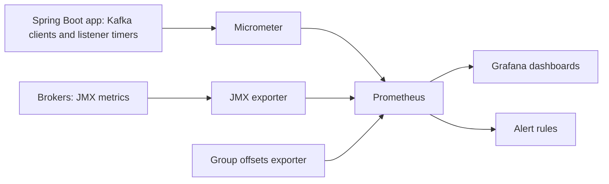
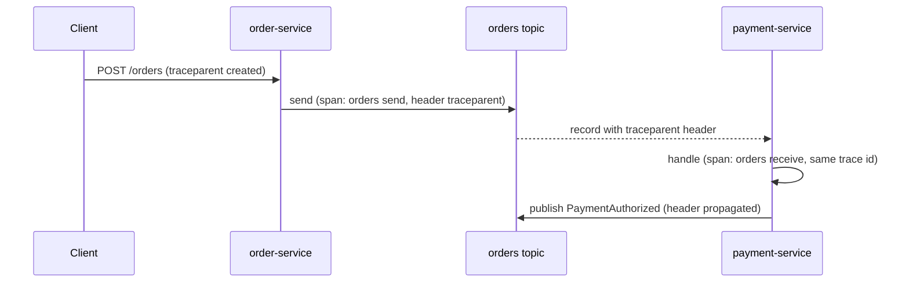

@more
## Metrics: What to Watch on Producers, Consumers and Brokers

A Kafka application can be broken in many ways while every health check says UP: the consumer is alive but ten minutes behind, the producer retries silently, a broker lost a replica. Monitoring Kafka means choosing a **small set of signals** that each answer a specific question, and alerting on the ones that mean users are affected.

### Getting client metrics out of Spring Boot

Every Kafka client keeps hundreds of metrics. With Micrometer on the classpath, Spring Boot registers them for you: it adds a metrics listener to the producer and consumer factories, so each client's metrics appear as Micrometer meters tagged with the `client.id`. Add the actuator and a registry and expose the endpoint:

```yaml application.yml
management:
  endpoints:
    web:
      exposure:
        include: health,prometheus
spring:
  kafka:
    listener:
      observation-enabled: true      # Spring's own timers and traces for each listener invocation
    template:
      observation-enabled: true
```

The Kafka metric `records-lag-max` of the group `consumer-fetch-manager-metrics` becomes `kafka.consumer.fetch.manager.records.lag.max` in Micrometer and `kafka_consumer_fetch_manager_records_lag_max` in Prometheus. The naming rule is mechanical, but registries differ in detail, so copy the exact names from `/actuator/prometheus` of your own service before writing queries and alerts.

On top of the client metrics Spring adds a timer per listener invocation (`spring.kafka.listener`, with the listener id, the result and the exception as tags) and per send (`spring.kafka.template`). They answer the question the client metrics cannot: how long does **my handler** take, and how often does it fail.



### Consumer signals

| Metric (client name) | Question it answers | Look for |
|---|---|---|
| `records-lag-max`, `records-lag` (per partition) | How far behind are we | Growth over time; one partition far above the others |
| `records-consumed-rate` | How fast are we working | A drop to zero while lag is positive: stuck |
| `fetch-latency-avg`, `fetch-rate` | Is fetching slow | High latency with an idle handler points at the network or brokers |
| `time-between-poll-max`, `poll-idle-ratio-avg` | Is the handler the bottleneck | Time between polls near `max.poll.interval.ms`; idle ratio near zero |
| `rebalance-total`, `rebalance-latency-avg`, `last-rebalance-seconds-ago` | Is the group unstable | Rebalances without a deploy |
| `commit-latency-avg`, `failed-rebalance-total` | Is committing healthy | Rising latency or failures |
| `spring.kafka.listener` timer, tagged `result=failure` | How long and how often does my handler fail | p99 latency, failure ratio |

### Producer signals

| Metric | Question | Look for |
|---|---|---|
| `record-error-rate`, `record-retry-rate` | Are sends failing or retrying | Anything above zero for a sustained time |
| `request-latency-avg` | How slow are the brokers | Sudden increase |
| `batch-size-avg`, `records-per-request-avg` | Is batching effective | Tiny batches under load mean the tuning is off |
| `buffer-available-bytes`, `buffer-exhausted-rate` | Is the producer backing up | Available buffer shrinking toward zero: `send()` will start to block |
| `produce-throttle-time-avg` | Are quotas throttling us | Non-zero values |

### Broker signals

Broker metrics are exposed over JMX. A Prometheus JMX exporter running as an agent in the broker process turns them into metrics; managed Kafka services expose the same ones in their own console.

| MBean | Meaning | Healthy |
|---|---|---|
| `kafka.server:type=ReplicaManager,name=UnderReplicatedPartitions` | Partitions led by this broker with fewer in-sync replicas than configured | 0 |
| `kafka.server:type=ReplicaManager,name=UnderMinIsrPartitionCount` | Partitions below `min.insync.replicas`: producers with `acks=all` fail | 0 |
| `kafka.controller:type=KafkaController,name=OfflinePartitionsCount` | Partitions with no leader: unavailable | 0 |
| `kafka.controller:type=KafkaController,name=ActiveControllerCount` | One controller must be active (the sum across the cluster) | 1 |
| `kafka.server:type=BrokerTopicMetrics,name=BytesInPerSec` and `BytesOutPerSec` | Throughput per broker | Balanced across brokers |
| `kafka.network:type=RequestMetrics,name=TotalTimeMs,request=Produce` (and `FetchConsumer`) | Total request time, with percentiles | p99 stable |
| `kafka.server:type=KafkaRequestHandlerPool,name=RequestHandlerAvgIdlePercent` | Spare capacity of the request threads | Not near zero |
| `kafka.server:type=ReplicaManager,name=IsrShrinksPerSec` | Replicas dropping out of sync | Close to zero, with spikes only during incidents |

Outside Kafka, watch the **disk usage of the log directories**: a full disk takes a broker down. A topic's size on disk is roughly its write rate multiplied by its retention, which *Topics, Partitions and the Commit Log* explains.

### Lag as a service-level signal

A lag number means little without the rate. Ten thousand records behind is two seconds of work at 5,000 records per second and four hours at one per second. The useful questions are *is it growing* and *how long until it is drained*:

```text Time to drain, approximately
lag / consumption rate
= sum(kafka_consumer_fetch_manager_records_lag) / sum(kafka_consumer_fetch_manager_records_consumed_rate)
```

Define the objective in time ("orders are charged within 30 seconds of creation, 99% of the time") and alert on that, using lag only as the cause you investigate. A consumer that is working through a spike will have a large lag that is falling; an alert that fires on the absolute number wakes people for it.

```yaml prometheus-rules.yml (adapt the names to your exporter)
groups:
  - name: kafka-consumers
    rules:
      - alert: ConsumerLagGrowing
        expr: |
          max by (job) (kafka_consumer_fetch_manager_records_lag_max) > 10000
          and
          deriv(max by (job) (kafka_consumer_fetch_manager_records_lag_max)[15m:1m]) > 0
        for: 15m
        annotations:
          summary: "Lag above 10000 and still growing for 15 minutes"
      - alert: ConsumerGroupUnstable
        expr: increase(kafka_consumer_coordinator_rebalance_total[30m]) > 5
        annotations:
          summary: "More than five rebalances in 30 minutes without a deploy: check poll interval and restarts"
```

Group the alert by the consequence a user would feel. Page on **sustained** growth, on any offline partition, and on a growing dead-letter topic. Treat a single rebalance, a short lag spike and one retried send as information.

!interview Interview angle: How do you monitor Kafka consumers in production? :: Track consumer lag per group and partition, but judge it as time to drain and as trend, not as a raw number. Add the consumption rate, the time between polls and the rebalance counters to tell a slow handler from an unstable group, and the handler's own latency and failure ratio. On the broker side watch under-replicated and offline partitions, request latency and disk usage. Alert on sustained user-visible conditions, and make the dead-letter topic's growth an alert of its own.

!keypoints Boot binds Kafka client metrics to Micrometer; copy exact names from `/actuator/prometheus` ;; Consumer: lag (trend and per partition), consumed rate, time between polls, rebalances ;; Producer: error and retry rate, request latency, buffer availability ;; Broker: under-replicated, under-min-ISR and offline partitions, request time, disk ;; Express lag as time to drain and tie alerts to a service-level objective ;; Page on sustained conditions and dead-letter growth, not on single blips

?? A lag of 50,000 and a lag of 500 on two services: which is worse?
=> It cannot be said without the consumption rate. Fifty thousand records at 10,000 per second drains in five seconds; five hundred at one per second takes more than eight minutes and may be stuck. Compare time to drain and the trend.

?? Which broker metric tells you that a producer using `acks=all` is about to fail?
=> `UnderMinIsrPartitionCount` above zero: some partitions have fewer in-sync replicas than `min.insync.replicas`, so such writes are rejected.

?? Why is the `spring.kafka.listener` timer useful in addition to client metrics?
=> Client metrics describe Kafka's side (fetching, lag, polling). The listener timer measures your handler: how long each invocation takes and how many fail, which tells you whether lag comes from slow or failing processing.

## Tracing, Logging and Correlation

When an order is slow, you want to follow it from the HTTP request, through the `orders` topic, into the `payment-service`, and out again. Kafka decouples the services in time, so the usual call stack disappears. Correlation is what puts it back: the same trace id and the same business id on every log line along the way.

### Traces across the topic

With observation enabled on the template and the listener (the properties in the previous chapter) and a tracing bridge on the classpath (Micrometer Tracing with OpenTelemetry), Spring Kafka carries the trace context in a **record header**. The producer side starts a span and writes a `traceparent` header (the W3C standard format); the listener side reads it and continues the same trace.



In the tracing UI you see one trace with the HTTP span, the send, and the receive spans of every service, and the gap between send and receive is the time the record spent waiting in the topic, which is queueing delay you can read directly.

What to know before relying on it:

- **Batch listeners** process many records in one call, so one span cannot have all their parents; per-record trace linking is lost or reduced to links. Keep trace-critical flows on record listeners.
- **Handing work to another thread** leaves the trace context behind unless you propagate it; use the instrumented executors.
- **Retries and dead letters** keep the original headers, including `traceparent`, so a dead letter is traceable to the request that caused it. Keep it when you copy records by hand.
- **Sampling** decides what you can see. A low sample rate means most traces are not there when you need one: sample errors preferentially if your backend allows.
- The header costs a few dozen bytes per record, which matters only for tiny, very high-volume records.

### Business ids in every log line

A trace id answers "which request", but support asks "what happened to order o-42". Put both in the **MDC** (mapped diagnostic context), so that the logging pattern prints them on every line. A `RecordInterceptor` runs around each record on the container thread, which is the right place.

```java MdcRecordInterceptor.java
package com.shopstream.payment.config;

import org.apache.kafka.clients.consumer.Consumer;
import org.apache.kafka.clients.consumer.ConsumerRecord;
import org.slf4j.MDC;
import org.springframework.kafka.listener.RecordInterceptor;

public class MdcRecordInterceptor<K, V> implements RecordInterceptor<K, V> {

    @Override
    public ConsumerRecord<K, V> intercept(ConsumerRecord<K, V> record, Consumer<K, V> consumer) {
        MDC.put("kafka.topic", record.topic());
        MDC.put("kafka.partition", Integer.toString(record.partition()));
        MDC.put("kafka.offset", Long.toString(record.offset()));
        if (record.key() != null) {
            MDC.put("kafka.key", String.valueOf(record.key()));      // the order id in ShopStream
        }
        return record;                                                // returning null would skip the record
    }

    @Override
    public void afterRecord(ConsumerRecord<K, V> record, Consumer<K, V> consumer) {
        MDC.remove("kafka.topic");
        MDC.remove("kafka.partition");
        MDC.remove("kafka.offset");
        MDC.remove("kafka.key");                                      // threads are reused: never leak into the next record
    }
}
```

Register it on your container factory with `factory.setRecordInterceptor(new MdcRecordInterceptor<>())`, and add the keys to the log pattern, for example `%X{kafka.topic}-%X{kafka.partition}@%X{kafka.offset} key=%X{kafka.key}`. Every line the handler writes, including lines written by libraries it calls, now names the record it belongs to.

### What to log, and at what level

| Event | Level | Content |
|---|---|---|
| A record handled | DEBUG (or a metric) | Not one INFO line per record at high volume |
| A handler retried | WARN | Attempt number, exception, topic-partition@offset |
| A record sent to the dead-letter topic | ERROR | Origin, exception class and message, the business id |
| A rebalance | INFO | The client logs this itself: keep `org.apache.kafka.clients.consumer.internals` at INFO |
| Connection problems | WARN | The client logs these; do not silence `org.apache.kafka.clients.NetworkClient` |

Never log full payloads with personal data (a customer's address, card details); log ids and let people look the rest up where access is controlled.

!tip Read the effective configuration from the log :: When a client starts, it logs every setting with its effective value (`ConsumerConfig values:` and `ProducerConfig values:`). When behaviour differs from what you thought you configured, such as a default you did not know about, a property that was ignored, or a profile that did not apply, that block is the first place to look.

!interview Interview angle: How do you trace a request across an asynchronous Kafka hop? :: The producer writes the trace context into a record header (W3C `traceparent`), the consumer reads it and continues the trace, and the time between the two spans is the time the record waited in the topic. In Spring this is switched on with observation on the template and the listener plus a tracing bridge. Add the business key and topic-partition-offset to the MDC so logs can be correlated even when a trace was not sampled.

!keypoints Trace context travels in a record header, so a trace continues across the topic ;; The gap between send and receive spans is queueing delay ;; Batch listeners and thread hand-offs weaken or lose per-record traces ;; Put business id, topic, partition and offset in the MDC with a `RecordInterceptor`, and remove them afterwards ;; Log retries at WARN and dead letters at ERROR; keep payloads with personal data out of logs ;; The client's start-up log prints every effective setting: use it

?? Why must the interceptor remove the MDC keys after each record?
=> Container threads are reused for the next record. Keys left in the MDC would be printed on unrelated log lines and attribute them to the wrong order.

?? A dead-lettered record cannot be linked to its original request. What was likely lost?
=> The `traceparent` header, because whoever copied or republished the record built a new one without the original headers. Copy headers when you park or replay records.

?? What does a long gap between the send span and the receive span tell you?
=> The record waited in the topic: the consumer group was behind (lag), paused, rebalancing, or too small. Look at lag and consumption rate for that period.

## A Troubleshooting Playbook

Kafka problems arrive as symptoms: "orders are not being charged", "the dashboard shows lag", "the service keeps restarting". This chapter gives a method, the commands you need, and three incidents worked from symptom to fix.

### The method

1. **Say what is wrong in one sentence**, in terms of what users or other services see.
2. **Find the layer**: producer, broker, or consumer. Compare the end offset of the topic (is anything being written?) with the group's committed offsets (is anything being read?).
3. **Look at the narrowest scope first**: one partition, one consumer, one broker. Problems that affect "everything" are usually the broker or the network; problems that affect "one partition" are usually a record or a key.
4. **Read the client logs** before the dashboards: they state the reason for rebalances, commit failures and connection errors.
5. **Change one thing**, and observe the signal that proved the problem.

### The command-line toolbox

```bash Where is the group, and how far behind?
kafka-consumer-groups.sh --bootstrap-server localhost:9092 --describe --group payment-service
kafka-consumer-groups.sh --bootstrap-server localhost:9092 --describe --group payment-service --members --verbose
kafka-consumer-groups.sh --bootstrap-server localhost:9092 --describe --group payment-service --state
```

```bash Is the topic healthy, and what does it contain?
kafka-topics.sh --bootstrap-server localhost:9092 --describe --topic orders
kafka-topics.sh --bootstrap-server localhost:9092 --describe --under-replicated-partitions
kafka-topics.sh --bootstrap-server localhost:9092 --describe --unavailable-partitions
kafka-get-offsets.sh --bootstrap-server localhost:9092 --topic orders --time -1      # latest offsets (-2 for earliest)
kafka-configs.sh --bootstrap-server localhost:9092 --entity-type topics --entity-name orders --describe
```

```bash Look at actual records (Kafka 4.2 and later; older versions use --property)
kafka-console-consumer.sh --bootstrap-server localhost:9092 --topic orders \
  --partition 3 --offset 1200 --max-messages 5 \
  --formatter-property print.offset=true --formatter-property print.key=true --formatter-property print.headers=true
```

```bash The cluster itself
kafka-metadata-quorum.sh --bootstrap-server localhost:9092 describe --status      # KRaft controllers
kafka-log-dirs.sh --bootstrap-server localhost:9092 --describe --topic-list orders  # sizes per broker and partition
kafka-dump-log.sh --files /var/lib/kafka/data/orders-3/00000000000000000000.log --print-data-log
```

### Symptom to cause

| Symptom | Likely causes | Check |
|---|---|---|
| **Lag grows on all partitions** | Handler slower than before (database, remote call), too few consumers, a GC problem | `time-between-poll`, the handler timer, thread dump, CPU |
| **Lag grows on one partition** | A hot key, or a record the handler cannot process (stuck on the same offset) | `--describe` per partition; logs for that partition; `CURRENT-OFFSET` not moving |
| **Consumers keep rejoining** | `max.poll.interval.ms` exceeded, restarts, session timeouts | `consumer poll timeout has expired`, restart counts, rebalance metrics |
| **No records arrive** | Wrong topic or group; `latest` offset with a new group; paused container; ACL denied; a `read_committed` consumer behind an open transaction; an application that never started the listener | Group `--describe`, container state, `TopicAuthorizationException`, `isolation.level` |
| **Duplicates** | At-least-once after a crash or rebalance; producer retries without idempotence | Idempotent handler; `enable.idempotence`; `CommitFailedException` in logs |
| **Records "lost"** | Auto-commit with asynchronous processing; committing before processing; skipping a poison record silently; retention shorter than the downtime | Commit strategy; dead-letter topic; `OffsetOutOfRangeException` and "resetting offset" in logs |
| **Producer times out: "Failed to update metadata"** | Wrong bootstrap address, DNS, or brokers advertising an address clients cannot reach (`advertised.listeners`) | Connect to the bootstrap, then check the host and port the cluster tells clients to use |
| **`NotEnoughReplicasException`** | Fewer in-sync replicas than `min.insync.replicas`, with `acks=all` | `UnderMinIsrPartitionCount`, broker health, `--under-replicated-partitions` |
| **`OffsetOutOfRangeException`** | The group was down longer than the topic's retention; offsets point to deleted data | The `auto.offset.reset` policy; widen retention or alert on lag earlier |
| **`CommitFailedException`** | Group rebalanced before the commit | Poll interval, processing time, `max.poll.records` |
| **`FencedInstanceIdException`** | Two live members share one `group.instance.id` | Pod naming; use a StatefulSet or unique ordinals |

!warning Gotcha: a transaction left open stalls a read_committed consumer :: A consumer with `isolation.level=read_committed` cannot read past the first record of a transaction that is still open; the broker holds the "last stable offset" back. If a transactional producer hangs or dies, consumers appear alive but stuck until the transaction times out. Look for an old open transaction before blaming the consumer.

### Incident 1: lag grows after a deploy

**Symptoms.** Alert: the `payment-service` lag is rising on all 12 partitions since 14:05. No errors. Consumers are all assigned.

**Diagnosis.** The `spring.kafka.listener` timer shows p99 handler time at 900 ms, up from 40 ms at 14:05. `time-between-poll-max` is still far from the poll interval, so no rebalance. A deploy at 14:03 added a query on an unindexed column in the charge path.

**Fix.** Roll back the deploy. The lag drains without intervention, because the consumers were healthy and the work was only slower. After the fix, add the index and a test that fails if the handler needs a full scan; add the handler-time p99 to the dashboard next to lag.

**Why this order.** Rolling back is the fastest way to stop the growth. Scaling out would not have helped: with 12 consumers on 12 partitions, there was nothing to add.

### Incident 2: one partition stuck on the same offset

**Symptoms.** Lag grows only on partition 3 of `orders`. `CURRENT-OFFSET` for that partition has not moved for an hour. The other partitions are fine.

**Diagnosis.** The logs of the consumer that owns partition 3 repeat one JSON parsing exception for offset 1204 every few seconds. A producer bug wrote a record that is not valid JSON, and this service has no `ErrorHandlingDeserializer`, so `poll()` throws on the same bytes every time.

**Fix.**

1. Keep the bytes: read the record with `kafka-console-consumer.sh --partition 3 --offset 1204 --max-messages 1` and store it, or copy it to a dead-letter topic.
2. Move past it. With the group stopped, run `kafka-consumer-groups.sh --group payment-service --topic orders:3 --reset-offsets --shift-by 1 --execute`, then start the consumers. The application should not need the manual step again once it uses `ErrorHandlingDeserializer` with a dead-letter recoverer.
3. Tell the producing team, and add the failure-path test from *Testing Failure Paths and Event Contracts*.

**Why this order.** Saving the record first matters: after the offset moves, retention will eventually delete it, and the only evidence of the producer's bug would be gone.

### Incident 3: a rebalance every few minutes

**Symptoms.** Every three to five minutes the group rebalances. Lag climbs and falls in waves. Some orders are charged twice.

**Diagnosis.** The log lines `consumer poll timeout has expired` appear on one pod just before each rebalance. That pod receives a partition whose records trigger a call to a slow fraud-check service, taking up to 8 seconds, and `max.poll.records` is 500: 4,000 seconds of work in the worst case against a 300-second poll interval. When it leaves, its partitions move; the next pod gets the slow records and repeats the cycle. The duplicates come from the batches that were being processed when the member left.

**Fix.** Add a timeout of 2 seconds to the fraud-check call, lower `max.poll.records` to 50, enable static membership and `CooperativeStickyAssignor`, and make the handler idempotent (it was not). Watch `rebalance-total` return to zero between deploys.

**Why this order.** The timeout removes the cause; the lower poll size bounds the damage if it recurs; static and cooperative settings make unavoidable rebalances cheap; idempotency makes the duplicates harmless.

!interview Interview angle: Lag is growing on a single partition while the others are fine. What are your first three checks? :: First, is that partition's committed offset moving at all? If it is frozen, a record is failing repeatedly: read the consumer's log for that partition and offset. Second, if it is moving slowly, is a hot key sending most traffic to that partition? Check key distribution and the partition's end offset growth against the others. Third, is the member that owns it unhealthy or restarting (rebalances, a stuck thread)? Use `--describe --members` to see who owns it.

!keypoints Describe the symptom, find the layer, look at the narrowest scope, read client logs, change one thing ;; Compare end offsets (written) with committed offsets (read) to split producer from consumer problems ;; One frozen partition means a bad record or a hot key; all partitions slow means the handler or the infrastructure ;; Save the evidence before skipping a poison record: `--shift-by 1` only with the group stopped ;; `read_committed` consumers stall behind open transactions ;; Rolling back beats scaling when the work got slower, not bigger

?? How do you skip exactly one bad record in partition 3 without losing it?
=> First store its bytes (console consumer at that offset, or copy to a dead-letter topic). Then stop the group and run `kafka-consumer-groups.sh --reset-offsets --shift-by 1 --topic orders:3 --execute`, and start it again.

?? A group shows no lag and no errors, yet new orders are not processed. What do you check?
=> Whether the group is reading the right topic and starting at `latest` (a new group id skips existing records), whether the container is paused or not started, whether a `read_committed` consumer is stuck behind an open transaction, and whether the producer is actually writing (compare topic end offsets over time).

?? Why do duplicates often appear together with rebalances?
=> A member that leaves mid-batch has not committed the batch. The new owner starts from the last committed offset and processes those records again. Idempotent handlers make this harmless; cooperative rebalancing, static membership and smaller batches make it rarer.
