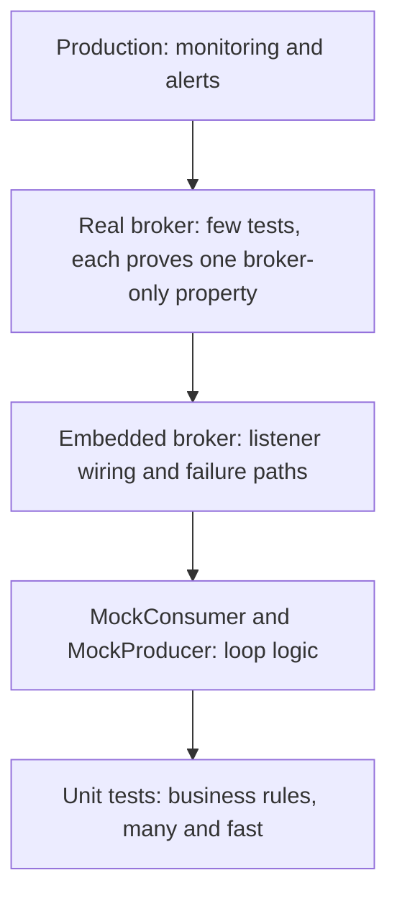

@part kafka-testing-observability | Kafka · Part 6b: Testing, Monitoring and Troubleshooting | distributed
## A Testing Strategy for Kafka Code

A payment listener passes every unit test, and in production two events of the same order are charged in the wrong order, because the producer forgot to set the record key. No mock could have caught that: a mocked `KafkaTemplate` accepts any arguments. Kafka code is correct only in combination with partitions, serializers, offsets and a broker, so a test strategy for it has to decide, for every property you care about, **which level of test can prove it**.

### What each level proves

| Level | Tool | Proves | Cannot prove | Cost |
|---|---|---|---|---|
| Unit | JUnit with plain objects or fakes | Business logic, mapping, idempotency check | Anything about Kafka | Milliseconds |
| Plain client | `MockConsumer`, `MockProducer` | Your own poll loop, commit and retry logic | Partitioning, real serializers, rebalances | Milliseconds |
| Embedded broker | `@EmbeddedKafka` | Listener wiring, serialization, topics, error handling, dead letters | The exact broker version and configuration you run | Seconds |
| Real broker | Testcontainers with the Apache Kafka image | The same, on the real server version and settings | Scale, real network failures | Seconds, shared across tests |
| Contract | Schema compatibility checks, fixture files | That producers and consumers still agree on events | Behaviour | Milliseconds |
| Production | Monitoring, alerts, canary traffic | Everything else | | Continuous |

The levels are not alternatives. Most of your tests should be fast and low, and a small number should go through a real broker, one per property that only a broker can prove: the key chooses the partition, the JSON survives the round trip, a bad record reaches the dead-letter topic, a duplicate does no harm.



### Design so most tests need no Kafka

The biggest win is in the code, not the tests. Keep the annotated method thin and put the decisions in a plain class.

```java PaymentHandler.java
package com.shopstream.payment.messaging;

import com.shopstream.payment.events.OrderCreated;
import com.shopstream.payment.service.PaymentService;
import com.shopstream.payment.service.ProcessedEvents;

/** All the decisions of the listener, with no Kafka types in sight. */
public class PaymentHandler {

    private final PaymentService payments;
    private final ProcessedEvents processed;

    public PaymentHandler(PaymentService payments, ProcessedEvents processed) {
        this.payments = payments;
        this.processed = processed;
    }

    /** @return true if the event was charged, false if it was a duplicate */
    public boolean handle(OrderCreated event) {
        if (!processed.firstTime("order-created:" + event.orderId())) {
            return false;
        }
        payments.charge(event);
        return true;
    }
}
```

The listener becomes one line that calls `handler.handle(event)`. Now the rules (a duplicate is ignored, a failure propagates) are tested with ordinary objects, in microseconds:

```java PaymentHandlerTest.java
package com.shopstream.payment.messaging;

import static org.junit.jupiter.api.Assertions.assertEquals;
import static org.junit.jupiter.api.Assertions.assertFalse;
import static org.junit.jupiter.api.Assertions.assertTrue;

import com.shopstream.payment.events.OrderCreated;
import com.shopstream.payment.service.PaymentService;
import com.shopstream.payment.service.ProcessedEvents;
import java.util.ArrayList;
import java.util.HashSet;
import java.util.List;
import java.util.Set;
import org.junit.jupiter.api.Test;

class PaymentHandlerTest {

    private final List<String> charged = new ArrayList<>();
    private final Set<String> seen = new HashSet<>();

    private final PaymentService payments = new PaymentService() {
        @Override public void charge(OrderCreated e) { charged.add(e.orderId()); }
        @Override public void refund(String orderId) { }
    };
    private final ProcessedEvents processed = seen::add;       // add() is true only the first time

    private final PaymentHandler handler = new PaymentHandler(payments, processed);

    @Test
    void duplicateDeliveryChargesOnce() {
        OrderCreated event = new OrderCreated("o-1", "c-9", 4_999, false);

        assertTrue(handler.handle(event));       // first delivery
        assertFalse(handler.handle(event));      // redelivery after a crash

        assertEquals(List.of("o-1"), charged);
    }
}
```

**What to notice.** The test needs no broker, no Spring context and no mocking library. It states the property that matters in production, *at-least-once delivery must not charge twice*, directly.

### Testing the sending side

For code written against the plain producer, `MockProducer` records everything sent, so you can assert on the **topic and the key**, which a mocked `KafkaTemplate` would never reveal as wrong.

```java OrderEventPublisher.java
package com.shopstream.order.messaging;

import org.apache.kafka.clients.producer.Producer;
import org.apache.kafka.clients.producer.ProducerRecord;

public class OrderEventPublisher {

    private final Producer<String, String> producer;

    public OrderEventPublisher(Producer<String, String> producer) {
        this.producer = producer;
    }

    public void orderCreated(String orderId, String json) {
        producer.send(new ProducerRecord<>("orders", orderId, json));   // the key keeps one order's events in order
    }
}
```

```java OrderEventPublisherTest.java
package com.shopstream.order.messaging;

import static org.junit.jupiter.api.Assertions.assertEquals;

import org.apache.kafka.clients.producer.MockProducer;
import org.apache.kafka.common.serialization.StringSerializer;
import org.junit.jupiter.api.Test;

class OrderEventPublisherTest {

    @Test
    void publishesToOrdersWithTheOrderIdAsKey() {
        MockProducer<String, String> producer = new MockProducer<>(true, new StringSerializer(), new StringSerializer());
        new OrderEventPublisher(producer).orderCreated("o-42", "{\"total\":10}");

        var sent = producer.history().get(0);
        assertEquals("orders", sent.topic());
        assertEquals("o-42", sent.key());          // the bug a mocked template would hide
    }
}
```

### Rules that remove flaky tests

Kafka tests are asynchronous, and nearly all flakiness comes from a few causes.

| Cause | Rule |
|---|---|
| A test consumer starts *after* the record was produced and misses it | Use `auto.offset.reset=earliest` for test consumers and listeners |
| `Thread.sleep(2000)` is too short on a slow CI machine and wasteful on a fast one | Wait for the condition with Awaitility (`await().atMost(...).untilAsserted(...)`) or Mockito's `timeout(...)` |
| Two tests share a topic and group, so one sees the other's records | Use a unique topic name or a unique `group.id` per test, or clean up |
| Tests assert on the number of `poll()` calls or on timing | Assert on outcomes: rows written, records received, headers present |
| A test starts a broker for each class | Share one broker and one Spring context across classes (*Integration Tests with Testcontainers*) |
| Tests run in parallel against one group | Give each its own `group.id` |

!tip Test the property, not the framework :: You do not need to prove that `@KafkaListener` calls a method or that Kafka orders a partition. Test your assumptions about them: that your key puts one order's events on one partition, that your JSON round-trips, that your error handler parks what it should.

!interview Interview angle: How do you unit-test a Kafka consumer? :: Separate the decisions from the transport: the listener only delegates to a plain handler, and the handler is tested with ordinary objects. Test your own poll loop with `MockConsumer`, and use an embedded or containerised broker for the few properties only a broker can prove (partitioning by key, serialization, dead-letter routing). Avoid sleeps; wait on conditions, and use `earliest` offsets and unique topics so tests do not interfere.

!keypoints Decide per property which test level can prove it: mocks cannot prove keys, partitions or serialization ;; Keep listeners thin; test the handler class with plain objects ;; `MockProducer` lets you assert the topic and key of what was sent ;; Test consumers need `auto.offset.reset=earliest`; wait with Awaitility, never sleep ;; Unique topics or groups per test prevent cross-talk ;; A few broker-backed tests, each proving one broker-only property, beat many broad ones

?? Why can a test with a mocked `KafkaTemplate` pass while the system loses per-order ordering?
=> The mock accepts any arguments, so a missing or wrong record key goes unnoticed. Ordering depends on the key choosing the partition, which only a test that captures the sent record's key, or one that uses a real broker, can check.

?? A Kafka integration test passes locally and fails on CI about one run in ten. Name three likely causes.
=> A fixed `sleep` that is too short on slow machines; a test consumer using `latest` that subscribes after the record was produced; or two tests sharing a topic or group so one consumes the other's records. Fix with condition-based waiting, `earliest`, and unique topics or groups.

?? Why is it useful to pass `Producer` and `Consumer` interfaces instead of concrete classes?
=> The test doubles `MockProducer` and `MockConsumer` implement the same interfaces, so the class can be tested without a broker.

## Embedded Broker Tests with spring-kafka-test

Between a unit test and a container sits the **embedded broker**: a real Kafka broker started inside the test JVM by `spring-kafka-test` (with Spring Boot 4 the test starter `spring-boot-starter-kafka-test` brings it). It is a genuine broker in KRaft mode with real partitions, real serializers and real consumer groups, started in about a second, with no Docker needed.

### The basic shape

```java PaymentListenerEmbeddedTest (Spring Boot test)
@SpringBootTest
@EmbeddedKafka(partitions = 3,
        topics = { "orders", "orders-dlt" },
        bootstrapServersProperty = "spring.kafka.bootstrap-servers")
@TestPropertySource(properties = "spring.kafka.consumer.auto-offset-reset=earliest")
class PaymentListenerEmbeddedTest {

    @Autowired KafkaTemplate<String, OrderCreated> template;
    @MockitoBean PaymentService payments;

    @Test
    void chargesTheOrderThatArrivesOnTheTopic() {
        template.send("orders", "o-1", new OrderCreated("o-1", "c-9", 4_999, false));

        verify(payments, timeout(10_000)).charge(argThat(e -> e.orderId().equals("o-1")));
    }
}
```

**What to notice.** The annotation starts a broker and creates the two topics with three partitions each. `bootstrapServersProperty` replaces the application's `spring.kafka.bootstrap-servers` with the embedded broker's address, so the real `payment-service` configuration, its listener, its deserializers and its error handler, all run against it unchanged. The test sends with the application's own `KafkaTemplate`, so the producer settings are tested too. `timeout(10_000)` waits for the asynchronous listener instead of sleeping. `@MockitoBean` replaces the service behind the listener, so the test stays about Kafka.

### Reading what the application wrote

Sometimes the test must look at a topic, for example to check the dead-letter topic. `KafkaTestUtils` builds a consumer for the embedded broker:

```java Reading a topic in a test
Map<String, Object> props = KafkaTestUtils.consumerProps("verifier-" + UUID.randomUUID(), "true", embeddedKafka);
props.put(ConsumerConfig.AUTO_OFFSET_RESET_CONFIG, "earliest");
try (Consumer<String, String> consumer = new DefaultKafkaConsumerFactory<>(
        props, new StringDeserializer(), new StringDeserializer()).createConsumer()) {
    embeddedKafka.consumeFromAnEmbeddedTopic(consumer, "orders-dlt");
    ConsumerRecord<String, String> dead = KafkaTestUtils.getSingleRecord(consumer, "orders-dlt", Duration.ofSeconds(10));
    assertThat(dead.headers().lastHeader(KafkaHeaders.DLT_EXCEPTION_FQCN)).isNotNull();
}
```

The unique group id keeps the verifying consumer from competing with the application. `getSingleRecord` fails the test with a clear message if no record arrives in time. The header names for dead-letter metadata are constants in `KafkaHeaders` (`DLT_EXCEPTION_FQCN`, `DLT_ORIGINAL_TOPIC`, `DLT_ORIGINAL_OFFSET` and others).

### Embedded broker or container?

| | `@EmbeddedKafka` | Testcontainers |
|---|---|---|
| Needs Docker | No | Yes |
| Start time | About a second | Several seconds for the first start |
| Broker version | Whatever `spring-kafka-test` bundles | Exactly the image you choose |
| Broker configuration | Limited | Any (listeners, auth, topics, KRaft settings) |
| Fidelity to production | Good for application logic | Better; the same image you run |
| Typical use | Everyday listener and error-handling tests | Pre-merge or nightly tests that must match production, tests with a database in the same setup |

Many teams use both: embedded for the inner loop, containers for a smaller suite that also runs against the database and the exact broker version.

!warning Gotcha: embedded brokers and the Spring test context cache :: The broker lives as long as the test class's context. Spring caches contexts across classes, so with different annotations you get several brokers, and with `@DirtiesContext` you pay a restart. Prefer sharing one context configuration, and isolate tests by topic name or group id instead of restarting the broker.

!keypoints `@EmbeddedKafka` starts a real KRaft broker in the test JVM: fast and Docker-free ;; `bootstrapServersProperty` points the real application configuration at it ;; Send with the application's own `KafkaTemplate`; wait with Mockito `timeout` or Awaitility ;; `KafkaTestUtils` builds verifying consumers; give them a unique group and `earliest` ;; Use containers when the broker version and configuration must match production ;; Isolate tests by topic or group, not by restarting the broker

?? What does `bootstrapServersProperty = "spring.kafka.bootstrap-servers"` do?
=> It makes the annotation set that property to the embedded broker's address, so the application's own Kafka configuration connects to the embedded broker instead of a real cluster.

?? Why give the verifying consumer a unique `group.id`?
=> If it used the application's group id it would join that group and take partitions (and records) away from the listener under test. A unique group lets it read independently.

?? When is the embedded broker not enough?
=> When behaviour depends on the exact broker version or configuration you run in production (authentication, listener setup, specific server settings), or when you want the same container setup as your CI uses for the database.

## Integration Tests with Testcontainers

A container test starts the **same Apache Kafka image you run in production**, in Docker, and points the application at it. It takes longer than the embedded broker and is closer to the truth: the real server version, real KRaft configuration, a real listener setup. *Integration Testing with Testcontainers* in Spring Boot Beyond Basics introduced Testcontainers in general; this chapter covers what is specific to Kafka.

### Starting a broker for the test

The container class for the Apache image lives in the `org.testcontainers.kafka` package (older tutorials show `org.testcontainers.containers.KafkaContainer`, which was built for the Confluent image and is gone from current Testcontainers). Spring Boot's `@ServiceConnection` turns the running container into `spring.kafka.bootstrap-servers` automatically.

```java Kafka container for tests (Spring Boot test)
@TestConfiguration(proxyBeanMethods = false)
public class KafkaContainerConfig {

    // use the same version as your production cluster
    private static final String IMAGE = "apache/kafka:4.3.1";

    @Bean
    @ServiceConnection
    KafkaContainer kafka() {
        return new KafkaContainer(DockerImageName.parse(IMAGE));
    }
}
```

```java OrderFlowIT (Spring Boot test)
@SpringBootTest
@Import(KafkaContainerConfig.class)
@TestPropertySource(properties = "spring.kafka.consumer.auto-offset-reset=earliest")
class OrderFlowIT {

    @Autowired KafkaTemplate<String, OrderCreated> template;
    @Autowired PaymentLedger ledger;                     // the real service, backed by a test database

    @Test
    void eventsOfOneOrderAreProcessedInOrder() {
        String key = "o-" + UUID.randomUUID();
        for (int i = 1; i <= 50; i++) {
            template.send("orders", key, new OrderCreated(key, "c-9", i, false));   // totalCents carries the sequence
        }

        await().atMost(Duration.ofSeconds(30))
               .untilAsserted(() -> assertThat(ledger.totalsFor(key)).hasSize(50));
        assertThat(ledger.totalsFor(key)).isSorted();            // same key, one partition, in order
    }
}
```

**What to notice.** This test proves exactly the property that mocks cannot: records with one key arrive in the order they were sent. It uses a unique key so that earlier runs on a shared broker do not interfere, and it waits on the outcome with `await`. A container also lets you place the *database* in the same test setup and check the end result, a row in the ledger, instead of a mocked call.

### Sharing the broker

Starting a container per test class dominates the run time. Declare the container once as a bean in a shared `@TestConfiguration` (as above) or as a `static` field of a base class, so that every test class that uses the same Spring context configuration reuses one broker. Spring caches the context, and the container lives with it. Isolate tests from one another with unique keys, topics or group ids, as in the rules of the first chapter.

### What to put in a container test

Keep this suite small and meaningful. Good candidates:

- **Ordering by key**, as above.
- **A full round trip** through the real serializers: object to JSON to the broker and back to the listener.
- **Consumer group behaviour that needs a real coordinator**, for instance that two application instances share the partitions (start two contexts in one test).
- **Configuration you rely on**: the topic is created with the partitions and retention you intend; the dead-letter topic has at least as many partitions as the source topic.
- **Failure of the broker**: stop and restart the container in the test and check that the producer retries and the consumer reconnects. For network faults between application and broker, the Testcontainers Toxiproxy module can add latency or cut the connection.

### CI practicalities

- The CI runner needs Docker, and enough memory for the broker plus the database.
- Pin the image tag. A floating tag changes behaviour between runs.
- First start pulls the image; cache it on the runner so the pull is not repeated.
- If a build occasionally fails with a container start error, retry the start rather than the whole job, and look at the container log, which Testcontainers prints on failure.

!interview Interview angle: Why use Testcontainers for Kafka instead of mocking the clients? :: A mock verifies that your code calls an API; it cannot verify what Kafka does with the call. A real broker verifies the properties that matter in production: that the key places records on one partition and keeps their order, that serialization round-trips, that a consumer group commits and resumes correctly, and that the topics have the configuration you expect. Containers give that with the exact production version, at a cost of seconds, which is why the suite stays small and focused.

!keypoints A container test runs the exact production image and proves broker-only properties ;; For the Apache image use the `org.testcontainers.kafka` container; `@ServiceConnection` wires the address ;; Share one container across test classes through the cached Spring context ;; Prove ordering with a unique key and many sequenced records ;; Test configuration you depend on: partitions, retention, dead-letter topic size ;; Pin image tags and cache them on CI

?? What should an ordering test look like, and why use a unique key?
=> Send many records that carry a sequence number with one key, wait for all to be processed, and assert the processing order. A unique key stops records from earlier tests or runs on a shared broker from mixing into the check.

?? Why is the container declared once and shared rather than started per test class?
=> Starting a broker takes seconds, so a container per class makes the suite slow. A shared bean lives as long as the cached Spring context, so all classes with the same configuration reuse one broker.

?? Name a failure mode that only a container (not an embedded broker) lets you reproduce realistically.
=> Stopping and restarting the broker, or cutting the network with a proxy such as Toxiproxy, to verify producer retries and consumer reconnection against a server whose version and configuration match production.

## Testing Failure Paths and Event Contracts

The happy path is the part of a consumer that is easy to test and rarely the part that fails. The code that decides whether one malformed record stalls a partition, or whether a transient error costs a duplicate charge, is error handling, and it deserves tests as careful as the business logic.

### Make the back-off testable

A production back-off of seconds makes tests slow. Take the back-off as a bean, so that tests can replace it with milliseconds.

```java ErrorHandlingConfig.java
package com.shopstream.payment.config;

import com.shopstream.payment.service.PermanentPaymentException;
import org.springframework.context.annotation.Bean;
import org.springframework.context.annotation.Configuration;
import org.springframework.context.annotation.Profile;
import org.springframework.kafka.core.KafkaOperations;
import org.springframework.kafka.listener.DeadLetterPublishingRecoverer;
import org.springframework.kafka.listener.DefaultErrorHandler;
import org.springframework.util.backoff.BackOff;
import org.springframework.util.backoff.FixedBackOff;

@Configuration
class ErrorHandlingConfig {

    @Bean
    @Profile("!test")
    BackOff productionBackOff() {
        return new FixedBackOff(1_000L, 3);
    }

    @Bean
    @Profile("test")
    BackOff testBackOff() {
        return new FixedBackOff(10L, 3);            // same shape, 100 times faster
    }

    @Bean
    DefaultErrorHandler errorHandler(KafkaOperations<Object, Object> template, BackOff backOff) {
        var handler = new DefaultErrorHandler(new DeadLetterPublishingRecoverer(template), backOff);
        handler.addNotRetryableExceptions(PermanentPaymentException.class);
        return handler;
    }
}
```

The test changes only the time, not the behaviour. That is the right kind of difference between test and production.

### The tests worth writing

Each of these pins down one decision of the error policy. They run against the embedded broker (or a container) with a fake service that counts calls.

| Test | Setup | Assert |
|---|---|---|
| **A transient failure is retried and then succeeds** | The fake fails twice, then works | The handler was called 3 times; nothing in the dead-letter topic |
| **A permanent failure is not retried** | The fake throws `PermanentPaymentException` | Called exactly once; one record in `orders-dlt` with `DLT_EXCEPTION_FQCN` set |
| **Retries are bounded** | The fake always fails | Called 4 times (the first attempt plus 3 retries); one dead letter |
| **A poison pill does not block the partition** | Send bytes that are not JSON, then a valid event with the same key | The valid event is processed; the bad bytes are in the dead-letter topic with the original payload intact |
| **A duplicate has no extra effect** | Send the same event twice | One charge |
| **Dead letters keep their origin** | Any dead-lettered record | `DLT_ORIGINAL_TOPIC`, partition and offset headers match the source |

The poison-pill test is the most valuable one. Send the bad record with a raw byte-array producer, bypassing the application's JSON serializer, so the broker really holds invalid JSON:

```java Sending a record that is not valid JSON (Spring Boot test)
Map<String, Object> props = KafkaTestUtils.producerProps(embeddedKafka);
try (Producer<String, byte[]> raw = new DefaultKafkaProducerFactory<>(
        props, new StringSerializer(), new ByteArraySerializer()).createProducer()) {
    raw.send(new ProducerRecord<>("orders", "o-7", "{not json".getBytes(StandardCharsets.UTF_8)));
    raw.send(new ProducerRecord<>("orders", "o-7", validJson("o-8")));     // must still be processed
}
verify(payments, timeout(10_000)).charge(argThat(e -> e.orderId().equals("o-8")));
```

If this test passes, a malformed record cannot stall a partition. If the service lacks `ErrorHandlingDeserializer`, the test fails by timing out, which is exactly the production failure, found in a build.

### Events are an API

Between services, an event is a public interface, and changing it can break consumers you do not own. The test strategy is the one for any API: **make compatibility a check, not a hope**.

| Technique | How it works | Fits |
|---|---|---|
| Schema compatibility in CI | The build asks the Schema Registry whether the new schema is compatible with the registered one (the registry's `/compatibility/subjects/<subject>/versions/latest` endpoint, or the registry's Maven plugin) and fails if not | Avro, Protobuf, JSON Schema with a registry (*Evolving Schemas Safely*) |
| Fixture files | Keep real examples of every past version of the event as files in the consumer's test resources; send each through the real listener and assert that it is still understood | JSON events without a registry |
| Consumer-driven contracts | Each consumer publishes the shape it relies on (Pact message pacts, Spring Cloud Contract); the producer's build verifies it | Many independent consumer teams |

The fixture technique costs almost nothing and catches the most common break: someone renames `customerId` to `buyerId`. Send each fixture to the topic with a `KafkaTemplate<String, String>`, wait for the effect, and the listener's real deserializer does the checking. Add the new fixture whenever the event changes, and never delete the old ones until no producer can send them.

!interview Interview angle: What are the most important consumer tests, and why? :: The failure-path tests. A poison pill must go to the dead-letter topic without stalling the partition; a transient error must be retried and a permanent one must not; redelivery must not repeat an effect. They are the behaviours that fail in production, they cannot be seen in a happy-path test, and they are cheap to write once the back-off is injectable.

!keypoints Inject the back-off so tests run in milliseconds with production's shape ;; Test each policy decision: retry then succeed, permanent not retried, bounded retries, dead-letter metadata ;; The poison-pill test (bad bytes, then a good record) proves a partition cannot be stalled ;; Send invalid data with a raw byte producer to bypass your own serializer ;; Treat events as an API: schema compatibility checks, fixture files, consumer-driven contracts ;; Keep fixtures of every historical event version
 
?? Why must the bad record in a poison-pill test be sent with a byte-array producer?
=> The application's own serializer would turn any object into valid JSON. To put invalid bytes on the topic, as a faulty producer in production would, the test must bypass that serializer.

?? A permanent business error is retried three times before reaching the dead-letter topic. What is wrong and how do you prove the fix?
=> The exception is not classified as non-retryable. Register it with `addNotRetryableExceptions`, and add a test where the fake throws it and asserts exactly one call and one dead letter.

?? What is the cheapest way to detect that a producer's change broke a consumer?
=> Keep fixture files of past event versions in the consumer's test resources and send each through the real listener on every build; a renamed or retyped field makes the test fail before release.
