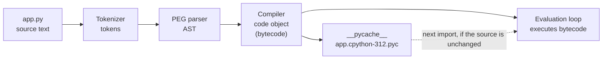
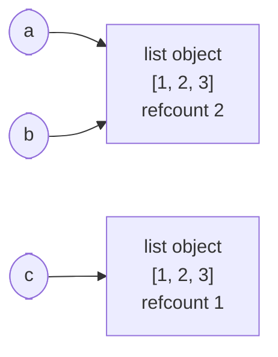

@part py-core-1 | Core Python · Part 1: The Python Platform and CPython | core-python
## What Python Is

Python is a **general-purpose, dynamically typed, garbage-collected, multi-paradigm language** designed around readability. Guido van Rossum started it in the late 1980s and released it in 1991. Python 3 arrived in December 2008 and deliberately broke compatibility with Python 2 (text became Unicode, `print` became a function, integer division became true division). Python 2 reached end of life on 1 January 2020, so everything you learn here is Python 3.

Four phrases in that definition do most of the work:

- **Dynamically typed.** Names have no types; *objects* do. `x = 1` and then `x = "one"` is legal because `x` is only a label that can point at any object. Types are checked when an operation runs, not before.
- **Strongly typed.** Python will not silently turn `"1" + 1` into something. It raises `TypeError`. Dynamic and weak are different things (JavaScript is both dynamic and weak).
- **Garbage collected.** You never free memory. CPython counts references and also runs a cycle collector (Part 10).
- **Multi-paradigm.** Procedural scripts, object-oriented classes and functional code (first-class functions, comprehensions, generators) all work and mix freely.

```python Hello.py
import platform
import sys

print("Hello from", platform.python_implementation())
print("Major version:", sys.version_info.major)
print(type(1), type("a"), type(None), type(print))
```

```output
```

`type(print)` printing `<class 'builtin_function_or_method'>` is the first hint of Python's core idea: **everything is an object**, including functions, classes and modules.

### Python is not "just interpreted"

"Interpreted language" and "compiled language" describe *implementations*, not languages. The reference implementation, **CPython**, first **compiles** your source to bytecode and then **interprets** that bytecode on a virtual machine, which is the same two-step shape as Java (`javac` then the JVM). The difference is where the work happens and how much optimisation is done: Java compiles ahead of time and its JIT turns hot code into machine code; CPython compiles on import, caches the bytecode, and (until the experimental JIT of 3.13+) interprets it.

| Implementation | What it is | Use it when |
| --- | --- | --- |
| **CPython** | The reference implementation, written in C. What `python` means on python.org, in Docker images and in almost all production | Always, unless you have a reason not to. Every library targets it |
| **PyPy** | Python written in a restricted Python (RPython) with a tracing JIT | Long-running, pure-Python, CPU-bound code. Weaker with C extensions |
| **MicroPython / CircuitPython** | A small Python 3 subset for microcontrollers | Embedded devices |
| **GraalPy** | Python on GraalVM (can call Java) | Embedding Python in a JVM application |
| **Jython, IronPython** | Python on the JVM and .NET | Rarely: they lag far behind Python 3 releases |
| **Cython, Nuitka, mypyc** | Compilers that translate Python (or a typed dialect) to C or machine code | Speeding up one hot module, or shipping a single executable |

This tree is about CPython. When a page says "Python does X" it means CPython does X; where another implementation differs, the page says so.

### Where Python is used, and what it costs

| Strong at | Weaker at |
| --- | --- |
| Web back ends (Django, FastAPI, Flask), APIs, automation, glue code | Raw CPU-bound speed: a plain Python loop is 10 to 100 times slower than the same loop in Java or Go |
| Data, analytics and machine learning (NumPy, pandas, PyTorch) | True multi-core threading in one process (the GIL, Part 8) |
| Scripting, DevOps tooling, testing, scraping | Mobile apps and in-browser code |
| Fast to write and read; the largest library ecosystem (PyPI) | Start-up time and memory per process are higher than a compiled language's |

The honest summary for interviews: Python buys **developer speed**; you pay in **raw runtime speed**, and you recover it by using C-backed libraries (NumPy, `json`, `re`), `asyncio` for I/O-bound concurrency, `multiprocessing` for CPU-bound parallelism, and by not putting hot loops in pure Python.

!realworld Why Python rules the back end of AI products :: Most AI work is calling a C, C++ or CUDA library (PyTorch, NumPy, `llama.cpp`) from a thin Python layer. The Python is orchestration; the heavy arithmetic is not Python at all. That is why a Python web service in front of a model is normal, and why "Python is slow" is rarely the real bottleneck in a web back end: database calls, network calls and model calls are.

### The release cycle and what "supported" means

Since Python 3.9 there is **one feature release every October**. Each release gets about two years of bug-fix releases and then security-only fixes, for roughly **five years** in total, after which it is end of life. Python 3.13 (October 2024) and 3.14 (October 2025) are recent releases; 3.15 is due in October 2026. In production you normally run a release that is at least a few months old so that your libraries have wheels (pre-built packages) for it. Check the status table on python.org before choosing a version for a new project.

!tip Pick the version deliberately :: For a new service, choose the newest release that all your dependencies support, pin it in your `Dockerfile` and CI (`python:3.13-slim`, not `python:3`), and write it in `pyproject.toml` (`requires-python = ">=3.12"`). "It works on my laptop's Python" is a classic source of production-only bugs.

!keypoints Everything in Python is an object ;; Names are labels, types live on objects ;; Python is strongly and dynamically typed ;; CPython compiles to bytecode, then interprets it ;; One feature release per year, about five years of support ;; Python buys development speed and pays in raw speed

??  Is Python interpreted or compiled?
=> Both, depending on what you mean. The language has no such property; the implementation does. CPython compiles source to bytecode (cached as `.pyc` files) and then interprets the bytecode on its virtual machine. PyPy adds a JIT; Cython and Nuitka compile to C or machine code.
??  What is the difference between dynamic typing and weak typing?
=> Dynamic typing means types are attached to objects and checked at run time, so a name can refer to different types over time. Weak typing means the language silently converts between unrelated types. Python is dynamic and strong: `"1" + 1` raises `TypeError` instead of converting.
??  Why is a Python loop so much slower than the same loop in Java, and what do people do about it?
=> CPython interprets bytecode and every value is a heap object (an integer is a full object with a reference count and a type pointer), whereas the JVM compiles hot loops to machine code and keeps primitives unboxed. People move the hot loop into C-backed libraries (NumPy, `re`, `json`), use `multiprocessing` for CPU parallelism, `asyncio` for I/O waiting, or compile the hot module (Cython, mypyc), and they profile before optimising.
??  What changed between Python 2 and Python 3 that you should know?
=> Text is Unicode by default (`str`) with `bytes` as a separate type; `print` is a function; `/` is true division and `//` is floor division; `range` and `dict.items()` are lazy views; and the standard library was reorganised. Python 2 has been unsupported since 2020.

## From Source to Running Program

Running `python app.py` does five things. Knowing them explains `.pyc` files, why import time matters, `SyntaxError` timing and why Python bytecode is specific to a version.



1. **Tokenize** the text into tokens (names, numbers, operators, indentation changes as `INDENT`/`DEDENT`).
2. **Parse** the tokens into an **abstract syntax tree (AST)** with the PEG parser (Python 3.9 and later). A `SyntaxError` comes from this step, *before any line runs*.
3. **Compile** the AST into a **code object** holding bytecode, constants and names.
4. For an imported module, **cache** the code object in `__pycache__/<name>.cpython-312.pyc`. The next import skips steps 1 to 3 if the source's modification time and size still match.
5. **Execute** the bytecode in the evaluation loop (`ceval.c`), a stack machine: instructions push and pop values on a per-call stack.

The `ast` module lets you see step 2 yourself:

```python Ast.py
import ast

tree = ast.parse("total = price * 3")
print(ast.dump(tree, indent=2))
```

```output
```

And `dis` shows step 3, the bytecode the compiler produced:

```python Bytecode.py
import dis


def add(a, b):
    return a + b


dis.dis(add)
print("constants:", add.__code__.co_consts)
print("local names:", add.__code__.co_varnames)
```

```output
```

Read the instructions as a tiny stack machine: `LOAD_FAST` pushes the local variable `a`, then `b`; `BINARY_OP` pops both and pushes the sum; `RETURN_VALUE` pops it and returns. Bytecode is **an implementation detail**: the instruction names and numbering change between versions (3.11 introduced a specialising adaptive interpreter that rewrites hot instructions in place; 3.13 and 3.14 changed instructions again). Never write code that depends on it, and never share `.pyc` files between Python versions: the file name carries the version for that reason.

### The .pyc cache, watched in action

```python PycCache.py
import importlib
import pathlib
import sys

pathlib.Path("greet.py").write_text("def hello():\n    return 'hi'\n")
sys.path.insert(0, ".")
import greet

print(greet.hello())
print([p.name for p in pathlib.Path("__pycache__").iterdir()])
print("greet module file:", pathlib.Path(greet.__file__).name)
importlib.invalidate_caches()
```

```output
```

Only **imported** modules are cached. The top-level script you run (`python app.py`) is compiled every time, which is why big programs keep their top-level file tiny and put the code in modules.

!warning Do not commit __pycache__ :: Bytecode caches are build artefacts, tied to one Python version. Add `__pycache__/` and `*.pyc` to `.gitignore`. In Docker, set `PYTHONDONTWRITEBYTECODE=1` if you do not want them in the image, or pre-compile on purpose with `python -m compileall` to cut start-up time.

### Python versus Java: the same shape, different weights

| Step | Java | Python (CPython) |
| --- | --- | --- |
| Source file | `Main.java` | `main.py` |
| Compile | `javac` produces `.class` files (explicit, ahead of time) | Automatic on import, cached as `.pyc` (implicit) |
| Executed by | JVM: interpreter plus C1/C2 JIT compilers | Evaluation loop; 3.11+ specialising interpreter; experimental JIT from 3.13 |
| Type errors found | At compile time (static types) | At run time, or earlier if you run a type checker such as mypy or pyright |
| Distribution | A JAR plus a JRE | Source or a wheel plus an interpreter (or a bundled executable) |
| Memory management | Tracing GC over a heap with generations | Reference counting plus a cycle collector |
| Parallel threads | Real parallelism on all cores | One thread runs bytecode at a time per interpreter (the GIL) unless you use the free-threaded build or processes |

!interview What happens when you import a module? :: Python looks the name up in `sys.modules` first. If absent, it finds the file through `sys.path` (the *finders*), compiles it (or loads the cached `.pyc`), creates a module object, **executes the module's top-level code once**, stores the module in `sys.modules`, and binds the name. A second `import` of the same name just reuses the cached module object. That is why top-level code runs once and why module-level state behaves like a singleton.

??  Where does a SyntaxError get raised: before the program runs or while it runs?
=> Before any line of that file runs, during parsing. If the file is imported, the error is raised at the `import` statement. A `NameError` or `TypeError`, by contrast, appears only when execution reaches that line.
!qa
What does this program print, and why does the second line not appear?
```python Boom.py !fail
print("first")
value = int("forty-two")
print("second")
```
=>
It prints `first`, then raises `ValueError` while converting the string, so execution stops and `second` never runs.
```output
```
Python reports the error with a traceback: the last line names the exception and the lines above it show the call path, oldest first.
!end
??  What is a code object, and where do you find it on a function?
=> A code object is the compiled form of a block of code: its bytecode (`co_code`), constants (`co_consts`), names and the number of arguments. Every function has one at `function.__code__`. It is immutable and shared by all calls; each call gets its own frame to hold local values.
??  Why do .pyc files live in a folder called __pycache__ and carry "cpython-312" in the name?
=> Bytecode differs between Python versions and implementations, so one folder can hold several variants side by side (`name.cpython-312.pyc`, `name.cpython-313.pyc`, `name.pypy310.pyc`). The interpreter picks the one that matches itself and recompiles if none matches.

## The CPython Object Model

Understanding one picture removes most beginner confusion about Python: **a variable is a name bound to an object**. Assignment never copies an object; it makes a name point at it.



Every object in CPython starts with the same header: a **reference count** and a pointer to its **type**. After that comes the data that belongs to that kind of object.

```python Identity.py
a = [1, 2, 3]
b = a            # same object, second name
c = [1, 2, 3]    # equal value, different object

print("a == c:", a == c)   # compares values
print("a is c:", a is c)   # compares identity
print("a is b:", a is b)

b.append(4)
print("a after b.append(4):", a)

# Small integers are cached; other values are separate objects
x, y = int("256"), int("256")
p, q = int("257"), int("257")
print("256 is 256:", x is y)
print("257 is 257:", p is q)
```

```output
```

The last two lines are **an implementation detail** (CPython caches the integers from -5 to 256), not a language guarantee. The rule to take away: use `==` to compare values, and `is` only for identity checks against singletons such as `None`, `True` and `False`.

### Everything has a size, a type and an identity

```python Sizes.py
import sys

for value in (0, 1, 2**30, 2**100, 1.5, "", "hello", b"hi", None, True, (), [], {}, set()):
    print(f"{type(value).__name__:<8} {sys.getsizeof(value):>4} bytes  {value!r}"[:52])
```

```output
```

These sizes are CPython on a 64-bit build; they will differ on another platform. An `int` is a variable-length object (it grows by 4 bytes per 30 bits, which is why Python integers never overflow), and even `True` is an `int` subclass instance. A list of one million integers is therefore far larger than a Java `int[]` of the same length, which is one reason NumPy arrays exist.

### Reference counting and the cycle collector

CPython frees most objects *immediately*: when the reference count drops to zero, the object's memory is released. That is deterministic and cheap, and it is why files closed by dropping the last reference usually close at once (but never rely on that: use `with`).

```python Refcount.py
import sys

data = []
print("one name:", sys.getrefcount(data) - 1)   # getrefcount itself adds one temporary reference
alias = data
print("two names:", sys.getrefcount(data) - 1)
del alias
print("after del:", sys.getrefcount(data) - 1)
```

```output
```

Reference counting cannot free **cycles** (two objects that reference each other keep each other's count above zero). A separate **cyclic garbage collector** finds those; Part 10 covers it, the `gc` module and how memory leaks happen in long-running services.

### Two ideas every Java developer must unlearn

1. **There are no primitives.** `int`, `float`, `bool` are full objects. There is no `int` versus `Integer` distinction and no autoboxing.
2. **No declarations, no `final`.** A name exists when you assign it and can be rebound at will. Constants are a *naming convention* (`MAX_RETRIES = 3`), enforced only by linters and type checkers (`typing.Final`).

!cheat Names, objects and identity ::
- `x = y` binds a second name; it never copies.
- `==` asks "equal value?" (calls `__eq__`); `is` asks "same object?". Use `is` only for `None`, `True`, `False` and sentinels.
- Mutable objects (`list`, `dict`, `set`, most classes) can change in place; immutable ones (`int`, `str`, `tuple`, `frozenset`, `bytes`) cannot.
- `id(x)` is the identity, `type(x)` the type, `sys.getsizeof(x)` the shallow size.
- Reference count hits zero: freed at once. Cycles: freed later by the cyclic collector.
!end

??  What is the difference between `==` and `is`?
=> `==` compares values by calling `__eq__`; `is` compares identity (the same object in memory). Two equal lists are `==` but not `is`. Use `is` for `None` and other singletons, never to compare numbers or strings, because object reuse is an implementation detail.
??  Why can a Python integer never overflow, and what does it cost?
=> `int` is an arbitrary-precision object that allocates more digits as the value grows. You pay with memory (28 bytes for a small int, plus 4 more per 30 bits) and speed (every operation goes through an object), compared with a fixed-width Java `int`.
??  How does CPython decide an object can be freed?
=> Each object has a reference count; when it reaches zero, CPython frees it immediately. Objects in reference cycles never reach zero, so a separate generational cyclic garbage collector periodically finds unreachable cycles and frees them.

## Your First Programs and the Toolchain

You need three things on a developer machine: an interpreter, an isolated place to install libraries (a **virtual environment**) and a package tool. In 2026 the fastest way to get all three is **uv**, though `venv` and `pip` (built into Python) always work.

### Run code five ways

| Command | What it does |
| --- | --- |
| `python` | Starts the REPL (read-eval-print loop). Best place to try a small idea |
| `python app.py` | Runs a script. `sys.argv` holds its arguments |
| `python -m package.module` | Runs a module found on `sys.path`; this is how `-m venv`, `-m pip`, `-m pytest`, `-m http.server` work |
| `python -c "print(1 + 1)"` | Runs one statement from the command line |
| `python -i app.py` | Runs the script, then drops into the REPL with its names defined |

```python Entry.py
import sys


def main() -> int:
    print("arguments:", sys.argv[1:])
    print("module name:", __name__)
    return 0


if __name__ == "__main__":
    raise SystemExit(main())
```

```output
```

`if __name__ == "__main__":` is Python's `public static void main`. When a file is **run**, its `__name__` is `"__main__"`; when it is **imported**, `__name__` is the module's name, so the guard keeps import side-effect free. Returning an exit code through `raise SystemExit(main())` is the clean pattern for command-line tools.

### Virtual environments

Never `pip install` into the system Python. Each project gets its own environment, a folder with its own `python` and `site-packages`:

```bash Create, activate, install
# built-in tools
python -m venv .venv
.venv\Scripts\activate          # Windows (PowerShell: .venv\Scripts\Activate.ps1)
source .venv/bin/activate       # macOS and Linux
python -m pip install requests
python -m pip freeze > requirements.txt

# the same with uv (one tool for Python versions, venvs, installs and locking)
uv init demo && cd demo
uv add requests                 # creates .venv, updates pyproject.toml and uv.lock
uv run python main.py           # runs inside the project's environment
uv python install 3.13          # downloads and manages interpreters
```

| Tool | Role | Notes |
| --- | --- | --- |
| `venv` | Creates isolated environments | In the standard library |
| `pip` | Installs packages from PyPI | Ships with Python; `python -m pip` guarantees the right interpreter |
| `uv` | Fast all-in-one: installs, venvs, lock files, Python versions, scripts, tools | Written in Rust; the common choice for new projects |
| `pipx` / `uv tool` | Install command-line tools (ruff, black, httpie) in their own environments | Keeps tools out of project dependencies |
| `poetry`, `pdm`, `hatch` | Project managers with lock files and builds | Common in existing codebases |
| `conda` | Environments plus non-Python binaries (CUDA, compilers) | Popular in data science |

### What a project looks like

```bash Project layout
shop/
  pyproject.toml        # name, version, requires-python, dependencies, tool settings
  uv.lock               # exact resolved versions (commit it for applications)
  src/
    shop/
      __init__.py
      main.py
  tests/
    test_main.py
  .gitignore            # .venv/, __pycache__/, *.pyc
```

`pyproject.toml` is the single standard file for metadata and tool configuration (PEP 517, 518, 621). `requirements.txt` still appears in older projects and in Docker examples, but new applications should declare dependencies in `pyproject.toml` and lock them.

!tip Two commands you will type every day :: `python -m pip list --outdated` shows what is stale, and `python -m site` / `python -c "import sys; print(sys.executable)"` tells you which interpreter you are actually running. "Wrong interpreter" is the most common beginner problem: always check `sys.executable` first when an import fails.

!warning Do not name your file after a library :: A file called `random.py`, `email.py` or `requests.py` in your project folder shadows the real module, because the script's folder is first on `sys.path`. The symptom is an import error or an attribute missing from a module that "should" have it.

??  Why use a virtual environment instead of installing packages globally?
=> Each project needs its own dependency versions. A virtual environment isolates them so that upgrading a library for one project cannot break another, keeps the system Python clean, and makes the project reproducible (together with a lock file).
??  What does `if __name__ == "__main__":` do and why is it used?
=> The code under it runs only when the file is executed directly, not when it is imported. It lets a file be both a reusable module and a runnable script, and it prevents import-time side effects such as starting a server.
??  What is the difference between `python script.py` and `python -m package.module`?
=> The first runs a file by path and puts the script's folder on `sys.path`. The second runs a module by its importable name, so relative imports and package context work as in real use, and the current folder becomes the first path entry. Use `-m` for tools (`-m pytest`) and for running modules inside packages.
??  What goes in pyproject.toml, and how is it different from requirements.txt?
=> `pyproject.toml` declares the project (name, version, supported Python, dependencies) and the configuration of tools such as pytest and ruff. `requirements.txt` is just a list of pinned packages for pip. Modern workflow: declare in `pyproject.toml`, lock with `uv.lock` (or another lock file), and export a `requirements.txt` only when a tool needs one.

## Python for Java Developers: A Crosswalk

If you know Java, Python will feel familiar and wrong at the same time. This table is the map for the rest of the tree. Each row links to the part that teaches it.

| Java | Python | Remember |
| --- | --- | --- |
| Static types, checked at compile time | Dynamic types, checked at run time; optional type hints (Part 12) | Hints are not enforced by the interpreter |
| `null` | `None` | A real object (singleton) of type `NoneType`; compare with `is None` |
| `int`, `long`, `Integer`... | one unbounded `int` | No overflow, no boxing |
| `==` for primitives, `.equals()` for objects | `==` for values, `is` for identity | `==` calls `__eq__` |
| `class` with fields and getters/setters | class with attributes, `@property` when needed | No getters by default (Part 3) |
| `private`, `protected` | `_name` by convention, `__name` for name mangling | Nothing is truly private |
| `interface`, `abstract class` | `abc.ABC`, `typing.Protocol` | Duck typing: if it has the method, it works |
| `ArrayList`, `HashMap`, `HashSet` | `list`, `dict`, `set` | Literal syntax: `[]`, `{}`, `{1, 2}` (Part 6) |
| `for (int i = 0; i < n; i++)` | `for i in range(n)` | `for` iterates over iterables |
| streams and lambdas | comprehensions, generators, `map`/`filter` (Part 7) | A comprehension is usually more Pythonic than `map` |
| `switch` | `match` (3.10+) or `if`/`elif`, dict dispatch | `match` is structural pattern matching, richer than `switch` |
| `try`/`catch`/`finally`, checked exceptions | `try`/`except`/`else`/`finally`, no checked exceptions | `with` replaces try-with-resources (Part 5) |
| `StringBuilder` | `"".join(parts)` | Strings are immutable in both |
| `synchronized`, threads, `ExecutorService` | `threading`, `concurrent.futures`, `asyncio`, `multiprocessing` | The GIL changes the rules (Parts 8 and 9) |
| Maven / Gradle | `uv`, `pip`, `poetry` + `pyproject.toml` | |
| JUnit, Mockito | `pytest`, `unittest.mock` | Tests are plain functions with `assert` |
| Spring Boot | FastAPI, Django, Flask | The web stage of this tree |
| Jackson | Pydantic, `json`, `dataclasses` | |
| Hibernate / JPA | SQLAlchemy, Django ORM | |
| `public static void main` | `if __name__ == "__main__":` | |

```python Java2Python.py
# The same small task in the two styles a Java developer writes first, and the Pythonic version.
prices = [120, 80, 45, 300, 15]

# Java-style translation
total = 0
i = 0
while i < len(prices):
    if prices[i] > 50:
        total += prices[i]
    i += 1

# Pythonic
pythonic = sum(p for p in prices if p > 50)

print(total, pythonic, total == pythonic)
```

```output
```

!interview "Pythonic" is a real interview word :: Interviewers use it to mean idiomatic: iterate over items instead of indexes, use comprehensions and generators, use `with` for resources, use `enumerate` and `zip`, unpack tuples, and prefer EAFP ("easier to ask forgiveness than permission": try it and catch the exception) over checking everything first (LBYL, "look before you leap"). Showing you can write the loop above in one line, and explaining when *not* to (when it hurts readability), is what they look for.

??  Name five things that are different in Python for someone coming from Java.
=> Dynamic typing instead of compile-time types; no primitives or boxing (one unbounded `int`); no access modifiers (underscore conventions); duck typing and protocols instead of mandatory interfaces; indentation instead of braces; `with` instead of try-with-resources; comprehensions and generators instead of streams; and the GIL, which means threads do not give CPU parallelism in standard CPython.
??  Does Python have `null`? Does it have checked exceptions?
=> It has `None`, a single real object of type `NoneType`, tested with `is None`. It has no checked exceptions: any function may raise anything, so you read documentation and write tests instead of relying on signatures.

## How to Study This Tree

The Python Full Stack tree has the same shape as the Java Full Stack tree: the language, then data structures and algorithms, then web frameworks, then data stores, operating systems and networks, distributed systems, design, delivery, frontend and interviews. Operating systems, networks, databases, Redis, Kafka internals, high-level design, Git and React are the *same deep guides* as in the Java tree, because those subjects do not depend on the language. Everything language-specific is written for Python.

### A weekly rhythm that works

| Block | Time | What to do |
| --- | --- | --- |
| Read | 40% | One chapter at a time. Type the examples; do not paste them |
| Run and break | 30% | Change an example, predict the result, run it, explain the difference |
| Practise | 20% | The chapter's questions, then 2 DSA problems a day (start at the DSA stage but keep going throughout) |
| Review | 10% | Explain yesterday's chapter aloud without notes (rubber-duck it) |

### Habits that separate fast learners

1. **Keep a REPL open next to the page.** Every claim in this tree can be tested in ten seconds. Use `help(obj)` and `dir(obj)` constantly.
2. **Read tracebacks from the bottom up.** The last line says what went wrong; the line above says where.
3. **Predict, then run.** Writing down what you expect an expression to print, before you run it, is the fastest way to find gaps.
4. **Build the projects** in Part 14 and the Library API in the FastAPI stage. Projects expose what reading hides.
5. **Pin your versions** (`uv.lock`) and write one test per bug you fix.

```python Repl.py
# dir() and help() are the two functions that make Python self-documenting.
names = [n for n in dir("text") if not n.startswith("_")]
print(len(names), "public methods on str, for example:", names[:6])
print(str.upper.__doc__)
```

```output
```

!cheat Python platform cheat sheet ::
| Question | Answer |
| --- | --- |
| Run a file / a module / a one-liner | `python f.py` / `python -m pkg.mod` / `python -c "..."` |
| Which Python am I running? | `python -c "import sys; print(sys.executable, sys.version)"` |
| Create and use an environment | `python -m venv .venv` then activate; or `uv venv` / `uv run` |
| Install | `python -m pip install pkg` or `uv add pkg` |
| See bytecode / AST | `import dis, ast` then `dis.dis(f)`, `ast.dump(ast.parse(src))` |
| What decides `is` results for ints? | CPython caches -5 to 256: an implementation detail |
| Entry point guard | `if __name__ == "__main__": main()` |
| Version support | One release per October, about five years of support |
!end

??  You get `ModuleNotFoundError: No module named 'requests'` right after installing it. What do you check?
=> Which interpreter is running versus which one pip installed into. Print `sys.executable`, run `python -m pip show requests` with the same interpreter, activate the project's virtual environment, and use `python -m pip` instead of bare `pip` so the two always match.
??  What is the difference between a module, a package and a distribution?
=> A module is one `.py` file you can import. A package is a folder of modules (with `__init__.py`, or a namespace package without it). A distribution is the thing you install from PyPI (a wheel or sdist) that contains one or more packages and metadata.
