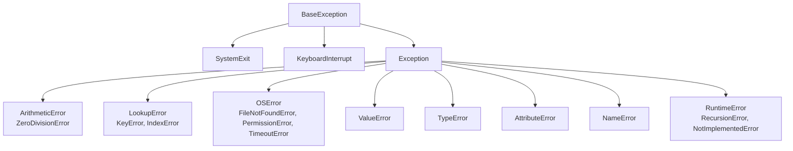

@part py-core-5 | Core Python · Part 5: Exceptions, Files and Utilities | core-python
## Exceptions

An exception is an object that interrupts normal flow and travels **up the call stack** until a matching `except` catches it; if none does, the program prints a traceback and exits. Python has **no checked exceptions**: any code may raise anything, so the discipline is yours.

```python Try.py
def parse_age(text):
    try:
        age = int(text)
    except ValueError as error:                 # catch the specific exception
        print("not a number:", error)
        return None
    else:                                       # runs only when the try block did NOT raise
        print("parsed", age)
        return age
    finally:                                    # ALWAYS runs: cleanup goes here
        print("done with", repr(text))

parse_age("42")
parse_age("forty")

try:
    {"a": 1}["b"]
except (KeyError, IndexError) as error:         # one handler for several types
    print(type(error).__name__, error)
```

```output
```

### The hierarchy



`except Exception` catches ordinary errors but **not** `KeyboardInterrupt` (Ctrl-C) or `SystemExit`, which derive from `BaseException`. A bare `except:` catches everything, including those two, and is almost always a bug.

### Raising, chaining and custom exceptions

```python Raising.py
class AppError(Exception):
    """Base class for this application's errors."""

class OrderNotFound(AppError):
    def __init__(self, order_id):
        super().__init__(f"order {order_id} not found")
        self.order_id = order_id

def load(order_id):
    try:
        return {"A1": "book"}[order_id]
    except KeyError as error:
        raise OrderNotFound(order_id) from error     # explicit cause

try:
    load("Z9")
except AppError as error:
    print(error, "| cause:", repr(error.__cause__), "| id:", error.order_id)

try:
    try:
        1 / 0
    except ZeroDivisionError:
        raise RuntimeError("calculation failed")     # implicit chaining: __context__ is set
except RuntimeError as error:
    print(repr(error.__context__))

try:
    raise ValueError("bad value")
except ValueError as error:
    error.add_note("while reading config.yaml")     # Python 3.11+
    print(error.__notes__)
```

```output
```

`raise NewError(...) from error` records the original as `__cause__` so the traceback shows both ("The above exception was the direct cause of..."); `raise ... from None` suppresses the context when it would only confuse. A bare `raise` inside `except` re-raises the current exception unchanged, which is right for "log and pass it on".

### Exception groups (3.11+)

Concurrent code can fail in several tasks at once. `ExceptionGroup` bundles errors, and `except*` handles the parts by type:

```python Groups.py
def run():
    raise ExceptionGroup("batch failed", [ValueError("bad row 3"), TypeError("bad type"), ValueError("bad row 9")])

try:
    run()
except* ValueError as group:
    print("values:", [str(e) for e in group.exceptions])
except* TypeError as group:
    print("types:", [str(e) for e in group.exceptions])
```

```output
```

`asyncio.TaskGroup` (Part 9) raises these. For ordinary code you rarely need them.

### Rules that make error handling good

1. **Catch the narrowest type you can handle**, as close as possible to where you can do something useful. Let the rest propagate.
2. **Never swallow silently** (`except Exception: pass`). At the least log with the traceback (`logger.exception(...)`).
3. **Do not use exceptions for normal control flow in hot loops**, but EAFP (try, then handle) is idiomatic Python and cheap when nothing is raised (since 3.11 a `try` block costs nothing until an exception occurs).
4. **Define one base exception per library or app** (`AppError`) so callers can catch all your errors without catching `Exception`.
5. **Do not `return` inside `finally`**: it silently discards an in-flight exception.
6. **`assert` is for debugging, not validation**: it is removed when Python runs with `-O`, and a validation check that vanishes in production is a vulnerability.

```python FinallyTrap.py
def risky():
    try:
        raise RuntimeError("important failure")
    finally:
        return "finally wins"          # swallows the RuntimeError

print(risky())
```

```output
```

!interview Difference between `except Exception` and a bare `except` :: A bare `except:` also catches `KeyboardInterrupt`, `SystemExit` and `GeneratorExit`, so Ctrl-C and `sys.exit()` stop working. `except Exception` handles errors and leaves those control-flow signals alone. In long-running workers, catch `Exception` at the top of the loop, log, and continue; let `BaseException` end the process.

??  What is the difference between `try/except/else/finally`'s `else` and putting the code in `try`?
=> Code in `else` runs only if the `try` block raised nothing, and its own exceptions are **not** caught by the preceding `except` clauses. Keep the `try` block as small as possible (just the line that can fail) and put the follow-up in `else`, so you never mask a bug in the follow-up code.
??  What does `raise ... from ...` do?
=> It sets `__cause__` on the new exception to the original one, so the traceback explicitly shows the chain, which is how you translate low-level errors (`KeyError`, `OSError`) into domain errors without losing the root cause. `from None` suppresses chaining.
??  Why is `except Exception: pass` dangerous?
=> It hides real bugs and failures: the program continues in an undefined state with no trace of what went wrong. Handle the specific case you expect, and log or re-raise everything else.
??  Python has no checked exceptions. What replaces them?
=> Documentation (docstrings state what a function raises), a small exception hierarchy for the application, type hints and tests, and boundaries (an API layer or worker loop) that catch and translate unexpected errors.

## Context Managers and `with`

A **context manager** guarantees cleanup: the `with` statement calls `__enter__` on entry and `__exit__` on the way out **even if an exception occurs**. It is Python's try-with-resources and is used for files, locks, database transactions, temporary state and timing.

```python Context.py
class Tracer:
    def __init__(self, name):
        self.name = name

    def __enter__(self):
        print("enter", self.name)
        return self                      # bound by `as`

    def __exit__(self, exc_type, exc, traceback):
        print("exit", self.name, "error:", exc_type.__name__ if exc_type else None)
        return False                     # False: do not suppress the exception

with Tracer("a") as a, Tracer("b") as b:
    print("inside")

try:
    with Tracer("c"):
        raise ValueError("boom")
except ValueError:
    print("handled outside")
```

```output
```

Writing a class is rarely necessary. `contextlib.contextmanager` turns a generator into a context manager: code before `yield` is the setup, code after is the teardown.

```python ContextLib.py
from contextlib import ExitStack, contextmanager, suppress
import time

@contextmanager
def timer(label):
    start = time.perf_counter()
    try:
        yield
    finally:                                        # runs on success and on error
        print(f"{label} took {'under a second' if time.perf_counter() - start < 1 else 'a while'}")

with timer("loop"):
    sum(range(1000))

with suppress(FileNotFoundError):                  # explicit, narrow "ignore this error"
    open("missing.txt").read()
print("continued")

with ExitStack() as stack:                         # a dynamic number of context managers
    for name in ("one", "two"):
        stack.callback(print, "closing", name)
    print("working")
```

```output
```

!tip Use a context manager whenever something must be undone :: Open files and sockets (`with open(...)`), database connections and transactions, locks (`with lock:`), temporary directories (`tempfile.TemporaryDirectory()`), changed settings (`decimal.localcontext`), mocks in tests. If you write `x.acquire()` and `x.release()` by hand, you have found a missing `with`.

??  What does the `with` statement guarantee?
=> That `__exit__` runs when the block ends, whether normally, through `return`/`break`, or by an exception, so resources are released deterministically. `__exit__` may inspect the exception and return `True` to suppress it.
??  How do you write a context manager without a class?
=> Decorate a generator function with `@contextlib.contextmanager`: statements before `yield` run on entry, the yielded value is bound by `as`, and statements after `yield` (put in `try/finally`) run on exit.
??  Why is relying on garbage collection to close a file a bad idea?
=> CPython usually closes a file when its last reference disappears, but PyPy and other implementations do not, buffered data may not be flushed when you expect, and on Windows an unclosed file stays locked. `with open(...)` makes closing explicit and portable.

## Logging and Debugging Basics

`print` is for scripts; `logging` is for programs that run somewhere you cannot watch. It gives **levels** (DEBUG, INFO, WARNING, ERROR, CRITICAL), **named loggers** arranged in a hierarchy, and **handlers** that decide where records go (console, file, syslog, a collector) with **formatters** that decide how they look.

```python Logging.py
import logging
import sys

handler = logging.StreamHandler(sys.stdout)
handler.setFormatter(logging.Formatter("%(levelname)-7s %(name)s: %(message)s"))
app = logging.getLogger("shop")                    # the application's parent logger
app.addHandler(handler)
app.setLevel(logging.INFO)

log = logging.getLogger("shop.orders")             # child: inherits handlers and level
log.debug("not shown: below INFO")
log.info("order %s placed for %.2f", "A-1", 12.5)  # lazy %-style arguments
log.warning("stock low for %s", "pen")
try:
    1 / 0
except ZeroDivisionError:
    log.exception("payment failed")                 # ERROR plus the traceback
print(log.name, log.getEffectiveLevel() == logging.INFO, log.isEnabledFor(logging.DEBUG))
```

```output
```

Habits that matter:

- One logger per module: `log = logging.getLogger(__name__)`. **Libraries never configure handlers**; the application does, once, at start-up (`logging.basicConfig(...)` for simple programs or `logging.config.dictConfig(...)` for real ones).
- Pass arguments instead of formatting: `log.info("user %s", user_id)`. The string is built only if the record is emitted.
- `log.exception(...)` inside `except` records the traceback. Do not log and re-raise the same error at every layer: log once, at the boundary.
- Never log secrets or personal data (tokens, passwords, card numbers). Containers should log to **stdout** and let the platform collect it.
- In production prefer structured (JSON) logs with request and trace IDs (see the observability part of the web stage).

### Debugging

| Tool | Use |
| --- | --- |
| Read the traceback | Bottom line: what; frames above: where |
| `breakpoint()` | Drops into `pdb` at that line (`n` next, `s` step, `c` continue, `p expr`, `l` list, `q` quit) |
| `python -m pdb script.py` | Debug from the start; `-i` or `post_mortem` after a crash |
| IDE debugger | Same engine, with breakpoints and watches (VS Code, PyCharm) |
| `traceback.format_exc()` | The traceback as a string (for logging in a custom handler) |
| `warnings.warn("...", DeprecationWarning)` | Tell callers an API is going away without breaking them |
| `python -X dev` / `-W error` | Development mode: more checks; turn warnings into errors in tests |

!warning Do not leave print() debugging in committed code :: It floods production output with noise and can leak data. Use `logging` at DEBUG level; linters (`ruff T201`) flag stray prints.

??  Why use `logging` instead of `print`?
=> Levels (filter by severity), configurable destinations, timestamps and context in the format, per-module loggers that can be tuned independently, thread safety and integration with every framework and log collector, all without changing the call sites.
??  Why pass `log.info("user %s", user)` rather than an f-string?
=> The logging call formats the message only if the record will actually be emitted, so disabled DEBUG logs cost almost nothing, and log systems can group records by the unformatted template.
??  What does `logging.getLogger(__name__)` give you?
=> A logger named after the module's import path (`shop.orders`), arranged in a hierarchy so configuring `shop` configures everything below it, and log lines that tell you which module produced them.

## Files and `pathlib`

```python Files.py
from pathlib import Path
import shutil
import tempfile

root = Path(tempfile.mkdtemp())
notes = root / "notes" / "today.txt"               # `/` joins paths on any operating system
notes.parent.mkdir(parents=True, exist_ok=True)

notes.write_text("first line\nsecond line\n", encoding="utf-8")
with notes.open("a", encoding="utf-8") as handle:
    handle.write("third line\n")

print(notes.read_text(encoding="utf-8").splitlines())
with notes.open(encoding="utf-8") as handle:
    for number, line in enumerate(handle, start=1):  # lazy: one line at a time
        print(number, line.rstrip())

print(notes.name, notes.stem, notes.suffix, notes.parent.name, notes.exists(), notes.stat().st_size > 0)
(root / "a.csv").write_text("x\n")
(root / "notes" / "b.csv").write_text("y\n")
print(sorted(p.relative_to(root).as_posix() for p in root.rglob("*.csv")))
print(sorted(p.name for p in root.iterdir()))

shutil.copy(notes, root / "copy.txt")
shutil.rmtree(root)
print(root.exists())
```

```output
```

| Mode | Meaning |
| --- | --- |
| `"r"` (default) | Read text; error if the file is missing |
| `"w"` | Write text; **truncates** an existing file |
| `"a"` | Append text |
| `"x"` | Create; error if it exists (a safe "do not overwrite") |
| `"rb"`, `"wb"` | Binary read/write (images, archives, network data) |
| `"r+"` | Read and write |

Use `pathlib.Path` rather than string concatenation and `os.path`: it handles separators for you, and has `read_text`, `write_text`, `glob`, `rglob`, `mkdir`, `unlink`, `rename`, `stat`. Iterate over a file object line by line instead of calling `read()` on a large file.

### Writing a file safely

A crash in the middle of `write_text` leaves a half-written file. For configuration or state, write to a temporary file in the **same directory** and rename it over the target, which the operating system does atomically:

```python Atomic.py
import json
import os
import tempfile
from pathlib import Path

def save_atomically(path: Path, data: dict) -> None:
    fd, tmp = tempfile.mkstemp(dir=path.parent, suffix=".tmp")
    try:
        with os.fdopen(fd, "w", encoding="utf-8") as handle:
            json.dump(data, handle)
            handle.flush()
            os.fsync(handle.fileno())            # make sure the bytes reached the disk
        os.replace(tmp, path)                    # atomic on the same filesystem
    except BaseException:
        os.unlink(tmp)
        raise

target = Path("state.json")
save_atomically(target, {"version": 2})
print(target.read_text())
```

```output
```

!warning Path traversal :: Never join a user-supplied name onto a base directory without checking where it lands. `base / user_input` with `"../../etc/passwd"` escapes the folder. Resolve and verify: `target = (base / name).resolve(); if not target.is_relative_to(base.resolve()): raise ValueError`. File upload and download endpoints are the usual victims (a standard OWASP finding).

??  Why prefer `pathlib` to `os.path`?
=> `Path` objects are readable (`base / "data" / "x.txt"`), portable across operating systems, and bundle common operations (`read_text`, `glob`, `mkdir`, `exists`) in one place, whereas `os.path` is a set of string functions.
??  What is the difference between modes `"w"` and `"a"`, and what is `"x"` for?
=> `"w"` truncates the file to zero length before writing; `"a"` appends to the end; `"x"` creates the file and fails with `FileExistsError` if it already exists, which prevents accidental overwrites.
??  How do you process a 10 GB file with little memory?
=> Open it and iterate (`for line in handle`) or read fixed-size chunks (`handle.read(1 << 20)`), process each piece and discard it. Avoid `read()` or `readlines()`, which load everything. For structured data use streaming parsers (`csv`, `ijson`) or memory-mapped files (`mmap`).
??  How do you avoid corrupting a file if the program crashes while writing?
=> Write to a temporary file in the same directory, flush and `fsync`, then `os.replace` it onto the target, which is atomic. Readers then see either the old or the new complete file.

## Serialization and Its Dangers

Serialization turns objects into bytes or text for storage and transmission. The standard library offers several formats with very different trade-offs.

```python Json.py
import csv
import io
import json
import tomllib
from datetime import datetime, timezone
from decimal import Decimal

order = {"id": 7, "items": ["pen", "ink"], "total": 12.5, "paid": True, "note": None, "tags": ("a", "b")}
text = json.dumps(order, indent=2, sort_keys=True, ensure_ascii=False)
print(text)
print(json.loads(text) == order, json.loads(text)["tags"])      # the tuple came back as a list

try:
    json.dumps({"at": datetime(2026, 11, 4, tzinfo=timezone.utc)})
except TypeError as error:
    print("TypeError:", error)

print(json.dumps({"at": datetime(2026, 11, 4, tzinfo=timezone.utc), "price": Decimal("9.99")}, default=str))

rows = list(csv.DictReader(io.StringIO("name,score\nasha,91\nravi,78\n")))
print(rows, sum(int(r["score"]) for r in rows))

config = tomllib.loads('[server]\nhost = "0.0.0.0"\nport = 8000\n[features]\nflags = ["a", "b"]')
print(config["server"]["port"], config["features"]["flags"])
```

```output
```

| Format | Module | Use it for | Caution |
| --- | --- | --- | --- |
| JSON | `json` | APIs, configuration, interchange with other languages | No dates, tuples, sets, `Decimal` or binary; object keys become strings |
| CSV | `csv` | Spreadsheets and exports | Everything is text; open with `newline=""`; beware formula injection in exports |
| TOML | `tomllib` (read), `tomli-w` (write) | Configuration (`pyproject.toml`) | Read-only in the standard library |
| INI | `configparser` | Simple settings files | Flat; values are strings |
| YAML | `PyYAML` (third party) | Human-edited configuration | Use `safe_load`, never `load` |
| pickle | `pickle` | **Trusted** Python-to-Python caches | **Executes code on load** |

### Pickle can run arbitrary code

`pickle` can rebuild almost any Python object, and to do so it can **call any function** while loading. Unpickling data from an attacker is remote code execution:

```python Pickle.py
import pickle

class Harmless:
    def __reduce__(self):                      # tells pickle how to rebuild the object
        return (print, ("this ran during pickle.loads, with the privileges of your program",))

blob = pickle.dumps(Harmless())
pickle.loads(blob)                             # prints the message: any callable could have been named here
```

```output
```

Here the "attack" is a `print`; a real payload would call `os.system`. The rules: **never unpickle data you did not produce yourself** (no pickles from users, queues, caches shared with other tenants, or downloaded files), prefer JSON or Protocol Buffers for anything that crosses a trust boundary, and sign or encrypt cached pickles if you must use them. Many ML model files had this problem, which is why formats such as `safetensors` exist.

!interview JSON versus pickle :: JSON is a language-neutral, human-readable data format that cannot execute code; it supports a small set of types and needs conversion for the rest. Pickle is Python-specific, handles arbitrary objects and is only safe for trusted data. For APIs, queues and caches that other services touch, use JSON (validated by Pydantic) or a schema format; reserve pickle for private, short-lived local caches.

??  Why does `json.dumps` raise `TypeError` for a `datetime` and how do you fix it?
=> JSON has no date type, so the encoder refuses unknown types. Convert explicitly (`dt.isoformat()`), pass `default=` with a function that converts such objects, or serialise through a model library (Pydantic) that knows the types.
??  What are the security risks of `pickle` and `yaml.load`?
=> Both can construct arbitrary objects and call functions during loading, so loading untrusted input executes attacker-chosen code. Use `json` and `yaml.safe_load` for untrusted data, and treat pickle as trusted-only.
??  What happens to tuples, sets and integer dictionary keys in a JSON round trip?
=> Tuples come back as lists, sets are not serialisable (convert to a list), and integer keys become strings (`{1: "a"}` returns as `{"1": "a"}`). Design the data model for JSON explicitly, or validate it with a schema.

## The Operating System Interface

```python System.py
import os
import platform
import shlex
import subprocess
import sys

os.environ["APP_MODE"] = "demo"
print(os.environ.get("APP_MODE"), os.environ.get("MISSING", "default"), os.getenv("MISSING") is None)
print(sys.platform in {"win32", "linux", "darwin"}, platform.python_implementation())
print(os.getcwd() == str(__import__("pathlib").Path.cwd()), os.cpu_count() >= 1, os.sep in ("/", "\\"))

result = subprocess.run([sys.executable, "-c", "import sys; print('child says hi'); sys.exit(3)"],
                        capture_output=True, text=True, timeout=10)
print(result.returncode, result.stdout.strip(), repr(result.stderr))

user_input = "report; rm -rf /"
print(shlex.quote(user_input))
try:
    subprocess.run([sys.executable, "-c", "raise SystemExit(1)"], check=True)
except subprocess.CalledProcessError as error:
    print("check=True raised:", error.returncode)
```

```output
```

- **Environment variables** carry configuration into a process (the twelve-factor way): `os.environ["DATABASE_URL"]` for required values (a `KeyError` at start-up is a *good* failure) and `os.environ.get("PORT", "8000")` for optional ones. Parse types explicitly (`int(...)`, comma-separated lists), and validate once at start-up, which is what Pydantic Settings automates later in this tree.
- **`subprocess.run([...])`** runs another program. Pass the command as a **list** so no shell is involved; add `check=True` to raise on a non-zero exit code, `capture_output=True, text=True` to collect output, and always a `timeout`. `shell=True` with any user-influenced string is command injection; if you must build a shell command, `shlex.quote` each piece.
- **`sys.exit(code)`** ends the program with an exit status (0 = success); in tools, `raise SystemExit(main())` is the clean entry point. Containers and CI rely on the status code.
- **`signal`** handles `SIGTERM` and `SIGINT` so a service can shut down gracefully (finish requests, flush buffers), which Docker and Kubernetes send before killing a process.

!cheat Exceptions, files and OS cheat sheet ::
- Narrow `except`; never bare; never silent; `raise X from e` to wrap; `finally` for cleanup; no `return` in `finally`.
- `with` for everything that must be released: files, locks, transactions, temp dirs.
- `logging.getLogger(__name__)`; lazy `%s` arguments; `log.exception` in `except`; libraries do not configure handlers.
- `pathlib.Path`, explicit `encoding="utf-8"`, iterate files lazily, atomic writes via `os.replace`, resolve user paths before use.
- JSON for interchange, `pickle` and `yaml.load` never on untrusted data.
- `subprocess.run([list], check=True, timeout=...)`; never `shell=True` with user input.
- Configuration from environment variables, validated at start-up.
!end

??  How do you read configuration in a container-friendly way?
=> From environment variables (and optionally a `.env` file in development), parsed and validated once at start-up into a settings object, with required values failing fast and secrets never hard-coded or logged. Pydantic Settings does this declaratively.
??  Why pass a list to `subprocess.run` instead of a string with `shell=True`?
=> With a list, arguments reach the program exactly as given, with no shell to interpret `;`, `&&`, `$()` or globs. With `shell=True` and untrusted text, an attacker can append commands. A list is also portable across operating systems.
??  What does `check=True` do in `subprocess.run`?
=> It raises `CalledProcessError` when the child exits with a non-zero status, so failures cannot be ignored by accident; without it you must inspect `returncode` yourself.
