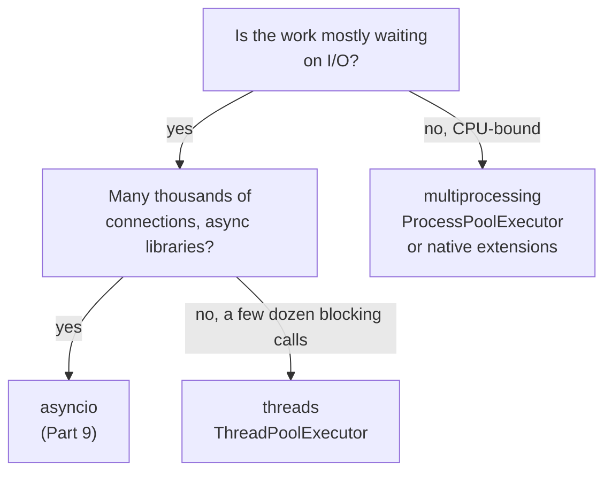

@part py-core-8 | Core Python · Part 8: Concurrency: Threads, Processes and the GIL | advanced-python
## Concurrency Concepts

**Concurrency** is dealing with many things at once (overlapping their progress); **parallelism** is doing many things at the same instant on several CPU cores. A program can be concurrent on one core (a web server juggling thousands of waiting connections) and parallel only with several cores.

The first question is never "which module?" but **"what is my program waiting for?"**

| Workload | Time is spent... | Best tool in Python | Why |
| --- | --- | --- | --- |
| **I/O-bound**: HTTP calls, database queries, files, sockets | waiting for something outside the CPU | `asyncio` (many connections) or threads (simple, blocking libraries) | The GIL is released while waiting, so waits overlap |
| **CPU-bound**: parsing, image or data crunching, hashing, compression in pure Python | executing bytecode | `multiprocessing` / `ProcessPoolExecutor`, or C-backed libraries (NumPy) | Each process has its own interpreter and GIL |
| **Mixed** | both | Processes for the CPU part, async or threads for the I/O part | Separate the two |



Python gives you four building blocks:

| Model | Module | Scheduling | Memory | Parallel CPU? |
| --- | --- | --- | --- | --- |
| Threads | `threading`, `concurrent.futures.ThreadPoolExecutor` | Preemptive (the OS) | Shared | Not in standard CPython (the GIL) |
| Processes | `multiprocessing`, `ProcessPoolExecutor` | Preemptive (the OS) | Separate; data is copied or shared explicitly | **Yes** |
| Coroutines | `asyncio` | **Cooperative** (`await` points) | Shared, one thread | No |
| Sub-interpreters | `concurrent.interpreters` (3.14) | Preemptive | Mostly isolated | Yes, with isolation |

!interview The first sentence of every Python concurrency answer :: "Is it I/O-bound or CPU-bound?" For I/O-bound work use threads or `asyncio`; for CPU-bound work use processes (or a native library). Interviewers ask this to see whether you understand the GIL rather than recite module names.

??  What is the difference between concurrency and parallelism?
=> Concurrency is structuring a program so several tasks make progress during overlapping time periods (possibly on one core by switching); parallelism is executing several tasks at the same instant on multiple cores. Concurrency is about structure, parallelism about hardware.
??  A service calls five external APIs per request. Threads, processes or asyncio?
=> The work is I/O-bound, so overlap the waits: `asyncio.gather` with an async HTTP client (or a thread pool with a blocking client). Processes would add start-up and serialisation cost for no benefit.
??  Why is a thread cheaper than a process, and why does that not make threads always better?
=> Threads share the address space and are lighter to create and switch, and sharing data needs no copying. But shared mutable state needs locks and causes races, and in standard CPython only one thread executes Python bytecode at a time, so CPU-bound threads do not speed up.

## The GIL

The **Global Interpreter Lock** is a mutex inside CPython: **only one thread at a time executes Python bytecode in a given interpreter**. It exists because CPython's memory management (reference counts, Part 10) is not thread-safe without it: with the GIL, `ob_refcnt += 1` can never race, and C extensions can rely on that.

What it means in practice:

- **CPU-bound threads do not run in parallel.** Two threads each doing pure-Python arithmetic take about as long as running the loops one after the other (a little longer, from lock hand-offs).
- **Blocking I/O releases the GIL.** `time.sleep`, socket reads, file I/O and most database drivers release it while waiting, so threads waiting on I/O genuinely overlap.
- **Native libraries can release it.** NumPy, `hashlib`, `zlib`, `re` (for long operations) and many scientific libraries run C code without holding the GIL, so threads can use several cores there.
- The interpreter switches threads about every 5 ms (`sys.getswitchinterval()`): a thread holding the GIL is asked to release it, so threads do interleave, but never run bytecode simultaneously.

```python Gil.py
import sys
import threading
import time


def cpu_work(n=300_000):
    total = 0
    for i in range(n):
        total += i * i
    return total


def run_sequential(count):
    start = time.perf_counter()
    for _ in range(count):
        cpu_work()
    return time.perf_counter() - start


def run_threaded(count):
    threads = [threading.Thread(target=cpu_work) for _ in range(count)]
    start = time.perf_counter()
    for t in threads:
        t.start()
    for t in threads:
        t.join()
    return time.perf_counter() - start


def io_task():
    time.sleep(0.1)                         # simulates waiting for a network response


def io_sequential(count):
    start = time.perf_counter()
    for _ in range(count):
        io_task()
    return time.perf_counter() - start


def io_threaded(count):
    threads = [threading.Thread(target=io_task) for _ in range(count)]
    start = time.perf_counter()
    for t in threads:
        t.start()
    for t in threads:
        t.join()
    return time.perf_counter() - start


gil_enabled = getattr(sys, "_is_gil_enabled", lambda: True)()
print("GIL enabled:", gil_enabled, "| switch interval:", sys.getswitchinterval())

cpu_speedup = run_sequential(4) / run_threaded(4)
print("CPU-bound, 4 threads: speed-up below 1.6x:", cpu_speedup < 1.6)

io_speedup = io_sequential(5) / io_threaded(5)
print("I/O-bound, 5 threads: speed-up above 3x:", io_speedup > 3)
```

```output
```

The two printed comparisons are the whole story. (The exact ratios depend on your machine, so the program prints whether they fall in the expected range rather than the numbers.)

### Free-threaded Python and sub-interpreters

The GIL is no longer permanent:

- **Python 3.12** gave each sub-interpreter its **own GIL** (PEP 684), the basis for running several interpreters in one process.
- **Python 3.13** added an **experimental free-threaded build** (PEP 703, installed as `python3.13t`) with no GIL, plus an experimental JIT. **Python 3.14** made free-threaded Python an officially supported (but still optional) build (PEP 779) and added `concurrent.interpreters` (PEP 734) for sub-interpreters.
- In a free-threaded build, threads run bytecode in parallel on several cores, at the cost of some single-thread speed and the need for **thread-safe code and libraries**: anything that relied on the GIL to protect data now needs locks. Many popular packages need updates to ship free-threaded wheels.

The ordinary GIL build remains the default today. You check the situation at run time with `sys._is_gil_enabled()` (3.13 and later). Treat free-threading as something to **test and prepare for** rather than assume, and read the current status on python.org before relying on it.

!cheat The GIL in six lines ::
- One thread runs Python bytecode at a time per interpreter; threads still interleave (every ~5 ms).
- Reason: reference counting and C-extension safety.
- Threads speed up **I/O-bound** work (the GIL is released while waiting) and native code that releases it.
- Threads do **not** speed up CPU-bound pure Python; use processes.
- `x += 1` on shared data is still a race: the GIL protects the interpreter, not your logic.
- 3.13 and 3.14 have an optional free-threaded build; code must be genuinely thread-safe either way.
!end

??  What is the GIL and why does CPython have it?
=> A global lock that lets only one thread execute Python bytecode at a time in an interpreter. It makes reference counting and the C API thread-safe without fine-grained locks, and keeps single-threaded code fast. The cost is that multi-threaded pure-Python code cannot use more than one core.
??  If the GIL exists, do you still need locks in threaded Python code?
=> Yes. The GIL makes individual bytecodes atomic, but `counter += 1` is several bytecodes (load, add, store), and the interpreter can switch threads between them; check-then-act sequences span many operations. Locks protect your invariants, and free-threaded builds make that requirement unmistakable.
??  Does `ThreadPoolExecutor` make a CPU-bound job faster?
=> Not in the standard build: the threads take turns holding the GIL. Use `ProcessPoolExecutor`, a native library that releases the GIL, or a free-threaded build.
??  How can threads help when the GIL exists?
=> Whenever a thread blocks on I/O (network, disk, `sleep`) it releases the GIL, so other threads run during the wait. Waiting dominates in web back ends, so a thread pool or `asyncio` overlaps the waits and raises throughput even though bytecode never runs in parallel.

## Threads

```python Threads.py
import threading
import time

results = {}

def worker(name, seconds):
    time.sleep(seconds)
    results[name] = f"{name} done"                       # writing distinct keys: safe

threads = [threading.Thread(target=worker, args=(f"t{i}", 0.05 * (3 - i)), name=f"worker-{i}") for i in range(3)]
for t in threads:
    t.start()
print("started:", [t.name for t in threads], "alive:", all(t.is_alive() for t in threads))
for t in threads:
    t.join()                                             # wait for the thread to finish
print(sorted(results.values()), threading.current_thread().name, threading.active_count())

class Greeter(threading.Thread):                         # alternative: subclass and override run()
    def run(self):
        print("hello from", self.name)

g = Greeter(name="greeter")
g.start()
g.join()

local = threading.local()                                # per-thread storage
def remember(value):
    local.value = value
    time.sleep(0.01)
    print("thread-local value:", local.value)

for v in ("a", "b"):
    t = threading.Thread(target=remember, args=(v,))
    t.start()
    t.join()
```

```output
```

Key points: `start()` begins execution, `join()` waits; **daemon threads** (`daemon=True`) are killed abruptly when the main thread exits, so never put cleanup in them; an exception in a thread does not propagate to the caller (it prints a traceback and ends that thread), so capture results and errors explicitly, or use `ThreadPoolExecutor`, which does it for you. Signals and `KeyboardInterrupt` are delivered to the **main** thread only.

### A race condition, made deterministic

A race happens when the result depends on the interleaving of threads. Real races are intermittent, which makes them hard to teach, so this program forces the unlucky interleaving with sleeps to show exactly what goes wrong, then fixes it with a lock:

```python Race.py
import threading
import time

class Counter:
    def __init__(self):
        self.value = 0
        self.lock = threading.Lock()

    def unsafe_increment(self):
        current = self.value          # 1. read
        time.sleep(0.05)              # 2. the other thread runs here (in real code: a context switch)
        self.value = current + 1      # 3. write back a stale value

    def safe_increment(self):
        with self.lock:               # the read-modify-write is now one indivisible step
            current = self.value
            time.sleep(0.05)
            self.value = current + 1

def run(method):
    threads = [threading.Thread(target=method) for _ in range(2)]
    for t in threads:
        t.start()
    for t in threads:
        t.join()

unsafe, safe = Counter(), Counter()
run(unsafe.unsafe_increment)
run(safe.safe_increment)
print("without a lock:", unsafe.value, "(expected 2)")
print("with a lock:   ", safe.value)
```

```output
```

The bug is a **lost update**: both threads read 0, both write 1. It is the same as any check-then-act or read-modify-write on shared state: balances, counters, inventory ("if stock > 0: stock -= 1"), caches ("if key not in d: d[key] = compute()").

??  What is a race condition? Give an example in Python.
=> A bug where the outcome depends on the timing of threads. Example: two threads run `counter += 1`; each reads the old value, adds one and writes it back, so one increment is lost. Fix it with a lock, an atomic operation (`queue.Queue`, `itertools.count`), or by avoiding shared mutable state.
??  What is the difference between `start()` and `run()` on a thread?
=> `start()` creates a new OS thread that then calls `run()`; calling `run()` directly just executes the method in the current thread, with no concurrency.
??  Why must you `join()` threads, and what is a daemon thread?
=> `join()` waits for completion so results are ready and cleanup happens before exit. A daemon thread does not keep the process alive and is stopped abruptly at interpreter exit, so it is only suitable for background work that may be dropped (heartbeats), never for work that must finish.

## Synchronisation Primitives

| Primitive | Purpose |
| --- | --- |
| `Lock` | Mutual exclusion: one thread at a time in the critical section. Not re-entrant |
| `RLock` | A lock the same thread may acquire repeatedly (recursive methods) |
| `Semaphore(n)` | At most n threads at once (connection or rate limits) |
| `Event` | A flag threads wait on: `set()`, `wait()`, `clear()` (shutdown signal, "ready") |
| `Condition` | Wait until a condition on shared state becomes true (`wait`, `notify`) |
| `Barrier(n)` | n threads wait for each other at a rendezvous point |
| `queue.Queue` | Thread-safe FIFO: the safest way to pass work and results between threads |

### Producer and consumer with a queue

```python ProducerConsumer.py
import queue
import threading

tasks = queue.Queue(maxsize=3)         # a bounded queue gives back-pressure
results = queue.Queue()
STOP = object()                        # sentinel: "no more work"

def producer():
    for n in range(6):
        tasks.put(n)                   # blocks while the queue is full
    for _ in range(2):
        tasks.put(STOP)                # one stop signal per consumer

def consumer():
    while True:
        item = tasks.get()
        if item is STOP:
            break
        results.put(item * item)

workers = [threading.Thread(target=consumer) for _ in range(2)]
prod = threading.Thread(target=producer)
for t in (*workers, prod):
    t.start()
for t in (*workers, prod):
    t.join()

print(sorted(results.queue))
```

```output
```

`Queue` does its own locking, so producers and consumers never touch shared state directly. This is the most robust way to structure threaded programs: **share data by communicating through queues**, not by communicating through shared variables.

### Deadlock

A deadlock is a cycle of waiting: thread A holds lock 1 and wants lock 2, thread B holds lock 2 and wants lock 1. Neither can ever continue.

```python Deadlock.py
import threading

lock_a, lock_b = threading.Lock(), threading.Lock()
both_hold_first = threading.Barrier(2)
messages = []                                        # list.append is atomic; printed sorted for a stable result

def worker(first, second, name):
    with first:
        both_hold_first.wait()                       # make sure each thread holds its first lock
        if second.acquire(timeout=0.3):              # a timeout is how we notice the deadlock
            second.release()
            messages.append(f"{name} finished")
        else:
            messages.append(f"{name} gave up waiting: deadlock")

t1 = threading.Thread(target=worker, args=(lock_a, lock_b, "T1"))
t2 = threading.Thread(target=worker, args=(lock_b, lock_a, "T2"))
t1.start(); t2.start(); t1.join(); t2.join()
print(sorted(messages))

def ordered(first, second, name):                    # fix: everyone takes locks in the same global order
    first, second = sorted((first, second), key=id)
    with first, second:
        messages.append(f"{name} finished safely")

messages.clear()
threads = [threading.Thread(target=ordered, args=args) for args in ((lock_a, lock_b, "T1"), (lock_b, lock_a, "T2"))]
for t in threads:
    t.start()
for t in threads:
    t.join()
print(sorted(messages))
```

```output
```

Ways to avoid deadlock: acquire locks in a **fixed global order**, hold locks for the shortest possible time and never while calling unknown code or doing I/O, use timeouts on `acquire`, and prefer designs with no shared locks (queues, immutable data, one owning thread).

!warning Never call blocking or user code while holding a lock :: Holding a lock during an HTTP call, a database query or a callback is how one slow dependency freezes every thread that needs the lock, and how deadlocks appear through code you did not write. Compute outside the lock, update shared state inside it.

??  List the four conditions for a deadlock and how you break one.
=> Mutual exclusion, hold-and-wait, no pre-emption, and circular wait. The practical break is removing circular wait by ordering lock acquisition globally; timeouts and try-acquire (`acquire(timeout=...)`) address hold-and-wait and no pre-emption.
??  When do you use `RLock` instead of `Lock`?
=> When the same thread may need to acquire the lock again, for example a synchronised method calling another synchronised method of the same object. A plain `Lock` would deadlock against itself; an `RLock` counts acquisitions by the owning thread.
??  Why is `queue.Queue` preferred to a list plus a lock for passing work between threads?
=> It already provides correct locking, blocking `get`/`put` with timeouts, bounded size for back-pressure, and `task_done`/`join` for completion tracking, so there is far less to get wrong.

## Thread Pools and Futures

Creating a thread per task does not scale and makes error handling awkward. `concurrent.futures.ThreadPoolExecutor` runs tasks on a fixed set of reusable threads and returns **futures**, objects representing results that may not exist yet.

```python Pool.py
import time
from concurrent.futures import ThreadPoolExecutor, as_completed, wait, TimeoutError as FutureTimeout

DELAYS = {"a.com": 0.05, "b.com": 0.15, "bad.com": 0.25, "slow.com": 0.45}     # distinct, so the order is stable

def fetch(url):
    time.sleep(DELAYS[url])                                # pretend network call
    if "bad" in url:
        raise ConnectionError(f"cannot reach {url}")
    return f"{url}: 200"

urls = ["a.com", "slow.com", "b.com", "bad.com"]

with ThreadPoolExecutor(max_workers=4) as pool:
    print(list(pool.map(fetch, ["a.com", "b.com", "slow.com"])))       # results in INPUT order

    futures = {pool.submit(fetch, u): u for u in urls}
    for future in as_completed(futures):                               # results in COMPLETION order
        url = futures[future]
        try:
            print("ok  ", future.result())
        except ConnectionError as error:                               # the worker's exception is re-raised here
            print("fail", error)

    slow = pool.submit(fetch, "slow.com")
    try:
        slow.result(timeout=0.05)
    except FutureTimeout:
        print("timed out waiting; task still running:", slow.running())
    done, not_done = wait([slow], timeout=2)
    print(len(done), len(not_done), slow.done(), slow.cancelled())
```

```output
```

| Method | Behaviour |
| --- | --- |
| `submit(fn, *args)` | Schedules one call, returns a `Future` |
| `map(fn, iterable)` | Like `map`, results in input order; an exception appears when you reach that item |
| `as_completed(futures)` | Yields futures as each finishes |
| `future.result(timeout)` | Waits (re-raises the task's exception) |
| `future.add_done_callback(fn)` | Runs `fn(future)` on completion |
| `future.cancel()` | Cancels a task that has not started |
| `with executor:` / `shutdown(wait=True)` | Waits for running tasks and releases threads |

Sizing: the default is `min(32, cpu_count + 4)` threads. For I/O-bound work a few dozen is typical, limited by the remote systems you call, not by your CPU. Always bound the pool: an unbounded number of threads exhausts memory and file descriptors.

!tip Exceptions in thread pools :: An exception inside a task is stored in its future and re-raised by `result()`. If you submit tasks and never call `result()` (or `exception()`), the error disappears silently. Always collect results, or log in a wrapper.

??  What is a Future?
=> An object that represents the eventual result of an asynchronous computation: you can ask whether it is done, wait for the result with a timeout, get its exception, cancel it or attach a callback. `asyncio` has its own awaitable futures with a similar idea.
??  `pool.map` versus `as_completed`: when do you use which?
=> `map` when you want results in the same order as the inputs and will consume them all; `as_completed` when you want to handle each result as soon as it is ready (progress reporting, early exit on the first success) and need the future to know which task failed.
??  How do you stop a running thread?
=> You cannot kill a thread safely from outside. Cooperate: share a `threading.Event` (`stop.is_set()` checked in the loop), use timeouts on blocking calls, and let the thread return. For forceful cancellation use processes (`terminate`) or an `asyncio` task with `cancel()`.

## Processes and Real Parallelism

Each process has its **own interpreter and GIL**, so CPU-bound work scales across cores. The price is that arguments and results are **pickled** and sent between processes, and starting a process costs tens of milliseconds, so the work per task must be large enough to pay for it.

```python Processes.py
import os
from concurrent.futures import ProcessPoolExecutor
from multiprocessing import cpu_count


def count_primes(limit):
    count = 0
    for n in range(2, limit):
        if all(n % d for d in range(2, int(n ** 0.5) + 1)):
            count += 1
    return count


def child_pid(_):
    return os.getpid()


if __name__ == "__main__":                         # REQUIRED: child processes re-import this module (spawn)
    limits = [20_000, 30_000, 40_000, 50_000]
    with ProcessPoolExecutor(max_workers=min(4, cpu_count())) as pool:
        print(list(pool.map(count_primes, limits)))
        pids = set(pool.map(child_pid, range(8)))
    print("ran in separate processes:", os.getpid() not in pids and len(pids) >= 1)
```

```output
```

Things to know:

- **Start methods.** `spawn` (the default on Windows and macOS) starts a fresh interpreter that re-imports your module, which is why the `if __name__ == "__main__":` guard is mandatory. `fork` (the default on Linux until 3.14) copies the parent process, which is fast but unsafe if the parent has threads or open connections; Python 3.14 changes the Linux default to `forkserver`. Choose explicitly with `multiprocessing.get_context("spawn")`.
- **Everything crossing the boundary must be picklable**: top-level functions, plain data, dataclasses. Lambdas, open sockets and database connections are not.
- **Share carefully.** `multiprocessing.Queue`, `Pipe`, `Value`/`Array` and `shared_memory` exist, but the simplest robust design is: send inputs, return results, keep workers independent.
- **Chunking.** `pool.map(fn, items, chunksize=100)` reduces per-task overhead when tasks are tiny.
- In web services, do not fork inside a running ASGI server; offload CPU work to a task queue (Celery, Arq) or a separate worker pool.

```python Compare.py
import os
import sys
import time
from concurrent.futures import ProcessPoolExecutor, ThreadPoolExecutor
from multiprocessing import cpu_count


def burn(n):
    total = 0
    for i in range(n):
        total += i * i
    return total


def timed(executor_class, jobs, size):
    start = time.perf_counter()
    with executor_class(max_workers=4) as pool:
        list(pool.map(burn, [size] * jobs))
    return time.perf_counter() - start


if __name__ == "__main__":
    gil_enabled = getattr(sys, "_is_gil_enabled", lambda: True)()
    t_threads = timed(ThreadPoolExecutor, 4, 5_000_000)       # big tasks: start-up cost must not dominate
    t_processes = timed(ProcessPoolExecutor, 4, 5_000_000)
    print("cores available:", cpu_count() >= 1, "| GIL build:", gil_enabled)
    if gil_enabled and cpu_count() >= 4:
        print("processes beat threads on CPU-bound work:", t_processes < t_threads)
    else:
        print("fewer than 4 cores or a free-threaded build: comparison skipped")
```

```output
```

??  Why does multiprocessing need `if __name__ == "__main__":`?
=> With the `spawn` start method (the default on Windows and macOS) each child process imports the main module again to find the target function. Without the guard the import would start new pools recursively. Even on `fork` platforms, the guard is the portable habit.
??  What are the costs of using processes instead of threads?
=> Process start-up time, memory duplication, and serialisation: arguments and results must be pickled and copied through pipes, and shared state needs explicit mechanisms. They are worth it when each task does substantial CPU work.
??  What is the difference between `fork`, `spawn` and `forkserver`?
=> `fork` clones the parent (fast, but dangerous with threads, locks and open connections); `spawn` starts a clean interpreter and imports your code (slow start, safest, default on Windows and macOS); `forkserver` forks workers from a clean helper process (a safe middle ground, the default on Linux from Python 3.14).

## Choosing, and the Pitfalls

| Situation | Choice |
| --- | --- |
| 20 blocking HTTP calls with `requests` | `ThreadPoolExecutor` |
| 10,000 simultaneous connections, async libraries | `asyncio` (Part 9) |
| Resize 10,000 images, parse many big files | `ProcessPoolExecutor` (or NumPy/Pillow native code) |
| Call blocking code from async code | `await asyncio.to_thread(fn, ...)` |
| Heavy CPU job triggered by a web request | Background worker (Celery/Arq) with a queue, not inline |
| Periodic background task inside one process | A daemon thread or an asyncio task, plus a stop `Event` |

Common failure modes in real systems:

1. **Unbounded concurrency**: one thread or task per incoming item. Bound it with a pool, a semaphore or a bounded queue.
2. **Shared mutable state** without a lock (dictionaries used as caches, counters, lazily-initialised singletons). Prefer queues, immutable data, or one owner.
3. **Forgotten exceptions** in threads and futures.
4. **Blocking the event loop** in async code with a synchronous call (Part 9).
5. **Using threads for CPU work**, then concluding "Python is slow".
6. **Forking after threads started**, or sharing database connections across processes. Create connections after the fork or spawn.
7. **No shutdown path**: no stop `Event`, daemon threads doing important work, no handling of `SIGTERM`.

!realworld Gunicorn, Uvicorn and Celery are concurrency models in a box :: A production Python web service usually runs **several worker processes** (to use every core and to isolate crashes), each handling many requests with **threads (WSGI) or an event loop (ASGI)**. Celery workers add a process pool for CPU-heavy jobs. When you size `--workers`, `--threads` or `--concurrency`, you are choosing among exactly the models in this part.

!cheat Concurrency cheat sheet ::
- I/O-bound: `ThreadPoolExecutor` (blocking libs) or `asyncio`. CPU-bound: `ProcessPoolExecutor`.
- Threads: `start`/`join`, `daemon`, `Lock`/`RLock`/`Semaphore`/`Event`/`Condition`/`Barrier`, `queue.Queue`.
- A race needs shared mutable state; a deadlock needs a lock cycle: order the locks, use timeouts.
- Futures: `submit`, `map`, `as_completed`, `result(timeout)`; exceptions surface at `result()`.
- Processes: `spawn` needs the `__main__` guard; arguments must be picklable; chunk small tasks.
- GIL: protects the interpreter, not your invariants; free-threaded builds exist from 3.13 (supported in 3.14).
!end

??  How would you design a service that calls many slow APIs and also resizes images?
=> Separate the two: handle the API calls with `asyncio` (or a bounded thread pool), and send image resizing to a process pool or a task queue worker. The web process stays responsive and CPU work uses all cores.
??  What problems do you expect if two threads write to the same dictionary?
=> Single operations like `d[k] = v` are atomic under the GIL, but compound logic (check then insert, read-modify-write, iterate while another thread mutates) can race or raise `RuntimeError`. Protect with a lock, use a queue, or build a new dictionary and swap the reference.
