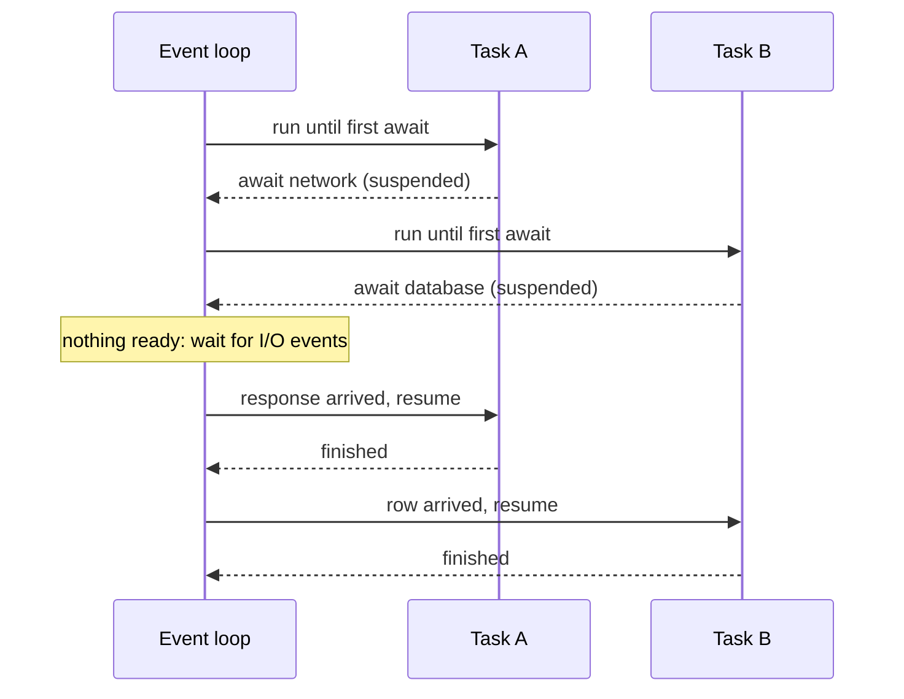

@part py-core-9 | Core Python · Part 9: asyncio in Depth | advanced-python
## The Event Loop and Coroutines

`asyncio` runs **many tasks on one thread** by letting each task say, at an `await`, "I am waiting; run someone else". A single **event loop** keeps a list of tasks, runs the ones that are ready, and resumes the others when their I/O completes. It is **cooperative**: a task is never interrupted, it only gives up control at an `await`. That makes it very cheap (a task is a small object, not an OS thread) and makes it possible to hold tens of thousands of open connections.



```python Basics.py
import asyncio


async def greet(name, delay):          # `async def` defines a COROUTINE FUNCTION
    await asyncio.sleep(delay)         # suspend here; the loop runs other tasks meanwhile
    return f"hello {name}"


async def main():
    coroutine = greet("asha", 0.1)     # calling it does NOT run it: it returns a coroutine object
    print(type(coroutine).__name__)
    print(await coroutine)             # `await` runs it to completion and gives the result

    # Sequential: total time is the sum of the waits
    results = [await greet("a", 0.1), await greet("b", 0.1)]

    # Concurrent: the waits overlap
    results += await asyncio.gather(greet("c", 0.1), greet("d", 0.1))
    print(results)


asyncio.run(main())                    # creates the loop, runs main(), closes the loop: ONE call per program
```

```output
```

Four rules to remember:

1. `async def` makes a function whose call returns a **coroutine object**; nothing runs until it is awaited or scheduled.
2. `await` can appear **only inside** `async def`. It suspends the current coroutine until the awaited thing completes and lets the loop run other work.
3. Only **awaitables** can be awaited: coroutines, tasks and futures.
4. `asyncio.run(main())` is the single entry point that creates and closes the event loop. (In a Jupyter notebook a loop is already running: just write `await main()`.)

### Concurrency needs tasks

Awaiting coroutines one after another is **sequential**. To overlap them, schedule them as **tasks** (or gather them):

```python Overlap.py
import asyncio
import time


async def fetch(name, delay):
    await asyncio.sleep(delay)
    return name


async def main():
    start = time.perf_counter()
    for n in range(3):
        await fetch(n, 0.2)
    sequential = time.perf_counter() - start

    start = time.perf_counter()
    await asyncio.gather(*(fetch(n, 0.2) for n in range(3)))
    concurrent = time.perf_counter() - start
    print("sequential is about 0.6 s:", 0.55 < sequential < 0.9)
    print("concurrent is about 0.2 s:", 0.15 < concurrent < 0.4)


asyncio.run(main())
```

```output
```

!interview Does async make code run in parallel? :: No. `asyncio` uses one thread, so only one piece of Python code runs at any instant. It improves **throughput for I/O-bound work** because the waits overlap. A CPU-bound coroutine (a long loop with no `await`) blocks the whole loop, and every other task stalls until it finishes.

??  What is the difference between a coroutine function, a coroutine object and a task?
=> A coroutine function is defined with `async def`. Calling it returns a coroutine object, a suspended computation that has not started. A task wraps a coroutine and schedules it on the event loop so it runs concurrently, even if nobody is awaiting it yet (`asyncio.create_task`).
??  What does `await` do?
=> It suspends the current coroutine until the awaited awaitable finishes, handing control back to the event loop so other tasks can run, then resumes with the awaited result (or raises its exception). It is a cooperative yield point.
??  Why does `asyncio.run` exist and why call it only once?
=> It creates a new event loop, runs the given coroutine to completion, cancels leftover tasks and closes the loop. A program normally has one top-level `asyncio.run`; calling it from inside a running loop raises `RuntimeError`.

## Tasks, `gather` and `TaskGroup`

```python Tasks.py
import asyncio


async def work(name, delay, fail=False):
    await asyncio.sleep(delay)
    if fail:
        raise ValueError(f"{name} failed")
    return f"{name} ok"


async def main():
    # create_task starts the coroutine immediately in the background
    background = asyncio.create_task(work("background", 0.1))
    print("scheduled:", background.done())
    print(await background, background.done())

    # gather: run together, results come back IN INPUT ORDER
    print(await asyncio.gather(work("a", 0.2), work("b", 0.1), work("c", 0.05)))

    # one failure: gather raises the first exception; with return_exceptions the rest are returned
    outcomes = await asyncio.gather(work("x", 0.05), work("y", 0.05, fail=True), return_exceptions=True)
    print(outcomes)

    # TaskGroup (3.11+): structured concurrency, failures cancel siblings and arrive as an ExceptionGroup
    try:
        async with asyncio.TaskGroup() as group:
            group.create_task(work("first", 0.05))
            group.create_task(work("second", 0.05, fail=True))
            slow = group.create_task(work("slow", 5))
    except* ValueError as errors:
        print("group failed:", [str(e) for e in errors.exceptions], "| slow task cancelled:", slow.cancelled())


asyncio.run(main())
```

```output
```

| Tool | Use it for | Failure behaviour |
| --- | --- | --- |
| `await coro` | One thing, in order | Raises directly |
| `asyncio.create_task(coro)` | Start now, await later | Exception is raised when you await the task (or logged as "never retrieved") |
| `asyncio.gather(*aws)` | A known batch, results in order | First exception propagates; other tasks **keep running**, unless `return_exceptions=True` |
| `asyncio.TaskGroup` (3.11+) | A set of related tasks with one lifetime | First failure **cancels the siblings**; errors arrive as an `ExceptionGroup`; nothing outlives the `async with` |
| `asyncio.as_completed(aws)` | Handle results as they finish | Per item |

Prefer `TaskGroup` for new code: it is **structured concurrency**, so no task can be forgotten or leaked, and failures cannot be silently lost.

!warning Keep a reference to fire-and-forget tasks :: The event loop holds only a **weak** reference to a task. `asyncio.create_task(send_email())` with no variable can be garbage collected mid-flight and vanish. Store tasks in a set (`tasks.add(t); t.add_done_callback(tasks.discard)`), or use a `TaskGroup`, or hand the work to a real background queue.

### Timeouts and cancellation

```python Timeouts.py
import asyncio


async def slow_call():
    try:
        await asyncio.sleep(10)
        return "finished"
    except asyncio.CancelledError:
        print("cleanup inside the cancelled task")
        raise                              # ALWAYS re-raise CancelledError


async def main():
    try:
        async with asyncio.timeout(0.1):               # 3.11+: a deadline for the whole block
            await slow_call()
    except TimeoutError:
        print("timed out")

    try:
        await asyncio.wait_for(slow_call(), timeout=0.1)   # older spelling, still fine
    except TimeoutError:
        print("wait_for timed out")

    task = asyncio.create_task(slow_call())
    await asyncio.sleep(0.05)
    task.cancel()                                       # request cancellation: raises CancelledError inside the task
    try:
        await task
    except asyncio.CancelledError:
        print("task cancelled:", task.cancelled())


asyncio.run(main())
```

```output
```

Cancellation works by raising `CancelledError` **at the task's current `await`**. Three rules: use `try/finally` (or `async with`) for cleanup; **never swallow** `CancelledError` (re-raise it), or timeouts and shutdowns stop working; and wrap things that must finish in `asyncio.shield(...)`. Put a **timeout on every network call**: a call without one can hang a task forever.

??  What is the difference between `gather` and `TaskGroup`?
=> `gather` returns results in order but leaves siblings running if one fails (unless `return_exceptions=True`) and tasks can outlive the call in some failure modes. `TaskGroup` ties task lifetimes to an `async with` block: the first failure cancels the remaining tasks, all are awaited, and the errors surface together as an `ExceptionGroup`.
??  How do you set a timeout on an async operation?
=> `async with asyncio.timeout(seconds): ...` (3.11+) or `await asyncio.wait_for(coro, seconds)`. Both cancel the work and raise `TimeoutError` when the deadline passes. Your code must allow the cancellation to propagate.
??  Why should a task never catch `CancelledError` and continue?
=> Cancellation is how timeouts, `TaskGroup` failures and shutdown stop work. Swallowing it makes the task uncancellable: the program hangs or the timeout fires without stopping the work. Do cleanup in `finally` and re-raise.

## Synchronisation and Communication

Even on one thread, interleaving at `await` points means shared state can still be touched in a bad order: any `await` between a check and an update opens a window. Use the async versions of the primitives; they are **not** thread-safe and **not** the same objects as in `threading`.

```python Limits.py
import asyncio

running = 0
peak = 0


async def call_api(i, semaphore):
    global running, peak
    async with semaphore:                    # at most N inside at once
        running += 1
        peak = max(peak, running)
        await asyncio.sleep(0.05)
        running -= 1
    return i


async def worker(name, queue, out):
    while True:
        item = await queue.get()
        try:
            out.append((name, item * item))
        finally:
            queue.task_done()


async def main():
    semaphore = asyncio.Semaphore(3)         # a concurrency limit: protects the downstream service
    await asyncio.gather(*(call_api(i, semaphore) for i in range(10)))
    print("peak concurrency:", peak)

    queue, out = asyncio.Queue(), []
    workers = [asyncio.create_task(worker(f"w{n}", queue, out)) for n in range(2)]
    for n in range(6):
        queue.put_nowait(n)
    await queue.join()                       # wait until every item has been processed
    for w in workers:
        w.cancel()
    print(sorted(v for _, v in out))

    lock, shared = asyncio.Lock(), []
    async def critical(label):
        async with lock:
            shared.append(f"{label} start")
            await asyncio.sleep(0.01)        # an await inside the critical section: the lock keeps others out
            shared.append(f"{label} end")
    await asyncio.gather(critical("A"), critical("B"))
    print(shared)

    ready = asyncio.Event()
    async def waiter():
        await ready.wait()
        return "released"
    task = asyncio.create_task(waiter())
    await asyncio.sleep(0.01)
    ready.set()
    print(await task)


asyncio.run(main())
```

```output
```

A **semaphore** is the standard way to cap concurrency (so ten thousand tasks do not become ten thousand simultaneous requests); a **queue** with a fixed number of workers is the standard worker-pool pattern, with `maxsize` giving back-pressure.

### Context variables

`contextvars.ContextVar` holds values that are **local to a task** (a request ID, the current user, a trace ID) and that survive across `await`, because each task runs in a copy of the context taken when it was created. It is what logging and tracing libraries use in async code, where thread-locals would be shared by every task:

```python ContextVars.py
import asyncio
from contextvars import ContextVar

request_id = ContextVar("request_id", default="-")


async def log(message):
    print(f"[{request_id.get()}] {message}")


async def handle(rid):
    request_id.set(rid)
    await asyncio.sleep(0.01)
    await log("handled")


async def main():
    await asyncio.gather(handle("req-1"), handle("req-2"))
    await log("main is unaffected")


asyncio.run(main())
```

```output
```

??  Is an `asyncio.Lock` needed when everything runs on one thread?
=> Yes, whenever a critical section contains an `await`: another task can run at that point and see or change half-updated state. If a section has no `await` between its steps, it cannot be interrupted, but relying on that is fragile.
??  How do you limit concurrent requests in asyncio?
=> Wrap each call in `async with asyncio.Semaphore(n):` (or use a queue with n worker tasks). Without a limit, `gather` over thousands of items opens thousands of connections at once and overwhelms the server or your connection pool.
??  Why use ContextVar instead of threading.local in async code?
=> Many tasks share one thread, so thread-local data would be shared between requests. A `ContextVar` is stored per task context, so each task sees its own value across `await` points.

## Async I/O in Practice

### HTTP clients

`requests` blocks. For async code use `httpx.AsyncClient` (or `aiohttp`). The example uses `httpx.MockTransport`, which answers requests in-process, so it runs without a network and is also how you **test** async HTTP code:

```python Httpx.py
import asyncio

import httpx


def fake_server(request: httpx.Request) -> httpx.Response:
    if request.url.path == "/slow":
        return httpx.Response(504, json={"error": "upstream timeout"})
    item = request.url.path.rsplit("/", 1)[-1]
    return httpx.Response(200, json={"id": int(item), "name": f"item-{item}"})


async def main():
    transport = httpx.MockTransport(fake_server)
    async with httpx.AsyncClient(transport=transport, base_url="https://api.example.test", timeout=5.0) as client:
        responses = await asyncio.gather(*(client.get(f"/items/{i}") for i in range(1, 4)))
        print([r.json()["name"] for r in responses])

        bad = await client.get("/slow")
        print(bad.status_code, bad.json())
        try:
            bad.raise_for_status()
        except httpx.HTTPStatusError as error:
            print("raised:", error.response.status_code)


asyncio.run(main())
```

```output
```

Create **one client** and reuse it (it pools connections); close it with `async with`; always set a `timeout`; and call `raise_for_status()` or check the status.

### Sockets and streams

`asyncio.start_server` and `open_connection` give you high-level streams. This echo server and client run in one process on the loopback address:

```python Streams.py
import asyncio


async def handle(reader: asyncio.StreamReader, writer: asyncio.StreamWriter):
    while line := await reader.readline():                  # b"" at EOF
        writer.write(b"echo: " + line)
        await writer.drain()                                # back-pressure: wait if the peer is slow
    writer.close()
    await writer.wait_closed()


async def main():
    server = await asyncio.start_server(handle, "127.0.0.1", 0)      # port 0: the OS picks a free port
    port = server.sockets[0].getsockname()[1]
    async with server:
        reader, writer = await asyncio.open_connection("127.0.0.1", port)
        for text in ("hello", "async"):
            writer.write(text.encode() + b"\n")
            await writer.drain()
            print((await reader.readline()).decode().strip())
        writer.close()
        await writer.wait_closed()


asyncio.run(main())
```

```output
```

### Blocking code inside async code

Any synchronous call that takes time (`time.sleep`, `requests.get`, a CPU loop, a sync database driver, big file reads) **freezes the entire loop**, including every other request. Move it off the loop with `asyncio.to_thread` (a thread, good for blocking I/O) or `loop.run_in_executor(ProcessPoolExecutor, ...)` (a process, for CPU work):

```python Blocking.py
import asyncio
import time


async def heartbeat(ticks):
    while True:
        await asyncio.sleep(0.05)
        ticks.append(1)


async def measure(work):
    ticks = []
    beat = asyncio.create_task(heartbeat(ticks))
    await asyncio.sleep(0)                 # let the heartbeat start
    await work()
    beat.cancel()
    return len(ticks)


async def blocking_work():
    time.sleep(0.5)                        # WRONG: blocks the whole event loop


async def friendly_work():
    await asyncio.sleep(0.5)               # RIGHT: yields to the loop


async def threaded_work():
    await asyncio.to_thread(time.sleep, 0.5)   # blocking call moved to a worker thread


async def main():
    print("blocking call starves the heartbeat:", await measure(blocking_work) <= 1)
    print("asyncio.sleep keeps it alive:", await measure(friendly_work) >= 5)
    print("to_thread keeps it alive:", await measure(threaded_work) >= 5)


asyncio.run(main())
```

```output
```

!warning The most common asyncio production bug :: A blocking call inside an `async def` endpoint (an `requests.get`, a synchronous ORM query, `time.sleep`, a large JSON dump, password hashing) makes **every** request on that worker slow, because the loop is stuck. Symptoms: latency spikes that grow with load while CPU looks idle. Use async libraries, `asyncio.to_thread`, or declare the endpoint with plain `def` (FastAPI then runs it in a thread pool).

??  What happens if you call `time.sleep(5)` inside a coroutine?
=> The whole event loop is blocked for five seconds: no other task runs, no connection is served, timeouts cannot fire. Use `await asyncio.sleep(5)` instead, or `await asyncio.to_thread(time.sleep, 5)` if the blocking call cannot be replaced.
??  How do you run a blocking function from async code?
=> `await asyncio.to_thread(func, *args)` runs it in the default thread pool; for CPU-bound work use `loop.run_in_executor(process_pool, func, *args)` so it gets its own GIL. The loop stays free while you await the result.
??  Why reuse one `httpx.AsyncClient`?
=> It keeps a connection pool, so repeated requests reuse TCP and TLS connections instead of paying the handshake every time. Creating a client per request is slow and can exhaust sockets.

## Async Iterators, Generators and Context Managers

The same protocols exist in async form: `__aiter__`/`__anext__` for `async for`, `__aenter__`/`__aexit__` for `async with`. An **async generator** is an `async def` with `yield`, the natural way to stream data that arrives over time (pages from an API, messages from a queue, lines from a socket):

```python AsyncIter.py
import asyncio
from contextlib import asynccontextmanager


async def pages(total, size):
    """An async generator: yields one page at a time, awaiting I/O between pages."""
    for start in range(0, total, size):
        await asyncio.sleep(0.01)                  # pretend to fetch a page
        yield list(range(start, min(start + size, total)))


@asynccontextmanager
async def connection(name):
    print("open", name)
    try:
        yield f"conn-{name}"
    finally:
        await asyncio.sleep(0)                     # async cleanup is allowed here
        print("close", name)


async def main():
    async for page in pages(7, 3):
        print(page)

    evens = [n async for page in pages(7, 3) for n in page if n % 2 == 0]   # async comprehension
    print(evens)

    async with connection("db") as conn:
        print("using", conn)

    iterator = aiter(pages(3, 2))
    print(await anext(iterator))                   # aiter / anext are builtins since 3.10


asyncio.run(main())
```

```output
```

!realworld Streaming responses :: A FastAPI endpoint can return `StreamingResponse(async_generator())` to send a large export, server-sent events or LLM tokens as they are produced, without holding the whole body in memory. The generator's `finally` block runs when the client disconnects, which is where you release resources.

??  What is an async generator?
=> A function defined with `async def` that contains `yield`. Calling it returns an async iterator consumed with `async for`; it can `await` between yields, so it models a stream whose items arrive over time. Cleanup belongs in `try/finally`, and `contextlib.aclosing` closes it deterministically.
??  How do you write an async context manager without a class?
=> Decorate an async generator with `@contextlib.asynccontextmanager`: code before `yield` is the async setup, the yielded value is bound by `as`, and code after (in `finally`) is the async teardown. Use it for connections, locks and transactions.

## Pitfalls and Patterns

```python Pitfalls.py
import asyncio
import functools


async def flaky(counter):
    counter["calls"] += 1
    if counter["calls"] < 3:
        raise ConnectionError("temporary")
    return "ok"


def retry(attempts, base_delay):
    """A decorator for coroutines: retry with exponential backoff."""
    def decorate(func):
        @functools.wraps(func)
        async def wrapper(*args, **kwargs):
            for attempt in range(attempts):
                try:
                    return await func(*args, **kwargs)
                except ConnectionError:
                    if attempt == attempts - 1:
                        raise
                    await asyncio.sleep(base_delay * 2 ** attempt)      # 0.01, 0.02, ...
        return wrapper
    return decorate


@retry(attempts=4, base_delay=0.01)
async def fetch(counter):
    return await flaky(counter)


async def main():
    counter = {"calls": 0}
    print(await fetch(counter), "after", counter["calls"], "calls")


asyncio.run(main())
```

```output
```

The following snippet shows the mistake the interpreter warns about; it is syntax-checked but deliberately not run:

```python ForgottenAwait.py !skip
async def save(order):
    ...

async def handler(order):
    save(order)            # BUG: creates a coroutine object and throws it away. It never runs.
                           # Python prints "RuntimeWarning: coroutine 'save' was never awaited"
    await save(order)      # correct
```

Checklist for production async code:

1. **No blocking calls** on the loop; check libraries (use async drivers: `asyncpg`, SQLAlchemy async, `redis.asyncio`, `httpx`, `aiokafka`).
2. **Timeouts** on every external call; **retries with backoff and jitter**, only for idempotent operations.
3. **Bounded concurrency** (semaphores, bounded queues); no unbounded `gather`.
4. **Structured concurrency**: `TaskGroup`, keep task references, handle `CancelledError`.
5. **Graceful shutdown**: handle `SIGTERM`, stop accepting work, let in-flight tasks finish within a deadline.
6. **Debug mode** (`asyncio.run(main(), debug=True)` or `PYTHONASYNCIODEBUG=1`) logs slow callbacks and never-awaited coroutines; run your tests with it.
7. **Test** with `pytest-asyncio` or `anyio`; fake the network with transports such as `httpx.MockTransport`.

### asyncio, threads or processes?

| | `asyncio` | Threads | Processes |
| --- | --- | --- | --- |
| Best for | Very many concurrent I/O waits | A handful of blocking calls, legacy blocking libraries | CPU-bound work |
| Cost per unit | A task: tiny | An OS thread: ~MB of stack | A process: tens of MB |
| Scheduling | Cooperative (`await`) | Preemptive | Preemptive |
| Shared-state hazards | Only across `await` | Any time | Not shared |
| Needs async libraries | **Yes** | No | No |
| Typical stack | FastAPI, Starlette, aiohttp, Quart | Flask or Django with Gunicorn threads | Celery, `ProcessPoolExecutor` |

!cheat asyncio cheat sheet ::
- `async def` returns a coroutine; `await` suspends; `asyncio.run(main())` once.
- Overlap work with `asyncio.gather(...)` or `TaskGroup` (preferred); `create_task` starts immediately.
- `asyncio.timeout(s)` / `wait_for`; re-raise `CancelledError`; clean up in `finally`.
- `Semaphore` for concurrency limits, `Queue` for worker pools, `Lock` when a section contains `await`.
- Never block the loop: `await asyncio.to_thread(...)` or `run_in_executor` for blocking and CPU work.
- Keep references to tasks; always `await` coroutines; one reusable `httpx.AsyncClient`.
- `ContextVar` for per-request state; async generators for streams; `asynccontextmanager` for resources.
!end

??  How does asyncio compare with threads for 10,000 idle connections?
=> 10,000 tasks cost a few tens of megabytes and are scheduled by one thread, while 10,000 threads would cost gigabytes of stack and heavy context switching. That is why async servers handle high connection counts, provided every library on the request path is non-blocking.
??  In FastAPI, what is the difference between `def` and `async def` endpoints?
=> An `async def` endpoint runs on the event loop and must not block; a plain `def` endpoint is run by Starlette in a worker thread pool, so blocking code is safe there. Choose `async def` with async libraries and `def` with blocking libraries, and never mix a blocking call into an `async def`.
??  How do you shut down an asyncio service gracefully?
=> Register a handler for `SIGTERM`/`SIGINT` that stops accepting new work, lets in-flight tasks finish within a timeout (a `TaskGroup` or `asyncio.wait`), then cancels the rest and closes clients and connection pools. ASGI servers (Uvicorn) provide lifespan hooks for exactly this.
