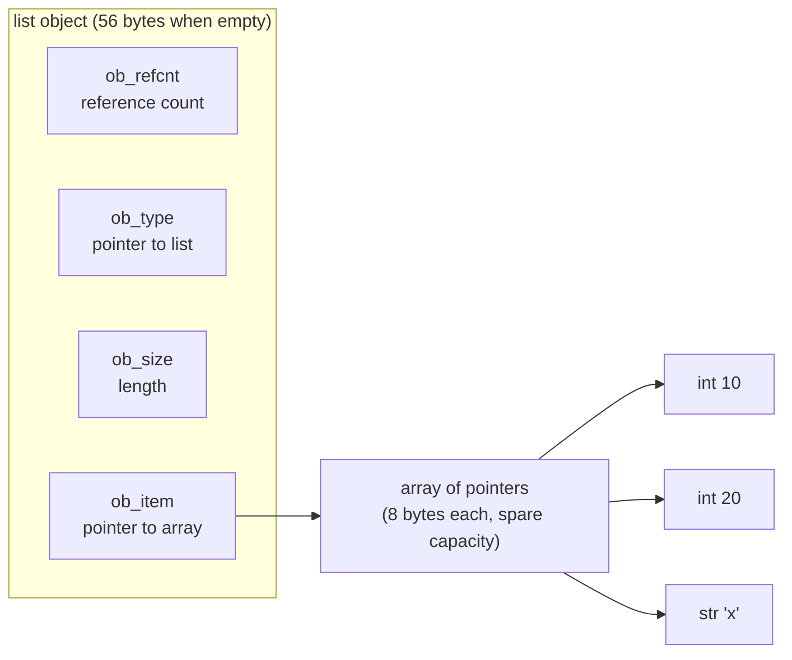
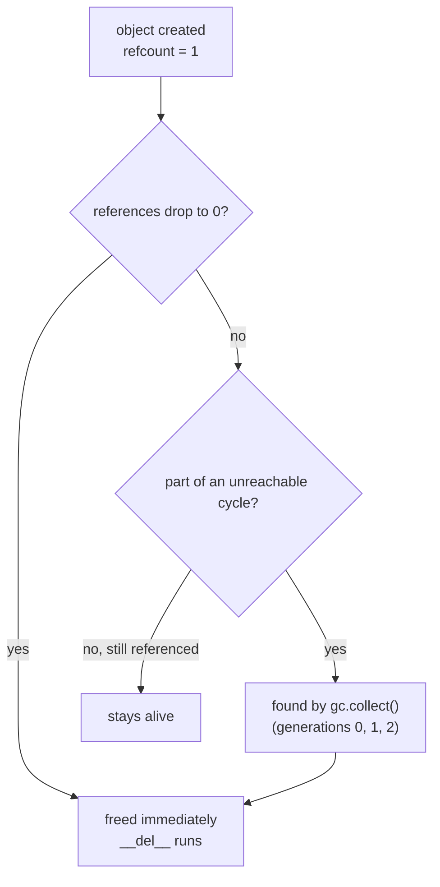

@part py-core-10 | Core Python · Part 10: CPython Internals: Memory, GC and Bytecode | advanced-python
## Objects in Memory

Every Python value is a **heap-allocated object**. In CPython each object begins with a small header: a **reference count** and a pointer to its **type object**. Variable-size objects (`list`, `tuple`, `int`, `str`) add a length field. After the header comes the data. A name never holds a value; it holds a **pointer** to an object.



Consequences you can measure:

- A list holds **pointers**, so `[1, 2, 3]` is one list object plus three int objects (small ints are shared). The list itself costs 8 bytes per slot plus the objects.
- An instance of an ordinary class has a `__dict__` for its attributes; CPython shares the *key* table between instances of the same class ("key-sharing dictionaries") to keep it small. `__slots__` removes the dictionary entirely.
- `sys.getsizeof(x)` returns the **shallow** size of one object, not what it references. To measure a structure you add up its parts, or use `tracemalloc` (below) or a tool such as `pympler.asizeof`.

```python Layout.py
import sys
import tracemalloc
from array import array


class Plain:
    def __init__(self):
        self.a, self.b = 1, 2


class Slotted:
    __slots__ = ("a", "b")

    def __init__(self):
        self.a, self.b = 1, 2


print("shallow sizes:", sys.getsizeof(1), sys.getsizeof([]), sys.getsizeof([1, 2, 3]), sys.getsizeof((1, 2, 3)))
print("a list holds pointers: its size does not depend on its items:", sys.getsizeof([1] * 3) == sys.getsizeof(["x" * 100] * 3))
print("Plain has a __dict__:", hasattr(Plain(), "__dict__"), "| Slotted has:", hasattr(Slotted(), "__dict__"))
print("None is immortal (3.12+), its refcount never changes:", sys.getrefcount(None) > 10_000)


def measure(make):
    tracemalloc.start()
    kept = make()                                  # keep a reference, or the memory is freed again
    current, _ = tracemalloc.get_traced_memory()
    tracemalloc.stop()
    return current, kept


as_list, kept_list = measure(lambda: list(range(100_000, 200_000)))
as_array, kept_array = measure(lambda: array("i", range(100_000, 200_000)))
print("100,000 ints: list uses more than 5x the memory of array('i'):", as_list > 5 * as_array)

objects, _ = measure(lambda: [Plain() for _ in range(10_000)])
slotted, _ = measure(lambda: [Slotted() for _ in range(10_000)])
print("10,000 instances: __slots__ saves more than 30%:", slotted < 0.7 * objects)
```

```output
```

### Where the memory comes from

CPython's allocator, **pymalloc**, serves objects up to 512 bytes from **arenas** (large blocks of about a megabyte, obtained from the operating system), carved into **pools** of equal-sized blocks. Larger objects go to the C library's `malloc`. Two facts matter in production:

1. **Fragmentation.** A pool or arena can return to the OS only when *every* block in it is free. A few surviving small objects scattered across arenas keep them all, so a process's resident memory (RSS) often does not shrink after you free a big structure, even though the memory is reusable by Python.
2. **Free lists and caches.** Small integers (-5 to 256), interned strings, and recycled floats, tuples and frames are reused instead of reallocated. That makes many short-lived allocations cheap.

Sizes and arena parameters are implementation details that change between versions; treat the numbers on this page as illustrations and measure your own build.

!tip Cut memory by choosing the structure :: Millions of small records: `@dataclass(slots=True)` or `__slots__`, or tuples/NamedTuples. Millions of numbers: `array`, NumPy or `bytes`/`bytearray`. Many repeated strings: `sys.intern` or categorical encodings. Large streams: generators instead of lists (Part 7). Often the biggest win is simply not holding everything in memory at once.

??  Why does a Python list of a million ints use so much more memory than a Java `int[]`?
=> The list stores a million 8-byte pointers to a million separate `int` objects (about 28 bytes each, minus shared small ints), whereas a Java `int[]` stores 4 bytes per value inline. For numeric data use `array`, NumPy or other compact containers.
??  What does `sys.getsizeof` measure and what does it miss?
=> The shallow size of the object itself, including its own header and internal buffers, but not the objects it references. The size of a list of 1,000 strings excludes the strings. Use `tracemalloc` or a deep-size library to account for the whole graph.
??  Why might a Python process keep high memory after you delete a large object?
=> The memory returns to Python's allocator, not necessarily to the operating system: arenas are released only when completely empty, and fragmentation keeps many partly used. The memory is reused for new Python objects, so it is usually not a leak unless usage keeps growing.

## Reference Counting and the Garbage Collector

CPython uses **two mechanisms** to reclaim memory:

1. **Reference counting** (immediate, deterministic). Each object counts how many references point to it. `x = obj`, putting it in a list, passing it to a function: the count goes up. When a reference disappears (name rebound, `del`, container destroyed, function returns) the count goes down, and at **zero the object is freed immediately** and its `__del__` runs.
2. **A cyclic garbage collector** (periodic). Reference counts alone cannot free objects that reference each other, because each keeps the other's count above zero. The `gc` module finds unreachable cycles and frees them.

```python Gc.py
import gc
import weakref


class Node:
    def __init__(self, name):
        self.name = name
        self.other = None

    def __del__(self):
        print("freed", self.name)


# 1. Reference counting frees at once
a = Node("a")
del a                                  # count drops to zero: "freed a" appears here, immediately

# 2. A cycle is not freed by counting
x, y = Node("x"), Node("y")
x.other, y.other = y, x
del x, y                               # both still have count 1 (from each other): nothing printed
print("after del, cycle still alive")
found = gc.collect()                   # the cycle detector finds and frees them
print("collector found unreachable objects:", found >= 2)

# 3. Weak references do not keep an object alive
target = Node("target")
alias = weakref.ref(target)
print(alias() is target)
del target
print(alias())                         # None: the object is gone

print("thresholds (generation 0, 1, 2) on this build:", gc.get_threshold())
```

```output
```

The collector is **generational**: new objects start in generation 0, which is scanned often; survivors move to older generations, which are scanned less often, based on the observation that most objects die young. A collection of generation 0 runs when the number of allocations minus deallocations of container objects exceeds the first threshold (700 by default in this build; versions differ, and Python 3.14 reworked the collector to be incremental, so check the `gc` documentation for yours).



Practical consequences:

- **Do not rely on `__del__`.** It runs at an unpredictable moment for objects in cycles, may never run at interpreter exit, and exceptions in it are ignored. Use context managers (`with`) for resources.
- **Weak references** (`weakref.ref`, `WeakValueDictionary`, `WeakSet`) are how caches and observer lists avoid keeping objects alive.
- `gc.disable()` is sometimes used in short-lived, allocation-heavy scripts, and `gc.freeze()` before a `fork` helps pre-forking servers share memory. Both are optimisations to measure, never defaults.
- **Immortal objects** (3.12+, PEP 683): `None`, `True`, small ints and interned strings have a fixed, non-counting reference count, which avoids needless writes (good for copy-on-write after `fork`) and helps per-interpreter GILs.

!interview Reference counting versus a tracing GC :: Counting frees memory immediately and predictably (a file or lock object dies the moment its last reference goes), but costs a write on every reference change, cannot free cycles by itself, and is a reason the GIL exists. A tracing collector (the JVM's) handles cycles, reclaims in batches, and lets threads run in parallel, but frees at unpredictable times. CPython uses counting **plus** a cycle detector.

??  How does CPython manage memory?
=> Mostly by reference counting: when an object's count reaches zero it is freed immediately. A generational cyclic collector (`gc`) periodically finds and frees groups of objects that only reference each other. A specialised allocator (pymalloc) serves small objects from arenas and pools.
??  What is a reference cycle and how does Python collect it?
=> Objects that refer to each other (parent and child with back-references, closures that capture themselves) so that their counts never reach zero. The cycle detector traverses container objects, finds sets that are unreachable from outside, and frees them.
??  When are weak references useful?
=> To refer to an object without keeping it alive: caches keyed by large objects, parent back-references in trees, listener registries. When the last strong reference disappears the object is freed and the weak reference returns `None` (or the entry vanishes from a `WeakValueDictionary`).
??  Why avoid `__del__` for cleanup?
=> Timing is not guaranteed (cycles, other interpreters, interpreter shutdown), exceptions inside it are swallowed, and resurrecting objects is subtle. Deterministic cleanup belongs in `with` blocks, `try/finally` or `weakref.finalize`.

## Memory Leaks and Finding Them

Python has no manual memory management, but **leaks** still happen: memory that is still *referenced* but no longer *needed*, so it can never be freed. The usual suspects:

| Cause | Example | Fix |
| --- | --- | --- |
| Unbounded cache or global | `CACHE = {}` that only grows; `functools.cache` on user-supplied inputs | Bound it: `lru_cache(maxsize=...)`, `cachetools.TTLCache`, eviction |
| Growing collection | A list of every request ever handled; an events list never cleared | Bounded `deque(maxlen=...)`, periodic cleanup |
| Closures or bound methods in registries | Callbacks registered and never unregistered keep their instances alive | `weakref`, explicit unregister |
| Cycles with `__del__` or big objects | Large graphs kept until the next collection | Break cycles, use weak back-references |
| Per-request state in module globals or thread-locals | Request objects retained after the request | Pass state explicitly; use `ContextVar` |
| Caching on methods | `@lru_cache` on a method keeps every `self` alive | Cache module-level functions, or use `cached_property` |
| C extensions | A native library forgetting to release memory | Upgrade, reproduce in isolation, tools like `memray` |

Find a leak by **comparing snapshots over time** with `tracemalloc`, which records where each allocation was made:

```python Leak.py
import tracemalloc

CACHE = {}                                   # the leak: it only ever grows


def handle(request_id):
    CACHE[request_id] = "x" * 10_000         # keeps 10 KB per request forever


def run(count, offset):
    for i in range(count):
        handle(offset + i)


tracemalloc.start(10)
run(100, 0)                                  # warm up
before = tracemalloc.take_snapshot()
run(1_000, 1_000)                            # the suspected workload
after = tracemalloc.take_snapshot()

top = after.compare_to(before, "lineno")[0]  # biggest growth, by source line
grew = top.size_diff
print("biggest growth comes from the handle() line:", top.traceback[0].lineno)
print("growth is about 10 MB:", 8_000_000 < grew < 12_000_000)

CACHE.clear()
```

```output
```

The method: **reproduce under load, take a snapshot, run the workload, take another, and diff**. The line that grows is where objects are allocated; then ask *who still references them* (`gc.get_referrers`, `objgraph.show_backrefs`) to find the owner that should have let go.

| Tool | Use |
| --- | --- |
| `tracemalloc` (standard library) | Where allocations happen; snapshot diffs |
| `memray` | Fast allocation profiler, including native code, flame graphs |
| `objgraph`, `gc.get_objects()` | Count objects by type, trace who holds them |
| `psutil.Process().memory_info().rss` | Process-level memory over time (alert on growth) |
| `resource` / container limits | Know the limit: containers are OOM-killed rather than raising `MemoryError` |

!realworld A gunicorn worker that grows until it is killed :: A common production symptom is RSS climbing steadily until the orchestrator kills the container. Before blaming Python, check for an unbounded cache, a growing list or a metrics label with unlimited cardinality. As a safety net, many deployments recycle workers (`--max-requests 1000 --max-requests-jitter 100`), which hides a slow leak but does not fix it: still find the cause.

??  What is a memory leak in a garbage-collected language?
=> Memory that is still reachable (referenced by a global, a cache, a registry, a long-lived container) but never used again, so the collector is correct not to free it. It shows as steadily growing memory and is fixed by removing or bounding the reference.
??  How would you find a memory leak in a running Python service?
=> Observe RSS over time, reproduce with a load test, enable `tracemalloc`, take snapshots before and after a workload and compare them by source line, then inspect what references the growing objects. In production, `memray` or sampling profilers can be attached with less overhead.
??  Why is `@lru_cache` on an instance method a leak risk?
=> The cache keys include `self`, so every instance that called the method stays referenced by the cache (until evicted or forever with `@cache`), even after the rest of the program dropped it. Cache a module-level function keyed on the identifying data, or store the cache on the instance.

## Bytecode and the Interpreter Loop

CPython compiles each function to bytecode and runs it on a **stack machine**. The `dis` module shows the instructions, and since Python 3.11 the interpreter is **adaptive**: after a function has run a few times it **specialises** hot instructions in place, replacing a generic `BINARY_OP` with a fast `BINARY_OP_ADD_INT` when it keeps seeing integers (PEP 659). You can watch it happen:

```python Adaptive.py
import dis


def add(a, b):
    return a + b


print("--- first look (generic instructions) ---")
dis.dis(add, adaptive=True)

for _ in range(2000):                  # warm up with ints: the interpreter specialises
    add(1, 2)

print("--- after warm-up (specialised) ---")
dis.dis(add, adaptive=True)
```

```output
```

The specialised names (`..._ADD_INT`, `LOAD_ATTR_INSTANCE_VALUE`, `LOAD_GLOBAL_BUILTIN`) depend on the version and may differ on yours; the point is that **the same bytecode gets faster when the types it sees are stable**, and that code which keeps changing the types at one site (a function called with ints, then strings, then floats) cannot benefit. This is part of the "Faster CPython" work (3.11 onward), which also made exceptions free when none is raised and made Python-to-Python calls cheaper.

### Things the compiler does for you

```python Compile.py
import dis

def constant_folding():
    return 60 * 60 * 24 + 1            # folded at compile time into one constant

def local_vs_global(items):
    total = 0
    for x in items:
        total += x                      # `total` and `x` are locals: fast array slots
    return total

print(constant_folding.__code__.co_consts)
dis.dis(local_vs_global)
```

```output
```

Reading the listing: `LOAD_FAST` / `STORE_FAST` are **local variables** (indexed array slots), the cheapest access. `LOAD_GLOBAL` does a dictionary lookup (cached by the adaptive interpreter), and `LOAD_ATTR` follows the object-attribute lookup rules. That is why assigning a hot global or attribute to a local name inside a tight loop can help, though measure before doing it.

??  Is Python bytecode the same across versions?
=> No. The instruction set changes with almost every release (new instructions, removed ones, different encodings), which is why `.pyc` files carry the version and why code that parses bytecode is fragile. Use `ast` for source-level tooling.
??  What is the specialising adaptive interpreter?
=> From 3.11, CPython counts executions of each bytecode instruction and, once an instruction is hot and sees consistent types, rewrites it to a specialised, cheaper variant (for example integer addition). If the assumption stops holding it falls back. It speeds up typical code without any change by the programmer.
??  Why are local variables faster than globals?
=> Locals live in a fixed array in the frame and are addressed by index. Globals and attributes need a dictionary or type lookup, which the interpreter has to guard and cache. In hot loops, locals (and local aliases for functions) avoid repeated lookups.

## Profiling, the JIT and Performance Rules

### Measure first

**Never optimise without measuring.** Three tools cover most needs:

| Tool | Answers | How |
| --- | --- | --- |
| `timeit` | "Which of these two snippets is faster?" | `python -m timeit "..."` or `timeit.timeit` |
| `cProfile` + `pstats` | "Where does the time go, by function?" | `python -m cProfile -s cumtime app.py` |
| Sampling profilers (`py-spy`, `pyinstrument`, `scalene`) | "Where is a running service spending time?" without stopping it | `py-spy top --pid <pid>` / `py-spy record` |

```python Profile.py
import cProfile
import io
import pstats


def slow_distinct(items):
    result = []
    for item in items:
        if item not in result:          # O(n) membership test on a list: O(n^2) overall
            result.append(item)
    return result


def fast_distinct(items):
    return list(dict.fromkeys(items))   # O(n)


data = [i % 500 for i in range(5000)]

profiler = cProfile.Profile()
profiler.enable()
a = slow_distinct(data)
b = fast_distinct(data)
profiler.disable()

stats = pstats.Stats(profiler, stream=io.StringIO())
calls = {name: ncalls for (_, _, name), (_, ncalls, *_) in stats.stats.items() if name in ("slow_distinct", "fast_distinct")}
print(a == b, calls)

import timeit
slow = timeit.timeit(lambda: slow_distinct(data), number=5)
fast = timeit.timeit(lambda: fast_distinct(data), number=5)
print("fast_distinct is more than 10x faster:", slow > 10 * fast)
```

```output
```

The profile tells you **which function** is hot; the fix here was algorithmic (a set-like structure instead of a list scan), which beats any micro-optimisation.

### The JIT and the roadmap

- **3.11-3.12**: the specialising interpreter described above; no JIT.
- **3.13**: an **experimental JIT compiler** (PEP 744, "copy-and-patch") that is off by default and must be enabled and built in; modest gains. The **free-threaded build** (Part 8) is also experimental.
- **3.14**: a faster interpreter dispatch on some platforms (tail calls with a recent compiler), free-threaded builds officially supported, an incremental garbage collector, and safer remote debugging hooks. Check the "What's New" page of your version for exact status.
- **PyPy** is a mature tracing JIT for long-running pure-Python workloads; `numba` JITs numeric functions; Cython and mypyc compile typed Python to C.

### Performance rules of thumb

1. **Algorithm and data structure first** (Part 6): list scan to set lookup, nested loops to a dictionary join, repeated sort to a heap.
2. **Use built-ins and the standard library** (`sum`, `min`, `sorted`, `str.join`, `itertools`, `collections`): they run in C.
3. **Vectorise** numeric work with NumPy or pandas; avoid Python loops over millions of elements.
4. **Do less work**: cache pure results (`lru_cache`), stream instead of materialising, stop early (`any`, `next`), batch I/O.
5. **Move waiting off the critical path**: concurrency for I/O (Parts 8 and 9), a task queue for slow work.
6. **Hoist invariant work out of loops** and use local names in genuinely hot paths.
7. **Only then** reach for Cython, mypyc, PyPy or rewriting a hot function in Rust or C.

```python Builtins.py
import timeit

numbers = list(range(1_000_000))


def manual():
    total = 0
    for n in numbers:
        total += n
    return total


builtin = timeit.timeit(lambda: sum(numbers), number=5)
loop = timeit.timeit(manual, number=5)
print("sum() is more than 2x faster than the Python loop:", loop > 2 * builtin)
print("same answer:", manual() == sum(numbers))
```

```output
```

!cheat CPython internals cheat sheet ::
- Every value is a heap object: header (refcount, type) plus data; names are pointers; `sys.getsizeof` is shallow.
- Memory: refcount hits 0 means freed now; cycles are found by the generational `gc`; pymalloc arenas rarely return memory to the OS.
- Weak references and context managers beat `__del__`.
- Leak = still referenced but not needed. Find it with `tracemalloc` snapshot diffs.
- Bytecode is a version-specific stack machine; 3.11+ specialises hot instructions; `dis` shows both.
- Measure: `timeit` (A or B), `cProfile` (which function), `py-spy` (a live service).
- Fix the algorithm before the constant factor; use C-backed built-ins, NumPy, and concurrency for waiting.
!end

??  How do you decide where to optimise a slow Python program?
=> Profile it (`cProfile` for functions, a sampling profiler for services, `tracemalloc` for memory), find the few functions that dominate, and fix the algorithmic or I/O problem there first. Micro-optimising code that is not on the hot path wastes effort and hurts readability.
??  Is the JIT going to make Python as fast as Java?
=> Not by itself. The interpreter speed-ups of 3.11 onward and the experimental JIT of 3.13 give moderate gains on typical code; dynamic typing and the object model limit what a JIT can remove. The practical route to speed remains native libraries, better algorithms, concurrency and, for hot spots, compiled extensions or PyPy.
