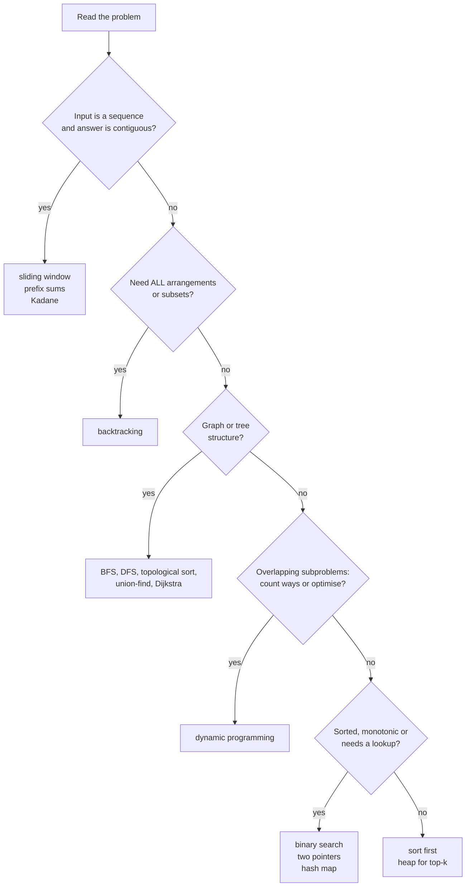

@part py-dsa-1 | DSA Patterns in Python · Part 1: Foundations | dsa
## How to Use This Guide and How Interviews Work

Data structures and algorithms (DSA) rounds test one skill: **turning a vague problem into an efficient, correct program while explaining your thinking**. They are learnable because the same 20 or so **patterns** solve most problems. This part builds the foundations (complexity, tracing, the Python toolkit, the core structures); Parts 2 to 6 teach the patterns; Part 7 is revision and mocks.

Every solution in this guide is a Python function followed by `assert` tests, and the guide is rebuilt only if they pass, so the code you copy is correct. Work like this:

1. **Read the pattern** and its signals (how to recognise the problem).
2. **Cover the solution**, solve the first problem yourself, then compare.
3. **Re-implement from memory** the next day without looking: that is what an interview needs.
4. **Do 2 problems a day** on a site such as LeetCode, tagging each with its pattern and writing one line about what gave it away.

### The interview loop, step by step

| Minute | What you do | What they watch |
| --- | --- | --- |
| 0 to 5 | Restate the problem; ask about input size, duplicates, negatives, empty input, sorted or not | Do you clarify before coding? |
| 5 to 10 | Work one example by hand; state the brute force and its complexity | Can you reason without code? |
| 10 to 15 | Find the bottleneck; name the pattern or data structure that removes it | Pattern recognition |
| 15 to 30 | Code it cleanly, narrating | Fluency in Python; naming; structure |
| 30 to 38 | Dry-run an example and an edge case through the code | Self-checking |
| 38 to 45 | State time and space complexity; discuss a trade-off or follow-up | Depth |

### Input size tells you the target complexity

| n (input size) | Usually acceptable | Typical technique |
| --- | --- | --- |
| up to about 10 | O(n!) or O(2ⁿ · n) | brute force, backtracking |
| up to about 20 to 25 | O(2ⁿ) | subsets, bitmask |
| up to about 500 | O(n³) | triple loop, DP over three indices |
| up to about 5,000 | O(n²) | DP on two indices, nested loops |
| up to about 10⁵ to 10⁶ | O(n log n) or O(n) | sorting, heap, binary search, hash map, two pointers |
| 10⁹ and beyond | O(log n) or O(1) | binary search on the answer, maths |

CPython executes roughly 10⁷ simple operations per second in pure Python, a good deal less than compiled languages, so **in Python the same constraints mean choosing the better algorithm and using built-ins** (`sorted`, `heapq`, `bisect`, `Counter`) which run in C.

!interview Say your complexity before they ask :: "This is O(n log n) for the sort plus O(n) for the scan, O(n) extra space for the map." Then name the trade-off: "I could do it in O(1) space if I sort in place, but then I lose the original order." Naming trade-offs unprompted is the difference between a pass and a strong pass.

??  What are the six steps of a good DSA interview answer?
=> Clarify and restate; work an example; give the brute force and its complexity; improve it by naming the pattern or data structure; code it cleanly while narrating; test on examples and edge cases, then state the complexity and trade-offs.
??  Why does the input size matter?
=> It tells you which complexity class will finish in time (about 10⁷ to 10⁸ simple operations in a second or two). A limit of 10⁵ means O(n²) is too slow and you should look for O(n log n) or O(n).

## Complexity Analysis

**Big-O** describes how the cost of an algorithm grows with the input size n, ignoring constants and lower-order terms. State **time** and **space** separately, and say which case (worst, average, amortised) you mean.

| Class | Name | Example |
| --- | --- | --- |
| O(1) | constant | dict lookup, list append (amortised), index |
| O(log n) | logarithmic | binary search, heap push/pop, balanced tree |
| O(n) | linear | scan a list, `in` on a list, `sum` |
| O(n log n) | linearithmic | sorting, merge sort, building a heap sort |
| O(n²) | quadratic | nested loops over the same input, naive pair checks |
| O(2ⁿ) | exponential | subsets, naive recursive Fibonacci |
| O(n!) | factorial | permutations |

```python Growth.py
import math

def count_operations(n):
    """Operation counts (not timings, so the output is exact) for typical growth rates."""
    return {
        "n": n,
        "log n": round(math.log2(n)),
        "n log n": round(n * math.log2(n)),
        "n^2": n * n,
        "2^n": 2 ** n if n <= 30 else None,
    }

for n in (10, 20, 30, 1000):
    print(count_operations(n))
```

```output
```

### Analysing code

1. **Loops multiply**: a loop of n iterations containing a loop of n iterations is O(n²); a loop that halves its range each time is O(log n).
2. **Sequential blocks add, then the larger wins**: O(n) followed by O(n log n) is O(n log n).
3. **Recursion**: count the calls and the work per call. Fibonacci's two recursive calls give a tree of about 2ⁿ calls; with memoisation each value is computed once, giving O(n).
4. **Amortised O(1)**: `list.append` occasionally copies the array, but the average over many appends is constant (Part 6 of Core Python).
5. **Hidden costs in Python**: slicing `a[i:j]` copies O(j - i); `x in list` is O(n); `s += t` in a loop may be O(n²); `list.insert(0, x)` and `pop(0)` are O(n); `sorted` is O(n log n); `str` comparison is O(length).

```python RecursionCost.py
from functools import cache

calls = {"naive": 0, "memo": 0}

def fib_naive(n):
    calls["naive"] += 1
    return n if n < 2 else fib_naive(n - 1) + fib_naive(n - 2)

@cache
def fib_memo(n):
    calls["memo"] += 1
    return n if n < 2 else fib_memo(n - 1) + fib_memo(n - 2)

assert fib_naive(25) == fib_memo(25) == 75025
print("calls for fib(25): naive =", calls["naive"], "| memoised =", calls["memo"])
```

```output
```

### Space complexity and the recursion limit

Space counts **extra memory** beyond the input: a new list or dict of size n is O(n); a recursive call stack of depth d is O(d). CPython limits recursion depth to about 1000, so a recursive DFS over a path of 10⁵ nodes raises `RecursionError`: convert it to an explicit stack, or in contests raise the limit with `sys.setrecursionlimit` (and a thread with a bigger stack) knowing it can still crash the process.

| Table of Python operation costs | Cost |
| --- | --- |
| `list`: index, append, pop() | O(1) (append amortised) |
| `list`: insert(0), pop(0), remove, `in`, index | O(n) |
| `dict` / `set`: get, set, delete, `in` | O(1) average |
| `deque`: append, appendleft, pop, popleft | O(1) |
| `heapq`: push, pop | O(log n); peek `h[0]` O(1); `heapify` O(n) |
| `sorted`, `list.sort` | O(n log n) |
| `bisect` | O(log n) search; `insort` O(n) |
| `str`: concatenation, slicing | O(length) |
| `s[::-1]`, `list(reversed(...))` | O(n) |

??  What is the time complexity of this code: `for i in range(n): for j in range(i, n): ...`?
=> The inner loop runs n, n-1, ..., 1 times, a total of n(n+1)/2 iterations, which is O(n²).
??  What does "amortised O(1)" mean?
=> The average cost per operation over a long sequence is constant even though some individual operations are expensive. Appending to a list occasionally resizes the array (O(n)), but the resizes are rare enough that the total for n appends is O(n).
??  Why is `s += ch` in a loop a performance smell?
=> Each concatenation may copy the whole string, so building a string of n characters can cost O(n²). Collect parts in a list and `"".join(parts)` once (O(n)).

## The Dry-Run Method

Most wrong answers in interviews are **logic slips that a trace would have caught**. A dry run is executing your code by hand on a small input, recording the variables at each step. Do it before you say "done", and say it aloud.

```python DryRun.py
def binary_search(nums, target, trace=None):
    lo, hi = 0, len(nums) - 1
    while lo <= hi:
        mid = (lo + hi) // 2
        if trace is not None:
            trace.append((lo, hi, mid, nums[mid]))      # the row of the trace table
        if nums[mid] == target:
            return mid
        if nums[mid] < target:
            lo = mid + 1
        else:
            hi = mid - 1
    return -1

rows = []
assert binary_search([1, 3, 5, 7, 9, 11], 9, rows) == 4
print("lo hi mid value")
for row in rows:
    print(*row)
```

```output
```

How to trace well:

1. **Pick a small but non-trivial input** that exercises the main branch (6 items, not 2).
2. **Write the variables as columns** and one row per loop iteration.
3. **Then run the edge cases**: empty input, one element, all equal, duplicates, negative numbers, the target at the first and last position, the target missing.
4. **Check the loop invariant**: here, "if the target exists it is within `[lo, hi]`". Off-by-one errors (`<` versus `<=`, `mid` versus `mid + 1`) are almost always a broken invariant.

!tip The edge-case checklist :: Empty input; one element; two elements; all equal; already sorted; reverse sorted; negatives and zero; duplicates; very large values; `None`; a target at either end or absent; a cycle or disconnected graph. Writing five of these as `assert`s takes two minutes and finds most bugs.

??  Why dry-run when you can just run the code?
=> In an interview you often cannot run it, and even when you can, a trace shows **why** it fails and proves understanding. It catches off-by-one errors, wrong initial values and unhandled edge cases before the interviewer does.

## The Python Toolkit for DSA

Fluency with a few standard-library tools is worth more than clever tricks.

```python Toolkit.py
import heapq
import math
from bisect import bisect_left, bisect_right
from collections import Counter, defaultdict, deque
from functools import cache
from itertools import accumulate, combinations, pairwise, permutations, product

# counting and grouping
print(Counter("mississippi").most_common(2), dict(Counter([1, 1, 2])))
groups = defaultdict(list)
for word in ("tea", "eat", "tan"):
    groups["".join(sorted(word))].append(word)
print(dict(groups))

# queues, stacks and heaps
queue = deque([1, 2, 3]); queue.append(4); print(queue.popleft(), queue)
stack = []; stack.append("a"); stack.append("b"); print(stack.pop(), stack)
heap = [5, 1, 4]; heapq.heapify(heap); print(heapq.heappop(heap), heapq.nsmallest(2, [9, 3, 7]))
max_heap = [-x for x in (5, 1, 4)]; heapq.heapify(max_heap); print(-heapq.heappop(max_heap))   # a max-heap by negation

# binary search on sorted lists
data = [1, 2, 2, 2, 5]
print(bisect_left(data, 2), bisect_right(data, 2), bisect_left(data, 3))

# prefix sums, pairs, combinatorics
print(list(accumulate([1, 2, 3, 4])), list(pairwise("abc")), len(list(combinations(range(5), 2))), len(list(permutations("abc"))))

# infinity, divmod, memoisation
print(math.inf > 10 ** 18, divmod(17, 5), -(-7 // 2))          # -(-a // b) is ceiling division
@cache
def ways(n): return 1 if n <= 1 else ways(n - 1) + ways(n - 2)
print(ways(30))

# 2-D grids: directions and in-bounds checks
DIRS = ((1, 0), (-1, 0), (0, 1), (0, -1))
grid = [[1, 2], [3, 4]]
print([grid[r + dr][c + dc] for r, c in [(0, 0)] for dr, dc in DIRS if 0 <= r + dr < 2 and 0 <= c + dc < 2])
```

```output
```

Other habits worth building:

| Habit | Why |
| --- | --- |
| `for i, x in enumerate(items)`, `zip(a, b)` | no manual index arithmetic |
| `float("inf")` / `math.inf` for min/max initial values | avoids magic numbers |
| `sorted(items, key=lambda x: (-x.score, x.name))` | multi-key sorting without comparators |
| Tuples as dict keys and set members `(r, c)` | visited sets on grids |
| `a, b = b, a + b` | swaps and Fibonacci-style updates |
| Early `return` and guard clauses | shallow, readable code |
| A tiny test helper with `assert` | fast feedback while practising |

```python Harness.py
def check(fn, cases):
    """cases: list of (arguments tuple, expected). Raises with the failing input shown."""
    for args, expected in cases:
        got = fn(*args)
        assert got == expected, f"{fn.__name__}{args}: expected {expected!r}, got {got!r}"
    return f"{fn.__name__}: {len(cases)} cases passed"

def is_anagram(a, b):
    from collections import Counter
    return Counter(a) == Counter(b)

print(check(is_anagram, [(("listen", "silent"), True), (("a", "b"), False), (("", ""), True)]))

import io, sys                                   # the contest-style input pattern, tested without a terminal
sys.stdin = io.StringIO("3\n4 5 6\n")
n = int(input())
numbers = list(map(int, input().split()))
print(n, sum(numbers))
```

```output
```

??  Which standard-library structures cover most DSA problems?
=> `list` (array and stack), `collections.deque` (queue, sliding window), `dict`/`set`/`Counter`/`defaultdict` (hashing), `heapq` (priority queue), `bisect` (binary search on sorted lists), `itertools` (combinatorics, accumulate), and `functools.cache` (memoisation).
??  How do you get a max-heap in Python?
=> `heapq` is a min-heap, so push negated values (or `(-priority, item)` tuples) and negate again when popping.

## Core Data Structures You Must Be Able to Write

Know how to build each from scratch and what each costs. Python's built-ins cover many, but interviews expect nodes and pointers for lists, trees and graphs.

```python Structures.py
from collections import defaultdict, deque


class ListNode:                                   # singly linked list
    def __init__(self, val=0, next=None):
        self.val, self.next = val, next

class TreeNode:                                   # binary tree
    def __init__(self, val=0, left=None, right=None):
        self.val, self.left, self.right = val, left, right

class TrieNode:
    def __init__(self):
        self.children, self.end = {}, False

class UnionFind:                                  # disjoint sets with path compression and union by size
    def __init__(self, n):
        self.parent, self.size = list(range(n)), [1] * n

    def find(self, x):
        while self.parent[x] != x:
            self.parent[x] = self.parent[self.parent[x]]
            x = self.parent[x]
        return x

    def union(self, a, b):
        ra, rb = self.find(a), self.find(b)
        if ra == rb:
            return False
        if self.size[ra] < self.size[rb]:
            ra, rb = rb, ra
        self.parent[rb] = ra
        self.size[ra] += self.size[rb]
        return True

def build_list(values):                           # helpers used throughout the guide
    head = ListNode()
    cur = head
    for v in values:
        cur.next = ListNode(v)
        cur = cur.next
    return head.next

def list_values(head):
    out = []
    while head:
        out.append(head.val)
        head = head.next
    return out

def build_tree(values):                           # level-order list with None for gaps, like LeetCode
    if not values or values[0] is None:
        return None
    root, queue, i = TreeNode(values[0]), None, 1
    queue = deque([root])
    while queue and i < len(values):
        node = queue.popleft()
        if i < len(values) and values[i] is not None:
            node.left = TreeNode(values[i]); queue.append(node.left)
        i += 1
        if i < len(values) and values[i] is not None:
            node.right = TreeNode(values[i]); queue.append(node.right)
        i += 1
    return root

def graph_from_edges(n, edges, directed=False):
    adjacency = defaultdict(list)
    for a, b in edges:
        adjacency[a].append(b)
        if not directed:
            adjacency[b].append(a)
    return adjacency

assert list_values(build_list([1, 2, 3])) == [1, 2, 3]
tree = build_tree([3, 9, 20, None, None, 15, 7])
assert (tree.val, tree.left.val, tree.right.right.val) == (3, 9, 7)
uf = UnionFind(5)
assert uf.union(0, 1) and uf.union(1, 2) and not uf.union(0, 2) and uf.find(0) == uf.find(2) != uf.find(4)
assert graph_from_edges(4, [(0, 1), (1, 2)])[1] == [0, 2]
print("structures ok")
```

```output
```

| Structure | Core operations and costs | Typical problems |
| --- | --- | --- |
| Array / list | index O(1); search O(n); insert/delete mid O(n) | prefix sums, two pointers, sliding window |
| Hash map / set | get, put, contains O(1) avg | counting, de-duplication, complements |
| Stack | push, pop O(1) | brackets, monotonic stack, DFS |
| Queue / deque | enqueue, dequeue O(1) | BFS, sliding window maximum |
| Heap | push, pop O(log n); peek O(1) | top-k, merge k, scheduling, Dijkstra |
| Linked list | insert/delete at a node O(1) with the pointer; search O(n) | reversal, cycle detection, merging |
| Binary tree / BST | traversal O(n); BST search O(h) | DFS/BFS, validation, LCA |
| Trie | insert/search O(length) | prefix matching, autocomplete |
| Graph | adjacency list O(V+E) space | BFS/DFS, topological sort, shortest paths |
| Union-Find | near O(1) per operation | components, cycle detection, Kruskal |

!realworld Why these structures matter outside interviews :: A hash map is a cache; a heap is a scheduler or a rate-limiter timer wheel; a trie powers autocomplete and routers; union-find clusters entities; a graph is every dependency resolver (pip, build systems) and every social network. Interview problems are small versions of real infrastructure.

??  When would you choose a heap over sorting?
=> When you need only the k largest or smallest items, or a stream of items with repeated "give me the min" queries: a heap is O(n log k) for top-k and O(log n) per update, whereas full sorting is O(n log n) and has to be redone when data changes.
??  What are union by size and path compression?
=> Two optimisations of union-find: attach the smaller tree under the larger (union by size) and flatten the path during `find` so later finds are shorter. Together they make operations effectively constant (inverse Ackermann) time.

## Pattern Map and How to Choose

Recognising the pattern is 70% of the problem. Read the statement for **signals**:

| Signal in the problem | Pattern | Part |
| --- | --- | --- |
| Sorted array, find a pair or target; remove duplicates in place | Two pointers | 2 |
| Longest/shortest/max contiguous subarray or substring with a condition | Sliding window | 2 |
| Sum of a range, or counting subarrays with a sum | Prefix sums (+ hash map) | 2 |
| "Does a pair/complement exist", count frequencies, duplicates | Hash map / set | 2 |
| Sorted input or monotonic condition; "minimum X such that feasible" | Binary search (on index or on the answer) | 2 |
| Overlapping ranges, scheduling, meetings | Sort + merge / greedy / heap | 2 |
| Maximum subarray, buy/sell once, jump reachability | Kadane / greedy scan | 2 |
| Linked list: cycle, middle, k-th from end | Fast and slow pointers | 3 |
| Matching brackets; "next greater element"; nested structure | Stack / monotonic stack | 3 |
| Sliding-window maximum; BFS levels | Deque / queue | 3 |
| All subsets, permutations, combinations, arrangements, "generate all" | Backtracking | 4 |
| Tree depth, paths, sums, validity | DFS (recursion) | 4 |
| Tree levels, shortest path in an unweighted graph or grid | BFS | 4, 5 |
| Prefix search, dictionary of words | Trie | 4 |
| k largest/smallest, merge k sorted, running median | Heap | 5 |
| Dependencies, ordering, prerequisites | Topological sort | 5 |
| Connected components, "are these connected", detecting a redundant edge | Union-Find (or DFS) | 5 |
| Shortest path with weights | Dijkstra (heap); negative edges Bellman-Ford | 5 |
| "Count the ways", "min cost", "can we reach", overlapping subproblems | Dynamic programming | 6 |
| Locally best choice provably leads to the global best | Greedy | 6 |
| Single/odd element, subsets of a small set, powers of two | Bit manipulation | 6 |



!cheat Five questions that find the pattern ::
1. Is the input sorted, or can sorting it help? (binary search, two pointers, intervals)
2. Do I need a contiguous part of a sequence? (window, prefix sums)
3. Am I asked for all possibilities or the best of exponentially many? (backtracking versus DP versus greedy)
4. Is there a graph or tree hiding in the statement? (nodes = states, edges = moves)
5. What does a brute force repeat? (that repeated work is what a hash map, memo table or heap removes)
!end

??  A problem asks for the number of ways to climb n stairs taking 1 or 2 steps. Which pattern, and what is the recurrence?
=> Dynamic programming (overlapping subproblems, "count the ways"): `ways[n] = ways[n-1] + ways[n-2]` with `ways[0] = ways[1] = 1`, O(n) time and O(1) space with two variables.
??  How do you distinguish greedy from dynamic programming?
=> Greedy makes one locally best choice at each step and never reconsiders, so it needs a proof (exchange argument) that the choice is safe; DP considers all choices through overlapping subproblems and stores their results. If a counter-example breaks the greedy choice (coin change with `[1, 3, 4]`), use DP.
??  The statement says "find the longest substring such that ...". Name the first two patterns you try.
=> Sliding window (contiguous, with a validity condition that can be maintained incrementally) and, if the condition is not monotonic, a hash map of first-seen positions or DP. Check whether shrinking and expanding the window keeps the condition easy to test.
