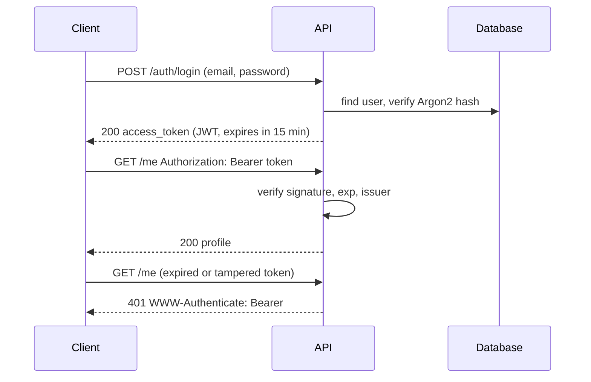

@part py-web-4 | FastAPI Basics · Part 4: Securing and Shipping | web
## Authentication: Passwords, Tokens and `get_current_user`

**Authentication** answers "who is this?"; **authorisation** answers "may they do this?". A typical JSON API authenticates with a **bearer token**: the client logs in once with credentials, receives a short-lived signed token (a **JWT**), and sends `Authorization: Bearer <token>` on later requests. The server verifies the signature and expiry without a database lookup, and loads the user only if it needs more than the token's claims.



```python AuthApp.py
from datetime import datetime, timedelta, timezone
from typing import Annotated

import jwt
from fastapi import Depends, FastAPI, HTTPException, status
from fastapi.security import OAuth2PasswordBearer, OAuth2PasswordRequestForm
from fastapi.testclient import TestClient
from pwdlib import PasswordHash
from pydantic import BaseModel, EmailStr

SECRET_KEY = "change-me-in-production-use-a-long-random-value"      # from the environment in real code
ALGORITHM, ACCESS_MINUTES = "HS256", 15
password_hasher = PasswordHash.recommended()                          # Argon2id: slow, salted, memory-hard
oauth2 = OAuth2PasswordBearer(tokenUrl="/auth/login")                 # also makes the docs show an "Authorize" button

USERS: dict[str, dict] = {}                                           # a stand-in for the users table


class Register(BaseModel):
    email: EmailStr
    password: str


class Token(BaseModel):
    access_token: str
    token_type: str = "bearer"


def create_token(subject: str, role: str, expires: timedelta) -> str:
    now = datetime.now(timezone.utc)
    claims = {"sub": subject, "role": role, "iat": now, "exp": now + expires, "iss": "shop-api"}
    return jwt.encode(claims, SECRET_KEY, algorithm=ALGORITHM)


def current_user(token: Annotated[str, Depends(oauth2)]) -> dict:
    unauthorised = HTTPException(status.HTTP_401_UNAUTHORIZED, "invalid or expired token", headers={"WWW-Authenticate": "Bearer"})
    try:
        claims = jwt.decode(token, SECRET_KEY, algorithms=[ALGORITHM], issuer="shop-api",          # ALWAYS pass the allowed algorithms
                            options={"require": ["exp", "sub", "iss"]})
    except jwt.PyJWTError:
        raise unauthorised from None
    user = USERS.get(claims["sub"])
    if user is None:
        raise unauthorised
    return user


def require_role(*roles: str):                                        # a dependency factory
    def check(user: Annotated[dict, Depends(current_user)]):
        if user["role"] not in roles:
            raise HTTPException(status.HTTP_403_FORBIDDEN, "insufficient role")
        return user
    return check


app = FastAPI()


@app.post("/auth/register", status_code=201)
def register(data: Register):
    if data.email in USERS:
        raise HTTPException(409, "email already registered")
    USERS[data.email] = {"email": data.email, "hash": password_hasher.hash(data.password), "role": "admin" if not USERS else "user"}
    return {"email": data.email}


@app.post("/auth/login", response_model=Token)
def login(form: Annotated[OAuth2PasswordRequestForm, Depends()]):    # form fields: username and password
    user = USERS.get(form.username)
    # verify against a dummy hash too when the user is unknown, so response time does not reveal which emails exist
    stored = user["hash"] if user else password_hasher.hash("dummy-password")
    if not password_hasher.verify(form.password, stored) or user is None:
        raise HTTPException(status.HTTP_401_UNAUTHORIZED, "incorrect email or password", headers={"WWW-Authenticate": "Bearer"})
    return Token(access_token=create_token(user["email"], user["role"], timedelta(minutes=ACCESS_MINUTES)))


@app.get("/me")
def me(user: Annotated[dict, Depends(current_user)]):
    return {"email": user["email"], "role": user["role"]}


@app.get("/admin/users", dependencies=[Depends(require_role("admin"))])
def list_users():
    return sorted(USERS)


client = TestClient(app)
client.post("/auth/register", json={"email": "admin@example.com", "password": "correct horse"})
client.post("/auth/register", json={"email": "asha@example.com", "password": "battery staple"})
print(USERS["asha@example.com"]["hash"].startswith("$argon2id$"), client.post("/auth/register", json={"email": "asha@example.com", "password": "x"}).status_code)

bad = client.post("/auth/login", data={"username": "asha@example.com", "password": "wrong"})
print(bad.status_code, bad.headers["www-authenticate"], client.post("/auth/login", data={"username": "ghost@example.com", "password": "x"}).json())

token = client.post("/auth/login", data={"username": "asha@example.com", "password": "battery staple"}).json()["access_token"]
auth = {"Authorization": f"Bearer {token}"}
print(client.get("/me", headers=auth).json(), client.get("/me").status_code)
print(client.get("/admin/users", headers=auth).status_code)

admin_token = client.post("/auth/login", data={"username": "admin@example.com", "password": "correct horse"}).json()["access_token"]
print(client.get("/admin/users", headers={"Authorization": f"Bearer {admin_token}"}).json())

expired = create_token("asha@example.com", "user", timedelta(minutes=-1))                   # already expired
tampered = token[:-4] + ("AAAA" if not token.endswith("AAAA") else "BBBB")                   # signature no longer matches
forged = jwt.encode({"sub": "asha@example.com", "role": "admin", "exp": datetime.now(timezone.utc) + timedelta(hours=1), "iss": "shop-api"}, "wrong-key", algorithm="HS256")
for name, bad_token in (("expired", expired), ("tampered", tampered), ("forged", forged), ("garbage", "abc.def.ghi")):
    print(name, client.get("/me", headers={"Authorization": f"Bearer {bad_token}"}).status_code)
claims = jwt.decode(token, options={"verify_signature": False})                              # a JWT is only SIGNED, not encrypted
print(sorted(claims), claims["role"])
```

```output
```

The decisions in this code, and why they matter:

1. **Hash passwords with Argon2id** (or bcrypt/scrypt) through a maintained library; never store or log plaintext, never use MD5/SHA-1/plain SHA-256. `pwdlib.PasswordHash.recommended()` picks a safe default and each hash carries its own random salt and parameters.
2. **JWT claims**: `sub` (who), `exp` (expiry: keep access tokens **short**, 5 to 15 minutes), `iat`, `iss` (issuer), and a role if you need one. **Verify on every request**: signature, `exp` and `iss`.
3. **Pass `algorithms=[...]` explicitly** when decoding. Libraries that trust the token's own `alg` header have suffered the "alg: none" and algorithm-confusion attacks.
4. **A JWT is signed, not encrypted**: anyone can read the claims (the last line decodes them without the key), so put no secrets in it.
5. **Do not reveal which part was wrong**: "incorrect email or password", the same message and similar timing for unknown users, and a 401 with `WWW-Authenticate: Bearer`.
6. **HS256 uses one shared secret** (fine when one service both issues and verifies); with several services or third-party issuers use **asymmetric keys** (RS256/ES256): the issuer signs with a private key, everyone else verifies with the public key (JWKS).

!warning Where the secret key lives :: `SECRET_KEY` must come from the environment or a secret manager, be long and random (`secrets.token_urlsafe(64)`), and never be committed. Leaking it lets an attacker mint valid tokens for any user. Plan for **rotation**: accept the old and new key for one token lifetime (the `kid` header names the key).

??  Why use short-lived access tokens, and how do users stay logged in?
=> A stolen JWT is valid until it expires, and it cannot easily be revoked, so keep its lifetime short. Long sessions use a **refresh token**: an opaque, revocable, rotating token stored server-side that is exchanged for new access tokens. Part 9 of this stage covers it in depth.
??  What is the difference between 401 and 403 in this API?
=> 401: no valid credentials (missing, expired or forged token; the response says how to authenticate with `WWW-Authenticate`). 403: the user is authenticated but the role or permission does not allow the action.
??  Why must `jwt.decode` be given the list of allowed algorithms?
=> So the verifier decides which algorithms are acceptable rather than trusting the token's own header. Otherwise an attacker can choose `none` or switch an RSA public key into an HMAC secret and forge tokens.

## Authorisation: Roles, Ownership and Object-Level Checks

Authentication gets you a user; most real vulnerabilities are **authorisation** mistakes. The top API risk in OWASP's API Security Top 10 is **Broken Object Level Authorization (BOLA)**: the endpoint checks that you are logged in but not that *this object is yours* (`GET /orders/1042` works for every user's order id).

```python Authorization.py
from typing import Annotated

from fastapi import Depends, FastAPI, Header, HTTPException
from fastapi.testclient import TestClient

app = FastAPI()
ORDERS = {1: {"id": 1, "owner": "asha", "total": 500}, 2: {"id": 2, "owner": "ravi", "total": 900}}
ROLES = {"asha": "user", "ravi": "user", "meera": "support"}


def current_user(x_user: Annotated[str | None, Header()] = None) -> str:       # stands in for the JWT dependency
    if x_user not in ROLES:
        raise HTTPException(401, "authentication required")
    return x_user


def get_owned_order(order_id: int, user: Annotated[str, Depends(current_user)]) -> dict:
    order = ORDERS.get(order_id)
    if order is None or (order["owner"] != user and ROLES[user] != "support"):
        raise HTTPException(404, "order not found")       # 404, not 403: do not reveal that other users' orders exist
    return order


@app.get("/orders/{order_id}")
def read_order(order: Annotated[dict, Depends(get_owned_order)]):
    return order


@app.get("/orders")
def list_orders(user: Annotated[str, Depends(current_user)]):
    return [o["id"] for o in ORDERS.values() if o["owner"] == user or ROLES[user] == "support"]        # filter in the query, too


client = TestClient(app)
as_asha, as_ravi, as_support = {"X-User": "asha"}, {"X-User": "ravi"}, {"X-User": "meera"}
print(client.get("/orders/1", headers=as_asha).status_code, client.get("/orders/1", headers=as_ravi).status_code,
      client.get("/orders/1", headers=as_support).status_code, client.get("/orders/1").status_code)
print(client.get("/orders", headers=as_asha).json(), client.get("/orders", headers=as_support).json())
```

```output
```

!cheat Authorisation rules ::
- **Deny by default**: every endpoint needs an explicit rule; a missing check is a hole.
- **Check the object, not only the role** (BOLA/IDOR): load the resource through a dependency that includes the ownership filter, and apply the same filter to list queries.
- **Prefer 404 over 403** for objects the caller must not know about.
- **Mass assignment**: use separate input schemas; never let clients set `role`, `owner_id`, `is_admin`.
- **Centralise decisions** (a dependency, a policy function) so rules are reviewed in one place, and test them: write tests where user A tries user B's resource.
- Tokens carry **identity and coarse roles**; fine-grained, changing permissions belong in the database or a policy service, not frozen in a 15-minute token.
!end

??  What is BOLA/IDOR and how do you prevent it?
=> Broken object-level authorisation (insecure direct object reference): an authenticated user reads or changes another user's object by guessing or incrementing an id. Prevent it by checking ownership or permission for **every** object access, loading objects through ownership-aware queries, using unpredictable ids where sensible, and testing cross-user access.
??  Role-based or attribute-based access control?
=> RBAC grants permissions to roles (admin, support, user) and is simple and enough for many systems; ABAC decides from attributes of the user, the resource and the context ("a manager can approve orders under 10,000 in their own region"). Real systems combine them: roles for coarse access, attribute rules for object-level decisions.

## Web Security Essentials for APIs

| Risk | What it looks like | Defence in FastAPI/Python |
| --- | --- | --- |
| **Broken authentication** | Weak passwords, no lockout, tokens that never expire | Argon2, rate-limit login, short tokens, MFA for sensitive roles |
| **Injection** | SQL built from strings, shell commands, template injection | ORM or parameters, `subprocess` with lists, validate input |
| **Excessive data exposure** | Returning the ORM object with `password_hash` | `response_model`, separate schemas |
| **Mass assignment** | Client sets `is_admin` | Separate create/update schemas, `extra="forbid"` |
| **Missing rate limits** | Credential stuffing, scraping, expensive endpoints | Gateway or Redis-backed limiter, pagination caps |
| **SSRF** | Server fetches a user-supplied URL (metadata service!) | Allow-list hosts, block private ranges (Core Python Part 13) |
| **Security misconfiguration** | Debug on, open CORS, default secrets, verbose errors | Settings validation, explicit CORS origins, generic 500s |
| **Vulnerable dependencies** | An old library with a known CVE | `pip-audit`, Dependabot, lock files |
| **Insufficient logging** | No trail of logins, denials, changes | Structured audit logs (without secrets) |
| **CSRF** | A malicious site makes the browser send your cookie | Not an issue for header-bearer APIs; **is** for cookie sessions: SameSite cookies + CSRF tokens |

```python Hardening.py
from fastapi import FastAPI, Request
from fastapi.middleware.trustedhost import TrustedHostMiddleware
from fastapi.responses import JSONResponse
from fastapi.testclient import TestClient

app = FastAPI(docs_url=None, redoc_url=None, openapi_url=None)               # do not publish docs publicly in production
app.add_middleware(TrustedHostMiddleware, allowed_hosts=["api.example.com", "testserver"])


@app.middleware("http")
async def security_headers(request: Request, call_next):
    response = await call_next(request)
    response.headers.update({
        "X-Content-Type-Options": "nosniff",                                   # the browser must not guess content types
        "X-Frame-Options": "DENY",                                             # no embedding in frames (clickjacking)
        "Referrer-Policy": "no-referrer",
        "Strict-Transport-Security": "max-age=31536000; includeSubDomains",    # HTTPS only (set when you terminate TLS)
        "Cache-Control": "no-store",                                           # API responses with personal data must not be cached
    })
    return response


@app.get("/ping")
def ping():
    return {"pong": True}


client = TestClient(app)
r = client.get("/ping")
print(r.status_code, {k: v for k, v in r.headers.items() if k.startswith(("x-", "strict", "referrer"))})
print(client.get("/ping", headers={"Host": "evil.example"}).status_code, client.get("/docs").status_code, client.get("/openapi.json").status_code)
```

```output
```

??  Does a bearer-token API need CSRF protection?
=> Not when the token is sent in the `Authorization` header by your own JavaScript: a malicious site cannot make the browser attach it. CSRF is a problem for **cookie-based** authentication, where the browser sends the cookie automatically; use `SameSite=Lax/Strict`, CSRF tokens and verify the `Origin` header.
??  Why prefer returning generic error messages and 404 for denied objects?
=> Detailed errors (SQL, stack traces, "user exists") help attackers enumerate users and internals. Return stable, minimal messages to clients, keep details in server logs with a correlation ID, and avoid confirming that a forbidden resource exists.

## Observability Basics: Logs, Health Checks and Metrics

You cannot operate what you cannot see. The three signals are **logs** (events), **metrics** (numbers over time) and **traces** (a request's path across services). Start with **structured logs carrying a request ID**, a **health endpoint**, and a few **metrics**.

```python Observability.py
import json
import logging
import sys
import time
import uuid
from contextvars import ContextVar

from fastapi import FastAPI, Request, Response
from fastapi.testclient import TestClient
from prometheus_client import CollectorRegistry, Counter, Histogram, generate_latest

request_id: ContextVar[str] = ContextVar("request_id", default="-")


class JsonFormatter(logging.Formatter):                                      # one JSON object per line: machines can parse it
    def format(self, record: logging.LogRecord) -> str:
        entry = {"level": record.levelname, "logger": record.name, "message": record.getMessage(), "request_id": request_id.get()}
        entry.update(getattr(record, "extra_fields", {}))
        return json.dumps(entry, sort_keys=True)


handler = logging.StreamHandler(sys.stdout)
handler.setFormatter(JsonFormatter())
log = logging.getLogger("shop")
log.addHandler(handler)
log.setLevel(logging.INFO)

registry = CollectorRegistry()
REQUESTS = Counter("http_requests_total", "Requests handled", ["method", "path", "status"], registry=registry)
LATENCY = Histogram("http_request_seconds", "Request latency", ["path"], buckets=(0.05, 0.5, 5), registry=registry)

app = FastAPI()


@app.middleware("http")
async def observe(request: Request, call_next):
    rid = request.headers.get("X-Request-ID") or uuid.uuid4().hex[:8]            # honour an incoming id, or create one
    token = request_id.set(rid)
    try:
        started = time.perf_counter()
        response = await call_next(request)
        route = request.scope.get("route")
        template = route.path if route else "unmatched"                            # label by route TEMPLATE: /orders/{order_id}, not /orders/7
        REQUESTS.labels(request.method, template, str(response.status_code)).inc()    # (raw URLs would create unbounded label cardinality)
        LATENCY.labels(template).observe(time.perf_counter() - started)
        response.headers["X-Request-ID"] = rid                                    # return it so users can quote it in bug reports
        return response
    finally:
        request_id.reset(token)


@app.get("/orders/{order_id}")
def get_order(order_id: int):
    log.info("order requested", extra={"extra_fields": {"order_id": order_id}})
    return {"id": order_id}


@app.get("/healthz")                                                             # liveness: the process is up (no dependencies!)
def healthz():
    return {"status": "ok"}


@app.get("/readyz")                                                              # readiness: dependencies are reachable
def readyz(response: Response):
    checks = {"database": True, "cache": True}
    if not all(checks.values()):
        response.status_code = 503
    return {"status": "ready" if all(checks.values()) else "degraded", "checks": checks}


@app.get("/metrics")
def metrics():
    return Response(generate_latest(registry), media_type="text/plain; version=0.0.4")


client = TestClient(app)
client.get("/orders/7", headers={"X-Request-ID": "abc12345"})
client.get("/orders/8", headers={"X-Request-ID": "def67890"})          # fixed ids keep the printed log lines reproducible
client.get("/healthz")
print(client.get("/readyz").json())
lines = client.get("/metrics").text.splitlines()
print([line for line in lines if line.startswith("http_requests_total{")])
print([line for line in lines if line.startswith("http_request_seconds_count")])
```

```output
```

| Signal | Tool | The questions it answers |
| --- | --- | --- |
| **Logs** | `logging` with JSON (`structlog`, `python-json-logger`), shipped to Loki, ELK or CloudWatch | What happened to this request? Include request ID, user ID, no secrets |
| **Metrics** | `prometheus_client` (or OpenTelemetry), scraped by Prometheus, shown in Grafana | How many, how fast, how many errors (the RED method: **R**ate, **E**rrors, **D**uration)? |
| **Traces** | OpenTelemetry (`opentelemetry-instrumentation-fastapi`) | Where did the time go across services? |
| **Health** | `/healthz` liveness, `/readyz` readiness | Should the orchestrator restart me? Should it send me traffic? |

!tip Liveness versus readiness :: Kubernetes restarts a container when **liveness** fails and stops routing traffic when **readiness** fails. A liveness probe that checks the database turns a database outage into a restart storm of every pod. Keep liveness trivial; put dependency checks in readiness.

??  What is a request ID and why do you propagate it?
=> A unique id attached to each incoming request, included in every log line, returned in a response header and forwarded to downstream calls. It lets you find all logs for one user problem, across services, from one string.
??  What is the difference between a liveness and a readiness probe?
=> Liveness says the process is alive (failure means restart it); readiness says it can serve traffic now (failure means remove it from the load balancer without restarting). Readiness checks dependencies; liveness should not.
??  Which metrics would you put on every API?
=> The RED metrics: request **rate**, **errors** (by status class) and **duration** (latency histogram, so you can compute p50, p95, p99), labelled by route template (not raw URL, which explodes cardinality), plus saturation signals such as pool usage and queue depth.

## Shipping: Running FastAPI in Production

```bash Running the app
# development
fastapi dev src/shop/main.py                         # auto-reload, debug-friendly
uvicorn shop.main:app --reload                       # the same through uvicorn directly

# production: several worker PROCESSES to use all cores, each with its own event loop
uvicorn shop.main:app --host 0.0.0.0 --port 8000 --workers 4 --proxy-headers --forwarded-allow-ips="*"
# or run one process per container and let Kubernetes scale replicas (common): uvicorn shop.main:app --host 0.0.0.0 --port 8000
```

A production checklist:

| Area | Do this |
| --- | --- |
| **Process model** | A few worker processes per host (about one per core) or one per container with many replicas. Threads do not give CPU parallelism (Core Python Part 8) |
| **Reverse proxy / load balancer** | TLS termination, compression, request size limits, timeouts and rate limits at nginx, Envoy or the cloud load balancer; run uvicorn with `--proxy-headers` so client IPs and schemes are correct |
| **Configuration** | Environment variables validated at start-up (`pydantic-settings`); secrets from a secret manager; no `.env` in images |
| **Graceful shutdown** | Handle `SIGTERM`: stop accepting, finish in-flight requests (Uvicorn does), close pools in `lifespan`; set a termination grace period longer than your slowest request |
| **Timeouts everywhere** | Server, client calls (`httpx` timeout), database statement timeouts |
| **Health checks** | `/healthz` and `/readyz` wired to the platform |
| **Database** | Migrations run as a separate release step, not on every container start; pool sizing: `workers × pool_size` must stay below the database's `max_connections` |
| **Observability** | JSON logs to stdout, metrics, tracing, error tracking (Sentry) with request IDs |
| **Security** | Docs disabled or protected, CORS origins explicit, dependencies audited and pinned, non-root user in the container |
| **Docker image** | Small base (`python:3.13-slim`), multi-stage build with `uv`, non-root, `PYTHONUNBUFFERED=1`, a `HEALTHCHECK` (full Dockerfile in the delivery stage) |

```text Dockerfile sketch
FROM python:3.13-slim AS build
COPY --from=ghcr.io/astral-sh/uv:latest /uv /bin/uv
WORKDIR /app
COPY pyproject.toml uv.lock ./
RUN uv sync --frozen --no-dev --no-install-project
COPY src ./src
RUN uv sync --frozen --no-dev

FROM python:3.13-slim
RUN useradd --create-home app
WORKDIR /app
COPY --from=build /app /app
ENV PATH="/app/.venv/bin:$PATH" PYTHONUNBUFFERED=1
USER app
EXPOSE 8000
CMD ["uvicorn", "shop.main:app", "--host", "0.0.0.0", "--port", "8000"]
```

!interview "How many workers should I run?" :: There is no magic number. For a sync (thread pool) workload: processes ≈ cores, each with a thread pool sized for the I/O wait; for an async workload: processes ≈ cores, each handling thousands of connections on one loop. Then **measure** with a load test, watch CPU, event-loop lag and database connections, and remember each worker has its own connection pool, so pool size times workers must fit the database limit.

??  Why run migrations as a separate step instead of at container start-up?
=> With several replicas starting together, each would try to migrate concurrently (locks, races), a failed migration would crash-loop every pod, and rolling back code would not roll back the schema. A single, deliberate release step (a job or pipeline stage) runs migrations once, before or after the rollout as planned.
??  Why do you need a reverse proxy in front of uvicorn?
=> To terminate TLS, handle slow clients and request-size limits, serve static files, compress, balance across processes and replicas, and apply timeouts and rate limits, so the Python process only does application work. Run uvicorn with `--proxy-headers` so it trusts the forwarded client information from your proxy.
??  What does graceful shutdown involve?
=> On `SIGTERM` the server stops accepting new connections, finishes in-flight requests, runs the `lifespan` shutdown code (close pools and clients), then exits before the platform's grace period expires. Without it, deployments drop requests.
