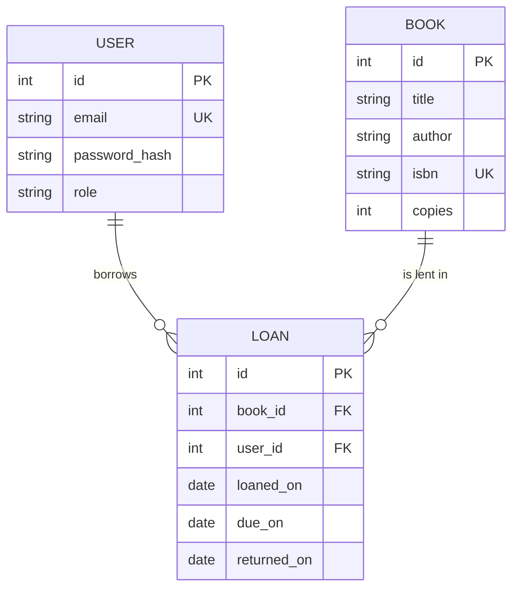

@part py-web-5 | FastAPI Basics · Part 5: Project: Library API | web
## Plan and Scaffold

Build a small library-lending service the way you would at work: requirements first, then a data model, endpoints, business rules, security and tests.

**Requirements**

| Actor | Can do |
| --- | --- |
| Anyone | List and search books, see how many copies are available |
| Member (logged in) | Borrow a book, return it, see their own loans |
| Librarian (logged in) | Add books, see all loans |

**Business rules** (these are what interviews and code reviews ask about):

1. A member may have at most **3 active loans**.
2. A member cannot borrow a book they already have, and cannot borrow when **no copy is available**.
3. A loan lasts **14 days**; returning late costs **2 per day** overdue.
4. A member sees and returns **only their own** loans; a librarian sees all.
5. ISBNs are unique; invalid input returns **422**, business-rule violations **409**, missing things **404**, bad credentials **401**, missing role **403**.

**Data model**



**Endpoints**

| Method and path | Role | Result |
| --- | --- | --- |
| `POST /auth/login` | public | access token (JWT) |
| `GET /books?q=&limit=&offset=` | public | books with `available` count |
| `POST /books` | librarian | 201 + the book; 409 duplicate ISBN |
| `POST /loans` (`{"book_id": 1}`) | member | 201 + the loan |
| `POST /loans/{id}/return` | owner or librarian | the loan and the late fee |
| `GET /loans/mine` | member | the caller's loans |
| `GET /loans` | librarian | every loan |

**Layers and files** (in a real repository each section of the single-file program below is its own module):

```text Layout
library-api/
  pyproject.toml
  src/library/
    main.py            # create_app(): routers, exception handlers, lifespan
    config.py          # Settings (secret, loan rules)
    db.py              # engine, SessionLocal, get_session
    models.py          # User, Book, Loan
    schemas.py         # BookIn, BookOut, LoanOut, Token
    service.py         # Library: borrow, give_back, add_book  (the rules; no HTTP)
    security.py        # password hashing, JWT, current_user, require_librarian
    errors.py          # LibraryError hierarchy and the problem+json handler
    routers/{auth,books,loans}.py
  tests/               # test_rules.py (service), test_api.py (HTTP), conftest.py
```

!tip Build in this order :: (1) models and the service with its rules, tested directly; (2) the schemas and routes; (3) errors; (4) security; (5) pagination and polish; (6) Docker and CI. Each step ends with green tests. The rules in the service are the product; HTTP is a thin layer over them.

??  Why are the business rules in a service class and not in the route functions?
=> Rules in a plain class can be tested without HTTP or a server, reused from a CLI or background job, and read in one place. Route functions then only translate between HTTP and the service: parse input, call, map errors to status codes.

## The Complete Application

The whole project in one file, with an end-to-end check at the bottom that exercises **every rule above through HTTP** (the same calls a client would make). It runs when this page is built, so it works.

```python LibraryApi.py
from datetime import date, datetime, timedelta, timezone
from typing import Annotated

import jwt
from fastapi import Depends, FastAPI, HTTPException, Query, Request, status
from fastapi.responses import JSONResponse
from fastapi.security import OAuth2PasswordBearer, OAuth2PasswordRequestForm
from fastapi.testclient import TestClient
from pwdlib import PasswordHash
from pydantic import BaseModel, ConfigDict, Field
from sqlalchemy import ForeignKey, String, create_engine, func, select
from sqlalchemy.orm import DeclarativeBase, Mapped, Session, mapped_column, sessionmaker
from sqlalchemy.pool import StaticPool

# ======================================================================== config.py
SECRET, ALGORITHM, TOKEN_MINUTES = "dev-secret-change-me", "HS256", 30
LOAN_DAYS, MAX_LOANS, FEE_PER_DAY = 14, 3, 2
hasher = PasswordHash.recommended()


# ======================================================================== models.py
class Base(DeclarativeBase):
    pass


class User(Base):
    __tablename__ = "users"
    id: Mapped[int] = mapped_column(primary_key=True)
    email: Mapped[str] = mapped_column(String(120), unique=True)
    password_hash: Mapped[str]
    role: Mapped[str] = mapped_column(String(20))                                  # "librarian" or "member"


class Book(Base):
    __tablename__ = "books"
    id: Mapped[int] = mapped_column(primary_key=True)
    title: Mapped[str] = mapped_column(String(200), index=True)
    author: Mapped[str] = mapped_column(String(120))
    isbn: Mapped[str] = mapped_column(String(13), unique=True)
    copies: Mapped[int]


class Loan(Base):
    __tablename__ = "loans"
    id: Mapped[int] = mapped_column(primary_key=True)
    book_id: Mapped[int] = mapped_column(ForeignKey("books.id"), index=True)
    user_id: Mapped[int] = mapped_column(ForeignKey("users.id"), index=True)
    loaned_on: Mapped[date]
    due_on: Mapped[date]
    returned_on: Mapped[date | None]


# ======================================================================== errors.py
class LibraryError(Exception):
    status, title = 400, "Bad request"

    def __init__(self, detail: str):
        super().__init__(detail)
        self.detail = detail


class NotFound(LibraryError):
    status, title = 404, "Not found"


class Conflict(LibraryError):
    status, title = 409, "Business rule violated"


def problem(request: Request, status_code: int, title: str, detail: str, **extra) -> JSONResponse:
    body = {"type": "about:blank", "title": title, "status": status_code, "detail": detail, "instance": request.url.path, **extra}
    return JSONResponse(body, status_code=status_code, media_type="application/problem+json")


# ======================================================================== service.py  (the rules: no HTTP in here)
class Library:
    def __init__(self, session: Session, today: date):
        self.session, self.today = session, today

    def add_book(self, title: str, author: str, isbn: str, copies: int) -> Book:
        if self.session.scalar(select(Book).where(Book.isbn == isbn)):
            raise Conflict(f"a book with ISBN {isbn} already exists")
        book = Book(title=title, author=author, isbn=isbn, copies=copies)
        self.session.add(book)
        self.session.flush()
        return book

    def available(self, book: Book) -> int:
        lent = self.session.scalar(select(func.count()).select_from(Loan).where(Loan.book_id == book.id, Loan.returned_on.is_(None)))
        return book.copies - (lent or 0)

    def borrow(self, user: User, book_id: int) -> Loan:
        book = self.session.get(Book, book_id, with_for_update=True)             # lock the row on PostgreSQL: two borrowers cannot both take the last copy
        if book is None:
            raise NotFound(f"book {book_id} does not exist")
        active = list(self.session.scalars(select(Loan).where(Loan.user_id == user.id, Loan.returned_on.is_(None))))
        if len(active) >= MAX_LOANS:
            raise Conflict(f"loan limit reached: {MAX_LOANS} active loans")
        if any(loan.book_id == book_id for loan in active):
            raise Conflict("you already have this book")
        if self.available(book) <= 0:
            raise Conflict("no copies available")
        loan = Loan(book_id=book_id, user_id=user.id, loaned_on=self.today, due_on=self.today + timedelta(days=LOAN_DAYS))
        self.session.add(loan)
        self.session.flush()
        return loan

    def give_back(self, user: User, loan_id: int) -> tuple[Loan, int]:
        loan = self.session.get(Loan, loan_id)
        if loan is None or (loan.user_id != user.id and user.role != "librarian"):
            raise NotFound(f"loan {loan_id} does not exist")                      # 404, not 403: do not reveal other people's loans
        if loan.returned_on is not None:
            raise Conflict("this loan was already returned")
        loan.returned_on = self.today
        return loan, max(0, (self.today - loan.due_on).days) * FEE_PER_DAY


# ======================================================================== schemas.py
class BookIn(BaseModel):
    title: str = Field(min_length=1, max_length=200)
    author: str = Field(min_length=1, max_length=120)
    isbn: str = Field(pattern=r"^\d{10}(\d{3})?$")
    copies: int = Field(ge=1, le=100)


class BookOut(BookIn):
    id: int
    available: int


class LoanOut(BaseModel):
    model_config = ConfigDict(from_attributes=True)
    id: int
    book_id: int
    loaned_on: date
    due_on: date
    returned_on: date | None


class ReturnOut(BaseModel):
    loan: LoanOut
    fee: int


class Token(BaseModel):
    access_token: str
    token_type: str = "bearer"


# ======================================================================== db.py and security.py
engine = create_engine("sqlite://", connect_args={"check_same_thread": False}, poolclass=StaticPool)     # tests only; PostgreSQL in production
SessionLocal = sessionmaker(engine, expire_on_commit=False)
oauth2 = OAuth2PasswordBearer(tokenUrl="/auth/login")


def get_session():
    with SessionLocal() as session:
        try:
            yield session
            session.commit()
        except Exception:
            session.rollback()
            raise


def get_today() -> date:                                                          # a dependency, so tests can move the calendar
    return date.today()


SessionDep = Annotated[Session, Depends(get_session)]


def get_library(session: SessionDep, today: Annotated[date, Depends(get_today)]) -> Library:
    return Library(session, today)


LibraryDep = Annotated[Library, Depends(get_library)]


def current_user(token: Annotated[str, Depends(oauth2)], session: SessionDep) -> User:
    unauthorised = HTTPException(status.HTTP_401_UNAUTHORIZED, "invalid or expired token", headers={"WWW-Authenticate": "Bearer"})
    try:
        claims = jwt.decode(token, SECRET, algorithms=[ALGORITHM], options={"require": ["exp", "sub"]})
    except jwt.PyJWTError:
        raise unauthorised from None
    user = session.get(User, int(claims["sub"]))
    if user is None:
        raise unauthorised
    return user


UserDep = Annotated[User, Depends(current_user)]


def require_librarian(user: UserDep) -> User:
    if user.role != "librarian":
        raise HTTPException(status.HTTP_403_FORBIDDEN, "librarians only")
    return user


# ======================================================================== main.py  (routes)
app = FastAPI(title="Library API", version="1.0.0")


@app.exception_handler(LibraryError)
async def library_error_handler(request: Request, exc: LibraryError):
    return problem(request, exc.status, exc.title, exc.detail)


@app.post("/auth/login", response_model=Token)
def login(form: Annotated[OAuth2PasswordRequestForm, Depends()], session: SessionDep):
    user = session.scalar(select(User).where(User.email == form.username))
    if user is None or not hasher.verify(form.password, user.password_hash):
        raise HTTPException(status.HTTP_401_UNAUTHORIZED, "incorrect email or password", headers={"WWW-Authenticate": "Bearer"})
    claims = {"sub": str(user.id), "role": user.role, "exp": datetime.now(timezone.utc) + timedelta(minutes=TOKEN_MINUTES)}
    return Token(access_token=jwt.encode(claims, SECRET, algorithm=ALGORITHM))


def book_out(library: Library, book: Book) -> BookOut:
    return BookOut(id=book.id, title=book.title, author=book.author, isbn=book.isbn, copies=book.copies, available=library.available(book))


@app.get("/books", response_model=list[BookOut])
def list_books(session: SessionDep, library: LibraryDep, q: str | None = None, limit: Annotated[int, Query(ge=1, le=50)] = 10, offset: Annotated[int, Query(ge=0)] = 0):
    stmt = select(Book).order_by(Book.id).limit(limit).offset(offset)
    if q:
        stmt = stmt.where(Book.title.ilike(f"%{q}%") | Book.author.ilike(f"%{q}%"))
    return [book_out(library, b) for b in session.scalars(stmt)]


@app.post("/books", response_model=BookOut, status_code=201, dependencies=[Depends(require_librarian)])
def create_book(payload: BookIn, library: LibraryDep):
    return book_out(library, library.add_book(**payload.model_dump()))


@app.post("/loans", response_model=LoanOut, status_code=201)
def borrow(body: dict, user: UserDep, library: LibraryDep):
    if not isinstance(body.get("book_id"), int):
        raise HTTPException(422, "book_id (integer) is required")
    return library.borrow(user, body["book_id"])


@app.post("/loans/{loan_id}/return", response_model=ReturnOut)
def give_back(loan_id: int, user: UserDep, library: LibraryDep):
    loan, fee = library.give_back(user, loan_id)
    return ReturnOut(loan=LoanOut.model_validate(loan), fee=fee)


@app.get("/loans/mine", response_model=list[LoanOut])
def my_loans(user: UserDep, session: SessionDep):
    return list(session.scalars(select(Loan).where(Loan.user_id == user.id).order_by(Loan.id)))


@app.get("/loans", response_model=list[LoanOut], dependencies=[Depends(require_librarian)])
def all_loans(session: SessionDep):
    return list(session.scalars(select(Loan).order_by(Loan.id)))


# ======================================================================== seed data and the end-to-end check
Base.metadata.create_all(engine)
with SessionLocal() as s, s.begin():
    s.add_all([User(email="lib@example.com", password_hash=hasher.hash("lib-pass"), role="librarian"),
               User(email="asha@example.com", password_hash=hasher.hash("asha-pass"), role="member"),
               User(email="ravi@example.com", password_hash=hasher.hash("ravi-pass"), role="member"),
               User(email="meera@example.com", password_hash=hasher.hash("meera-pass"), role="member")])

client = TestClient(app)
today = [date(2026, 11, 4)]
app.dependency_overrides[get_today] = lambda: today[0]                              # the test controls "today"


def headers_for(email: str, password: str) -> dict:
    token = client.post("/auth/login", data={"username": email, "password": password}).json()["access_token"]
    return {"Authorization": f"Bearer {token}"}


librarian = headers_for("lib@example.com", "lib-pass")
asha, ravi, meera = (headers_for("asha@example.com", "asha-pass"), headers_for("ravi@example.com", "ravi-pass"),
                     headers_for("meera@example.com", "meera-pass"))
checks = []


def check(label: str, condition: bool):
    assert condition, label
    checks.append(label)


# authentication and roles
check("bad password is 401", client.post("/auth/login", data={"username": "asha@example.com", "password": "x"}).status_code == 401)
check("no token is 401", client.get("/loans/mine").status_code == 401)
check("a member cannot add books (403)", client.post("/books", headers=asha, json={"title": "T", "author": "A", "isbn": "1234567890", "copies": 1}).status_code == 403)

# books: create, validate, duplicate, search
created = client.post("/books", headers=librarian, json={"title": "Python Internals", "author": "Asha Rao", "isbn": "9781234567897", "copies": 2})
check("librarian creates a book (201)", created.status_code == 201 and created.json()["available"] == 2)
check("invalid ISBN is 422", client.post("/books", headers=librarian, json={"title": "X", "author": "Y", "isbn": "abc", "copies": 1}).status_code == 422)
duplicate = client.post("/books", headers=librarian, json={"title": "Other", "author": "Z", "isbn": "9781234567897", "copies": 1})
check("duplicate ISBN is 409 problem+json", duplicate.status_code == 409 and duplicate.headers["content-type"].startswith("application/problem+json"))
for n, title in enumerate(["Async Patterns", "Django Cookbook", "SQL Tuning"], start=2):
    client.post("/books", headers=librarian, json={"title": title, "author": "Various", "isbn": f"978000000{n:04d}", "copies": 1})
check("search finds by title, case-insensitively", [b["title"] for b in client.get("/books?q=django").json()] == ["Django Cookbook"])
check("pagination limits the page", len(client.get("/books?limit=2").json()) == 2)

# borrowing rules
first = client.post("/loans", headers=asha, json={"book_id": 1})
check("member borrows (201), due in 14 days", first.status_code == 201 and first.json()["due_on"] == "2026-11-18")
check("available copies drop", client.get("/books?q=internals").json()[0]["available"] == 1)
check("cannot borrow the same book twice (409)", client.post("/loans", headers=asha, json={"book_id": 1}).status_code == 409)
client.post("/loans", headers=asha, json={"book_id": 2})
client.post("/loans", headers=asha, json={"book_id": 3})
check("fourth active loan is refused (409)", client.post("/loans", headers=asha, json={"book_id": 4}).status_code == 409)
client.post("/loans", headers=ravi, json={"book_id": 1})                              # book 1 has two copies: asha and ravi hold them
none_left = client.post("/loans", headers=meera, json={"book_id": 1})
check("no copies left is refused (409)", none_left.status_code == 409 and "no copies" in none_left.json()["detail"])
check("an unknown book is 404", client.post("/loans", headers=meera, json={"book_id": 99}).status_code == 404)

# returning: ownership and late fees
check("other members cannot return someone's loan (404)", client.post("/loans/1/return", headers=ravi).status_code == 404)
today[0] = date(2026, 11, 10)                                                         # 6 days into a 14-day loan
check("on-time return is free", client.post("/loans/3/return", headers=asha).json()["fee"] == 0)
today[0] = date(2026, 12, 8)                                                          # 34 days after the loan: 20 days overdue
late = client.post("/loans/1/return", headers=asha).json()
check("late return costs 20 days x 2 = 40", late["fee"] == 40 and late["loan"]["returned_on"] == "2026-12-08")
check("returning twice is refused (409)", client.post("/loans/1/return", headers=asha).status_code == 409)
check("a librarian can return a member's loan", client.post("/loans/2/return", headers=librarian).status_code == 200)

# listing
check("members see only their loans", {loan["id"] for loan in client.get("/loans/mine", headers=ravi).json()} == {4})
check("librarian sees every loan", len(client.get("/loans", headers=librarian).json()) == 4)
check("members cannot list all loans (403)", client.get("/loans", headers=asha).status_code == 403)

print(f"{len(checks)} end-to-end checks passed")
print("endpoints:", sorted(f"{m} {p}" for p, ops in client.get("/openapi.json").json()["paths"].items() for m in ops))
```

```output
```

## Domain, Repository and Service Walkthrough

The **`Library` service** is the heart of the project. Read `borrow` as a checklist, in the order that gives the clearest error:

```python borrow() rule order
def borrow(self, user, book_id):
    book = self.session.get(Book, book_id, with_for_update=True)     # 1. does it exist? (and lock the row)
    if book is None:
        raise NotFound(...)                                           # 404
    active = list(self.session.scalars(select(Loan).where(Loan.user_id == user.id, Loan.returned_on.is_(None))))
    if len(active) >= MAX_LOANS:                                      # 2. the member's limit
        raise Conflict(...)
    if any(loan.book_id == book_id for loan in active):               # 3. no duplicate loans
        raise Conflict(...)
    if self.available(book) <= 0:                                     # 4. a copy must be free
        raise Conflict(...)
    loan = Loan(book_id=book_id, user_id=user.id, loaned_on=self.today, due_on=self.today + timedelta(days=LOAN_DAYS))
    self.session.add(loan)
    self.session.flush()                                              # id assigned; the dependency commits at the end
    return loan
```

Design decisions worth explaining in an interview:

1. **Availability is derived, not stored.** `copies - active loans` can never drift out of sync, unlike a stored `available` counter that two requests can corrupt. (The price is one `COUNT` query; for hot paths you would add an index on `(book_id, returned_on)` or cache it.)
2. **Time is injected** (`today`). A function that calls `date.today()` inside is untestable for late fees; passing the date in (here through a `get_today` dependency) lets the check above move the calendar forward by weeks.
3. **Concurrency.** Two members borrowing the last copy at the same moment can both pass the availability check (a **race condition**, check-then-act). The row lock (`with_for_update=True`, honoured by PostgreSQL, ignored by SQLite) serialises borrowers of one book; the alternative is a database constraint (a unique partial index or a `CHECK` through a counter) so the database itself refuses the second loan. **Application checks alone are never enough under concurrency.**
4. **Money as integers** (`FEE_PER_DAY = 2` in minor units), never floats.
5. **The service raises `Conflict`/`NotFound`, not `HTTPException`**: the HTTP layer maps them in one handler, so the same service could run in a CLI.
6. **404 for someone else's loan** hides its existence: object-level authorisation (Part 4).

??  How would you make `borrow` safe if two requests arrive at the same instant for the last copy?
=> Lock the book row (`SELECT ... FOR UPDATE`) inside the transaction so the second request waits and then sees the updated availability, or enforce the rule in the database (a constraint or a counter updated with a conditional `UPDATE ... WHERE available > 0` and checking the affected row count). Application-level checks alone leave a check-then-act race.
??  Why compute `available` from the loans table instead of storing a counter?
=> A derived value cannot be inconsistent with the loans it summarises, whereas a stored counter must be updated atomically with every borrow, return and deletion and can drift after a bug or a crash. Cache or denormalise only when measurement shows the query is too slow.

## REST Layer, Validation and Error Handling Walkthrough

Every rule has one **error class** and one **status code**, and the handler turns them into `application/problem+json`:

| Situation | Raised as | HTTP |
| --- | --- | --- |
| Unknown book or someone else's loan | `NotFound` | 404 |
| Loan limit, duplicate, no copies, already returned, duplicate ISBN | `Conflict` | 409 |
| Invalid ISBN, missing field, bad type | Pydantic validation (automatic) | 422 |
| No or bad token | `HTTPException(401)` + `WWW-Authenticate` | 401 |
| Wrong role | `HTTPException(403)` | 403 |

Points to notice in the routes:

- **Input schemas** (`BookIn`) validate everything at the boundary: the ISBN regex, `copies` range, lengths. `BookOut` inherits from `BookIn` and adds `id` and the computed `available`, so the response shape is explicit.
- **`response_model`** controls the output: `User.password_hash` can never leak because no route returns a `User`.
- **Dependencies compose**: `require_librarian` is attached with `dependencies=[Depends(...)]` when it needs no value, and `UserDep` is injected when the user object is needed.
- **Pagination is capped** (`le=50` and `min(limit, 50)`), and search uses parameters (`ilike` with a bound pattern), never string-built SQL.

!warning What this project deliberately leaves out :: Refresh tokens and logout, password reset and email verification, rate limiting on `/auth/login`, structured logging with request IDs, migrations (it uses `create_all`), a real PostgreSQL, and retry-safe idempotency keys for `POST /loans`. Each has a section earlier in this tree; adding them is the best follow-up exercise.

??  Why does the check at the bottom override `get_today`?
=> So the test can set the date: the loan is created on a known day and returned 34 days later to assert a late fee of exactly 40 (20 days overdue at 2 a day). Without injecting the clock the test would depend on the real calendar and be unreliable.
??  Where would you add rate limiting for login attempts, and why there?
=> On `POST /auth/login` (and password-reset endpoints) at the reverse proxy or with a Redis-backed limiter dependency keyed by IP and account, to slow credential stuffing and brute force. Login is the endpoint attackers hit most because it is cheap to automate and valuable to win.

## Security and Tests Walkthrough

Authentication is the JWT flow of Part 4: Argon2 hashes, a 30-minute access token with `sub` (user id) and `exp`, verified on every request with the algorithm list pinned. Authorisation lives in two dependencies (`require_librarian` for role) and inside the service (ownership of loans).

The end-to-end block is a **test suite in miniature**. In the real repository the same checks become two layers of `pytest` tests:

| Layer | What it tests | Tools |
| --- | --- | --- |
| **Service tests** | The rules, directly: borrow limits, fees, availability. Fast, no HTTP | `Library(session, today)` with an in-memory database and a fixed date |
| **API tests** | Status codes, auth, validation and error shapes through the real app | `TestClient`, `dependency_overrides` for `get_today` and `get_session` |
| **Contract test** | `openapi.json` did not change by accident | Compare against a committed snapshot |
| **Migration test** | Upgrade from empty and downgrade work | Alembic against PostgreSQL in CI |

A good habit is to name each test after the rule (`test_fourth_active_loan_is_refused`), so that a failing test reads like a bug report.

```python Parametrised rule tests !skip
import pytest


@pytest.mark.parametrize("copies, borrowers, expected_statuses", [
    (1, 2, [201, 409]),          # the second borrower finds no copy
    (2, 2, [201, 201]),
    (3, 4, [201, 201, 201, 409]),
])
def test_availability_is_enforced(client, librarian, members, copies, borrowers, expected_statuses):
    book_id = client.post("/books", headers=librarian, json=make_book(copies=copies)).json()["id"]
    statuses = [client.post("/loans", headers=members[i], json={"book_id": book_id}).status_code for i in range(borrowers)]
    assert statuses == expected_statuses
```

??  How do you test the late-fee rule without waiting 20 days?
=> Inject the clock: the service takes `today` as a parameter and the API gets it from a dependency, so the test overrides it with a fixed or advancing date. Time is a dependency like the database.
??  What should a code reviewer look for in this project?
=> Missing ownership checks (BOLA), rules enforced only in the application under concurrency, floats for money, `HTTPException` leaking into the service, unbounded list endpoints, secrets in code, and tests that depend on the clock, the network or each other's data.

## Run It and Call It

```bash Run the API
uv run uvicorn library.main:app --reload             # http://127.0.0.1:8000, interactive docs at /docs

# 1. log in (form-encoded) and keep the token
TOKEN=$(curl -s -X POST localhost:8000/auth/login -d "username=asha@example.com&password=asha-pass" | python -c "import sys, json; print(json.load(sys.stdin)['access_token'])")

# 2. browse and borrow
curl -s "localhost:8000/books?q=python"
curl -s -X POST localhost:8000/loans -H "Authorization: Bearer $TOKEN" -H "Content-Type: application/json" -d '{"book_id": 1}'
curl -s localhost:8000/loans/mine -H "Authorization: Bearer $TOKEN"

# 3. return it and see the fee
curl -s -X POST localhost:8000/loans/1/return -H "Authorization: Bearer $TOKEN"
```

Open `/docs`, press **Authorize**, log in with the form, and call each endpoint from the browser. Then try to break your own API: another user's loan id, a negative `limit`, a 10,000-character title, an expired token. Each should produce a clean, specific error.

**Where to take it next**

1. Move the in-memory SQLite to PostgreSQL with Alembic migrations and a Docker Compose file.
2. Add refresh tokens and a request-ID log middleware.
3. Add a React front end against this API (the frontend stage covers the integration).
4. Add a background job (Celery) that emails members whose books are due tomorrow.
5. Deploy it (the delivery stage) and add a dashboard from its `/metrics`.

!keypoints Rules live in a service, HTTP is a thin layer ;; Derive availability, do not store it ;; Inject time and sessions so tests control them ;; One error class per rule, mapped in one handler ;; Check ownership on every object ;; Concurrency needs locks or constraints, not just checks

??  How would you extend the API so members can reserve a book that has no free copy?
=> Add a `Reservation` table (book, user, created_at, status) with a queue per book; when a loan is returned, the service offers the copy to the first waiting reservation (a notification and a hold window), and borrowing is allowed for that member first. Model the states explicitly (waiting, ready, expired, fulfilled) and test the transitions.
