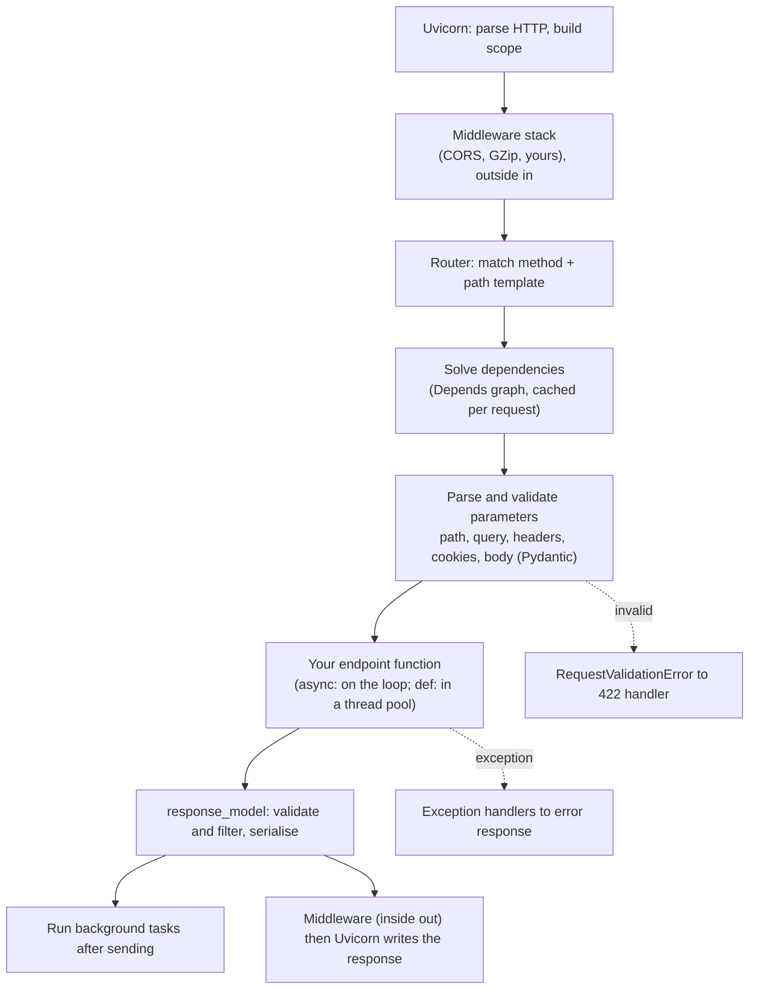

@part py-web-7 | FastAPI Beyond Basics · Part 1: ASGI, Starlette and FastAPI Internals | web
## ASGI From Scratch

FastAPI is a thin layer on **Starlette**, which is a thin layer on **ASGI**. Understanding ASGI removes the magic: a web application is just **an async callable that receives a `scope` and two channels, `receive` and `send`**.

```python RawAsgi.py
import asyncio
import json

import httpx


async def app(scope, receive, send):
    if scope["type"] == "lifespan":                                    # the server tells the app when it starts and stops
        while True:
            message = await receive()
            if message["type"] == "lifespan.startup":
                await send({"type": "lifespan.startup.complete"})
            elif message["type"] == "lifespan.shutdown":
                await send({"type": "lifespan.shutdown.complete"})
                return

    assert scope["type"] == "http"                                      # also "websocket" for WebSocket connections
    body = b""
    while True:                                                         # the request body arrives as one or more events
        message = await receive()
        body += message.get("body", b"")
        if not message.get("more_body"):
            break

    payload = {"method": scope["method"], "path": scope["path"], "query": scope["query_string"].decode(),
               "headers": {k.decode(): v.decode() for k, v in scope["headers"] if k == b"x-demo"}, "body": body.decode()}
    data = json.dumps(payload).encode()
    await send({"type": "http.response.start", "status": 200, "headers": [(b"content-type", b"application/json"), (b"content-length", str(len(data)).encode())]})
    await send({"type": "http.response.body", "body": data})


async def main():
    transport = httpx.ASGITransport(app=app)                            # httpx can call an ASGI app in-process: no server needed
    async with httpx.AsyncClient(transport=transport, base_url="http://test") as client:
        response = await client.post("/hello?x=1", content=b"ping", headers={"X-Demo": "yes"})
        print(response.status_code, response.headers["content-type"])
        print(response.json())


asyncio.run(main())
```

```output
```

Everything a framework does is built on those events:

| Piece | What it is |
| --- | --- |
| **`scope`** | A dictionary describing the connection: `type` (`http`, `websocket`, `lifespan`), `method`, `path`, `query_string`, `headers` (a list of byte pairs), `client`, `server`, and anything middleware adds |
| **`receive()`** | An awaitable returning events from the client: `http.request` (body chunks), `http.disconnect`, `websocket.receive` |
| **`send(event)`** | Sends events to the client: `http.response.start` (status, headers), then `http.response.body` (chunks; `more_body` for streaming) |
| **lifespan** | A special connection that carries start-up and shutdown, which is what `FastAPI(lifespan=...)` plugs into |
| **Server** | Uvicorn, Hypercorn or Granian: parses HTTP off the socket, builds the scope, calls `await app(scope, receive, send)` for every request |

### Middleware is just a wrapper around an ASGI app

```python AsgiMiddleware.py
import asyncio
import time

import httpx
from fastapi import FastAPI


class TimingMiddleware:
    """A PURE ASGI middleware: wraps send() to add a header. Faster and safer than BaseHTTPMiddleware."""

    def __init__(self, app):
        self.app = app

    async def __call__(self, scope, receive, send):
        if scope["type"] != "http":                                      # pass websockets and lifespan straight through
            await self.app(scope, receive, send)
            return
        started = time.perf_counter()

        async def send_with_header(message):
            if message["type"] == "http.response.start":
                headers = list(message.get("headers", []))
                headers.append((b"x-handled-by", b"pure-asgi"))
                message = {**message, "headers": headers}
            await send(message)

        await self.app(scope, receive, send_with_header)


app = FastAPI()
app.add_middleware(TimingMiddleware)


@app.get("/ping")
async def ping():
    return {"pong": True}


async def main():
    async with httpx.AsyncClient(transport=httpx.ASGITransport(app=app), base_url="http://test") as client:
        response = await client.get("/ping")
        print(response.json(), response.headers["x-handled-by"])
        print(type(app.middleware_stack).__name__ if app.middleware_stack else "built on first request", app.user_middleware[0].cls.__name__)


asyncio.run(main())
```

```output
```

`@app.middleware("http")` (and `BaseHTTPMiddleware`) is convenient but wraps each request in extra machinery: it cannot be combined easily with streaming bodies, background tasks and some context-variable patterns. **Pure ASGI middleware** like the one above has none of those limits and is what high-quality libraries ship. Middleware order is outside-in for requests and inside-out for responses: the last one added is the outermost.

??  What are `scope`, `receive` and `send` in ASGI?
=> `scope` is a dict describing the connection (type, method, path, headers); `receive` is an async function that yields incoming events (request body chunks, disconnects); `send` is an async function the app calls with outgoing events (response start with status and headers, then body chunks). An ASGI app is `async def app(scope, receive, send)`.
??  Why is pure ASGI middleware preferred over `BaseHTTPMiddleware` in libraries?
=> It wraps the raw callables without copying the request or response through extra streams, supports websockets and streaming correctly, and avoids known issues with background tasks and context variables. `BaseHTTPMiddleware` is easier to write for application code but has these limitations.
??  How does a server like Uvicorn relate to the framework?
=> Uvicorn owns the socket and the HTTP protocol: it parses requests, builds the ASGI scope and calls the application for each connection, writing back whatever events the app sends. The framework only implements the ASGI interface, so servers and frameworks are interchangeable.

## Starlette and the FastAPI Request Lifecycle

**Starlette** provides the routing, `Request`/`Response` objects, middleware, WebSockets, background tasks and the test client. **FastAPI** subclasses it and adds what makes it special: type-driven parameter parsing, dependency injection, Pydantic validation and OpenAPI generation. The life of one request:



You can look at what FastAPI built for an endpoint. Each route has a **dependant**: a tree describing every parameter and sub-dependency that FastAPI will resolve (this is internal API, so treat it as a debugging aid rather than something to build on):

```python Lifecycle.py
from typing import Annotated

from fastapi import Depends, FastAPI, Header, Query
from fastapi.routing import APIRoute
from fastapi.testclient import TestClient
from pydantic import BaseModel

app = FastAPI()
trace = []


def get_db():
    trace.append("db open")
    yield "db"
    trace.append("db close")


def get_user(db: Annotated[str, Depends(get_db)], x_user: Annotated[str, Header()]):
    trace.append("user")
    return x_user


def get_audit(db: Annotated[str, Depends(get_db)], user: Annotated[str, Depends(get_user)]):
    trace.append("audit")                                          # get_db is shared: it runs ONCE for this request
    return f"audit:{user}"


class Order(BaseModel):
    sku: str
    qty: int = 1


@app.post("/orders/{order_id}")
def create(order_id: int, order: Order, audit: Annotated[str, Depends(get_audit)], note: Annotated[str | None, Query()] = None):
    trace.append("endpoint")
    return {"id": order_id, "order": order, "audit": audit}


route = next(r for r in app.routes if isinstance(r, APIRoute) and r.path == "/orders/{order_id}")


def show(dependant, depth=0):
    kinds = {"path": [p.name for p in dependant.path_params], "query": [p.name for p in dependant.query_params],
             "header": [p.name for p in dependant.header_params], "body": [p.name for p in dependant.body_params]}
    print("  " * depth + (getattr(dependant.call, "__name__", "endpoint") if dependant.call else "root"), {k: v for k, v in kinds.items() if v})
    for sub in dependant.dependencies:
        show(sub, depth + 1)


show(route.dependant)
response = TestClient(app).post("/orders/5?note=x", json={"sku": "pen"}, headers={"X-User": "asha"})
print(response.json(), trace)
```

```output
```

What the output tells you: dependencies resolve **depth first**, a dependency used twice (`get_db`) is **executed once and shared** for the request (the cache), the `yield` clean-up runs **after** the endpoint, and the body model, path and query parameters are collected from the signature into one description that also feeds the OpenAPI schema.

!tip A single source of truth :: The `dependant` tree is why FastAPI's documentation, validation and parameter handling can never disagree: all three are generated from the same function signature. When behaviour surprises you (a parameter treated as a query instead of a body), look at the type annotation first, then print the dependant.

??  How does FastAPI avoid running the same dependency twice in one request?
=> It caches each dependency's result per request by the callable (`use_cache=True` by default), so `get_db` used by several sub-dependencies runs once and they all receive the same object. Pass `Depends(fn, use_cache=False)` to force a fresh call.
??  In which order are dependencies and their clean-up executed?
=> Depth first, parents before children: a dependency's own dependencies are resolved before it runs. `yield` dependencies clean up in reverse order after the endpoint has produced its response.
??  Where do validation errors and exceptions go?
=> Parameter and body validation failures raise `RequestValidationError`, handled by the 422 exception handler. Exceptions from your code go to registered handlers (`HTTPException`, your own types) or become a 500 response through the server's error middleware.

## Pydantic v2 in Depth

```python PydanticDeep.py
import json
from typing import Annotated, Generic, Literal, TypeVar, Union

from pydantic import BaseModel, ConfigDict, Field, ValidationError, field_serializer, model_validator

T = TypeVar("T")


class Page(BaseModel, Generic[T]):                                    # a reusable generic response envelope
    items: list[T]
    total: int
    page: int = 1


class Card(BaseModel):
    kind: Literal["card"]
    last4: Annotated[str, Field(pattern=r"^\d{4}$")]


class Upi(BaseModel):
    kind: Literal["upi"]
    handle: str


class Payment(BaseModel):                                              # a DISCRIMINATED union: `kind` picks the model directly
    method: Annotated[Union[Card, Upi], Field(discriminator="kind")]
    amount_paise: int


class Event(BaseModel):
    model_config = ConfigDict(populate_by_name=True)
    id: int
    secret_token: str = Field(exclude=True)                           # never serialised

    @field_serializer("id")
    def pad(self, value: int) -> str:
        return f"EV-{value:05d}"


print(Page[int](items=[1, 2], total=2).model_dump(), Page[Card].model_json_schema()["properties"]["items"]["items"]["$ref"])

ok = Payment.model_validate({"method": {"kind": "upi", "handle": "asha@bank"}, "amount_paise": 500})
print(type(ok.method).__name__, ok.model_dump(mode="json"))
try:
    Payment.model_validate({"method": {"kind": "card", "last4": "12"}, "amount_paise": 500})
except ValidationError as error:
    print(error.errors()[0]["loc"], error.errors()[0]["type"])        # the error names the chosen branch, not "no union member matched"

event = Event(id=7, secret_token="hidden")
print(event.model_dump(), json.loads(event.model_dump_json()))
print(sorted(Payment.model_json_schema()["$defs"]), Payment.model_json_schema()["properties"]["method"]["discriminator"]["propertyName"])

# model_construct skips validation: only for data you have ALREADY validated
trusted = Card.model_construct(kind="card", last4="not-checked")
print(trusted.last4, Card.model_fields["last4"].annotation.__name__ if hasattr(Card.model_fields["last4"].annotation, "__name__") else "str")
```

```output
```

Pydantic v2 features worth knowing for design discussions:

- **Generic models** (`Page[T]`) give typed envelopes for lists; FastAPI documents each concrete form in OpenAPI.
- **Discriminated unions** (`Field(discriminator="kind")`) pick the right model from one field: faster, with precise errors, and they produce `oneOf` + `discriminator` in the schema for client generators.
- **Serialisation is configurable**: `exclude`, `@field_serializer`, `mode="json"` (turns `Decimal`, `datetime`, `UUID` into JSON-safe values), `by_alias`, `exclude_none`.
- **`model_json_schema()`** gives the JSON Schema that OpenAPI embeds; it is a contract you can snapshot-test.
- **Performance**: the validator is compiled once per model (Rust core). Avoid re-validating data you already validated, build models once at import time, use `TypeAdapter` for bulk validation of lists (`TypeAdapter(list[Order])`), and use `model_construct` only for trusted data.

??  Why use a discriminated union instead of a plain `Union[A, B]`?
=> The discriminator field tells Pydantic which model to validate against, so validation is faster, errors point at the chosen model's fields instead of listing failures for every member, and the OpenAPI schema carries the discriminator so generated clients can model it.
??  What does `model_construct` do and why is it dangerous?
=> It builds a model instance **without validation** or coercion, which is faster but means invalid or unconverted data can sit inside a "typed" object. Use it only for data you have just validated or loaded from a trusted store.
??  How do you stop a field from appearing in responses?
=> Use `Field(exclude=True)` on the model, a `response_model` that does not declare it, or `response_model_exclude`. Prefer separate read schemas that simply do not contain sensitive fields.

## WebSockets, Streaming and Server-Sent Events

HTTP request/response cannot push data. For live updates there are three options:

| Mechanism | Direction | Use for |
| --- | --- | --- |
| **Polling** | client asks repeatedly | Simple, low-frequency updates |
| **Server-sent events (SSE)** | server to client over one HTTP response | Notifications, progress, LLM token streams; works through proxies, auto-reconnect |
| **WebSocket** | both directions, one persistent connection | Chat, collaboration, games, live dashboards |

```python Live.py
import asyncio

from fastapi import FastAPI, WebSocket, WebSocketDisconnect
from fastapi.responses import StreamingResponse
from fastapi.testclient import TestClient

app = FastAPI()


class Room:
    """Tracks the live connections of one chat room."""

    def __init__(self):
        self.members: dict[str, WebSocket] = {}

    async def broadcast(self, text: str):
        for socket in list(self.members.values()):
            await socket.send_text(text)


room = Room()


@app.websocket("/ws/{name}")
async def chat(websocket: WebSocket, name: str):
    await websocket.accept()
    room.members[name] = websocket
    await room.broadcast(f"{name} joined")
    try:
        while True:
            text = await websocket.receive_text()                        # wait for the next message from this client
            await room.broadcast(f"{name}: {text}")
    except WebSocketDisconnect:
        del room.members[name]                                           # always clean up on disconnect
        await room.broadcast(f"{name} left")


async def events():
    for i in range(3):
        yield f"data: tick {i}\n\n"                                       # the SSE wire format: "data: ...", blank line between events
        await asyncio.sleep(0)


@app.get("/stream")
async def stream():
    return StreamingResponse(events(), media_type="text/event-stream")


client = TestClient(app)
with client.websocket_connect("/ws/asha") as asha:
    print(asha.receive_text())
    with client.websocket_connect("/ws/ravi") as ravi:
        print(ravi.receive_text(), "|", asha.receive_text())
        ravi.send_text("hello everyone")
        print(asha.receive_text())
print(sorted(room.members))
print(client.get("/stream").text.replace("\n\n", " | "))
```

```output
```

Production notes: a WebSocket server holds **one connection per client** for a long time, so check connection limits and idle timeouts at every proxy; authenticate during the handshake (a token in the first message or the query string over TLS) because browsers cannot set headers on `WebSocket`; and when you run **several workers or replicas**, a client on worker A cannot receive a message published on worker B, so fan out through **Redis pub/sub** (or a broker) instead of an in-process `Room`.

??  When do you choose SSE over WebSockets?
=> When data flows only from server to client (notifications, progress bars, streaming text): SSE is plain HTTP, passes proxies easily, reconnects automatically and is simpler to scale. Use WebSockets when the client also sends frequent messages, as in chat or collaborative editing.
??  How do you scale WebSocket broadcasts across multiple server processes?
=> Each process only knows its own connections, so publish messages to a shared channel (Redis pub/sub or Streams, a message broker) and have every process forward them to its local connections.

## HTTP Clients: httpx in Production

Services call other services, and the HTTP client is where most outages are born: missing timeouts, unbounded concurrency and no connection reuse. `httpx` provides sync and async clients with the same API.

```python HttpxDeep.py
import asyncio

import httpx

calls = {"count": 0}


def flaky_upstream(request: httpx.Request) -> httpx.Response:
    calls["count"] += 1
    if request.url.path == "/slow":
        raise httpx.ReadTimeout("upstream did not answer in time", request=request)
    if calls["count"] <= 2:
        return httpx.Response(503, json={"error": "try again"}, headers={"Retry-After": "0"})
    return httpx.Response(200, json={"ok": True, "attempt": calls["count"]})


async def get_with_retries(client: httpx.AsyncClient, url: str, attempts: int = 4):
    for attempt in range(1, attempts + 1):
        try:
            response = await client.get(url)
            if response.status_code not in (502, 503, 504):             # retry only transient server-side failures
                return response
        except (httpx.ConnectTimeout, httpx.ReadTimeout):
            pass
        await asyncio.sleep(0.01 * 2 ** attempt)                        # exponential backoff (add jitter in real code)
    raise RuntimeError(f"gave up after {attempts} attempts")


async def main():
    timeout = httpx.Timeout(5.0, connect=2.0, pool=1.0)                  # separate limits for connect, read/write and pool wait
    limits = httpx.Limits(max_connections=20, max_keepalive_connections=10)
    async with httpx.AsyncClient(base_url="https://api.test", timeout=timeout, limits=limits, transport=httpx.MockTransport(flaky_upstream),
                                 headers={"User-Agent": "shop-api/1.0"}) as client:
        response = await get_with_retries(client, "/items")
        print(response.status_code, response.json(), "calls:", calls["count"])

        try:
            await client.get("/slow")
        except httpx.ReadTimeout as error:
            print(type(error).__name__, "->", error)

        results = await asyncio.gather(*(client.get(f"/items?page={i}") for i in range(3)))
        print([r.status_code for r in results], client.timeout.connect, client.timeout.read)


asyncio.run(main())
```

```output
```

| Practice | Why |
| --- | --- |
| **One long-lived client** per upstream (created at start-up in `lifespan`) | Connection pooling and keep-alive; a client per request pays TCP and TLS every time |
| **Explicit timeouts** (connect, read, write, pool) | The default of "wait forever" turns one slow dependency into an outage for everyone |
| **Retry only idempotent, transient failures** with exponential backoff and jitter, and a **retry budget** | Retrying `POST` payments or retrying a struggling server in lockstep makes things worse |
| **Limit concurrency** (`httpx.Limits`, a semaphore) | Protects the upstream and your own connection pool |
| **Circuit breaker** around calls to unreliable services (Part 11) | Fail fast instead of piling up waiting requests |
| **Propagate correlation IDs and deadlines** | Debuggable, bounded calls across services |
| **Test with `MockTransport` / `ASGITransport`** | No network in tests, and failure modes (timeouts, 503s) are easy to simulate |

!warning requests inside async code :: `requests` is synchronous: calling it from `async def` blocks the loop. In async services use `httpx.AsyncClient` (or `aiohttp`); in sync services (Django, Flask, `def` endpoints) `requests` or `httpx.Client` is fine. Whichever you use, set a timeout: `requests.get(url)` has **no** timeout by default.

??  Why should an HTTP client be created once and reused?
=> It keeps a pool of open connections (and negotiated TLS sessions), so later requests skip the TCP and TLS handshakes. Creating a client per request is slow and can exhaust sockets and file descriptors.
??  What timeouts should every outbound call have?
=> At least connect and read timeouts (httpx also has write and pool timeouts), set deliberately below your own request deadline so a slow dependency fails fast and cannot hold your worker. A call without a timeout can wait forever.
??  Which failures are safe to retry?
=> Network errors and 502/503/504 on **idempotent** operations (GET, PUT, DELETE, or POST with an idempotency key), with exponential backoff, jitter and a cap. Never blindly retry non-idempotent operations or 4xx client errors.
