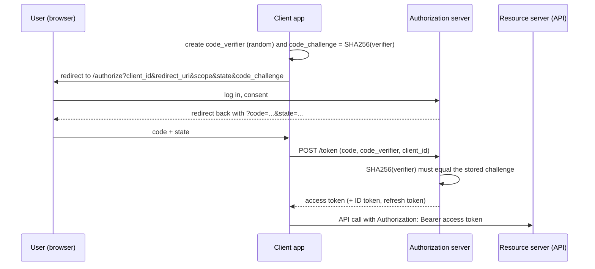

@part py-web-9 | FastAPI Beyond Basics · Part 3: Authentication and Security in Depth | web
## Sessions, Cookies and Tokens: Choosing a State Model

HTTP is stateless, so after login the client must present **proof of who it is** on every request. There are three families, and choosing among them is a design decision, not a fashion:

| Model | What the client holds | Server stores | Revocation | Fits |
| --- | --- | --- | --- | --- |
| **Server-side session** | An opaque id in a cookie | The session (in Redis or a database) | Instant: delete the session | Browser apps with a server-rendered or same-site front end |
| **Signed cookie session** | The session data itself, signed (Starlette's `SessionMiddleware`) | Nothing | Hard: wait for expiry or rotate the key | Small, low-risk state (flash messages, a user id) |
| **Self-contained token (JWT)** | A signed token with claims | Nothing (or a deny-list) | Hard: short expiry plus refresh | APIs, mobile apps, service-to-service, SPAs |
| **Opaque access token** | A random string | A token table or cache, or ask the auth server (introspection) | Instant | APIs wanting easy revocation |

Cookies and `Authorization` headers have different security properties:

| | Cookie | `Authorization: Bearer` header |
| --- | --- | --- |
| Sent automatically by the browser | **Yes**: CSRF applies | No: your code attaches it |
| Reachable from JavaScript | Not if `HttpOnly`: XSS cannot steal it | Yes if stored in `localStorage`/memory: XSS can steal it |
| Cross-site safety | `SameSite=Lax/Strict`, CSRF token | Not sent by other sites |
| Works for non-browser clients | Awkward | Natural |

```python Cookies.py
from fastapi import FastAPI, HTTPException, Request, Response
from fastapi.testclient import TestClient
from starlette.middleware.sessions import SessionMiddleware

app = FastAPI()
app.add_middleware(SessionMiddleware, secret_key="a-long-random-secret", session_cookie="sid", same_site="lax", https_only=False, max_age=3600)


@app.post("/login")
def login(request: Request, user: str):
    request.session["user"] = user                                      # stored in a SIGNED cookie, not on the server
    request.session["csrf"] = "token-123"                               # double-submit token for state-changing requests
    return {"ok": True}


@app.post("/transfer")
def transfer(request: Request, amount: int, x_csrf: str | None = None):
    if "user" not in request.session:
        raise HTTPException(401, "login required")
    if x_csrf != request.session["csrf"]:                              # a forged cross-site request cannot know this value
        raise HTTPException(403, "CSRF token missing or wrong")
    return {"moved": amount, "by": request.session["user"]}


client = TestClient(app)
print(client.post("/transfer?amount=5").status_code)
login_response = client.post("/login?user=asha")
cookie = login_response.headers["set-cookie"]
print(cookie.split(";")[0].startswith("sid="), "httponly" in cookie.lower(), "samesite=lax" in cookie.lower())
print(client.post("/transfer?amount=5").status_code, client.post("/transfer?amount=5&x_csrf=token-123").json())

tampered = TestClient(app)
tampered.cookies.set("sid", "forged-value")
print(tampered.post("/transfer?amount=5&x_csrf=token-123").status_code)    # a forged cookie fails signature verification
```

```output
```

!cheat Cookie flags that matter ::
- **`HttpOnly`**: JavaScript cannot read it, so XSS cannot steal it.
- **`Secure`**: sent only over HTTPS (set it in production).
- **`SameSite=Lax`** (a good default) or **`Strict`**: the browser does not send it on cross-site POSTs, which blocks most CSRF; `None` requires `Secure` and reopens the risk.
- **`Max-Age`/`Expires`**: short for sensitive sessions; **`Path`/`Domain`**: as narrow as possible; the `__Host-` cookie prefix enforces Secure, no Domain and Path `/`.
- For cookie-authenticated state-changing endpoints also verify a **CSRF token** or the **`Origin` header**.
!end

??  Where should a single-page application keep its access token?
=> There is no free lunch. In memory (lost on refresh, safe from persistent storage theft but readable by injected scripts), or in an `HttpOnly`, `Secure`, `SameSite` cookie set by a backend-for-frontend (BFF) so JavaScript never sees it, which is the recommended pattern for browser apps. `localStorage` is readable by any XSS payload.
??  What is CSRF and why do bearer-header APIs not suffer from it?
=> Cross-site request forgery makes a victim's browser send a state-changing request to your site, with the victim's cookies attached automatically. Header-based tokens are not attached automatically by the browser, so a malicious site cannot make the request authenticated. Cookie-based auth needs SameSite cookies and CSRF tokens.
??  Server-side sessions or JWT?
=> Sessions give instant revocation and keep secrets on the server but need shared storage (Redis); JWTs avoid a lookup and suit APIs and microservices but are hard to revoke and easy to misuse. Many systems use short-lived JWT access tokens plus server-side refresh tokens.

## JWTs Under the Microscope

A JWT is three base64url parts, `header.payload.signature`. Building one by hand removes the mystery and shows exactly what a signature guarantees (integrity and authenticity) and what it does not (secrecy).

```python JwtByHand.py
import base64
import hashlib
import hmac
import json

import jwt


def b64(data: bytes) -> str:
    return base64.urlsafe_b64encode(data).rstrip(b"=").decode()


def sign_hs256(payload: dict, secret: bytes) -> str:
    header = {"alg": "HS256", "typ": "JWT"}
    signing_input = b64(json.dumps(header, separators=(",", ":")).encode()) + "." + b64(json.dumps(payload, separators=(",", ":")).encode())
    signature = hmac.new(secret, signing_input.encode(), hashlib.sha256).digest()
    return signing_input + "." + b64(signature)


claims = {"sub": "42", "role": "admin", "exp": 4102444800}               # exp: year 2100
secret = b"shared-secret-that-is-long-enough-for-hs256"
by_hand = sign_hs256(claims, secret)
library = jwt.encode(claims, secret, algorithm="HS256")
print(by_hand.split(".")[0] == library.split(".")[0], by_hand.split(".")[2] == library.split(".")[2], jwt.decode(by_hand, secret, algorithms=["HS256"])["role"])

header_part, payload_part, _ = by_hand.split(".")
decoded = json.loads(base64.urlsafe_b64decode(payload_part + "=" * (-len(payload_part) % 4)))
print(decoded)                                                           # anyone can read the payload: it is encoded, not encrypted

forged_payload = b64(json.dumps({**claims, "role": "superadmin"}, separators=(",", ":")).encode())
forged = f"{header_part}.{forged_payload}.{by_hand.split('.')[2]}"       # change the payload, keep the old signature
try:
    jwt.decode(forged, secret, algorithms=["HS256"])
except jwt.InvalidSignatureError:
    print("forged payload rejected: the signature no longer matches")

none_token = b64(b'{"alg":"none","typ":"JWT"}') + "." + payload_part + "."
try:
    jwt.decode(none_token, secret, algorithms=["HS256"])
except jwt.PyJWTError as error:
    print("alg=none rejected:", type(error).__name__)
```

```output
```

### Asymmetric signatures, `kid` and key rotation

With **HS256** every service that verifies tokens must hold the secret that also signs them, so any of them could mint tokens. With **RS256/ES256** the auth server signs with a **private key**, and every other service verifies with the **public key**, usually fetched from a **JWKS** endpoint (`/.well-known/jwks.json`). A `kid` header says which key signed the token, which makes **rotation** painless.

```python Rs256Rotation.py
import json

import jwt
from cryptography.hazmat.primitives.asymmetric import rsa
from jwt.algorithms import RSAAlgorithm


def new_key():
    return rsa.generate_private_key(public_exponent=65537, key_size=2048)


old_key, new_key_ = new_key(), new_key()
signing_keys = {"2026-01": old_key, "2026-07": new_key_}                    # the auth server keeps both while old tokens live
jwks = {"keys": [{**json.loads(RSAAlgorithm.to_jwk(k.public_key())), "kid": kid, "alg": "RS256", "use": "sig"} for kid, k in signing_keys.items()]}
print(sorted(key["kid"] for key in jwks["keys"]), [sorted(k) for k in jwks["keys"]][0])                # public material only: n, e, kty, kid...


def issue(kid, subject):
    return jwt.encode({"sub": subject, "aud": "shop-api", "iss": "https://auth.example.com", "exp": 4102444800}, signing_keys[kid], algorithm="RS256", headers={"kid": kid})


def verify(token):                                                         # what a resource server does with the JWKS it fetched
    kid = jwt.get_unverified_header(token)["kid"]
    jwk = next(k for k in jwks["keys"] if k["kid"] == kid)
    public_key = RSAAlgorithm.from_jwk(json.dumps(jwk))
    return jwt.decode(token, public_key, algorithms=["RS256"], audience="shop-api", issuer="https://auth.example.com")


print(verify(issue("2026-01", "asha"))["sub"], verify(issue("2026-07", "ravi"))["sub"])                  # old and new tokens both verify during rotation
try:
    jwt.decode(issue("2026-07", "x"), RSAAlgorithm.from_jwk(json.dumps(jwks["keys"][0])), algorithms=["RS256"], audience="shop-api")
except jwt.InvalidSignatureError:
    print("a token signed by the new key fails against the old public key, as it should")
try:
    jwt.decode(issue("2026-07", "x"), RSAAlgorithm.from_jwk(json.dumps(jwks["keys"][1])), algorithms=["RS256"], audience="another-api")
except jwt.InvalidAudienceError:
    print("wrong audience rejected: a token for one API cannot be replayed against another")
```

```output
```

Claims to validate on every token:

| Claim | Meaning | Check |
| --- | --- | --- |
| `exp`, `nbf`, `iat` | Expiry, not before, issued at | Required; allow a few seconds of clock skew (`leeway`) |
| `iss` | Issuer | Must equal the auth server you trust |
| `aud` | Audience | Must name **your** API, so tokens for another service are useless to an attacker |
| `sub` | Subject (user id) | Stable identifier, not an email that can change |
| `scope` / `roles` | Permissions | Coarse; re-check fine-grained rules server-side |
| `jti` | Token id | Enables a deny-list or replay detection |

!warning The JWT mistakes that become CVEs :: Accepting `alg: none`; letting the token pick the algorithm (RS256 public key used as an HS256 secret); not checking `aud` or `iss`; not requiring `exp`; trusting claims before verifying the signature (`verify_signature=False` in production code); storing secrets in the payload; very long lifetimes with no revocation story; and leaking the signing key. Libraries fixed most of these defaults, but you still have to ask for the checks.

??  Why can a JWT's payload be read by anyone but not changed?
=> The payload is base64url-encoded JSON, not encrypted, so anyone can decode it. The signature covers header and payload with a secret or private key, so any change invalidates it unless the attacker holds the key. Signing gives integrity and authenticity, not confidentiality.
??  HS256 or RS256 for a system with several services?
=> RS256 (or ES256). One auth server signs with a private key; every service only needs the public key (via JWKS), so a compromised downstream service cannot forge tokens. HS256 requires distributing the shared secret to every verifier.
??  How does key rotation work with `kid`?
=> The token header names the signing key's `kid`. The auth server publishes all currently valid public keys in the JWKS; verifiers pick the key by `kid`, so new tokens use the new key while tokens signed by the old key remain valid until they expire, after which the old key is removed.

## Refresh Tokens, Rotation and Logout

Short access tokens (5 to 15 minutes) limit damage, but users should not log in every 15 minutes. A **refresh token** is a long-lived credential used only to obtain new access tokens. It is **opaque, stored server-side (hashed), revocable and rotated**: every refresh returns a new refresh token and invalidates the old one. If an **old token is presented again**, someone has stolen it, so the whole **token family** is revoked.

```python RefreshRotation.py
import hashlib
import secrets
import time

REFRESH_TTL = 7 * 24 * 3600


class TokenStore:
    """Server-side refresh tokens. Only HASHES are stored, so a database leak does not leak usable tokens."""

    def __init__(self, clock=time.time):
        self.clock = clock
        self.tokens: dict[str, dict] = {}                              # hash -> record

    @staticmethod
    def _hash(token: str) -> str:
        return hashlib.sha256(token.encode()).hexdigest()

    def issue(self, user_id: int, family: str | None = None) -> str:
        token = secrets.token_urlsafe(32)
        self.tokens[self._hash(token)] = {"user": user_id, "family": family or secrets.token_hex(4), "used": False, "revoked": False,
                                          "expires": self.clock() + REFRESH_TTL}
        return token

    def rotate(self, token: str) -> str:
        record = self.tokens.get(self._hash(token))
        if record is None or record["revoked"] or record["expires"] < self.clock():
            raise PermissionError("invalid refresh token")
        if record["used"]:                                             # REUSE DETECTED: an old token came back, so it was stolen
            for other in self.tokens.values():
                if other["family"] == record["family"]:
                    other["revoked"] = True                            # revoke the whole family: the real user must log in again
            raise PermissionError("refresh token reuse detected: session revoked")
        record["used"] = True
        return self.issue(record["user"], record["family"])

    def logout(self, token: str):
        record = self.tokens.get(self._hash(token))
        if record:
            for other in self.tokens.values():
                if other["family"] == record["family"]:
                    other["revoked"] = True


now = [1_000_000.0]
store = TokenStore(clock=lambda: now[0])
first = store.issue(user_id=42)
second = store.rotate(first)                                           # normal use: exchange and replace
third = store.rotate(second)
print(first != second != third, len(store.tokens), {r["family"] for r in store.tokens.values()} == {next(iter(store.tokens.values()))["family"]})

for label, attempt in (("replaying the first token (attacker)", first), ("the user's current token, after the revocation", third)):
    try:
        store.rotate(attempt)
    except PermissionError as error:
        print(label, "->", error)

fresh = store.issue(user_id=7)
now[0] += REFRESH_TTL + 1
try:
    store.rotate(fresh)
except PermissionError as error:
    print("expired ->", error)

other = store.issue(user_id=9)
store.logout(other)
try:
    store.rotate(other)
except PermissionError as error:
    print("after logout ->", error)
```

```output
```

Design notes:

- **Access token**: JWT, 5 to 15 minutes, never stored server-side; **refresh token**: opaque random value (at least 128 bits), **stored hashed**, one use, rotated.
- **Reuse detection** converts theft into a forced logout for the whole token family, which is what OAuth 2.0 security guidance recommends for public clients.
- **Logout** = revoke the refresh token family and let access tokens expire; for instant cut-off keep a small **deny-list** of `jti` values until their expiry, or check a per-user "tokens valid after" timestamp.
- **Send the refresh token in an `HttpOnly` cookie** scoped to the refresh path where possible; never in a URL.
- Store a **device/session record** with the family (user agent, IP, created) so users can see and revoke sessions.

??  What is refresh token rotation and what attack does reuse detection catch?
=> Each refresh issues a new refresh token and invalidates the previous one. If a previously used token is presented again, either the attacker or the legitimate user holds a stale copy, so the server revokes the entire family and forces re-authentication, limiting the value of a stolen refresh token.
??  Why store only a hash of refresh tokens?
=> A database leak would otherwise hand out working credentials. Because tokens are high-entropy random values, a fast hash (SHA-256) is sufficient (unlike passwords, which need a slow, salted hash).
??  How do you log a user out when access tokens are JWTs?
=> Revoke their refresh tokens and let the short-lived access token expire. For immediate revocation, keep a deny-list of token ids (or a "valid after" timestamp per user) that the verifier checks, which reintroduces a small amount of state.

## OAuth 2.0 and OpenID Connect

**OAuth 2.0** lets an application act on a user's behalf **without ever seeing their password**: the user authenticates at an **authorization server** (Google, GitHub, Auth0, Keycloak, your own) which issues tokens to the **client**. **OpenID Connect (OIDC)** adds an **ID token** (a JWT about *who the user is*) on top of OAuth's access tokens (about *what the client may do*).



| Flow | Use for | Notes |
| --- | --- | --- |
| **Authorization Code + PKCE** | Web apps, SPAs, mobile apps (users) | The default today. PKCE protects the code even for public clients with no secret |
| **Client Credentials** | Service-to-service, cron jobs | No user; the client authenticates with its own secret or key |
| **Device Code** | TVs, CLIs | User approves on another device |
| ~~Implicit~~, ~~Password~~ | Legacy | Deprecated: do not use |

PKCE is small enough to verify exactly. This checks the worked example of RFC 7636:

```python Pkce.py
import base64
import hashlib
import secrets


def code_challenge(verifier: str) -> str:
    digest = hashlib.sha256(verifier.encode("ascii")).digest()
    return base64.urlsafe_b64encode(digest).rstrip(b"=").decode()          # S256: BASE64URL(SHA256(verifier))


rfc_verifier = "dBjftJeZ4CVP-mB92K27uhbUJU1p1r_wW1gFWFOEjXk"
print(code_challenge(rfc_verifier) == "E9Melhoa2OwvFrEMTJguCHaoeK1t8URWbuGJSstw-cM")

verifier = secrets.token_urlsafe(48)                                      # 43 to 128 characters of unguessable text
challenge = code_challenge(verifier)
print(43 <= len(verifier) <= 128, len(challenge))


def token_endpoint_accepts(stored_challenge: str, presented_verifier: str) -> bool:      # what the authorization server does
    return secrets.compare_digest(code_challenge(presented_verifier), stored_challenge)


print(token_endpoint_accepts(challenge, verifier), token_endpoint_accepts(challenge, secrets.token_urlsafe(48)))
```

```output
```

An attacker who steals the **authorization code** from the redirect cannot redeem it, because only the original client knows the `code_verifier`. Also always: validate the **`state`** parameter (CSRF protection for the redirect), use **exact-match registered redirect URIs**, request the **minimum scopes**, and verify the **ID token** (signature, `iss`, `aud`, `exp`, `nonce`).

!interview Authentication versus authorisation in OAuth/OIDC :: OAuth 2.0 is an **authorisation** (delegation) framework: it issues access tokens that say what a client may do. **OIDC** adds **authentication**: an ID token that says who the user is and how they logged in. A common vulnerability is treating an OAuth access token as proof of identity ("log in with" built on plain OAuth); use the ID token (or the userinfo endpoint) from OIDC for that.

??  Why was PKCE added, and when is it required?
=> Public clients (SPAs, mobile apps) cannot keep a client secret, so an intercepted authorisation code could be redeemed by an attacker. PKCE binds the code to a random verifier that only the starting client knows. It is now recommended for all clients using the authorization code flow.
??  What is the difference between an access token and an ID token?
=> The access token is for the resource server: it grants access to an API with certain scopes and its contents are meant for that API. The ID token is for the client: a JWT describing the authenticated user (`sub`, `name`, `email`) and the authentication event. Do not send the ID token to APIs as an access token.
??  Which OAuth flow do two backend services use to talk to each other?
=> Client credentials: the calling service authenticates with its client id and secret (or a signed assertion or mTLS certificate) and receives an access token scoped to what it needs, with no user involved.

## Passwords, TOTP and Multi-Factor Authentication

**Passwords**: hash with **Argon2id** (or bcrypt/scrypt), a unique salt per password, tuned so one hash takes tens to hundreds of milliseconds on your hardware; follow the current NIST guidance (length over composition rules, allow long passphrases and password managers, no forced periodic rotation, block known-breached passwords via a k-anonymity breach-check service, rate-limit attempts). Store nothing reversible.

**Multi-factor authentication** blocks most credential-stuffing and phishing of passwords. The most common second factor is **TOTP** (the 6-digit app codes): a shared secret plus the current time. It is small enough to implement and check against the RFC 6238 test vectors:

```python Totp.py
import base64
import hashlib
import hmac
import struct


def hotp(secret: bytes, counter: int, digits: int = 6, algorithm=hashlib.sha1) -> str:
    digest = hmac.new(secret, struct.pack(">Q", counter), algorithm).digest()
    offset = digest[-1] & 0x0F                                              # dynamic truncation (RFC 4226)
    code = (struct.unpack(">I", digest[offset:offset + 4])[0] & 0x7FFFFFFF) % 10 ** digits
    return str(code).zfill(digits)


def totp(secret: bytes, timestamp: float, step: int = 30, digits: int = 6, algorithm=hashlib.sha1) -> str:
    return hotp(secret, int(timestamp // step), digits, algorithm)


def verify(secret: bytes, submitted: str, timestamp: float, window: int = 1) -> bool:
    """Accept the current step and `window` steps either side (clock drift); compare in constant time."""
    return any(hmac.compare_digest(totp(secret, timestamp + drift * 30), submitted) for drift in range(-window, window + 1))


secret = b"12345678901234567890"                                            # the RFC 6238 test secret for SHA-1
vectors = {59: "94287082", 1111111109: "07081804", 1111111111: "14050471", 1234567890: "89005924", 2000000000: "69279037"}
print(all(totp(secret, t, digits=8) == code for t, code in vectors.items()))

now = 1_700_000_000
code = totp(secret, now)
print(len(code), verify(secret, code, now), verify(secret, code, now + 31), verify(secret, code, now + 95), verify(secret, "000000", now))

provisioning_secret = base64.b32encode(b"example-secret-20!!").decode().rstrip("=")      # authenticator apps expect unpadded base32
print(f"otpauth://totp/Shop:asha@example.com?secret={provisioning_secret}&issuer=Shop&digits=6&period=30")          # the QR code content
```

```output
```

Operational rules for MFA: store the TOTP secret **encrypted**, accept each code **once** (prevent replay inside its window), **rate-limit** attempts, issue **one-time recovery codes** (hashed) at enrolment, prefer **WebAuthn/passkeys** (phishing-resistant) for high-value accounts, and require MFA for admin roles and sensitive actions (**step-up authentication**).

!cheat Authentication hardening checklist ::
- Argon2id for passwords; breached-password check; generic login errors; constant-time comparisons.
- Throttle logins per account **and** per IP with backoff; alert on spikes (credential stuffing).
- Short access tokens, rotating refresh tokens with reuse detection, logout revokes the family.
- Verify `exp`, `iss`, `aud`, algorithm; asymmetric keys with JWKS and `kid` rotation for multi-service systems.
- Cookies: `HttpOnly`, `Secure`, `SameSite`; CSRF tokens for cookie auth; BFF for browser apps.
- OAuth: Authorization Code + PKCE, `state`, exact redirect URIs, minimal scopes; ID token for identity.
- MFA (TOTP now, WebAuthn better); step-up for sensitive operations; recovery codes.
- Audit log of logins, failures, token refreshes and permission changes (without secrets).
!end

??  Why is TOTP verified with a small time window?
=> Client and server clocks differ slightly and users type codes late, so the verifier accepts the current 30-second step plus one on either side. A wider window increases the chance of an attacker guessing a code, so keep it small and limit attempts.
??  What is step-up authentication?
=> Requiring a stronger or fresher proof for a sensitive action (changing the email, large transfers, admin operations) even though the user already has a session, for example by prompting for MFA again, so a stolen session alone is not enough.
??  How do you defend against credential stuffing?
=> Unique salted slow hashes limit offline damage, but online attacks reuse leaked passwords from other sites: rate-limit and slow logins by account and IP, detect distributed bursts, require MFA, block known-breached passwords, add CAPTCHA or bot defences at the edge, and notify users of suspicious logins.
