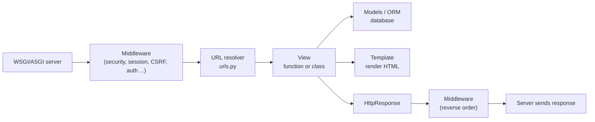

@part py-django-1 | Django · Part 1: Django Foundations | web
## Django at a Glance

**Django** is the "batteries included" Python web framework: an **ORM**, **migrations**, an **admin interface**, **authentication and permissions**, **forms and validation**, a **template engine**, **sessions**, **caching**, **internationalisation**, **security protections** (CSRF, XSS escaping, clickjacking, SQL-injection-safe queries) and a **test framework**, all designed to work together. It powers sites from small CMSs to Instagram-scale products, and with **Django REST Framework** (Part 3) it is a strong API platform.

Django follows **MVT**: Model, View, Template. It is MVC with different names:

| MVT piece | Role | Spring analogue |
| --- | --- | --- |
| **Model** | Data and rules (`models.py`) | Entity + repository |
| **View** | Receives a request, returns a response (`views.py`): the *controller* logic | `@Controller` method |
| **Template** | HTML with placeholders (`templates/*.html`) | Thymeleaf / JSP view |
| **URLconf** | Maps URLs to views (`urls.py`) | `@RequestMapping` |
| **Framework** | Dispatches, runs middleware, handles forms, auth, admin | Spring MVC + Security + Data |

A Django **project** is the whole site (settings, root URLs, deployment). It is made of reusable **apps**, each a Python package with one purpose (`accounts`, `catalog`, `orders`). A typical layout:

```text Project layout
shop/                       # the repository
  manage.py                 # command-line entry point: runserver, migrate, test, shell, createsuperuser
  config/                   # the project package
    settings.py             # configuration
    urls.py                 # root URL configuration
    asgi.py, wsgi.py        # entry points for ASGI / WSGI servers
  catalog/                  # an app
    models.py               # database models
    views.py                # request handlers
    urls.py                 # the app's routes
    forms.py                # forms and validation
    admin.py                # admin configuration
    tests.py                # tests
    migrations/             # generated schema history: commit these
    templates/catalog/      # HTML templates
```

### The request lifecycle



### The commands you will use daily

| Command | Purpose |
| --- | --- |
| `django-admin startproject config .` / `python manage.py startapp catalog` | Scaffold a project / an app |
| `python manage.py runserver` | Development server with auto-reload |
| `python manage.py makemigrations` / `migrate` | Generate migration files from model changes / apply them |
| `python manage.py createsuperuser` | An admin account |
| `python manage.py shell` | A Python shell with Django loaded (try queries here) |
| `python manage.py test` | Run the test suite (a throw-away test database is created for you) |
| `python manage.py check --deploy` | Audit the settings for production risks |
| `python manage.py collectstatic` | Gather static files for deployment |

!interview Django, Flask or FastAPI? :: **Django** when you need a full application quickly: admin, auth, ORM, forms, templates (content sites, internal tools, e-commerce back office, anything with many CRUD screens) and the team values conventions. **FastAPI** for async-first JSON APIs and microservices with explicit control over each piece. **Flask** for small services and when you want to choose every component. Many companies run Django for the core product and FastAPI for specific high-throughput services.

??  What does MVT mean and how does it differ from MVC?
=> Model-View-Template: the Model is the data layer, the Template is the presentation (HTML), and the View is the Python function or class that handles a request and returns a response (what MVC calls the controller). Django itself plays the controller role by routing requests to views.
??  What is the difference between a Django project and an app?
=> A project is one site with its settings and root URLs; an app is a self-contained, reusable package (models, views, templates) that does one job. A project installs many apps (`INSTALLED_APPS`), including Django's own (`auth`, `admin`, `sessions`).
??  Why does Django generate migration files?
=> Migrations are a versioned history of schema changes derived from your models. They are code you commit and review, applied in order on every environment (`migrate`) so databases evolve consistently, and they can often be reversed.

## A Working Project, File by File

The program below writes a complete (tiny) Django project into a folder, exactly as a developer would create it, and then **runs `python manage.py test` on it**. Everything you see in the files is what runs.

```python FirstDjango.py
import os
import pathlib
import re
import subprocess
import sys
import textwrap

ROOT = pathlib.Path("shop")


def write(files: dict):
    for name, content in files.items():
        path = ROOT / name
        path.parent.mkdir(parents=True, exist_ok=True)
        path.write_text(textwrap.dedent(content).lstrip(), encoding="utf-8")


def manage(*args):
    run = subprocess.run([sys.executable, "manage.py", *args], cwd=ROOT, capture_output=True, text=True,
                         env={**os.environ, "DJANGO_SETTINGS_MODULE": "config.settings"})
    return run.stdout + run.stderr


def summary(output):
    ran = re.search(r"Ran \d+ tests?", output)
    return f"{ran[0] if ran else 'no tests ran'}: {'OK' if re.search(r'^OK', output, re.M) else 'FAILED'}"


write({
    "manage.py": """
        import os, sys

        if __name__ == "__main__":
            os.environ.setdefault("DJANGO_SETTINGS_MODULE", "config.settings")
            from django.core.management import execute_from_command_line
            execute_from_command_line(sys.argv)
    """,
    "config/__init__.py": "",
    "config/settings.py": """
        from pathlib import Path

        BASE_DIR = Path(__file__).resolve().parent.parent
        SECRET_KEY = "dev-only-not-a-secret"
        DEBUG = True
        ALLOWED_HOSTS = ["testserver", "localhost"]
        INSTALLED_APPS = ["django.contrib.contenttypes", "django.contrib.auth", "django.contrib.sessions", "django.contrib.messages", "catalog"]
        MIDDLEWARE = ["django.middleware.security.SecurityMiddleware", "django.contrib.sessions.middleware.SessionMiddleware",
                      "django.middleware.common.CommonMiddleware", "django.middleware.csrf.CsrfViewMiddleware",
                      "django.contrib.auth.middleware.AuthenticationMiddleware", "django.contrib.messages.middleware.MessageMiddleware"]
        ROOT_URLCONF = "config.urls"
        TEMPLATES = [{"BACKEND": "django.template.backends.django.DjangoTemplates", "APP_DIRS": True,
                      "OPTIONS": {"context_processors": ["django.template.context_processors.request"]}}]
        DATABASES = {"default": {"ENGINE": "django.db.backends.sqlite3", "NAME": BASE_DIR / "db.sqlite3"}}
        DEFAULT_AUTO_FIELD = "django.db.models.BigAutoField"
        USE_TZ = True
    """,
    "config/urls.py": """
        from django.urls import include, path

        urlpatterns = [path("", include("catalog.urls"))]
    """,
    "catalog/__init__.py": "",
    "catalog/urls.py": """
        from django.urls import path

        from . import views

        app_name = "catalog"
        urlpatterns = [path("", views.home, name="home"), path("api/products/", views.products_json, name="products-json")]
    """,
    "catalog/views.py": """
        from django.http import JsonResponse
        from django.shortcuts import render

        PRODUCTS = [{"id": 1, "name": "Notebook", "price": 120}, {"id": 2, "name": "Pen <b>set</b>", "price": 45}]


        def home(request):
            return render(request, "catalog/home.html", {"products": PRODUCTS, "shop": "Trail Stationery"})


        def products_json(request):
            return JsonResponse({"products": PRODUCTS})
    """,
    "catalog/templates/catalog/home.html": """
        <h1>{{ shop }}</h1>
        <ul>
        
          <li>{{ p.name }}: {{ p.price|floatformat:2 }}</li>
        
          <li>nothing yet</li>
        
        </ul>
    """,
    "catalog/tests.py": """
        from django.test import SimpleTestCase
        from django.urls import reverse


        class CatalogViewTests(SimpleTestCase):
            def test_home_renders_the_template(self):
                response = self.client.get(reverse("catalog:home"))
                self.assertEqual(response.status_code, 200)
                self.assertContains(response, "<h1>Trail Stationery</h1>")
                self.assertContains(response, "Notebook: 120.00")

            def test_template_escapes_html_automatically(self):
                response = self.client.get("/")
                self.assertContains(response, "Pen &lt;b&gt;set&lt;/b&gt;")      # the <b> tag did not become markup
                self.assertNotContains(response, "<b>set</b>")

            def test_json_api(self):
                response = self.client.get("/api/products/")
                self.assertEqual(response["Content-Type"], "application/json")
                self.assertEqual(response.json()["products"][0]["name"], "Notebook")

            def test_reverse_builds_urls_from_names(self):
                self.assertEqual(reverse("catalog:products-json"), "/api/products/")

            def test_unknown_url_is_404(self):
                self.assertEqual(self.client.get("/nope/").status_code, 404)
    """,
})

print(summary(manage("test")))
print(manage("check").strip())
```

```output
```

Read what happened:

1. **`settings.py`** is plain Python: apps, middleware, templates, database, security. Environment-specific values (secret key, database URL, `DEBUG`) come from environment variables in real projects.
2. **`config/urls.py`** delegates to each app's `urls.py` with `include`; **`app_name`** namespaces URL names so `reverse("catalog:home")` works.
3. **A view** is any callable taking a `request` and returning a response: here `render(...)` builds HTML from a **template**, and `JsonResponse` returns JSON.
4. **Templates auto-escape** variables: the product named `Pen <b>set</b>` is rendered as text, not markup, which is Django's built-in defence against **cross-site scripting (XSS)**. Only mark content safe (`|safe`, `mark_safe`) when you built it yourself.
5. **Tests** use Django's test client: `self.client.get(...)` runs the full stack (middleware, URL resolver, view) in-process, with a clean test database per run.

??  What does `reverse()` do and why use it instead of hard-coded URLs?
=> It builds a URL from a route name (and arguments) using the URLconf, so changing a URL pattern in one place updates every link, redirect and test. Templates use `` for the same reason.
??  Why does Django escape template variables by default?
=> To prevent XSS: user-supplied text containing `<script>` is converted to harmless entities (`&lt;script&gt;`) when rendered. You must opt out explicitly (`|safe`) for HTML you trust, which makes dangerous places easy to find in review.
??  What is the role of `INSTALLED_APPS`?
=> It lists the apps Django loads: their models are registered, their templates and static files discovered, their migrations applied and their admin and management commands made available. An app that is not listed has no tables and no templates.

## URLs, Views and Templates in Depth

### URL patterns and converters

```python
from django.urls import path, re_path

urlpatterns = [
    path("products/", views.product_list, name="product-list"),
    path("products/<int:pk>/", views.product_detail, name="product-detail"),            # converters: int, str, slug, uuid, path
    path("blog/<slug:slug>/", views.post, name="post"),
    path("archive/<int:year>/<int:month>/", views.archive, name="archive"),
    re_path(r"^legacy/(?P<code>[A-Z]{3})/$", views.legacy, name="legacy"),                # regular expressions when you need them
]
```

URLs are matched **top to bottom**, first match wins, so put specific patterns before general ones. Always end URLs with a trailing slash and use names with `reverse` / ``.

### Function views and class-based views

```python Cbv.py
import os
import pathlib
import re
import subprocess
import sys
import textwrap

ROOT = pathlib.Path("shop")


def write(files: dict):
    for name, content in files.items():
        path = ROOT / name
        path.parent.mkdir(parents=True, exist_ok=True)
        path.write_text(textwrap.dedent(content).lstrip(), encoding="utf-8")


def manage(*args):
    run = subprocess.run([sys.executable, "manage.py", *args], cwd=ROOT, capture_output=True, text=True, env={**os.environ, "DJANGO_SETTINGS_MODULE": "config.settings"})
    return run.stdout + run.stderr


def summary(output):
    ran = re.search(r"Ran \d+ tests?", output)
    return f"{ran[0] if ran else 'no tests ran'}: {'OK' if re.search(r'^OK', output, re.M) else 'FAILED'}"


write({
    "manage.py": "import os, sys\nfrom django.core.management import execute_from_command_line\nexecute_from_command_line(sys.argv)\n",
    "config/__init__.py": "",
    "config/settings.py": """
        SECRET_KEY = "x"
        DEBUG = True
        ALLOWED_HOSTS = ["testserver"]
        INSTALLED_APPS = ["django.contrib.contenttypes", "django.contrib.auth", "shop"]
        MIDDLEWARE = ["django.middleware.common.CommonMiddleware"]
        ROOT_URLCONF = "config.urls"
        TEMPLATES = [{"BACKEND": "django.template.backends.django.DjangoTemplates", "APP_DIRS": True}]
        DATABASES = {"default": {"ENGINE": "django.db.backends.sqlite3", "NAME": ":memory:"}}
        DEFAULT_AUTO_FIELD = "django.db.models.BigAutoField"
    """,
    "config/urls.py": """
        from django.urls import path

        from shop import views

        urlpatterns = [
            path("items/", views.ItemList.as_view(), name="items"),
            path("items/<int:pk>/", views.ItemDetail.as_view(), name="item"),
            path("hello/", views.hello, name="hello"),
            path("limited/", views.Limited.as_view(), name="limited"),
        ]
    """,
    "shop/__init__.py": "",
    "shop/models.py": """
        from django.db import models


        class Item(models.Model):
            name = models.CharField(max_length=50)
            price = models.PositiveIntegerField()

            def __str__(self):
                return self.name
    """,
    "shop/views.py": """
        from django.http import HttpResponse, HttpResponseNotAllowed
        from django.utils.decorators import method_decorator
        from django.views import View
        from django.views.decorators.http import require_GET
        from django.views.generic import DetailView, ListView

        from .models import Item


        @require_GET                                                   # a decorator on a function view
        def hello(request):
            return HttpResponse(f"hello {request.GET.get('name', 'world')}")


        class ItemList(ListView):                                       # a generic view: queryset + template, pagination for free
            model = Item
            paginate_by = 2
            template_name = "items.html"


        class ItemDetail(DetailView):
            model = Item
            template_name = "item.html"                                 # a missing object becomes a 404 automatically


        class Limited(View):                                            # a plain class view: one method per HTTP verb
            def get(self, request):
                return HttpResponse("read")

            def post(self, request):
                return HttpResponse("created", status=201)
    """,
    "shop/templates/items.html": "{{ item.name }}={{ item.price }}; page {{ page_obj.number }} of {{ paginator.num_pages }}",
    "shop/templates/item.html": "<h1>{{ item.name }}</h1><p>{{ item.price }}</p>",
    "shop/tests.py": """
        from django.test import TestCase

        from .models import Item


        class ViewTests(TestCase):
            @classmethod
            def setUpTestData(cls):                                    # created once per class, rolled back per test
                for n, name in enumerate(["pen", "ink", "pad"], start=1):
                    Item.objects.create(name=name, price=n * 10)

            def test_list_is_paginated(self):
                first = self.client.get("/items/")
                self.assertContains(first, "pen=10;ink=20; page 1 of 2")
                self.assertContains(self.client.get("/items/?page=2"), "pad=30; page 2 of 2")

            def test_detail_and_404(self):
                self.assertContains(self.client.get("/items/1/"), "<h1>pen</h1>")
                self.assertEqual(self.client.get("/items/99/").status_code, 404)

            def test_http_methods(self):
                self.assertEqual(self.client.get("/hello/?name=asha").content, b"hello asha")
                self.assertEqual(self.client.post("/hello/").status_code, 405)       # @require_GET
                self.assertEqual(self.client.post("/limited/").status_code, 201)

            def test_queries_per_request(self):
                with self.assertNumQueries(2):                          # one COUNT for pagination and one SELECT for the page
                    self.client.get("/items/")
    """,
})
print(summary(manage("test")))
```

```output
```

| | **Function-based view** | **Class-based view (CBV)** |
| --- | --- | --- |
| Shape | `def view(request, ...)` | `class V(View)` with `get`, `post`, ... |
| Reuse | Decorators, helper functions | Inheritance and mixins (`LoginRequiredMixin`) |
| Generic CRUD | Write by hand | `ListView`, `DetailView`, `CreateView`, `UpdateView`, `DeleteView` |
| Readability | Explicit and simple | Concise for standard patterns, harder to trace when heavily customised |

Use function views for one-off logic and CBVs where generic views remove boilerplate; both are normal. The test above also demonstrates `assertNumQueries`, a guard against N+1 regressions.

### The template language

```text Template language
                              {# inherit a layout #}

  <h1>{{ product.name|title }}</h1>                    {# variable + filter; output is auto-escaped #}
  In stockSold out
  {{ tag }}, 
  <a href="">details</a>
  
  <form method="post"> ... </form>     {# REQUIRED in every POST form #}

```

Keep **logic out of templates**: they are for presentation (loops, conditionals, filters). Compute in the view or model. Every HTML form that changes data needs ``; Django's CSRF middleware rejects POSTs without it (403).

??  When do you choose class-based views over function views?
=> When a generic view (`ListView`, `CreateView`) matches the task, or when you want to share behaviour through mixins (login required, permission checks). Function views are simpler for custom or one-off logic. Neither is "more correct".
??  What is the first thing to check when a Django page unexpectedly returns 403 on a POST?
=> The CSRF token: the form must include `` (or the AJAX request must send the `X-CSRFToken` header), and the cookie must be sent. Django rejects state-changing requests without a valid token.
??  How do you guard against N+1 queries in Django tests?
=> Use `assertNumQueries(n)` around the code (or the `django-debug-toolbar` / `nplusone` in development), and fix with `select_related` (foreign keys) or `prefetch_related` (many-to-many and reverse relations).

## Forms and Validation

Django **forms** turn untrusted input (POST data, query strings) into **validated, typed Python values**, and render errors. A `ModelForm` builds a form from a model. Validation runs in layers: field type and constraints, then `clean_<field>()` per field, then `clean()` across fields.

```python Forms.py
import os
import pathlib
import re
import subprocess
import sys
import textwrap

ROOT = pathlib.Path("shop")


def write(files: dict):
    for name, content in files.items():
        path = ROOT / name
        path.parent.mkdir(parents=True, exist_ok=True)
        path.write_text(textwrap.dedent(content).lstrip(), encoding="utf-8")


def manage(*args):
    run = subprocess.run([sys.executable, "manage.py", *args], cwd=ROOT, capture_output=True, text=True, env={**os.environ, "DJANGO_SETTINGS_MODULE": "config.settings"})
    return run.stdout + run.stderr


def summary(output):
    ran = re.search(r"Ran \d+ tests?", output)
    return f"{ran[0] if ran else 'no tests ran'}: {'OK' if re.search(r'^OK', output, re.M) else 'FAILED'}"


write({
    "manage.py": "import sys\nfrom django.core.management import execute_from_command_line\nexecute_from_command_line(sys.argv)\n",
    "config/__init__.py": "",
    "config/settings.py": """
        SECRET_KEY = "x"
        ALLOWED_HOSTS = ["testserver"]
        INSTALLED_APPS = ["django.contrib.contenttypes", "django.contrib.auth", "django.contrib.sessions", "signup"]
        MIDDLEWARE = ["django.contrib.sessions.middleware.SessionMiddleware", "django.middleware.csrf.CsrfViewMiddleware"]
        ROOT_URLCONF = "config.urls"
        TEMPLATES = [{"BACKEND": "django.template.backends.django.DjangoTemplates", "APP_DIRS": True}]
        DATABASES = {"default": {"ENGINE": "django.db.backends.sqlite3", "NAME": ":memory:"}}
        DEFAULT_AUTO_FIELD = "django.db.models.BigAutoField"
    """,
    "config/urls.py": "from django.urls import path\nfrom signup import views\nurlpatterns = [path('signup/', views.signup, name='signup')]\n",
    "signup/__init__.py": "",
    "signup/models.py": """
        from django.db import models


        class Member(models.Model):
            email = models.EmailField(unique=True)
            age = models.PositiveSmallIntegerField()
    """,
    "signup/forms.py": """
        from django import forms
        from django.core.exceptions import ValidationError

        from .models import Member


        class SignupForm(forms.ModelForm):
            password = forms.CharField(min_length=8, widget=forms.PasswordInput)
            confirm = forms.CharField(widget=forms.PasswordInput)

            class Meta:
                model = Member
                fields = ["email", "age"]

            def clean_age(self):                                         # field-level rule
                age = self.cleaned_data["age"]
                if age < 18:
                    raise ValidationError("You must be at least 18.")
                return age

            def clean(self):                                             # cross-field rule
                cleaned = super().clean()
                if cleaned.get("password") != cleaned.get("confirm"):
                    self.add_error("confirm", "Passwords do not match.")
                return cleaned
    """,
    "signup/views.py": """
        from django.http import HttpResponse, JsonResponse
        from django.shortcuts import render

        from .forms import SignupForm


        def signup(request):
            form = SignupForm(request.POST or None)
            if request.method == "POST":
                if form.is_valid():
                    form.save()                                           # ModelForm creates the Member row
                    return JsonResponse({"created": form.cleaned_data["email"]}, status=201)
                return JsonResponse({"errors": form.errors.get_json_data()}, status=422)
            return HttpResponse(form.as_p())
    """,
    "signup/tests.py": """
        from django.test import TestCase

        from .models import Member


        class SignupTests(TestCase):
            def post(self, **overrides):
                data = {"email": "asha@example.com", "age": "29", "password": "correct-horse", "confirm": "correct-horse", **overrides}
                return self.client.post("/signup/", data)

            def test_valid_signup_creates_a_member(self):
                response = self.post()
                self.assertEqual((response.status_code, response.json()), (201, {"created": "asha@example.com"}))
                self.assertEqual(Member.objects.get().age, 29)

            def test_each_rule_reports_its_own_error(self):
                errors = self.post(age="15", confirm="different", email="not-an-email").json()["errors"]
                self.assertEqual(sorted(errors), ["age", "confirm", "email"])
                self.assertEqual(errors["age"][0]["message"], "You must be at least 18.")
                self.assertEqual(Member.objects.count(), 0)

            def test_duplicate_email_is_rejected_by_the_model_validation(self):
                self.post()
                self.assertIn("already exists", self.post().json()["errors"]["email"][0]["message"])

            def test_forms_render_html(self):
                self.assertContains(self.client.get("/signup/"), 'type="password"')
    """,
})
print(summary(manage("test")))
```

```output
```

**Forms validate; they never trust.** The same `SignupForm` renders the HTML, parses and converts the submitted strings (`"29"` to `29`), runs every rule, collects *all* errors (not only the first), and, as a `ModelForm`, saves the instance including **model-level validation** such as `unique=True`. Server-side validation is mandatory even if JavaScript also validates in the browser.

??  What is the order of form validation?
=> Each field's `clean()` (type, required, length), then the form's `clean_<fieldname>()` methods, then the form-level `clean()` for rules across fields, and for a `ModelForm` the model's own validation (including uniqueness). `form.errors` collects everything that failed.
??  How is a `ModelForm` different from a `Form`?
=> A `ModelForm` derives its fields, types and validation from a model (and `save()` creates or updates the instance); a plain `Form` is declared by hand and is for input that does not map to one model (search, contact, multi-model workflows).

## Settings, Middleware and Environment

Settings change between **development**, **testing** and **production**. The rules that keep them manageable: one `settings.py` driven by **environment variables** (or a small settings package with `base.py`, `dev.py`, `prod.py`), **no secrets in the repository**, and `python manage.py check --deploy` in CI.

```python Middleware.py
import os
import pathlib
import re
import subprocess
import sys
import textwrap

ROOT = pathlib.Path("shop")


def write(files: dict):
    for name, content in files.items():
        path = ROOT / name
        path.parent.mkdir(parents=True, exist_ok=True)
        path.write_text(textwrap.dedent(content).lstrip(), encoding="utf-8")


def manage(*args, **env):
    run = subprocess.run([sys.executable, "manage.py", *args], cwd=ROOT, capture_output=True, text=True,
                         env={**os.environ, "DJANGO_SETTINGS_MODULE": "config.settings", **env})
    return run.stdout + run.stderr


def summary(output):
    ran = re.search(r"Ran \d+ tests?", output)
    return f"{ran[0] if ran else 'no tests ran'}: {'OK' if re.search(r'^OK', output, re.M) else 'FAILED'}"


write({
    "manage.py": "import sys\nfrom django.core.management import execute_from_command_line\nexecute_from_command_line(sys.argv)\n",
    "config/__init__.py": "",
    "config/settings.py": """
        import os

        SECRET_KEY = os.environ.get("DJANGO_SECRET_KEY", "insecure-development-key")             # real value comes from the environment
        DEBUG = os.environ.get("DJANGO_DEBUG", "0") == "1"                                       # never True in production
        ALLOWED_HOSTS = os.environ.get("DJANGO_ALLOWED_HOSTS", "testserver").split(",")
        INSTALLED_APPS = ["django.contrib.contenttypes", "django.contrib.auth", "core"]
        MIDDLEWARE = ["core.middleware.RequestIdMiddleware", "core.middleware.TimingMiddleware"]
        ROOT_URLCONF = "config.urls"
        DATABASES = {"default": {"ENGINE": "django.db.backends.sqlite3", "NAME": ":memory:"}}
        DEFAULT_AUTO_FIELD = "django.db.models.BigAutoField"
        TEMPLATES = []
    """,
    "config/urls.py": "from django.urls import path\nfrom core import views\nurlpatterns = [path('whoami/', views.whoami)]\n",
    "core/__init__.py": "",
    "core/middleware.py": """
        import uuid


        class RequestIdMiddleware:                                       # a class-based middleware: __init__ once, __call__ per request
            def __init__(self, get_response):
                self.get_response = get_response

            def __call__(self, request):
                request.request_id = request.headers.get("X-Request-ID") or uuid.uuid4().hex[:8]    # BEFORE the view
                response = self.get_response(request)                                                # the view and inner middleware run here
                response["X-Request-ID"] = request.request_id                                         # AFTER the view
                return response


        class TimingMiddleware:
            order = []

            def __init__(self, get_response):
                self.get_response = get_response

            def __call__(self, request):
                TimingMiddleware.order.append("timing: before view")
                response = self.get_response(request)
                TimingMiddleware.order.append("timing: after view")
                return response
    """,
    "core/views.py": """
        from django.http import JsonResponse

        from .middleware import TimingMiddleware


        def whoami(request):
            TimingMiddleware.order.append("view")
            return JsonResponse({"request_id": request.request_id})
    """,
    "core/tests.py": """
        from django.test import SimpleTestCase

        from .middleware import TimingMiddleware


        class MiddlewareTests(SimpleTestCase):
            def test_request_id_is_available_to_views_and_returned(self):
                response = self.client.get("/whoami/", headers={"X-Request-ID": "abc12345"})
                self.assertEqual(response.json()["request_id"], "abc12345")
                self.assertEqual(response["X-Request-ID"], "abc12345")

            def test_middleware_wraps_the_view_like_layers(self):
                TimingMiddleware.order.clear()
                self.client.get("/whoami/")
                self.assertEqual(TimingMiddleware.order, ["timing: before view", "view", "timing: after view"])
    """,
})
print(summary(manage("test")))
checks = manage("check", "--deploy", DJANGO_SECRET_KEY="a-long-random-value-of-more-than-fifty-characters-1234567890!", DJANGO_ALLOWED_HOSTS="example.com")
print(sorted(set(re.findall(r"security\.W\d+", checks))))
```

```output
```

Middleware is a chain of onions: each layer runs code **before** the view on the way in and **after** on the way out (the order of `MIDDLEWARE` is inside-out for responses). The built-in middleware provides security headers, sessions, CSRF protection, authentication and clickjacking defence. The `check --deploy` run at the end prints the warnings that remain. This tiny project installs none of the security middleware, so it reports `security.W001` to `W003` (missing `SecurityMiddleware`, `XFrameOptionsMiddleware` and CSRF middleware); a fuller project would instead see warnings such as `security.W004` (HSTS), `W008` (HTTPS redirect) or `W012` (secure session cookie). Each warning names a production hardening step.

!cheat Django production settings ::
- `DEBUG = False`; a long random `SECRET_KEY` from the environment; explicit `ALLOWED_HOSTS`.
- `SECURE_SSL_REDIRECT = True`, `SECURE_HSTS_SECONDS`, `SESSION_COOKIE_SECURE = True`, `CSRF_COOKIE_SECURE = True`, `SECURE_PROXY_SSL_HEADER` behind a proxy.
- A real database (PostgreSQL) with persistent connections (`CONN_MAX_AGE` or pooling), configured from `DATABASE_URL`.
- Static files via `collectstatic` plus WhiteNoise or a CDN; media on object storage.
- A production email and cache backend; error reporting (Sentry); structured logging to stdout.
- `python manage.py check --deploy` clean in CI; migrations run as a separate release step.
!end

??  What does middleware do and how is it ordered?
=> Middleware are classes (or functions) wrapping every request and response: each receives `get_response`, can act before calling it (inspect or modify the request) and after (modify the response). They run top to bottom on the way in and bottom to top on the way out, so order matters (sessions before authentication, for example).
??  How do you keep secrets and per-environment configuration out of Django's `settings.py`?
=> Read them from environment variables (or a secrets manager) with safe defaults only for development, keep a separate settings module or flags per environment, never commit `.env` files or keys, and validate with `check --deploy`.
